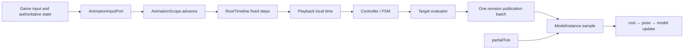

# AnimationScope: From Business State to a Stable Image

An animation system answers two different questions: what state the game is in, and how that state should be displayed. Game ticks, player input, state-machine rules, and networking decide the first. Clips, poses, model placement, and render interpolation decide the second. `AnimationScope` joins them into one process whose results can be committed, paused, interpolated, and observed without mixing old and new state.

For content authors, the Scope defines when animation advances, which inputs belong to the same step, and when the renderer may see the result. For the renderer, it exposes completed animation results without asking the render thread to reinterpret a state machine or sample an animation source again.

## Business problems it solves

| Business need | Mechanism | Visible result |
|---|---|---|
| Block, entity, or vehicle animation follows gameplay | The host submits fixed-length logical steps | Animation speed does not change with client frame rate |
| State machines, manual clips, and multi-part models stay coherent | One Scope commits one generation of results | The body cannot reach the next frame while a wheel group remains on the previous one |
| Pause, resume, and seeking must not make animation race ahead | One root timeline owns accumulation, pause, and discontinuity | Paused time is not replayed; a seek does not interpolate across unrelated time ranges |
| Minecraft logic advances at 20 Hz while monitors render faster | Logical results and render-frame interpolation are separated | Logic is stable and the image remains smooth |
| A server owns control state while clients render it | An adapter maps authoritative state into inputs or a client replica | Client interpolation cannot rewrite server rules |
| Resource reloads and model rebuilds should not restart animation | Targets support rebind while the Scope retains playback state | A fresh model receives subsequent writes without losing playback progress |

The governing rule is simple: the logical phase produces results, and the render phase consumes them. A render frame may change interpolation phase, but it cannot advance animation time, change a revision, or execute a state machine.

## How one business event becomes animation

Consider a minecart entering a curve and beginning to tilt:

```text
World state: speed, track direction, vehicle type
        -> host writes values through AnimationInputPort
        -> AnimationScope.advance(raw delta)
        -> RootTimeline emits 0..N fixed logical steps
        -> Controllers read the frozen input snapshot and read-only playback state
        -> a controller selects, switches, or stops a playback instance
        -> Playback resolves local time for each leaf clip
        -> target evaluators produce immutable target-specific results
        -> one revision is shared by the TargetPublication batch
        -> the Minecraft adapter calls ModelInstance.sample(...) for a render frame
        -> root is written first, pose second, then model update and GPU submission
```

Controllers answer why something plays and which playback should be selected. Playback instances answer which source time is active. Targets answer where the result is written. With those roles separated, a new trigger does not require changes to the renderer, and a new output slot does not make controllers understand a model format.



## Three time domains

The word "time" serves three different purposes:

| Time domain | Business meaning | Owner | Must not do |
|---|---|---|---|
| Host time | Seconds elapsed in the current game tick | MC/Proxy adapter | Change a playhead or Target directly |
| Scope logical time | Fixed steps used for state advancement and results | `RootTimeline` and `AnimationScope` | Use a render frame or `revision` as seconds |
| Render interpolation | Display phase between two committed logical results | `RenderSampleContext.interpolationAlpha` | Resample an animation source, run Controllers, or create revisions |

The Minecraft adapter normally uses `1/20s` as the fixed step and caps catch-up. A large host delta may create several logical substeps or discard stale steps at that cap. Those are host runtime policies, not properties of an animation asset.

`partialTick` becomes an `interpolationAlpha` in `[0,1]` only at the adapter boundary. It lets a train already reach its next logical position while the image smoothly moves from the previous position to the current one.

## Business concepts and code responsibilities

| Business concept | Code collaborator | Responsibility |
|---|---|---|
| Animation scope | `AnimationScope` / `ManagedAnimationScope` | Transaction boundary for one logical step plus lifecycle entry point |
| Root clock | `RootTimeline` | Previous/current logical time, pause, seek, and fixed-step planning |
| Runtime input | `ScopeInputStore` | Freeze values and triggers for the step; consume triggers only after commit |
| State rules | `RuntimeController` | Decide play, switch, stop, or other valid controls from inputs and playback views |
| Clip arrangement | `PlaybackRegistry` / `PlaybackTimeGraph` | Hold playback instances and derive local time, loops, and boundaries from parent time |
| Animation result | `TargetOutputEvaluator<O>` | Turn committed state into one immutable result for a target |
| Output destination | `AnimationTarget<O>` | Store a publication and write one exclusive slot during a render frame |
| Render entry | `ModelInstance.sample(RenderSampleContext)` | Sample a model at most once per frame in a fixed order |

`ManagedAnimationScope` is the final default implementation. Integrations add Controllers, Playback, Targets, and command handlers through its builder. They do not subclass the Scope to add behavior for a block, entity, or model format.

## Common business scenarios

### FSM-driven characters and blocks

`FsmPoseEvaluator` wraps a `StateMachine` as a Controller. Each real logical substep advances the machine once, then hands the composed pose to `ModelPoseTarget`. Transitions, durations, variables, and triggers live in the logical phase. Bones, morphs, material frames, and IK are interpolated into the model during rendering.

### Code-controlled one-shot animation

`AnimationPlayer.play(...)` creates a private Scope for a standalone player. The clip is sampled
during logical substeps, and render sampling reads only committed poses. A non-looping clip
naturally holds its final pose; `stop()` removes the playback result. `follow(...)` also creates a
private Scope and follows an `AnimationTimeline` owned by another system through an observer. It
does not own external time advancement, but logical sampling, publication, and render interpolation
still use the same flow as standalone playback. Loop boundaries publish both end and start results
so interpolation cannot cross two loop iterations.

### Vehicles and machinery made from multiple model parts

`ModelGroupScope` composes a `ManagedAnimationScope` rather than inheriting from it. Every rigid part in the group shares the logical commit and revision. Tick-domain root and local motion are published in the same batch, while frame-domain motion updates only the render snapshot. A bogie, wheel group, and body therefore cannot observe different generations.

### Server authority with smooth client display

In a synchronized FSM, the server remains the business-state authority and the client receives playable state through synchronization. The client presentation path still uses a Scope to produce render publications, but interpolation never writes client guesses back into server rules. Networking, authority conflicts, and connection lifecycle stay in adapters; the core Scope has no Minecraft networking types.

### Resource reloads and model rebuilds

A reload prepares the fresh model instance and Target, then switches the binding and releases the old reference after success. Failure keeps the old binding. Rebinding a Target replaces only the write destination; it does not reset logical time, playback instances, or the latest publication.

## Guarantees

- One successful real logical step commits one generation of results. Every Target in the batch receives the same `revision`.
- `revision` is a commit generation, not seconds, a frame number, or a playback id. Pause, resume, and seek control commits also create revisions.
- Inputs are frozen for the step. A Controller or internal command failure aborts the step. An expected rejection of one command can remain isolated without blocking unrelated commands.
- A publication pass completes the whole Target batch before atomically replacing the render batch. Rendering cannot combine two revisions.
- One model and one `RenderFrameToken` are sampled at most once. Targets run in stable registration order; when one model owns both root and pose, the composition root should register root before pose in the same batch.
- A paused playback subtree freezes local time and does not replay the paused interval on resume. Seek uses `SNAP` semantics and does not interpolate across unrelated source times.
- Scope close is idempotent. A closed Scope rejects advancement and releases runtime references held by registered Targets.

## Choosing an extension point

| Desired feature | Extension point |
|---|---|
| "Play a hurt animation below a health threshold" | `RuntimeController` plus typed inputs |
| "Switch to another clip when an action finishes" | Controllers, playback instances, and command handling |
| "Arrange clip speed, loops, and windows on parent time" | `PlaybackBinding` and the playback graph |
| "Write bones, morphs, or material frames" | `TargetOutputEvaluator<PoseOutput>` and a pose Target |
| "Write placement and local motion for one rigid part" | A root Target plus a model-group adapter |
| "Read inputs from a BlockEntity, Entity, or vehicle" | An MC/Proxy adapter writing through `AnimationInputPort` |
| "Map MC ticks and partial frames into core time" | A composition root constructing `ScopeAdvance` and `RenderSampleContext` |

Two boundaries keep this extensible: Controllers do not write model slots, and Targets do not read animation sources, Controllers, or other Targets. Those restrictions make failure isolation, rebinding, and render deduplication tractable.

## Current boundaries

The Scope does not schedule Minecraft rendering, own world objects, load resources, or issue
OpenGL/GPU uploads. Camera playback uses the private Scope in `ScopedCameraPosePlayback` and the
`kasuga:camera_pose` Target; a shared timeline only produces time snapshots, while the camera layer
consumes the resulting channels. See [Camera Animation](../camera-animation.md). FSM layers and
pose composition are described in [FSM](../fsm.md), and model format and pose channels in
[Model Subsystems](../model-subsystems.md).

Implementation:

- [`AnimationScope.java`](../../../modules/render-core/src/main/java/lib/kasuga/rendering/models/uml/dynamic/animation/scope/AnimationScope.java)
- [`ManagedAnimationScope.java`](../../../modules/render-core/src/main/java/lib/kasuga/rendering/models/uml/dynamic/animation/scope/ManagedAnimationScope.java)
- [`RootTimeline.java`](../../../modules/render-core/src/main/java/lib/kasuga/rendering/models/uml/dynamic/animation/scope/RootTimeline.java)
- [`TargetRegistry.java`](../../../modules/render-core/src/main/java/lib/kasuga/rendering/models/uml/dynamic/animation/scope/TargetRegistry.java)
- [`ScopedPlayerPosePlayback.java`](../../../modules/render-core/src/main/java/lib/kasuga/rendering/models/uml/dynamic/animation/ScopedPlayerPosePlayback.java)
- [`ScopedCameraPosePlayback.java`](../../../modules/render-core/src/main/java/lib/kasuga/rendering/output/camera/ScopedCameraPosePlayback.java)
- [`ModelInstance.java`](../../../modules/render-core/src/main/java/lib/kasuga/rendering/models/uml/dynamic/ModelInstance.java)
