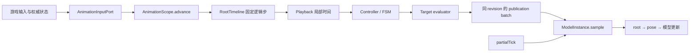

# AnimationScope：从业务状态到稳定画面

动画系统需要回答两个不同的问题：业务现在处于什么状态，以及这一状态应该如何显示。前者由游戏 tick、玩家输入、状态机规则和网络同步决定，后者由动画片段、骨骼姿态、模型位置和渲染插值决定。`AnimationScope` 把这两部分连接成一条可提交、可暂停、可插值且不会混用新旧结果的处理链。

对内容开发者来说，它定义“什么时候推进动画、哪些输入算同一步、结果何时能被渲染看到”；对渲染端来说，它只暴露已经完成的动画结果，不要求渲染线程重新解释状态机或采样动画源。

## 它解决的业务问题

| 业务需求 | 系统机制 | 可见结果 |
|---|---|---|
| 方块、实体或载具的动画需要随游戏逻辑推进 | 宿主提交固定长度的逻辑步 | 动画速度不随客户端帧率变化 |
| 状态机、手动片段和模型多部件必须保持一致 | 一个 Scope 提交同一代结果 | 不会出现车身已到下一帧、轮组还停在上一帧 |
| 暂停、恢复、跳转后动画不能突然补跑 | 根时间线统一管理 accumulator、暂停和 discontinuity | 暂停期间不偷跑，seek 后不跨越无关时间段做插值 |
| Minecraft 以 20 Hz 推进逻辑、显示器以更高帧率绘制 | 逻辑结果与 render frame 插值分离 | 逻辑稳定，画面仍能平滑过渡 |
| 服务端控制状态、客户端负责表现 | adapter 把权威状态转为输入或客户端副本 | 客户端插值不会自行改写服务端业务规则 |
| 资源重载或模型重建后动画不应从头开始 | Target 支持 rebind，Scope 保存播放状态 | 新模型实例接管后续写入，当前播放进度保留 |

核心原则是“逻辑阶段生产结果，渲染阶段消费结果”。渲染阶段只能改变显示采样的相位，不能推进动画时间、改变 revision 或重新执行状态机。

## 一次业务事件如何变成动画

以“矿车进入弯道并开始倾斜”为例：

```text
世界状态：速度、轨道方向、载具类型
        -> 宿主采集并写入 AnimationInputPort
        -> AnimationScope.advance(raw delta)
        -> RootTimeline 产生 0..N 个固定逻辑步
        -> Controller 读取本步输入快照和只读播放状态
        -> 控制器选择、切换或停止播放实例
        -> Playback 计算各叶子片段的局部时间
        -> Target evaluator 生成不可变的目标结果
        -> 同一 revision 的 TargetPublication batch
        -> Minecraft adapter 按 render frame 调用 ModelInstance.sample(...)
        -> 先写 root，再写 pose，最后进入现有模型更新和 GPU 提交
```

控制器回答“为什么播放、播放哪一个”；播放实例回答“播放到源素材的哪个时间”；Target 回答“结果写到哪个模型槽位”。三者分开后，新增一种动画触发方式不需要修改渲染后端，新增一种输出也不需要让控制器理解模型格式。



## 三个时间域

业务代码最容易混淆的是“时间”其实分为三种用途：

| 时间域 | 业务含义 | 谁负责 | 不应做什么 |
|---|---|---|---|
| 宿主时间 | 本 game tick 实际经过的秒数 | MC/Proxy adapter | 直接修改播放头或 Target |
| Scope 逻辑时间 | 用于状态推进和动画结果的固定步 | `RootTimeline` 与 `AnimationScope` | 用 render frame 或 `revision` 代替秒数 |
| 渲染插值 | 两次已提交逻辑结果之间的显示相位 | `RenderSampleContext.interpolationAlpha` | 重新采样动画源、执行 Controller 或产生 revision |

Minecraft adapter 通常以 `1/20s` 作为固定步，并限制单次追帧数。一个较大的宿主 delta 可以产生多个逻辑子步，也可以因追帧上限丢弃过期步；这些决定属于平台运行策略，不属于动画内容格式。

`partialTick` 只在 adapter 边界转换为 `[0,1]` 的 `interpolationAlpha`。它让一列火车在逻辑上已经到达下一个位置时，画面仍能平滑地从上一位置过渡到当前位置。

## 业务对象与代码职责

| 业务概念 | 代码协作者 | 职责 |
|---|---|---|
| 动画作用域 | `AnimationScope` / `ManagedAnimationScope` | 一次逻辑步的事务边界和生命周期入口 |
| 动画总时钟 | `RootTimeline` | previous/current 逻辑时间、暂停、seek、固定子步 |
| 动态输入 | `ScopeInputStore` | 冻结本步变量和 trigger，提交成功后才消费 trigger |
| 状态规则 | `RuntimeController` | 根据输入和播放视图决定播放、切换、停止或执行其他允许的控制 |
| 片段编排 | `PlaybackRegistry` / `PlaybackTimeGraph` | 保存播放实例，并从父时间派生局部时间、循环和边界状态 |
| 动画结果 | `TargetOutputEvaluator<O>` | 把本步提交状态变成目标专用不可变结果 |
| 输出位置 | `AnimationTarget<O>` | 保存 publication，在 render frame 写入独占槽位 |
| 渲染入口 | `ModelInstance.sample(RenderSampleContext)` | 保证一个模型每帧只采样一次，并按固定顺序写入 |

`ManagedAnimationScope` 是 final 默认实现。接入方通过 builder 注册 Controller、Playback、Target 和命令处理器；不应继承 Scope 来添加某种方块、实体或模型格式的特殊逻辑。

## 常见业务场景

### 状态机驱动的角色或方块

`FsmPoseEvaluator` 把 `StateMachine` 包装成 Controller。每个真实逻辑子步只推进状态机一次，然后把组合后的姿态交给 `ModelPoseTarget`。状态转移、持续时间、变量和 trigger 都属于逻辑阶段；骨骼、morph、材质帧和 IK 的结果在渲染阶段插值写入模型。

### 代码控制的单段动画

`AnimationPlayer.play(...)` 为独立播放器建立私有 Scope。片段在逻辑子步中采样，render sample
只读取已提交姿态。非循环片段自然结束后保留最终姿态，`stop()` 才会移除该播放结果。
`follow(...)` 同样创建私有 Scope，并通过 observer 跟随其他系统拥有的 `AnimationTimeline`；
它不拥有外部时间推进权，但逻辑采样、结果发布和 render 插值仍走与 standalone 相同的流程。
循环边界会同时提交 end/start 两侧结果，避免渲染插值跨越两次循环迭代。

### 多模型部件组成的载具或机械结构

`ModelGroupScope` 用组合方式持有一个 `ManagedAnimationScope`，不继承 Scope。组内所有刚体部件共享逻辑提交和 revision；tick-domain 的 root 与局部运动随同一批结果发布，frame-domain motion 只在渲染快照中更新。这样，转向架、轮组和车体不会读到不同代次的状态。

### 服务端权威、客户端平滑显示

联网 FSM 中，服务端继续决定业务状态，客户端通过同步得到可播放状态。客户端表现路径仍使用 Scope 产生渲染 publication，但渲染插值不会把客户端猜测写回服务端规则。同步消息、权威冲突和网络生命周期由 adapter 处理，核心 Scope 不引用 Minecraft 网络类型。

### 资源重载和模型重建

重载先准备新的模型实例和 Target，再切换绑定，成功后释放旧引用；失败时保留旧绑定。Target 的 rebind 只替换写入槽位，不重置逻辑时间、播放实例或最新 publication。

## 系统保证

- 一次成功的真实逻辑步只提交一代结果；同批 Target 使用同一个 `revision`。
- `revision` 是提交代次，不是秒数、帧号或播放实例 id。pause、resume、seek 等控制提交也会产生新 revision。
- 输入在本步冻结。Controller 或内部命令失败时，整步不提交；预期中的单条命令拒绝可以隔离，不阻断无关命令。
- 发布先完成整批 Target，再原子替换 render batch。渲染线程不会把新旧 revision 拼在一起。
- 同一模型、同一 `RenderFrameToken` 最多采样一次。Target 按稳定注册顺序执行；同一模型同时拥有 root 和 pose 时，composition root 应在同一 batch 中先注册 root、后注册 pose。
- 暂停的播放子树冻结局部时间，恢复时不补算暂停时长。seek 使用 `SNAP` 语义，不跨越两个无关时间点插值。
- Scope 关闭幂等；关闭后拒绝继续推进，并释放已注册 Target 的运行时引用。

## 选择扩展点

| 需要实现的功能 | 应扩展的位置 |
|---|---|
| “生命值低于阈值时播放受伤动作” | `RuntimeController` 与类型化输入 |
| “一个动作结束后切换另一段动作” | Controller、播放实例和命令处理器 |
| “按父时间轴安排片段的速度、循环和窗口” | `PlaybackBinding` / 播放图 |
| “把姿态写到骨骼、morph 或材质帧” | `TargetOutputEvaluator<PoseOutput>` 与 pose Target |
| “把位置和局部运动写到一个刚体部件” | root Target 与模型组 adapter |
| “从 BlockEntity、Entity 或载具读取业务输入” | MC/Proxy adapter，经 `AnimationInputPort` 提交 |
| “把 MC tick 和部分帧时间映射到核心时间” | composition root 构造 `ScopeAdvance` 与 `RenderSampleContext` |

目标扩展必须遵守两个边界：Controller 不直接写模型；Target 不回读动画源、Controller 或其他 Target。这个约束让失败隔离、重绑和渲染去重保持可控。

## 当前边界

Scope 不调度 Minecraft 渲染、不拥有世界对象、不加载资源，也不直接执行 OpenGL 或 GPU 上传。
摄像机通过 `ScopedCameraPosePlayback` 的私有 Scope 和 `kasuga:camera_pose` Target 接入；
共享 timeline 只负责产生时间快照，最终相机通道仍由相机层消费，详见
[Camera Animation](../camera-animation.md)。FSM 的层、动作和姿态混合规则见 [FSM](../fsm.md)；
模型格式与姿态通道见 [Model 子系统](../model-subsystems.md)。

相关实现：

- [`AnimationScope.java`](../../../modules/render-core/src/main/java/lib/kasuga/rendering/models/uml/dynamic/animation/scope/AnimationScope.java)
- [`ManagedAnimationScope.java`](../../../modules/render-core/src/main/java/lib/kasuga/rendering/models/uml/dynamic/animation/scope/ManagedAnimationScope.java)
- [`RootTimeline.java`](../../../modules/render-core/src/main/java/lib/kasuga/rendering/models/uml/dynamic/animation/scope/RootTimeline.java)
- [`TargetRegistry.java`](../../../modules/render-core/src/main/java/lib/kasuga/rendering/models/uml/dynamic/animation/scope/TargetRegistry.java)
- [`ScopedPlayerPosePlayback.java`](../../../modules/render-core/src/main/java/lib/kasuga/rendering/models/uml/dynamic/animation/ScopedPlayerPosePlayback.java)
- [`ScopedCameraPosePlayback.java`](../../../modules/render-core/src/main/java/lib/kasuga/rendering/output/camera/ScopedCameraPosePlayback.java)
- [`ModelInstance.java`](../../../modules/render-core/src/main/java/lib/kasuga/rendering/models/uml/dynamic/ModelInstance.java)
