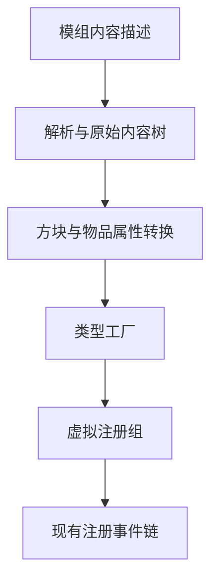

# How data-driven registration works

For file structure, fields, factories, and property extensions see the [API reference](../reference/data-driven/README.md).

## From content descriptions to the registration tree

Data packs describe blocks, items, and block entities; the parsing layer builds only the raw content tree. Property parsers turn a description into property transforms,
factories turn a type description into registration nodes that already exist, and finally the virtual registry group is attached to the mod's main registration tree.
Data content reuses the existing registration event dispatch, and no second parallel registration system is maintained.

Parsing, property extension, and object construction are kept apart, so custom content can reuse the default property handling and Java registration can coexist with data registration.
Creative tabs are still injected through the existing modifier path. Complex behavior stays on the code side; content only selects a behavior factory and its parameters.

## Initialization order

The content tree is built lazily at the first registration dispatch, not during some arbitrary resource scan. That way factory types and custom property parsers can
finish initializing with their context class first, so parsing does not fail from a missing factory because static registration has not happened yet.

A group's hierarchy organizes and shares properties, but group inheritance does not mean that all item properties are already fully merged. Certain types, circular dependency
detection, DataFixer types, and more complex item components remain implementation boundaries; the mere existence of a description file is not proof that they are supported.

## Discovery, reload, and source ownership

The index separates registration-phase content from reloadable content. Both phases share path validation, index parsing, and content shape handling, which are
handed to registration dispatch and reload orchestration respectively; each reload type is declared by a host extension, not hardcoded by the orchestrator.
Content candidates are merged in a deterministic order, the same effective identity adopts last-wins, and pack overrides are processed in pack stack order too.

A reload cycle first clears the definitions contributed by resource sources, then collects, decodes, and registers candidates, and finally re-checks dependencies across definitions.
State machines and clips registered from code are held by the code side, survive resource reloads, and take precedence over resource definitions of the same name.
Diagnostics are stored by source and phase ownership, and error boundaries are limited to the corresponding file or handler so that other content can still be processed.

Interfaces, schema, content authoring, and extension guides all live under [the data-driven API topic](../guides/data-driven/intro.md).
