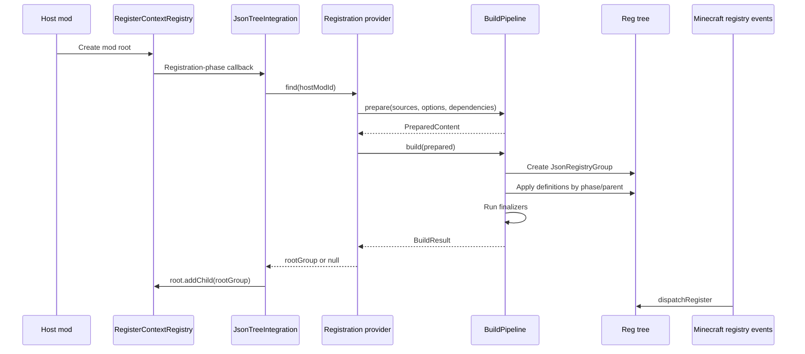
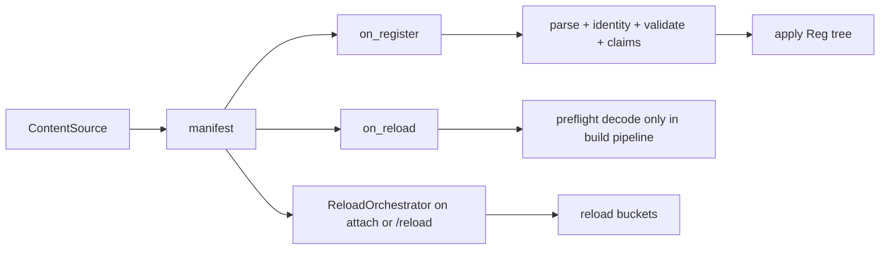

# Concepts and Lifecycle

The data-driven system separates content capture, build policy, and actual registration. `core`'s `ResourceSource` captures and fixes the bytes of a source/root, `ContentSourceFactory.snapshot(...)` projects the snapshot into a registration view, `TypeHandler` interprets each type, `DataDrivenBuildPipeline` determines which definitions enter the build, and the `Reg` tree completes Minecraft registration during the existing registration phase.

## Registration Phase vs. Reload Phase

The registration phase runs during mod construction and before registry events. Once content enters `BuiltInRegistries` or the corresponding deferred registry, it stays fixed for the lifetime of the process. The registration phase is suited for:

- `Block`, `Item`, and `BlockEntityType`;
- Registry groups that govern object construction;
- Java types, codecs, or behavior selection;
- Startup configuration requiring cross-definition preflight.

The reload phase runs when `ResourceManager` first attaches and whenever the resource stack is rebuilt afterward. Resource/data packs can override content at the same path, so the reload phase is suited for data that does not alter Java registry shape:

- FSM state machine definitions;
- Animation clips;
- Other replaceable buckets managed by custom `ReloadHandler` implementations.

The same content file must not be listed in both `on_register` and `on_reload`. That conflict fails closed in both domains, and neither domain consumes the file.

Although the registration phase and reload phase share the index directory, manifest fields, and logical path constraints, they read from different sources:

| Phase | Actual Input | Interpreter | Result |
| --- | --- | --- | --- |
| Registration | Host-approved fixed `ResourceSnapshot` exposed via `ContentSource`; falls back to legacy mod JAR scan only when no provider is installed | `TypeHandler` | `JsonRegistryGroup` for this startup |
| Reload | Active pack stack selected by `ResourceManager` | `ReloadHandler` | Resource buckets that can be cleared and rebuilt |

`DataDrivenBuildPipeline.prepare` can preflight `on_reload` files during the registration build, but it only invokes the decoder and does not run `clearBucket` or `register`. Actual reload registration is still performed by `ReloadOrchestrator`.

## Core Terms

| Term | Meaning |
| --- | --- |
| source | An independently addressable content root within a `prepare` call; in v2, typically projected from a concrete `ResourceSource`/`ResourceSnapshot` |
| `ResourceSourceDescriptor` | Platform identity: `ownerId`, `sourceId`, `rootId`, non-negative `rank`, and `origin` |
| `SourceDescriptor` | Registration-view metadata augmenting platform identity with allowed `namespaces` and a diagnostic label |
| scene index | The set of entry indexes chosen by the host for the current registration scenario; expressed in Java by `ContentSource.indexes()` |
| `LogicalPath` | A slash-separated path relative to a source root; disallows absolute paths, `.`, `..`, and backslashes |
| index manifest | An index file under `data/<ns>/kasuga_lib/data_driven/*.json` that lists content file paths only |
| content path | A path in a manifest relative to `data/<ns>/`, required to end with `.json` |
| owner | Ownership unit of a content source; cross-owner references must declare direct dependencies explicitly |
| handler | An extension type that interprets one top-level JSON field |
| definition | The result of a handler's `parse` |
| identity | Logical identity within one handler type, used for overrides and deduplication |
| claim | A final Minecraft registry key a definition intends to occupy |
| provider | The entry point where a host takes over building a mod's JSON root group |
| finalizer | A host hook executed once after all selected definitions have been applied |
| dispatch group | A `RegistryGroup` subtree that may carry a runtime predicate |

`sourceOrder`, `declarationOrder`, `logicalPath`, and `jsonPointer` establish a reproducible build order and diagnostic location. For shared platform sources, `sourceOrder` comes from the explicit `rank`; every source/root rank must be unique within a session. Handlers must not rely on undefined map iteration orders.

## Fixed Roots and `main`/`parcel`

The platform assigns no business meaning to `rootId`, requiring only that it match `[A-Za-z0-9_-][A-Za-z0-9._-]{0,127}` (and not `.` or `..`). Train-pack hosts commonly use:

- `main`: the pack root content, with the lowest rank;
- `parcel-*`: a separate root for each parcel in the manifest, assigned increasing ranks in the frozen manifest order.

These roots share the same `ownerId` and `sourceId`, while `(sourceId, rootId)` must be unique. Business parcel IDs may contain a resource namespace colon, whereas platform `rootId`s cannot; the host should maintain a stable, collision-free, loggable mapping. Registration, resource discovery, and reload must read from the same startup snapshot rather than using a snapshot on one side and reopening the install directory on the other.

## Startup Registration Flow

The host provider must be installed before the registration callback runs. `JsonTreeIntegration` looks up the provider by mod id inside the callback; installing too late does not execute retroactively, so installation must happen before the registry events fire.

Returning `null` from a provider indicates that the mod has no JSON registration tree for this round. Runtime exceptions thrown by a provider are not swallowed by the legacy entry point's `catch`; the host should convert expected failures into `BuildResult` and diagnostics inside the provider.

## What `prepare` Does

`DataDrivenBuildPipeline.prepare` completes every step that requires no registration side effects:

1. Reads explicit `rank` from shared platform sources and stably sorts by it; only legacy `SourceDescriptor`s receive `sourceOrder` by input list position;
2. Checks for duplicate `(sourceId, rootId)` pairs and verifies that all source/root ranks are unique;
3. Checks whether owner dependency declarations point to known sources;
4. Scans each source's indexes and aggregates `on_register` and `on_reload` paths;
5. Reads and parses `on_register` content files;
6. Extracts embedded types;
7. Calls `resolveIdentity` on each definition;
8. Decodes `on_reload` files for preflight inspection only, without registering them into reload buckets;
9. In STRICT mode, verifies handler capabilities (`STRICT_PREFLIGHT`, `strictValidationImplemented()`, and a single identity role);
10. Selects definitions according to `BuildOptions`;
11. In STRICT mode, calls `validate` to check references, resources, factories, and strict properties;
12. Checks selected `parentDefinition` references for cycles;
13. Calls `claims` on selected definitions and checks reserved keys and duplicate claims.

`prepare` never calls `apply`. It does invoke `parse`, `resolveIdentity(...)`, `capabilities`, `strictValidationImplemented`, `validate`, `parentDefinition`, `claims`, and reload decoders, so all of those methods must be side-effect-free. The pipeline selects LEGACY or STRICT identity rules for `DefinitionKey` via `BuildOptions`. Throwing from a custom `apply` causes `build` to return `FAILED`, whereas built-in registration handlers catch per-entry `apply` exceptions and continue as warnings when running in a non-strict context. Before entering the logic above, STRICT mode decodes every manifest, registration content file, and reload file with `StrictResourceJson`: the root must be a single object, and duplicate keys, comments, trailing commas, invalid UTF-8, depth exceeding 64, or more than 100,000 nodes produce blocking diagnostics.

If processing a source throws an uncaught `RuntimeException`, the pipeline records `SOURCE_READ_FAILED` and continues with the remaining sources, without rolling back files or definitions already parsed from that source. STRICT rejects the build due to the blocking diagnostic; LEGACY may still proceed with partial results.

## What `build` Does

`build` creates a fresh `JsonRegistryGroup` and `RegBuildContext` from an immutable `PreparedContent`, then:

1. Returns `REJECTED` if STRICT mode is active and any `ERROR` diagnostic is present;
2. Creates the root group and configures the default namespace mapping;
3. Sorts selected definitions by `TypeHandler.getPhase()`, handler registration order, source order, logical path, JSON pointer, declaration order, and `parentDefinition` dependencies;
4. Invokes `apply` on each definition inside `BuildContext.withCurrentDefinition`;
5. Runs finalizers after all definitions finish;
6. Returns `APPLIED`, `FAILED`, or `REJECTED`.

| Status | Meaning | Did `apply` run? |
| --- | --- | --- |
| `REJECTED` | STRICT preflight found blocking diagnostics | No; `rootGroup()` is `null` |
| `APPLIED` | All selected `apply` calls and finalizers succeeded | Yes |
| `FAILED` | Context creation, sorting, `apply`, or a finalizer threw a runtime exception | Partial `apply` calls may have run; typically retains an incomplete `rootGroup` |

Both `BuildResult.successful()` and `BuildResult.applied()` return `true` only when the status is `APPLIED` (both return `false` on `FAILED` and `REJECTED`). Callers inspecting `FAILED` should check `status()` and `cause()`, and avoid mounting an incomplete `rootGroup` unless partial side effects are known to be safe.

Note that `prepared.hasBlockingDiagnostics()` checks only `Severity.ERROR`. LEGACY builds do not consult this predicate to block `apply`, so a LEGACY result can be `APPLIED` while still carrying error diagnostics. `successful()` indicates that the apply pass completed, not that the inputs were error-free.

## How the Same Data Enters Different Phases

In `DataDrivenBuildPipeline`, preflight for `on_reload` verifies only that the manifest-listed files are readable, that their top-level types are registered, and that the decoders report no errors. It uses the process-wide `ReloadHandlerRegistry` rather than the `TypeHandler` list passed to the pipeline constructor, and it does not perform `globDirectories()` discovery. Actual reload registration is executed by `ReloadOrchestrator` on initial Manager attach and on every resource reload.

## Source Provenance from `BuildContext`

The `BuildContext` passed to `apply` temporarily binds the active definition via `withCurrentDefinition` and exposes:

- `getHostModId()` / `getModId()`: the mod owning the build root;
- `getRootGroup()`: the `JsonRegistryGroup` of this build;
- `getCurrentDefinition()`: the full `LocatedDefinition`;
- `getSourceId()`: the current source id;
- `getOwnerId()`: the current content owner;
- `getNamespaces()`: the namespaces accessible to that source;
- `getCurrentHandlerType()`: the current handler's type field name;
- `getCurrentLogicalPath()`: the current content file path;
- `getCurrentJsonPointer()`: the current definition's location within the file;
- `isStrict()`: the active build policy;
- `putMeta` / `getMeta`: temporary cross-type data scoped to this build.

`getModId()` is a historical alias returning the same host id as `getHostModId()`. Content namespaces and owners must be read from source provenance rather than treating the host id as the namespace for every definition.

## Concurrency and Resource Lifecycle

Registration builds are deterministic startup operations. The provider table uses a process-wide `ConcurrentHashMap`, and the source list and `PreparedContent` are copied on construction; this does not mean handlers, `Reg` subclasses, or host resources may be mutated concurrently across arbitrary threads.

Callers own `ContentSource` instances and any streams opened from them; the pipeline never closes sources. `SnapshotContentSource` owns and closes its wrapped `ResourceSnapshot`; once closed, existing streams/leases may finish reading, while new reads fail. Once `prepare` finishes, standard handlers have already copied parsed results into definitions, so sources can normally be closed immediately. If a custom definition retains a `ContentSource`, path, or deferred-read logic, it must define and manage that extra lifecycle itself.

`FixedResourceSource` holds a process-level baseline snapshot. Every `capture()` creates an independent snapshot via `ResourceSnapshot.Builder.copy`, allowing separate consumers to retire their own snapshots without causing `STALE_REFERENCE` for one another; closing a fixed source retires only its baseline. The original directory, ZIP, or union filesystem is no longer read after pinning.

The commit order for a registration provider should be: complete strict `prepare`, pack rejection / dependency closure, and claims checks, succeed in `build` and update the host's registered set, and only then publish the corresponding MC resource layers. Publishing in the reverse order exposes rejected source/roots to `ResourceManager`.

`TypeHandlerRegistry`, `ReloadHandlerRegistry`, `FactoryRegistry`, and `DataDrivenRegistrationProviders` are process-wide state. The current API assumes handlers, factories, and providers are registered before the first `prepare` or registration dispatch and does not guarantee safety under concurrent mutation during active builds or reloads.

## Runtime Dispatch

The `JsonRegistryGroup` returned by a data build is a standard `Reg` subtree. When Minecraft registry events arrive, the existing `RegisterContextRegistry` calls `dispatchRegister` on the root, registering child nodes recursively.

`RegistryGroup.dispatchWhen(BooleanSupplier)` lets a host decide at dispatch time whether an entire subtree is enabled—for example, to gate code registrations owned by a pack set. `RegistryClaimSnapshot.collect` skips groups whose predicate returns `false` along with their subtrees; JSON builds and resource availability remain controlled separately by the host.
