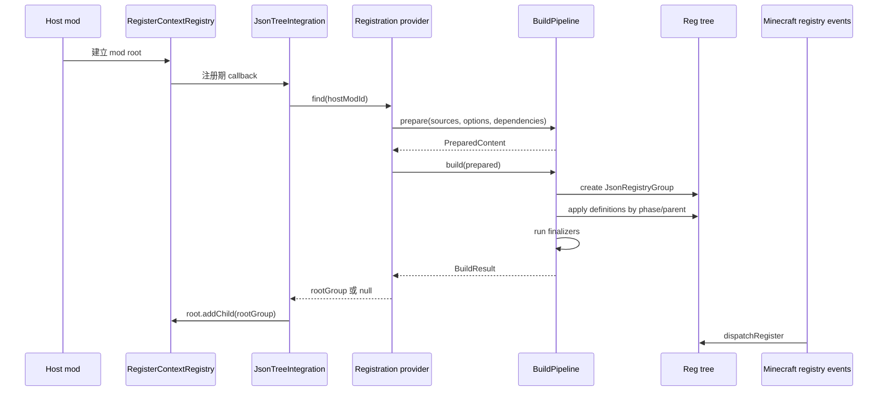
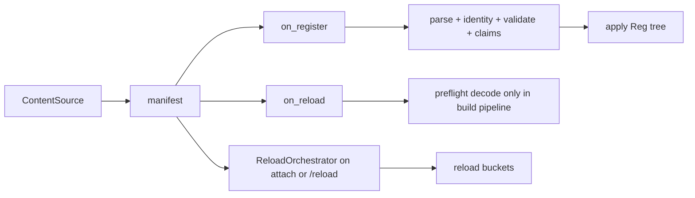

# 概念与生命周期

数据驱动系统把“内容捕获”“构建策略”和“实际注册”分开。core 的 `ResourceSource` 捕获并固定一个 source/root 的字节，`ContentSourceFactory.snapshot(...)` 把快照投影成注册视图；`TypeHandler` 解释类型，`DataDrivenBuildPipeline` 决定哪些定义进入本次构建，`Reg` 树在既有注册阶段完成 Minecraft 注册。

## 注册期与 reload 期

注册期发生在 mod 构造和 registry event 之前。内容一旦进入 `BuiltInRegistries` 或对应的 deferred registry，就在本次进程生命周期内保持固定。注册期适合：

- `Block`、`Item`、`BlockEntityType`；
- 决定对象构造的属性组；
- Java 类型、codec 或行为选择；
- 需要跨定义预检的启动配置。

reload 期发生在 `ResourceManager` 首次挂接以及之后每次资源栈重建时。资源包可以覆盖同路径内容，因此 reload 期适合不改变 Java registry 形状的数据：

- FSM 状态机定义；
- 动画片段；
- 其他由自定义 `ReloadHandler` 管理的可替换桶。

同一内容文件不能同时列入 `on_register` 和 `on_reload`。该冲突会在两个域中 fail closed，文件不会被任何一域消费。

注册期和 reload 期虽然共享索引目录、manifest 字段和逻辑路径约束，但读取来源不同：

| 阶段 | 实际输入 | 解释器 | 结果 |
| --- | --- | --- | --- |
| 注册 | 宿主批准的固定 `ResourceSnapshot`，经 `ContentSource` 暴露；无 provider 时才回退旧 mod JAR | `TypeHandler` | 本次启动的 `JsonRegistryGroup` |
| reload | 当前 `ResourceManager` 选中的资源栈 | `ReloadHandler` | 可清空并重建的资源桶 |

`DataDrivenBuildPipeline.prepare` 在注册构建期间可以预检 `on_reload` 文件，但它只调用 decoder，不执行 `clearBucket` 或 `register`。真正的 reload 注册仍由 `ReloadOrchestrator` 完成。

## 核心术语

| 术语 | 含义 |
| --- | --- |
| source | 一次 prepare 中可独立寻址的内容根；v2 通常由一个具体 `ResourceSource`/`ResourceSnapshot` 投影而来 |
| `ResourceSourceDescriptor` | 平台身份：`ownerId`、`sourceId`、`rootId`、非负 `rank` 和 origin |
| `SourceDescriptor` | 注册视图元数据，在平台身份外补充 namespace 集合和诊断标签 |
| scene index | 宿主为当前注册场景选择的入口索引集合；Java 层由 `ContentSource.indexes()` 表达 |
| `LogicalPath` | 相对于来源根的 slash 分隔路径，不允许绝对路径、`.`、`..` 或反斜杠 |
| index manifest | `data/<ns>/kasuga_lib/data_driven/*.json` 下的索引文件，只列出内容文件路径 |
| content path | manifest 中相对于 `data/<ns>/` 的路径，必须带 `.json` |
| owner | 内容来源的归属单位；跨 owner 引用必须显式声明直接依赖 |
| handler | 解释一个顶层 JSON 字段的扩展类型 |
| definition | handler 的 `parse` 结果 |
| identity | 同一 handler 类型中的逻辑身份，用于覆盖和去重 |
| claim | 一个 definition 最终打算占用的 Minecraft registry key |
| provider | 宿主接管某个 mod 的 JSON 根组构建的入口 |
| finalizer | 所有 selected definition apply 之后运行一次的宿主钩子 |
| dispatch group | 可带运行时谓词的 `RegistryGroup` 子树 |

`sourceOrder`、`declarationOrder`、`logicalPath` 和 `jsonPointer` 构成可重复的构建顺序与诊断定位。共享平台来源的 `sourceOrder` 来自显式 rank；所有 source/root 的 rank 必须在本 session 内唯一。handler 不应依赖未定义的 map 遍历顺序。

## 固定根与 main/parcel

平台不规定 `rootId` 的业务含义，只要求它匹配 `[A-Za-z0-9_-][A-Za-z0-9._-]{0,127}`。车包一类宿主通常采用：

- `main`：pack 根内容，rank 最低；
- `parcel-*`：manifest 中每个 parcel 的独立根，按冻结后的 manifest 顺序获得递增 rank。

这些根共享同一 `ownerId`/`sourceId`，但 `(sourceId, rootId)` 必须唯一。parcel ID 可以含资源 namespace 冒号，平台 `rootId` 不能；宿主应建立稳定、无碰撞且可记录的映射。注册、资源发现和 reload 应从同一启动快照读取，不能一边用快照、另一边重新打开安装目录。

## 启动注册流程

宿主 provider 必须在注册 callback 执行前安装。`JsonTreeIntegration` 在 callback 中按 mod id 查找 provider；安装过晚不会追溯执行，早于注册事件的安装才有效。

provider 返回 `null` 表示该 mod 本轮没有 JSON 注册树。provider 抛出的运行时异常不会被旧入口的 catch 吸收，宿主应在 provider 内把可预期失败转换成 `BuildResult` 和诊断。

## `prepare` 做什么

`DataDrivenBuildPipeline.prepare` 完成所有无需注册副作用的步骤：

1. 对共享平台来源读取显式 `rank`，按其稳定排序；只有旧 `SourceDescriptor` 才按输入位置分配 `sourceOrder`；
2. 检查 `(sourceId, rootId)` 是否重复，以及所有 source/root 的 rank 是否唯一；
3. 检查 owner 依赖声明是否指向已知来源；
4. 扫描每个来源的索引，聚合 `on_register` 与 `on_reload` 路径；
5. 读取、解析 `on_register` 文件；
6. 解析内嵌类型；
7. 调用每个 definition 的 `resolveIdentity`；
8. 只解析检查 `on_reload` 文件，不把它注册到 reload 桶；
9. 在 STRICT 模式检查 handler capabilities；
10. 根据 `BuildOptions` 选择定义；
11. 在 STRICT 模式调用 `validate`，检查引用、资源和工厂；
12. 检查 selected `parentDefinition` 环；
13. 调用 selected `claims`，检查 reserved key 和重复 claim。

`prepare` 不调用 `apply`。它仍会调用 `parse`、`resolveIdentity(...)`、`capabilities`、`validate`、`parentDefinition`、`claims` 以及 reload decoder，所以这些方法都必须无副作用。pipeline 按 `BuildOptions` 选择 DefinitionKey 的 LEGACY 或 STRICT 身份规则。自定义 `apply` 抛异常仍会使 build 返回 `FAILED`；内建注册 handler 在非 strict context 中会转为日志后继续。STRICT 在进入上述逻辑前由 `StrictResourceJson` 解码每个 manifest/content/reload 文件：根必须是单个 object，重复键、注释、尾逗号、非法 UTF-8、超过 64 层或 100,000 个节点都会产生 blocking diagnostic。

如果一个来源在处理过程中抛出未捕获的 `RuntimeException`，pipeline 会把它记录为 `SOURCE_READ_FAILED` 并继续处理其他来源，但不会撤销该来源此前已经解析的文件或 definition。STRICT 会因 blocking diagnostic 拒绝 build；LEGACY 仍可能带着部分结果继续。

## `build` 做什么

`build` 从一个不可变的 `PreparedContent` 创建新的 `JsonRegistryGroup` 和 `RegBuildContext`，然后：

1. STRICT 且存在 `ERROR` 诊断时返回 `REJECTED`；
2. 创建根组并设置默认 namespace 映射；
3. 按 `TypeHandler.getPhase()`、handler 注册顺序、来源顺序、路径和父依赖排序；
4. 在 `BuildContext.withCurrentDefinition` 中逐个调用 `apply`；
5. 所有定义完成后运行 finalizer；
6. 返回 `APPLIED`、`FAILED` 或 `REJECTED`。

| 状态 | 含义 | 是否执行过 apply |
| --- | --- | --- |
| `REJECTED` | STRICT 预检发现 blocking diagnostic | 否；`rootGroup()` 为 `null` |
| `APPLIED` | 所有 selected apply 与 finalizer 成功 | 是 |
| `FAILED` | context 创建、排序、apply 或 finalizer 抛出运行时异常 | 可能已执行部分 apply；通常保留不完整 root |

`BuildResult.successful()` 只在 `APPLIED` 时为 true。`BuildResult.applied()` 对 `APPLIED` 和 `FAILED` 都返回 true，因为它表示“没有在 apply 前拒绝”。调用方应根据意图选对方法。

注意 `prepared.hasBlockingDiagnostics()` 只看 `Severity.ERROR`。LEGACY build 不读取这个谓词来阻止 apply，所以一个 LEGACY 结果可能同时是 `APPLIED` 且带有 error diagnostic。`successful()` 表示 apply 流程完成，不表示输入没有问题。

## 同一份数据如何进入不同阶段

`DataDrivenBuildPipeline` 对 `on_reload` 的预检只验证 manifest 列出文件可读、顶层类型已注册、decoder 不报告错误。它使用进程级 `ReloadHandlerRegistry`，而不是 pipeline 构造时传入的 `TypeHandler` 列表，也不执行 `globDirectories()` 发现。真正的 reload 注册由 `ReloadOrchestrator` 在 Manager 首次挂接和每次资源重载时重新发现并执行。

## BuildContext 提供的来源信息

`apply` 收到的 `BuildContext` 通过 `withCurrentDefinition` 临时绑定当前定义，并提供：

- `getHostModId()` / `getModId()`：构建根所属的 mod；
- `getRootGroup()`：本次 build 的 `JsonRegistryGroup`；
- `getCurrentDefinition()`：完整 `LocatedDefinition`；
- `getSourceId()`：当前来源 id；
- `getOwnerId()`：当前内容 owner；
- `getNamespaces()`：该来源可访问的 namespace；
- `getCurrentHandlerType()`：当前 handler 的类型字段；
- `getCurrentLogicalPath()`：当前内容文件；
- `getCurrentJsonPointer()`：当前定义在文件中的位置；
- `isStrict()`：当前构建策略；
- `putMeta` / `getMeta`：本次 build 内的类型间临时数据。

`getModId()` 是历史名称，与 `getHostModId()` 返回同一 host id。内容 namespace 和 owner 要从来源信息读取，不能把 host id 当成所有定义的 namespace。

## 并发与资源生命周期

注册构建是启动期的确定性操作。provider 表使用进程级 `ConcurrentHashMap`，来源列表和 `PreparedContent` 在构建时复制；这不表示 handler、`Reg` 子类或宿主资源可以任意跨线程并发修改。

调用方拥有 `ContentSource` 和其中打开的 stream。pipeline 不关闭来源。`SnapshotContentSource` 拥有并关闭其包裹的 `ResourceSnapshot`；关闭后已有 stream/lease 可完成，但不能创建新读取。`prepare` 完成后，标准 handler 的解析结果已经保存在 definition 中，正常情况下即可关闭来源；若自定义 definition 持有 `ContentSource`、路径或延迟读取逻辑，它必须自行定义并管理额外生命周期。

`FixedResourceSource` 持有一个进程级 baseline snapshot。每次 `capture()` 都用 `ResourceSnapshot.Builder.copy` 生成独立快照，因此多个消费者可以各自 retire，不会互相触发 `STALE_REFERENCE`；关闭 fixed source 时它只关闭自己的 baseline。原始目录、ZIP 或 union filesystem 在固定后不再参与读取。

注册 provider 的提交顺序应为：完成 strict prepare、拒包/依赖闭包和 claims 检查，build 成功并更新宿主已注册集合，然后才发布对应的 MC 资源层。反序发布会把最终被拒绝的 source/root 暴露给 `ResourceManager`。

`TypeHandlerRegistry`、`ReloadHandlerRegistry`、`FactoryRegistry` 和 `DataDrivenRegistrationProviders` 都是进程级状态。当前 API 假定 handler/factory/provider 在首次 prepare 或首次注册分派前完成登记，不保证与正在进行的构建或 reload 并发修改安全。

## 运行期 dispatch

数据构建返回的 `JsonRegistryGroup` 仍是普通 `Reg` 子树。Minecraft registry event 到来时，现有 `RegisterContextRegistry` 对根调用 `dispatchRegister`，子节点递归注册。

`RegistryGroup.dispatchWhen(BooleanSupplier)` 允许宿主在 dispatch 时决定整棵子树是否启用。例如宿主可以用它隔离某个包集合的代码注册。`RegistryClaimSnapshot.collect` 会跳过 predicate 为 false 的组及其子树；JSON 构建和资源可用性仍由宿主单独控制。
