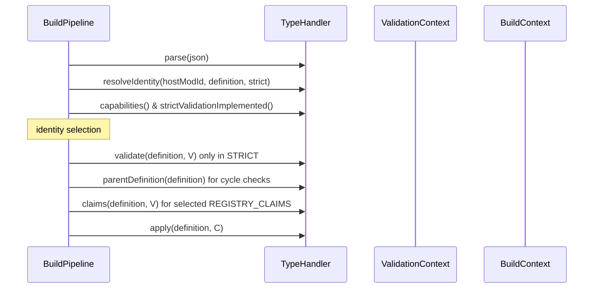
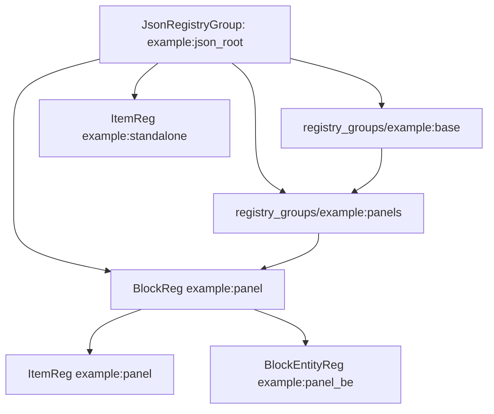

# TypeHandler and Preflight

`TypeHandler<T>` is the extension point for registration-phase content types. A handler owns one top-level field or one embedded field, parses JSON into a typed definition, and applies it to `RegBuildContext`.

```java
public interface TypeHandler<T> {
    String getTypeName();
    int getPhase();
    T parse(JsonObject json);
    void apply(T definition, BuildContext context);

    default Set<HandlerCapability> capabilities() { return Set.of(); }
    default boolean strictValidationImplemented() { return false; }
    default void validate(T definition, ValidationContext context) {}
    default List<RegistryClaim> claims(T definition, ValidationContext context) {
        return List.of();
    }
    default DefinitionKey parentDefinition(T definition) { return null; }
    default String getParentTypeName() { return null; }
    default String getEmbeddedKeyName() { return null; }
    default List<JsonObject> extractEmbedded(JsonObject parentJson) { return null; }
    default String resolveIdentity(String modId, T definition) { return null; }
    default String resolveIdentity(String modId, T definition, boolean strict) {
        return resolveIdentity(modId, definition);
    }
}
```

Source: [TypeHandler.java](../../../modules/data-driven/src/main/java/lib/kasuga/registration/data_driven/TypeHandler.java).

## Handler Registration

The new pipeline does not auto-discover handlers. The host passes a list of handler instances to `DataDrivenBuildPipeline`:

```java
DataDrivenBuildPipeline pipeline = new DataDrivenBuildPipeline(
        "example",
        List.of(new RegistryGroupHandler(), new BlockTypeHandler(), new ItemTypeHandler()),
        finalizers
);
```

The legacy `JsonTreeBuilder` uses the process-wide `TypeHandlerRegistry`. On the first call to `buildForMod` or `parseContentBody`, `ensureHandlersRegistered()` registers the four built-in handlers:

```java
JsonTreeBuilder.ensureHandlersRegistered();
Collection<TypeHandler<?>> handlers = TypeHandlerRegistry.all();
```

To reuse the legacy registry in the new pipeline, copy its contents into a normal collection before passing it to the pipeline constructor. `all()` returns a read-only view, while the registry itself remains a global static map where registering the same name overwrites the previous handler.

`DataDrivenBuildPipeline` neither auto-discovers handlers nor fills in built-in handlers automatically. If a host wants to reuse the built-in set, it must call `JsonTreeBuilder.ensureHandlersRegistered()` before constructing the pipeline and copy `TypeHandlerRegistry.all()`. Because the registry is not synchronized for concurrent mutation, additions should happen only before the first build.

## Lifecycle



Method contracts:

| Method | Must Be Side-Effect-Free | Primary Responsibility |
| --- | --- | --- |
| `capabilities` / `strictValidationImplemented` | Yes | Declare STRICT readiness and identity role |
| `parse` | Yes | Convert JSON into a definition object without registering anything |
| `resolveIdentity(..., strict)` | Yes | Derive a stable logical id in the handler's namespace, respecting LEGACY/STRICT rules |
| `validate` | Yes | Validate references, resources, factories, and field semantics |
| `parentDefinition` | Yes | Return the parent definition that must be applied first |
| `claims` | Yes | List all final Minecraft registry keys |
| `apply` | May mutate registration tree | Create `Reg` nodes, attach to groups, and configure properties/factory params |

`parentDefinition` is called during `prepare` for cycle detection and again during `build` for topological ordering. Both calls must return identical results and must not depend on changing iteration order.

More precisely, `parse` and `resolveIdentity` run for every successfully parsed definition, including candidates that are later overridden; `validate` runs only on selected definitions and only in STRICT mode; `claims` runs only on selected definitions whose handler declares `REGISTRY_CLAIMS`. LEGACY still collects claims and records conflicts, but does not block `apply`. `apply` runs only on selected definitions.

## From JSON Tree to `Reg` Tree

The "JSON tree" is not a Minecraft registry itself, but a tree of `Reg` registration intentions built per `build` call:



A handler's `apply` turns a definition into tree nodes:

- `RegistryGroupHandler` creates a `JsonRegistryGroup` and stores it in `RegBuildContext.registryGroups`;
- `RegTypeHandler` invokes the factory to create a block or item `Reg`, attaches it to its target group, and stores it in `regStore`;
- `BlockEntityTypeHandler` obtains a BE `Reg` from its factory and attaches it as a child node of the host block;
- `Reg.setParent` establishes both the parent/child link and the property inheritance chain;
- `withProperty` stores deferred property modifiers on the node;
- `configure` attaches registration-phase modifiers (such as creative tab bindings);
- `JsonRegistryGroup` is attached as a child of the mod's `Registry` root.

`RegBuildContext.getRegistryGroup(id)` and `getReg(typeName, rawId)` are scoped to a single `apply` pass. They allow later phases to look up earlier objects—for example, a block entity resolving its host block via `_parent_block`—and are not persisted as global singletons.

Actual writes into Minecraft registries happen when `dispatchRegister` calls `MinecraftDeferRegistryReg.register`. `prepare` and `build` only construct registration intentions; if a host discards the root after a successful `build`, un-dispatched entries never enter Minecraft registries.

`Reg.applyProperties` evaluates property modifiers parent-first during object construction, so registry group ordering determines not only hierarchy, but also the final `BlockBehaviour.Properties`, `Item.Properties`, and creative tab mappings.

## `parse`

`parse` receives only the definition `JsonObject`—not the mod id, source descriptor, or validation context. When required fields are missing or cannot be decoded, it should throw a `RuntimeException` with a clear message; the pipeline records it as `PARSE_FAILED` along with the logical path and JSON Pointer.

Before `parse` runs in STRICT mode, `StrictResourceJson` has already decoded the entire file and verified that the manifest or content root is a single JSON object. Malformed UTF-8, duplicate keys, comments, trailing commas, trailing documents, or documents exceeding depth/node limits never reach the handler. LEGACY mode delegates to Gson's tolerant rules for backward compatibility.

Even if a definition later loses in last-wins selection, `parse` has already run. Never register objects, mutate global caches, or alter other definitions inside `parse`.

## Identity and `EffectiveId`

`resolveIdentity(hostModId, definition)` returns the identity within that handler's type domain. Here `hostModId` is the pipeline's registration host, not the definition's source owner. A `DefinitionKey` consists of:

```text
(handler.getTypeName(), identity)
```

Different handler types can safely reuse the same string id because their type domains differ.

Returning `null` indicates an anonymous definition:

- LEGACY permits anonymous definitions and applies all of them;
- STRICT records `MISSING_IDENTITY` and rejects the entire build.

`DataDrivenBuildPipeline` passes `options.isStrict()` to the three-argument `resolveIdentity(hostModId, definition, strict)`. The legacy `JsonTreeBuilder` still calls the two-argument overload. For built-in blocks, items, and embedded block entities, the two rules behave as follows:

| Raw id | STRICT effective id | LEGACY effective id |
| --- | --- | --- |
| `panel` | `<hostModId>:panel`, then rejected by `validate` with `INVALID_IDENTITY` | `<hostModId>:panel` |
| `minecraft:panel` | `minecraft:panel` | `<hostModId>:panel` |
| `example:panel` | `example:panel` | `example:panel` |

In the legacy entry point, a bare id and an explicit `minecraft:` id collide as a historical compatibility quirk. Three-argument STRICT requires an explicit namespace and preserves explicit `minecraft:` namespaces as-is. `DataDrivenBuildPipeline` in LEGACY mode uses the historical rule for `DefinitionKey`, while STRICT mode preserves explicit namespaces. Embedded block entities use their host block's effective id under the active rule. `registry_groups` uses the raw group id string verbatim because other definitions reference groups by raw string.

In STRICT mode, `BlockTypeHandler` and `ItemTypeHandler` reject bare IDs; only explicit, valid `namespace:path` IDs pass validation. `RegTypeHandler.apply` in STRICT attaches the `ResourceLocation` mapping for any explicit namespace, so `minecraft:path` is no longer rewritten to the host namespace. LEGACY retains the old `minecraft:` rewrite compatibility rule.

Logical configuration identity and registry identity are distinct concepts:

- Identity governs configuration overrides, deduplication, and `DefinitionKey`;
- `RegistryClaim` governs final Minecraft registry keys.

Custom handlers must keep the relationship between identity and claims consistent. If one definition occupies multiple keys, list all of them in `claims`; if the identity names configuration rather than a registry entry, declare `NON_REGISTRATION`.

## Phase

`getPhase()` governs the coarse `apply` stages:

| Constant | Value | Typical Content |
| --- | --- | --- |
| `PHASE_GROUPS` | 0 | `registry_groups` |
| `PHASE_CONTENT` | 1 | `blocks`, `items` |
| `PHASE_EMBEDDED` | 2 | Embedded `block_entity` |

Phase takes higher priority than handler list order. Even if handlers are passed in reverse order, phase 0 still runs before phase 1. Pipeline handler order breaks ties only within the same phase.

Full deterministic apply order:

1. Phase (`getPhase()`);
2. First occurrence index of the handler in the pipeline list;
3. `sourceOrder`;
4. `logicalPath`;
5. `jsonPointer`;
6. `declarationOrder`;
7. Topological constraints formed by `parentDefinition`.

When a parent edge exists, the parent definition always applies before its child, overriding the base comparator if necessary.

## Parent and Cycles

`parentDefinition` accepts only a `DefinitionKey`. Returning a missing parent does not raise an error automatically; handlers should verify it in `validate` via `requireDefinition`.

During `prepare`, the pipeline traces parent chains across selected definitions. When a cycle is detected:

- Every member on the cycle receives `GROUP_CYCLE`;
- Under STRICT, this is a blocking error;
- Under LEGACY, it is logged as a warning and still enters apply ordering.

If `apply` ordering encounters a cycle it cannot resolve topologically, it appends the remaining nodes sorted by the comparator so `build` never loops infinitely.

## Embedded Types

An embedded handler is described by four methods on `TypeHandler`:

```java
String getTypeName();        // internal type name, e.g. "block_entities"
String getParentTypeName();  // "blocks"
String getEmbeddedKeyName(); // "block_entity"
List<JsonObject> extractEmbedded(JsonObject parentJson);
```

Returning `null` from `extractEmbedded` indicates the parent entry has no embedded child of this type; returning a list passes each object to the embedded handler's `parse`. A parent type can technically host multiple embedded handlers as long as their type names and JSON keys do not collide.

Embedded types cannot appear as top-level fields. The new pipeline dispatches top-level arrays only to handlers where `getParentTypeName() == null`; the legacy entry point emits a diagnostic with location guidance if `block_entities` is written at the top level.

## Capabilities

STRICT mode accepts only used handlers that satisfy all of the following:

```text
STRICT_PREFLIGHT
and strictValidationImplemented() == true
and exactly one of (
    NON_REGISTRATION
    REGISTRY_CLAIMS
)
```

Even if a type has no content, the pipeline checks for duplicate `typeName()` values across the handler list and emits `HANDLER_NOT_STRICT_READY` if any type name appears more than once. "Used" means `prepare` parsed at least one definition for that type; an empty array does not trigger capability checks for that handler.

| Capability | Meaning |
| --- | --- |
| `STRICT_PREFLIGHT` | `validate` is side-effect-free and catches build-blocking problems before apply |
| `NON_REGISTRATION` | Definitions are startup configuration and occupy no Minecraft registry entries |
| `REGISTRY_CLAIMS` | Definitions may occupy Minecraft registry entries and must report all claims |
| `OVERLAY` | Retains all candidates sharing an identity instead of dropping lower-priority ones |

A typical `NON_REGISTRATION` handler is `RegistryGroupHandler`. Without `OVERLAY`, configuration definitions select only the highest-priority candidate even in STRICT mode, because configuration follows override semantics.

Registration types with `REGISTRY_CLAIMS` retain all candidates for the same `DefinitionKey` in STRICT mode. Claim checking then inspects each final registry key; if multiple definitions compete for the same key, the entire batch is rejected. This prevents sources from bypassing conflict detection by using different definition IDs that resolve to the same block id.

If a handler declares `REGISTRY_CLAIMS` yet returns an empty list, the framework cannot observe the keys it actually registers, and strict mode may miss a conflict—maintaining accurate claim reporting is the extension's responsibility.

## `ValidationContext`

`ValidationContext` provides a read-only view over the prepared session:

| Method | Purpose |
| --- | --- |
| `hostModId()` | Current registration host |
| `source()` / `sourceOrder()` | Provenance of the current definition |
| `currentDefinition()` | Current `LocatedDefinition` |
| `directDependencies()` | Direct dependencies declared by the current owner |
| `find(key)` | Returns the visible candidate for `key` if and only if exactly one candidate is visible to the current owner |
| `findAllVisible(key)` | All candidates for `key` owned by the current owner or its direct dependencies |
| `findAll(key)` | All parsed candidates for `key` across all owners, including invisible ones |
| `findAll(typeDomain)` | All parsed definitions of one handler type in declaration order |
| `canReference(key)` | Whether at least one candidate exists and is owned by the current owner or a direct dependency |
| `requireDefinition(key, pointer)` | Emits `MISSING_REFERENCE`, `REFERENCE_NOT_DECLARED`, or `REFERENCE_AMBIGUOUS` when invalid; returns whether the reference is valid and unambiguous |
| `resourceExists(domain, location)` | Checks logical resources under `assets/` or `data/` across visible sources (plus `sharedAssetOwners` for `ASSETS`) |
| `factoryAvailable(type, id)` | Checks whether a factory is registered |
| `factorySupports(type, id, class)` | Checks whether the registered factory implements a capability interface |
| `isReserved(symbol)` / `reservedSymbols()` | Queries host-reserved configuration symbols |
| `claim(registry, id)` / `claimAt(registry, id, pointer)` | Creates a claim carrying the current source provenance |
| `error(...)` / `warning(...)` | Records a `VALIDATION` diagnostic |

`find(key)` delegates to `findAllVisible(key)`, so it enforces owner visibility and returns `Optional.empty()` when zero or more than one visible candidate exists. For cross-owner references with clear diagnostics, prefer `requireDefinition(key, pointer)`, or inspect `findAllVisible(key)` directly when custom resolution across multiple visible candidates is needed.

Dependencies are direct only: if A depends on B and B depends on C, A cannot reference C's definitions or resources unless C is explicitly listed in A's dependencies.

`resourceExists` searches only sources owned by the current owner or its direct dependencies (and `sharedAssetOwners` when `domain == ASSETS`) whose descriptor permits the target namespace:

```text
assets/<namespace>/<path>
data/<namespace>/<path>
```

It checks the source's logical file list; it does not register resource packs or guarantee which file the Minecraft client's runtime pack stack will select.

## Claims

`claims` returns every final registry key produced by the definition:

```java
@Override
public List<RegistryClaim> claims(PanelDef definition, ValidationContext context) {
    ResourceLocation id = ResourceLocation.parse(definition.id());
    return List.of(context.claim("minecraft:block", id));
}
```

`context.claim` automatically attaches the current source, `sourceOrder`, `definitionKey`, logical path, and JSON Pointer. Registry strings follow built-in conventions such as `minecraft:block`, `minecraft:item`, and `minecraft:block_entity_type`.

Every claim requires a non-null definition identity. In STRICT mode, missing identities fail earlier during `PARSE`; in LEGACY mode, calling `context.claim` on an anonymous definition throws `IllegalStateException` and records `CLAIM_FAILED`.

STRICT mode checks:

- Whether any claim conflicts with the host's reserved snapshot;
- Whether distinct definitions claim the same `(registry, id)`;
- Whether a handler omits any key remains the handler's responsibility.

Claims are collected before `apply`. Built-in handlers derive `ResourceLocation` values using the same identity rules as `apply`; custom handlers must do the same so preflight and the registration tree never diverge.

Built-in handlers keep `DefinitionKey`, `claims`, and `apply` aligned on the same identity mode: explicit `minecraft:` retains its namespace in STRICT, while LEGACY uses the historical host mapping. Custom handlers must ensure the same consistency themselves.

LEGACY still collects claims. Normal claim conflicts are recorded as warnings; conflicts with reserved host keys are always recorded as errors, though LEGACY builds still proceed. Neither conflict should be ignored in production.

## Minimal Custom Handler

The handler below registers a configuration symbol without occupying a Minecraft registry entry:

```java
public record PanelMode(String id, String mode) {}

public final class PanelModeHandler implements TypeHandler<PanelMode> {
    @Override
    public String getTypeName() {
        return "panel_modes";
    }

    @Override
    public int getPhase() {
        return PHASE_CONTENT;
    }

    @Override
    public Set<HandlerCapability> capabilities() {
        return Set.of(
                HandlerCapability.STRICT_PREFLIGHT,
                HandlerCapability.NON_REGISTRATION
        );
    }

    @Override
    public boolean strictValidationImplemented() {
        return true;
    }

    @Override
    public PanelMode parse(JsonObject json) {
        return new PanelMode(
                json.get("id").getAsString(),
                json.get("mode").getAsString()
        );
    }

    @Override
    public String resolveIdentity(String hostModId, PanelMode definition) {
        return definition.id();
    }

    @Override
    public void validate(PanelMode definition, ValidationContext context) {
        if (!Set.of("idle", "running").contains(definition.mode())) {
            context.error(
                    BuildDiagnostic.Code.CONTENT_INVALID,
                    "/mode",
                    "Unknown panel mode " + definition.mode(),
                    "Use idle or running."
            );
        }
    }

    @Override
    public void apply(PanelMode definition, BuildContext context) {
        context.putMeta("panel_modes", definition.id(), definition.mode());
    }
}
```

If another handler reads that configuration, ensure its phase or `apply` order runs after `metaStore` is populated, or move cross-type assembly into a finalizer. `metaStore` is scoped strictly to the current build's `RegBuildContext`.

## Checklist

- Top-level field names are unique within the pipeline's handler list.
- `parse`, identity resolution, `validate`, `claims`, and `parentDefinition` have no side effects.
- Three-argument `resolveIdentity` handles STRICT and LEGACY explicitly without leaking the `minecraft:` compatibility rewrite into v2 STRICT.
- STRICT handlers declare `STRICT_PREFLIGHT`, return `true` from `strictValidationImplemented()`, and declare exactly one identity role (`NON_REGISTRATION` or `REGISTRY_CLAIMS`).
- Every Minecraft registry output is listed in `claims`.
- Types requiring a parent to exist first use both `getPhase()` and `parentDefinition`.
- Cross-owner references call `requireDefinition` or `canReference`.
- Factories, resources, and registry group references are checked inside `validate`.
- Embedded types extract only from parent objects and never claim top-level fields.
- Priority and selection semantics for duplicate identities match either configuration override or strict registration rules.
