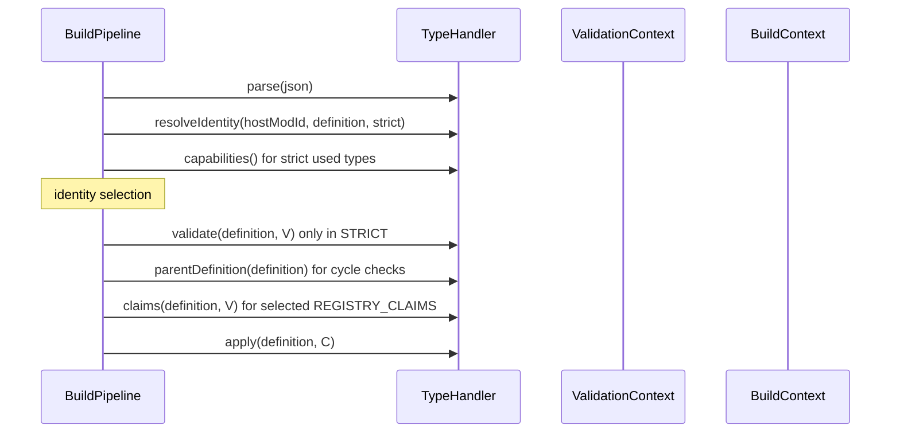
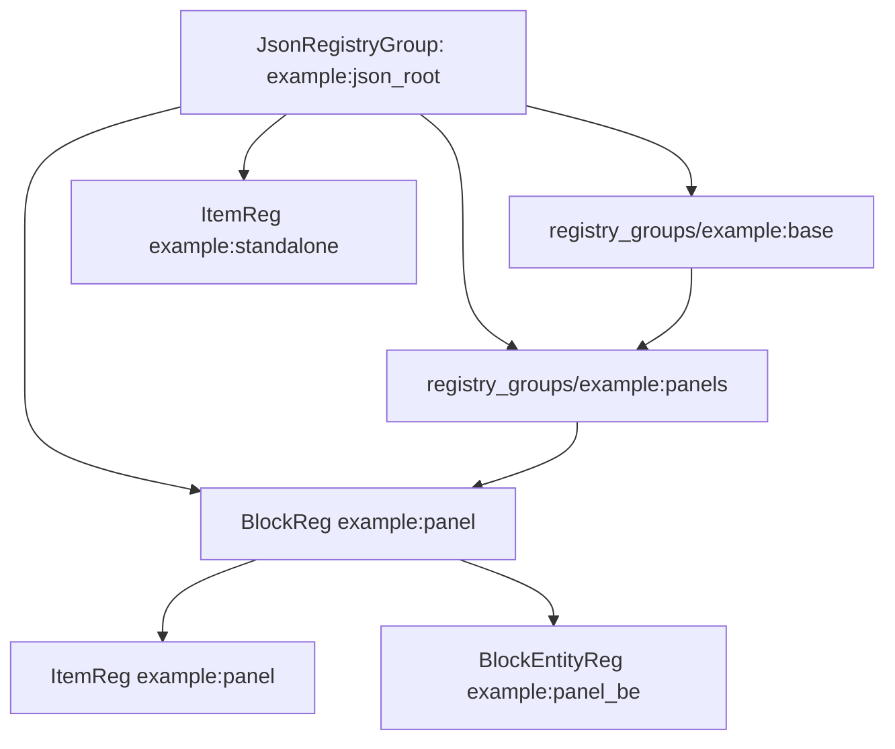

# TypeHandler 与预检

`TypeHandler<T>` 是注册期内容类型扩展点。一个 handler 负责一个顶层字段或一个内嵌字段，把 JSON 解析成自定义 definition，再把它应用到 `RegBuildContext`。

```java
public interface TypeHandler<T> {
    String getTypeName();
    int getPhase();
    T parse(JsonObject json);
    void apply(T definition, BuildContext context);

    default Set<HandlerCapability> capabilities() { return Set.of(); }
    default void validate(T definition, ValidationContext context) {}
    default List<RegistryClaim> claims(T definition, ValidationContext context) {
        return List.of();
    }
    default DefinitionKey parentDefinition(T definition) { return null; }
    default String getParentTypeName() { return null; }
    default String getEmbeddedKeyName() { return null; }
    default List<JsonObject> extractEmbedded(JsonObject parentJson) { return null; }
    default String resolveIdentity(String modId, T definition) { return null; }
    default String resolveIdentity(String modId, T definition, boolean strict) {
        return resolveIdentity(modId, definition);
    }
}
```

源码：[TypeHandler.java](../../../modules/data-driven/src/main/java/lib/kasuga/registration/data_driven/TypeHandler.java)。

## Handler 注册

新管线不自动发现 handler。宿主把 handler 实例列表传给 `DataDrivenBuildPipeline`：

```java
DataDrivenBuildPipeline pipeline = new DataDrivenBuildPipeline(
        "example",
        List.of(new RegistryGroupHandler(), new BlockTypeHandler(), new ItemTypeHandler()),
        finalizers
);
```

旧 `JsonTreeBuilder` 使用进程级 `TypeHandlerRegistry`。第一次调用 `buildForMod` 或 `parseContentBody` 时，`ensureHandlersRegistered()` 注册内建四类 handler：

```java
JsonTreeBuilder.ensureHandlersRegistered();
Collection<TypeHandler<?>> handlers = TypeHandlerRegistry.all();
```

需要在新管线复用旧注册表时，必须先把表内容复制到普通集合再传给 pipeline。`all()` 是只读视图，注册表本身仍是全局静态 map；同名 `register` 会覆盖原 handler。

`DataDrivenBuildPipeline` 不会自动发现 handler，也不会自动补齐内建 handler。若宿主希望复用内建集合，需在构造 pipeline 前调用 `JsonTreeBuilder.ensureHandlersRegistered()`，再复制 `TypeHandlerRegistry.all()`。registry 不是同步容器，动态增删只应在首次构建前完成。

## 生命周期



各方法的约束：

| 方法 | 必须无副作用 | 主要职责 |
| --- | --- | --- |
| `capabilities` | 是 | 声明 STRICT 能力和 identity 角色 |
| `parse` | 是 | 把 JSON 转 definition；不注册对象 |
| `resolveIdentity(..., strict)` | 是 | 计算 handler 命名空间内的稳定逻辑 id，并区分 LEGACY/STRICT 身份规则 |
| `validate` | 是 | 检查引用、资源、工厂、字段语义 |
| `parentDefinition` | 是 | 返回必须先 apply 的父 definition |
| `claims` | 是 | 列出所有最终 registry key |
| `apply` | 可以产生注册树副作用 | 构造 `Reg`、挂组、配置属性和工厂参数 |

`parentDefinition` 在 prepare 阶段用于环检查，在 build 阶段再次用于拓扑排序。两次必须返回相同结果。它也不应依赖枚举顺序变化。

更精确地说：所有解析成功的定义都会执行 `parse` 和 `resolveIdentity`，包括最后被覆盖的候选；`validate` 只对 selected definitions 执行，而且只在 STRICT 中调用；`claims` 只对 selected definition 且声明了 `REGISTRY_CLAIMS` 的 handler 调用。LEGACY 仍会收集 claim 和记录冲突，只是不因此拒绝 apply。`apply` 只对 selected definitions 执行。

## 从 JSON 树到 `Reg` 树

“JSON tree”不是 Minecraft registry 本身，而是每次 build 新建的一棵 `Reg` 意图树：



handler 的 `apply` 负责把 definition 变成节点：

- `RegistryGroupHandler` 创建 `JsonRegistryGroup`，保存到 `RegBuildContext.registryGroups`；
- `RegTypeHandler` 调 factory 创建 block/item `Reg`，把它解析到目标 group 并保存到 `regStore`；
- `BlockEntityTypeHandler` 从 factory 得到 BE `Reg`，挂到宿主 block 的 child 节点；
- `Reg.setParent` 同时建立 parent/child 关系和属性继承链；
- `withProperty` 在节点上保存延迟属性函数；
- `configure` 保存注册阶段 modifier；
- `JsonRegistryGroup` 最终作为 child 挂到 mod 的 `Registry` root。

`RegBuildContext.getRegistryGroup(id)` 和 `getReg(typeName, rawId)` 只服务本次 apply。它们让后续 phase 能查找前序对象，例如方块实体按 `_parent_block` 找到已经创建的 block。它们不持久化为全局单例。

最终 Minecraft registry 写入发生在 `dispatchRegister` 调用各 `MinecraftDeferRegistryReg.register` 时。prepare 和 build 本身只创建注册意图；如果宿主在 build 成功后丢弃 root，尚未 dispatch 的条目不会进入 Minecraft registry。

`Reg.applyProperties` 在对象构造时 parent-first 执行属性函数，所以属性组的顺序不仅是组织关系，也决定 `BlockBehaviour.Properties`、`Item.Properties` 和创造栏映射的结果。

## `parse`

`parse` 只收到定义 object，不收到 mod id、来源或 validation context。缺字段或无法解码时应抛出有明确消息的 `RuntimeException`，管线会把它记录为 `PARSE_FAILED`，并包含逻辑路径和 JSON Pointer。

在 `parse` 之前，STRICT 已经用 `StrictResourceJson` 解码了整份文件，并把 manifest/content 根固定为 object。非法 UTF-8、重复键、注释、尾逗号、额外文档、超过深度或节点限额的输入不会进入 handler。LEGACY 仍交给 Gson，宽容规则属于兼容语义。

即使某个定义最终会在 last-wins 中落败，`parse` 也已经执行。不能在 `parse` 中注册对象、写全局缓存或修改其他 definition。

## Identity 与 `EffectiveId`

`resolveIdentity(hostModId, definition)` 返回该类型内部的 identity。这里的 `hostModId` 是 pipeline 的注册宿主，不是 definition 的 source owner。`DefinitionKey` 由：

```text
(handler.getTypeName(), identity)
```

组成。不同类型可以安全使用相同字符串 id，因为 type domain 不同。

返回 `null` 表示匿名定义：

- LEGACY 允许匿名定义并全部应用；
- STRICT 记录 `MISSING_IDENTITY` 并拒绝整批构建。

`DataDrivenBuildPipeline` 按 `BuildOptions` 把 `strict` 传给三参数 `resolveIdentity(hostModId, definition, strict)`。旧 `JsonTreeBuilder` 仍调用二参数方法。内建方块、物品和内嵌方块实体的两种规则是：

| raw id | STRICT effective id | LEGACY effective id |
| --- | --- | --- |
| `panel` | `<hostModId>:panel`，随后由 `validate` 以 `INVALID_IDENTITY` 拒绝 | `<hostModId>:panel` |
| `minecraft:panel` | `minecraft:panel` | `<hostModId>:panel` |
| `example:panel` | `example:panel` | `example:panel` |

因此旧入口中裸 id 与显式 `minecraft:` 会竞争；这是历史兼容行为。三参数 STRICT 要求显式 namespace，并让显式 `minecraft:` 保持原 namespace。`DataDrivenBuildPipeline` 的 LEGACY 模式用同一历史规则构建 `DefinitionKey`，STRICT 模式则保持显式 namespace。内嵌方块实体使用宿主方块在同一 identity 规则下的 effective id。`registry_groups` 的 identity 是组 id 原字符串，因为其他定义用原字符串查找组。

STRICT 的 `BlockTypeHandler`、`ItemTypeHandler` 会拒绝裸 id；显式写了合法 `namespace:path` 才通过格式检查。`RegTypeHandler.apply` 在 STRICT 中会为任意显式 namespace 添加自己的 `ResourceLocation` 映射，所以 `minecraft:path` 不再被重写到 host namespace。LEGACY 保持旧 `minecraft:` 兼容映射。

字节码身份和文字身份是两回事：

- identity 决定配置覆盖、去重和 `DefinitionKey`；
- `RegistryClaim` 决定最终 Minecraft registry key。

自定义 handler 需要保证 identity 与 claim 的关系可解释。若同一个 definition 可能占用多个 key，应全部列在 `claims`；若 identity 是配置名而非 registry id，应把 handler 标成 `NON_REGISTRATION`。

## Phase

`getPhase()` 控制 apply 的大阶段：

| 常量 | 数值 | 典型内容 |
| --- | --- | --- |
| `PHASE_GROUPS` | 0 | `registry_groups` |
| `PHASE_CONTENT` | 1 | blocks、items |
| `PHASE_EMBEDDED` | 2 | 内嵌 block entity |

phase 小于 handler 注册顺序的优先级。把所有 handler 反序传入，phase 0 仍先于 phase 1。只有同一 phase 内才按 pipeline handler 顺序处理。

完整稳定排序为：

1. phase；
2. handler 在 pipeline 列表中的首次位置；
3. `sourceOrder`；
4. `logicalPath`；
5. `jsonPointer`；
6. `declarationOrder`；
7. `parentDefinition` 形成的拓扑约束。

父边存在时，父 definition 先于子 definition，即使默认 comparator 相反。

## Parent 与环

`parentDefinition` 只接受 `DefinitionKey`。返回的 parent 不存在时不会自动产生错误；handler 应在 `validate` 中用 `requireDefinition` 检查。

STRICT 会对 selected definitions 追踪 parent 链。检测到环时：

- 环中每个成员产生 `GROUP_CYCLE`；
- STRICT 下为 blocking error；
- LEGACY 下记录 warning，但仍进入 apply 排序。

apply 排序如果无法吸收环，会把剩余节点按 comparator 追加，避免 build 卡在循环里。

## Embedded 类型

内嵌 handler 通过三个默认方法描述：

```java
String getTypeName();        // 内部类型名，例如 block_entities
String getParentTypeName();  // blocks
String getEmbeddedKeyName(); // block_entity
List<JsonObject> extractEmbedded(JsonObject parentJson);
```

`extractEmbedded` 返回 `null` 表示父条目没有该子类型；返回对象列表时，每个对象交给内嵌 handler 的 `parse`。一个父类型技术上可以声明多个内嵌 handler，只要顶层类型名和 JSON 键不冲突。

内嵌类型不能作为顶层字段。新管线只给 `getParentTypeName() == null` 的 handler 分派顶层数组；旧入口会对误写在顶层的 `block_entities` 产生带位置提示的诊断。

## Capabilities

STRICT 只接受同时满足以下条件的已使用 handler：

```text
STRICT_PREFLIGHT
and exactly one of (
    NON_REGISTRATION
    REGISTRY_CLAIMS
)
```

pipeline 会检查 handler 列表中同一 `typeName()` 是否重复，即使该类型没有内容，重复表项也会产生 `HANDLER_NOT_STRICT_READY`。“已使用”则指 prepare 已成功解析出该类型 definition；没有 definition 的空数组不会触发该类型的 capability 检查。

| capability | 含义 |
| --- | --- |
| `STRICT_PREFLIGHT` | `validate` 无副作用，并能在 apply 前发现需要阻止构建的问题 |
| `NON_REGISTRATION` | definition 是启动期配置，不占 Minecraft registry |
| `REGISTRY_CLAIMS` | definition 可能占 registry，必须完整报告 claims |

使用 `NON_REGISTRATION` 的典型类型是属性组。配置定义即使在 STRICT 中也只选最高优先级的候选，因为配置的语义是覆盖。

使用 `REGISTRY_CLAIMS` 的注册类型在 STRICT 中保留同 `DefinitionKey` 的全部候选。随后 claim 检查同一最终 registry key；若多个定义抢占同一 key，整批拒绝。这样来源无法通过“不同 definition id 却 claim 同一个 block id”绕过冲突检查。

若 handler 声明 `REGISTRY_CLAIMS` 却总返回空列表，框架看不出它实际占用的 key。严格模式仍可能错误放行冲突，这是扩展责任。

## `ValidationContext`

`ValidationContext` 提供一份只读的 prepared session 视图：

| 方法 | 用途 |
| --- | --- |
| `hostModId()` | 当前注册宿主 |
| `source()` / `sourceOrder()` | 当前 definition 来源 |
| `currentDefinition()` | 当前 `LocatedDefinition` |
| `directDependencies()` | 当前 owner 声明的直接依赖 |
| `find(key)` | 当前 session 中该 identity 的 effective winner |
| `findAll(key)` | 全部候选，包括优先级较低的候选 |
| `canReference(key)` | 候选是否存在且由当前 owner 或直接依赖拥有 |
| `requireDefinition(key, pointer)` | 缺失或不可见时登记诊断，返回是否通过 |
| `resourceExists(domain, location)` | 在可见来源中查 `assets/` 或 `data/` 逻辑资源 |
| `factoryAvailable(type, id)` | 查工厂是否存在 |
| `factorySupports(type, id, class)` | 查工厂对象是否实现某能力接口 |
| `isReserved(symbol)` / `reservedSymbols()` | 查宿主保留的配置符号 |
| `claim(registry, id)` | 创建带当前来源 provenance 的 claim |
| `error(...)` / `warning(...)` | 追加 VALIDATION 诊断 |

`find` 返回全 session 的 effective winner，不自动检查可见性。跨 owner 依赖需要调用 `canReference` 或 `requireDefinition`；只调用 `find` 会漏掉所有权检查。

依赖只认直接 owner。A 依赖 B、B 依赖 C 时，A 不能读取 C 的 definition 或资源。需要读取时在 A 的依赖集合中显式列出 C。

当前 `canReference` / `requireDefinition` 的判定单位是“至少存在一个可见候选”，`find` 的判定单位是“全 session 最高优先级 winner”。两者在极端来源重叠时可能不同：隐藏 owner 的高优先级候选可以成为 `find` 结果，而当前 owner 仍因为有一个低优先级可见候选而通过引用检查。自定义 handler 若必须读取 effective owner，应遍历 `findAll`、过滤 `canReference` 先允许的 owner，再自行选择可见 winner；框架目前没有单独提供“visible effective definition”查询。

`resourceExists` 只在当前 owner 与直接依赖拥有、且 namespace 被来源 descriptor 允许的来源中查找：

```text
assets/<namespace>/<path>
data/<namespace>/<path>
```

它检查来源逻辑文件列表，不负责注册 resource pack，也不保证 Minecraft 客户端当前加载的包栈选择了同一文件。

## Claims

`claims` 返回所有最终 registry key：

```java
@Override
public List<RegistryClaim> claims(PanelDef definition, ValidationContext context) {
    ResourceLocation id = ResourceLocation.parse(definition.id());
    return List.of(context.claim("minecraft:block", id));
}
```

`context.claim` 自动附加当前 source、source order、definition key、逻辑路径和 JSON Pointer。registry 字符串采用当前内建约定，如 `minecraft:block`、`minecraft:item`、`minecraft:block_entity_type`。

claim 必须绑定 definition identity。STRICT 的 missing identity 已在更早阶段阻止构建；LEGACY 中若匿名 handler 直接调用 `context.claim`，会抛 `IllegalStateException` 并记录 `CLAIM_FAILED`。

STRICT 会检查：

- claim 是否与宿主提供的 reserved snapshot 冲突；
- 不同 definition 是否 claim 同一 `(registry, id)`；
- 一个 handler 是否漏报 key，由 handler 自己负责。

claims 的收集发生在 apply 前。内建 handler 会从同一套 identity 解析规则生成 `ResourceLocation`；自定义 handler 也必须使用与 `apply` 相同的最终 ID 规则，否则预检和实际注册树会分叉。

内建 handler 已让 DefinitionKey、claim 和 apply 使用同一身份模式：STRICT 下显式 `minecraft:` 保持原 namespace，LEGACY 下使用历史映射。自定义 handler 仍须自行保证这一点。

LEGACY 仍收集 claims。普通 claim 冲突按 warning 处理；与宿主 reserved key 的冲突始终记录为 error，但 LEGACY build 仍会继续。两种情况下都不应在生产环境忽略冲突。

## 最小自定义 Handler

下面的 handler 注册一个“配置符号”，不占 Minecraft registry：

```java
public record PanelMode(String id, String mode) {}

public final class PanelModeHandler implements TypeHandler<PanelMode> {
    @Override
    public String getTypeName() {
        return "panel_modes";
    }

    @Override
    public int getPhase() {
        return PHASE_CONTENT;
    }

    @Override
    public Set<HandlerCapability> capabilities() {
        return Set.of(
                HandlerCapability.STRICT_PREFLIGHT,
                HandlerCapability.NON_REGISTRATION
        );
    }

    @Override
    public PanelMode parse(JsonObject json) {
        return new PanelMode(
                json.get("id").getAsString(),
                json.get("mode").getAsString()
        );
    }

    @Override
    public String resolveIdentity(String hostModId, PanelMode definition) {
        return definition.id();
    }

    @Override
    public void validate(PanelMode definition, ValidationContext context) {
        if (!Set.of("idle", "running").contains(definition.mode())) {
            context.error(
                    BuildDiagnostic.Code.CONTENT_INVALID,
                    "/mode",
                    "Unknown panel mode " + definition.mode(),
                    "Use idle or running."
            );
        }
    }

    @Override
    public void apply(PanelMode definition, BuildContext context) {
        context.putMeta("panel_modes", definition.id(), definition.mode());
    }
}
```

若另一个 handler 要读取该配置，必须保证它之后的 phase 或 apply 顺序能读取 `metaStore`，或者改为由 finalizer 做跨类型收尾。`metaStore` 只属于当前 build 的 `RegBuildContext`。

## 检查清单

- 顶层字段名在当前 pipeline handler 列表中唯一。
- `parse`、identity、validate、claims 和 parent 查询没有副作用。
- 三参数 identity 明确处理 STRICT 与 LEGACY，不把 `minecraft:` 兼容映射带入 v2。
- STRICT 使用 `STRICT_PREFLIGHT` 加恰好一个 identity role。
- 所有 registry 输出都出现在 `claims` 中。
- 需要父对象先存在的类型使用 phase 和 `parentDefinition` 双重保证。
- 跨 owner 引用调用 `requireDefinition` 或 `canReference`。
- factory、resource 和 group 引用在 validate 中检查。
- 内嵌类型只从父对象提取，不占顶层字段。
- 同类同 identity 的优先级语义符合配置或注册角色的定义。
