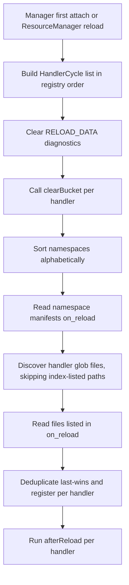

# ReloadHandler and Resource Reload

Reload data comes from the active Minecraft `ResourceManager` pack stack rather than the registration provider's `ResourceSnapshot`. Resource/data packs can override content at the same namespace and path, so definitions in this domain must be reconstructible on every resource reload.

`ReloadOrchestrator` owns the complete cycle: clearing buckets, discovery, decoding, deduplication, registration, and post-reload cross-type checks. It extends types via `ReloadHandlerRegistry` without hard-coding `state_machines` or `animation_clips`. Because `ScopedResourceManager.addListener` triggers `onReloaded` immediately on registration, loading runs both when the Manager first attaches and on every subsequent `/reload`.

## `ReloadHandler`

```java
public interface ReloadHandler<T> {
    String typeName();
    default String describeFile() { return "reload-domain file"; }
    default Set<String> globDirectories() { return Set.of(); }
    void clearBucket();
    Decoded<T> decode(JsonObject root);
    void register(T payload);
    default void afterReload(List<Reloaded<T>> registered) {}
}
```

Source: [ReloadHandler.java](../../../modules/data-driven/src/main/java/lib/kasuga/registration/data_driven/reload/ReloadHandler.java).

### Callback Responsibilities

| Callback | Timing | Contract |
| --- | --- | --- |
| `typeName()` | Registration and routing | Top-level JSON key and deduplication namespace for this type |
| `describeFile()` | Diagnostics | Human-readable file noun for decode messages |
| `globDirectories()` | Discovery | Extra `data/<ns>/.../*.json` directories to scan; default empty = index-only |
| `clearBucket()` | Before each cycle's discovery | Clears resource-sourced entries only; preserves script/code entries |
| `decode(root)` | On each matched file | Pure decode; must not perform I/O or throw on malformed content |
| `register(payload)` | After all discovery and deduplication | Writes into the handler's bucket; may throw on failure |
| `afterReload(list)` | After all handlers finish `register` | Runs cross-type or bucket-wide post-load validation |

`decode` receives the entire file already parsed into a `JsonObject`. Because a single file may carry multiple top-level keys, each decoder should inspect only its own key.

`Decoded.Entry(id, payload)` binds a payload to its deduplication identity. The identity should be a stable, namespace-qualified string. The orchestrator accepts whatever string the decoder returns; `null` opts the entry out of deduplication without prepending a namespace automatically. FSM decoders guarantee non-empty, stringified definition IDs themselves.

## Handler Registration

```java
@Context
public final class MyReloadHandlers {
    @PostConstruct
    void init() {
        ReloadHandlerRegistry.register(new MyDefinitionsReloadHandler(MyBuckets.DEFINITIONS));
    }
}
```

`ReloadHandlerRegistry` behavior:

- Indexed by `typeName()`;
- Re-registering the same `typeName()` replaces the instance in place while keeping its original iteration position;
- `all()` returns a read-only view in registration order;
- `clearForTest()` is reserved strictly for isolating in-JVM tests.

Registration order determines top-level routing order and the order in which candidates are organized before `register`. Cross-type `afterReload` checks should rely on the guarantee that all handlers have finished `register`, not on another handler's `afterReload` running first.

The registry itself is not a thread-safe container. Handlers should be installed before server or client `ResourceManager` reloads start, never added or removed concurrently during reload callbacks.

The built-in modelling handlers are registered at `@Context` startup by `FsmReloadHandlerRegistrar` in the following order:

1. `state_machines`;
2. `animation_clips`.

`ReloadHandlerRegistry` lives in `data-driven`, while the concrete FSM handlers remain in `modelling`, preserving the `modelling` -> `data-driven` dependency direction. Third-party extensions should similarly place handlers that depend on their own or Minecraft types in downstream modules rather than introducing reverse imports into `data-driven`.

## One Reload Cycle



Cycle rules:

- `Diagnostics.Domain.RELOAD_DATA` is cleared at the start of every cycle so diagnostics do not accumulate across reloads.
- `clearBucket()` is called once per registered handler regardless of whether any files exist in that cycle.
- Namespaces are processed in ascending alphabetical order.
- For each namespace, manifests under `kasuga_lib/data_driven/` are read first to collect `on_reload` paths; directory globs then scan unlisted files (skipping managed sources covered by `ManagedReloadAllowlist`); finally, index-listed files are read.
- Within a handler, glob candidates precede index candidates, so for the same id an index entry wins.
- A file matched by both glob and index is read once through the index path.
- `register` begins only after all discovery and `decode` calls across all handlers have completed; each handler deduplicates its candidates first and then registers winners.
- `afterReload` runs only after every handler's `register` phase has completed.

Keep these three distinct "completion" points separate:

1. Every file has been read and decoded, and candidates have been appended to each handler's glob/index lists;
2. `DuplicateIdResolver` has selected the winners for each handler and called `register` in order;
3. Finally, `afterReload` is called across all handlers.

Consequently, state machine reference validation sees animation clips registered during the same cycle, while individual `decode` calls must never assume other types are already registered.

## Paths and Overrides

The actual resource path for reload indexes is:

```text
data/<namespace>/kasuga_lib/data_driven/<index>.json
```

Content paths remain relative to `data/<namespace>/`. They are resolved via:

```java
resourceManager.getResourceStack(ResourceLocation.fromNamespaceAndPath(namespace, path))
```

For legacy (unmanaged) packs, `ReloadOrchestrator` selects the top resource in the stack (`findFirst()`), allowing higher-priority data packs to override matching files. For managed sources registered via `ManagedReloadAllowlist`, `readReloadPaths` and `collectIndex` filter to allowlisted managed layers ordered by `ManagedReloadAllowlist.priority`, and `collectGlob` skips managed sources so managed roots load only manifest-authorized reload files. When identities include namespaces, equal IDs across different namespaces never collide.

Registration-phase `ContentSource` reads from the host-selected sources, whereas reload reads from the game's currently active pack stack. Hosts that want registration schemas and data pack schemas to agree must validate both sides separately rather than assuming registration-time ZIP contents match runtime reload contents.

For `main`/`parcel` train packs, registration should read all active roots from frozen `FixedResourceSource` instances and publish those same roots as Approved pack layers into the Minecraft stack. Runtime reload still selects files along the active MC pack stack (with `ManagedReloadAllowlist` enforcing index/content authorization for managed packs) rather than re-capturing the registration provider's snapshot. When a user changes pack ordering or enabled state, the registered set and reloadable set must go through a consistent host startup flow instead of mutating registries during `/reload`.

## File Routing

Each known top-level key is decoded independently by its matching handler:

```json
{
  "state_machines": [],
  "animation_clips": []
}
```

The file above contributes to both types. Unknown top-level keys emit diagnostics while known keys still decode and contribute. Non-object files are rejected as a whole; a JSON parse failure does not abort other files.

`ContentStructure` handles shared file-shape checks and unknown-key detection. Each decoder is responsible for verifying:

- Whether its own top-level key is present;
- Whether its value is a JSON array;
- Whether every array element is a JSON object;
- Whether the codec decodes each payload cleanly.

File-level vs. element-level rejection is governed by each decoder. The built-in FSM decoders reject malformed wrapper shapes while skipping invalid elements and retaining valid siblings.

## Deduplication and Failure Isolation

The orchestrator applies `DuplicateIdResolver` to each handler's candidate list:

- Identity is `Decoded.Entry.id()`;
- Duplicates sharing `(typeName, id)` follow last-wins;
- Losing payloads never reach `register`;
- Each conflict logs a `WARN` and records an entry in `Diagnostics.Domain.RELOAD_DATA`;
- Conflict entries are attributed to the namespace of the losing file.

Failures are isolated across boundaries:

- A `clearBucket()` failure on one handler does not stop other handlers;
- A read or `decode` failure on one file does not stop other files;
- A discovery failure in one namespace does not stop subsequent namespaces;
- A `register()` failure on one winner does not stop other winners;
- An `afterReload()` failure on one handler does not stop subsequent handlers;
- An outer fallback guard prevents runtime exceptions from escaping the reload listener.

Failure isolation guarantees that the cycle finishes, not transactional rollback. Errors after `clearBucket` can leave empty or partially populated buckets, and diagnostics record what failed to load in that round.

Diagnostics are split across two outlets:

- File reads, unknown top-level keys, `decode`, `register`, and after-phase failures are written by the orchestrator into `Diagnostics.Domain.RELOAD_DATA`;
- Runtime manifest parsing delegates to `JsonTreeBuilder.parseIndexManifest` and `resolveIndexManifests` to share the registration-side schema rules, so manifest schema errors land in the legacy per-mod/namespace error bucket, which is not cleared at the start of each reload cycle.

`/kasuga_data errors <namespace>` prints both outlets, so visibility in that command does not imply both entries live in `RELOAD_DATA`.

## Built-in FSM Handlers

### `state_machines`

`FsmReloadHandler`:

- `typeName()` returns `state_machines`;
- Declares glob directory `state_machines`;
- `clearBucket()` calls `FsmDefinitions.clearResource()`;
- `decode` delegates to `StateMachineDefinitionLoader.decodeFile`;
- `register` writes to the `RESOURCE` half of `FsmDefinitions`;
- `afterReload` verifies whether `states[].clip` entries exist in the clip bucket.

Script- or code-registered definitions survive `clearResource()`. When a script entry and a resource entry share an id, the script entry stays active and `afterReload` skips the resource definition because it is no longer the live entry in the bucket.

Dangling clip references:

- Log a `WARN`;
- Record an entry in `RELOAD_DATA` diagnostics;
- Do not block state machine registration;
- Degrade affected runtime states to an available static pose.

Because `Diagnostics` source buckets do not store severity, dangling clip references still count toward the error total shown by `/kasuga_data errors` even though they are logged as `WARN`.

### `animation_clips`

`FsmClipsReloadHandler`:

- Index-only via `on_reload`, with no directory glob;
- `clearBucket()` calls `FsmAnimationClips.clearResource()`;
- `decode` delegates to `AnimationClipLoader.decodeFile`;
- `register` delegates to `AnimationClipLoader.register`.

`animation_clips/*.json` files omitted from manifests are not loaded. Placing them under `state_machines/` does not automatically turn them into clips via the glob either; files are always routed by top-level key, and the directory affects discovery only.

## Reload Content in STRICT Preflight

`DataDrivenBuildPipeline.prepare` reads `on_reload` files listed in source manifests and runs each top-level key through the corresponding decoder in `ReloadHandlerRegistry`:

- Unregistered top-level key: blocking error in STRICT;
- Decoder errors: blocking error in STRICT;
- Decoder throws an exception: converted to `CONTENT_INVALID`;
- Neither `clearBucket` nor `register` is called.

This lets third-party external packs catch reload schema mistakes before startup completes. Preflight does not run `globDirectories()` discovery, so `state_machines/` files omitted from manifests skip this preflight and are discovered only at runtime by `ReloadOrchestrator`.

Preflight queries the process-wide `ReloadHandlerRegistry` rather than the `TypeHandler` list passed to `DataDrivenBuildPipeline`. The host must install reload handlers before running a STRICT `prepare` intended to validate reload schemas. Preflight also does not construct `ResourceLocation` instances, so uppercase letters or invalid resource-path characters may be rejected only at runtime. Note that STRICT preflight uses `StrictResourceJson`, whereas runtime `ReloadOrchestrator` reads via Minecraft `Resource` and Gson `JsonParser`, so runtime parsing is more permissive toward inputs like duplicate keys than preflight.

## Custom `ReloadHandler` Example

```java
public record DisplayRule(ResourceLocation id, String template) {}

public final class DisplayRulesReloadHandler
        implements ReloadHandler<DisplayRule> {

    private final DisplayRuleBucket bucket;

    public DisplayRulesReloadHandler(DisplayRuleBucket bucket) {
        this.bucket = bucket;
    }

    @Override
    public String typeName() {
        return "display_rules";
    }

    @Override
    public String describeFile() {
        return "display rule file";
    }

    @Override
    public Set<String> globDirectories() {
        return Set.of("display_rules");
    }

    @Override
    public void clearBucket() {
        bucket.clearResource();
    }

    @Override
    public Decoded<DisplayRule> decode(JsonObject root) {
        JsonElement value = root.get(typeName());
        if (value == null || !value.isJsonArray()) {
            return new Decoded<>(
                    List.of(),
                    List.of("display_rules must be an array")
            );
        }

        List<Decoded.Entry<DisplayRule>> entries = new ArrayList<>();
        List<String> errors = new ArrayList<>();
        for (JsonElement element : value.getAsJsonArray()) {
            if (!element.isJsonObject()) {
                errors.add("each display rule must be an object");
                continue;
            }
            JsonObject object = element.getAsJsonObject();
            JsonElement idValue = object.get("id");
            if (idValue == null || !idValue.isJsonPrimitive()
                    || !idValue.getAsJsonPrimitive().isString()) {
                errors.add("display rule id must be a string");
                continue;
            }
            ResourceLocation id = ResourceLocation.tryParse(idValue.getAsString());
            if (id == null) {
                errors.add("display rule id is invalid");
                continue;
            }
            JsonElement templateValue = object.get("template");
            if (templateValue == null || !templateValue.isJsonPrimitive()
                    || !templateValue.getAsJsonPrimitive().isString()) {
                errors.add("display rule template must be a string");
                continue;
            }
            entries.add(new Decoded.Entry<>(
                    id.toString(),
                    new DisplayRule(id, templateValue.getAsString())
            ));
        }
        return new Decoded<>(entries, errors);
    }

    @Override
    public void register(DisplayRule payload) {
        bucket.registerResource(payload.id(), payload);
    }
}
```

This example illustrates responsibility boundaries; `DisplayRuleBucket` is fictional. Production buckets should distinguish `RESOURCE` and `SCRIPT` sources like the FSM buckets so `clearBucket` clears only resource-sourced entries.

## Testing Recommendations

- Pure `decode`: construct `JsonObject` instances directly and assert `entries` and `errors`;
- Registry ordering: register two handlers and verify in-place replacement preserves order and type names;
- Mixed-file routing: put two known top-level keys in one file;
- Unknown keys: verify diagnostics are recorded while known keys still contribute;
- Last-wins: test glob and index candidates sharing the same `(typeName, id)`;
- Clear isolation: throw from one handler's `clearBucket` and verify other handlers still run;
- `afterReload`: verify it runs after all `register` calls and can observe other handlers' buckets;
- Resource overrides: use a `ResourceManager` test fixture to verify higher-priority pack selection.

Existing tests live under [`modules/modelling/src/test/java/lib/kasuga/rendering/models/mc/dynamic/fsm/`](../../../modules/modelling/src/test/java/lib/kasuga/rendering/models/mc/dynamic/fsm/), covering mixed files, file order, exception boundaries, script-wins, and cross-type references.
