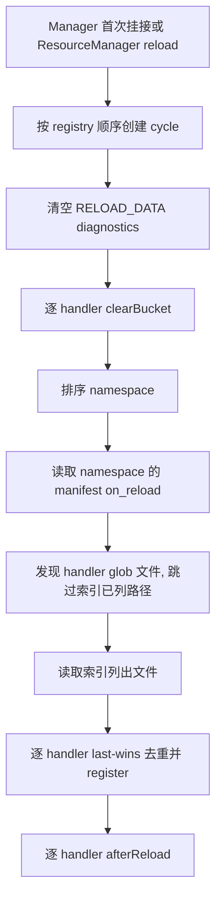

# ReloadHandler 与资源重载

reload 数据来自当前 Minecraft `ResourceManager` 的包栈，而不是注册 provider 的 `ResourceSnapshot`。资源包可以在同 namespace、同路径上覆盖原内容，因此本域中的定义必须能在每轮资源重载后重新创建。

`ReloadOrchestrator` 负责一个完整周期：清理、发现、解码、去重、注册和跨类型后检查。它通过 `ReloadHandlerRegistry` 扩展类型，代码中不写死 `state_machines` 或 `animation_clips`。`ScopedResourceManager.addListener` 会立即触发一次 `onReloaded`，因此首次挂接 Manager 时也会加载，而不只响应显式 `/reload`。

## ReloadHandler

```java
public interface ReloadHandler<T> {
    String typeName();
    default String describeFile() { return "reload-domain file"; }
    default Set<String> globDirectories() { return Set.of(); }
    void clearBucket();
    Decoded<T> decode(JsonObject root);
    void register(T payload);
    default void afterReload(List<Reloaded<T>> registered) {}
}
```

源码：[ReloadHandler.java](../../../modules/data-driven/src/main/java/lib/kasuga/registration/data_driven/reload/ReloadHandler.java)。

### 回调职责

| 回调 | 时机 | 要求 |
| --- | --- | --- |
| `typeName()` | 注册与路由 | 顶层 JSON 键，也是该类型的去重空间 |
| `describeFile()` | 诊断 | 返回可读的类型名称 |
| `globDirectories()` | 发现 | 返回额外的 `data/<ns>/.../*.json` 目录；默认仅索引 |
| `clearBucket()` | 每轮发现前 | 只清资源来源，保留脚本/代码来源 |
| `decode(root)` | 读到一个命中文件后 | 纯解码，不读文件，不为 malformed content 抛异常 |
| `register(payload)` | 全部发现与去重后 | 写入本类型桶；失败可抛出 |
| `afterReload(list)` | 所有 handler 完成 register 后 | 做跨类型或桶内最终检查 |

`decode` 的输入是已经解析成 object 的整个文件。一个文件可能有多个顶层键，因此 decoder 只读取自己的键。

`Decoded.Entry(id, payload)` 将 payload 与去重 identity 绑定。identity 应该是命名空间限定的稳定字符串。当前编排器接受 decoder 返回的任何字符串；`null` 会退化为“不参与去重”，不会自动补 namespace。FSM decoder 自行保证定义 id 非空并转成字符串。

## Handler 注册

```java
@Context
public final class MyReloadHandlers {
    @PostConstruct
    void init() {
        ReloadHandlerRegistry.register(new MyDefinitionsReloadHandler(MyBuckets.DEFINITIONS));
    }
}
```

`ReloadHandlerRegistry` 的行为：

- 按 `typeName()` 索引；
- 相同 type name 再次注册时替换实例并保留原始迭代位置；
- `all()` 返回注册顺序的只读视图；
- `clearForTest()` 只用于隔离 JVM 内测试。

注册顺序会影响顶层键路由顺序和 register 前候选的组织顺序。跨类型 `afterReload` 应依赖“所有类型已注册”的保证，不应依赖另一个 handler 先执行 `afterReload`。

注册表本身不是线程安全容器。handler 应在服务端/客户端 Manager 开始重载前完成安装，不要在 reload 回调期间并发增删。

内建 modelling handler 由 `FsmReloadHandlerRegistrar` 在 `@Context` 启动时注册，顺序是：

1. `state_machines`；
2. `animation_clips`。

`ReloadHandlerRegistry` 本身属于 data-driven 模块。具体的 FSM handler 留在 modelling，依赖方向仍是 modelling → data-driven。第三方扩展也应把依赖自己类型或 Minecraft 对象的 handler 放在下游模块，不要在 data-driven 中反向 import 消费方。

## 一个 reload 周期



具体规则：

- `Diagnostics.Domain.RELOAD_DATA` 在每轮开始清理，避免诊断跨轮累积。
- 每个注册 handler 恰好调用一次 `clearBucket()`，无论本轮是否有文件。
- namespace 按字母序处理。
- 每个 namespace 先从包栈读取 `kasuga_lib/data_driven/` 下的 manifest，得到 `on_reload` 路径；随后 glob 发现未列出的目录文件；最后读取索引文件。
- reload candidate 在同一 handler 内是 glob 在前、index 在后；同一 id 的 index 条目胜出。
- 一个文件同时被 glob 和索引命中时，只通过索引读取一次。
- 所有 handler 的发现与 decode 完成后才开始第一个 register；每个 handler 在自己的 register 阶段先去重，再写入 winner。
- 所有 register 完成后才进入任何 `afterReload`。

这里有三个容易混淆的“完成”：

1. 所有文件已经读取并 decode，候选已经追加到各 handler 的 glob/index 列表；
2. `DuplicateIdResolver` 已为每个 handler 选出去重 winner，并依次调用 `register`；
3. 最后统一调用 `afterReload`。

因此状态机引用检查能看见本轮刚注册的动画片段，但单个文件 decode 阶段不应假定其他类型已经注册。

## 路径与覆盖

reload index 的实际资源路径是：

```text
data/<namespace>/kasuga_lib/data_driven/<index>.json
```

内容路径仍相对于 `data/<namespace>/`。读取通过：

```java
resourceManager.getResource(ResourceLocation.fromNamespaceAndPath(namespace, path))
```

因此高层资源包可以选择同名内容文件。identity 包含 namespace 时，不同 namespace 的同 id 不会冲突；同 namespace 中被包栈选中的内容作为该路径的输入。

注册期 `ContentSource` 读取的是宿主选定来源，reload 期读取的是游戏当前生效的包栈。宿主若希望注册 schema 与数据包 schema 兼容，需要分别验证两边，不能假定注册时的 ZIP 内容就是运行期 reload 内容。

main/parcel 车包应让注册期从冻结的 `FixedResourceSource` 读取全部有效 roots，并让对应 root 作为 Approved pack 层进入 MC 栈。reload 仍按 MC 当前选中的包栈重选同路径文件；它不是“重新捕获注册 provider 的 snapshot”。用户调整包顺序或禁用状态后，注册集和 reload 可见集要在宿主层重新进入一致启动流程，不能在本轮 reload 中热改 registry。

## 文件路由

每个已知顶层键由对应 handler 独立解码：

```json
{
  "state_machines": [],
  "animation_clips": []
}
```

上面文件同时贡献两个类型。未知顶层键会产生诊断，但已知键仍可被处理。非 object 文件整体拒绝；JSON parse 失败不会终止其他文件。

`ContentStructure` 负责通用文件结构和未知键发现。每个 decoder 负责：

- 自己的键是否存在；
- 值是否为数组；
- 每个元素是否为 object；
- codec 是否能解出 payload。

文件级失败和元素级失败由具体 decoder 控制。当前 FSM decoder 会拒绝错误的 wrapper 形状，同时跳过坏元素并保留兄弟元素。

## 去重与失败隔离

编排器对每个 handler 的候选应用 `DuplicateIdResolver`：

- identity 是 `Decoded.Entry.id()`；
- 相同 handler、相同 id 使用 last-wins；
- 落败 payload 不调用 `register`；
- 每个冲突产生 WARN 和 `Diagnostics.Domain.RELOAD_DATA` 条目；
- 同一错误归到 loser 文件所在 namespace。

以下失败彼此隔离：

- 一个 handler 的 clear 失败不阻止其他 handler；
- 一个文件读取或 decode 失败不阻止其他文件；
- 一个 namespace 的发现失败不阻止下一个 namespace；
- 一个 entry 的 register 失败不阻止其他 winner；
- 一个 handler 的 afterReload 失败不阻止后续 handler；
- 最外层还有兜底 guard，保证异常不逃出 reload listener。

失败隔离保证周期能完成，不代表状态回滚。`clearBucket` 之后的错误可能留下部分或空桶；诊断会记录本轮未加载或只加载一部分。

诊断也分两层：

- 文件读取、未知顶层键、decode、register 和 after-phase 错误由编排器写入 `Diagnostics.Domain.RELOAD_DATA`；
- 运行期 manifest 为了与注册期共享同一套解析规则，会调用 `JsonTreeBuilder.parseIndexManifest` / `resolveIndexManifests`，其 manifest schema 错误通过旧解析器写入 per-mod/namespace 兼容错误桶。该桶不会在本轮开始时清空。

`/kasuga_data errors <namespace>` 会同时读取这两层，因此命令中可见不等于两个错误都落在 `RELOAD_DATA`。

## 内建 FSM handler

### `state_machines`

`FsmReloadHandler`：

- `typeName()` 返回 `state_machines`；
- 声明 glob 目录 `state_machines`；
- `clearBucket()` 调用 `FsmDefinitions.clearResource()`；
- `decode` 委托 `StateMachineDefinitionLoader.decodeFile`；
- `register` 写 resource 半区；
- `afterReload` 检查 `states[].clip` 是否能在 clip 桶中找到。

脚本或代码注册的 definition 在 resource clear 后保留。若脚本条目与资源条目同 id，脚本条目继续有效，后检查会跳过不再代表当前 live bucket 的资源 definition。

悬空 clip 引用：

- 在群组日志中为 WARN；
- 在 `RELOAD_DATA` 诊断中登记；
- 不阻止状态机注册；
- 对应运行态会退化为可用的静态姿态。

`Diagnostics` 的 source bucket 不保存 severity，悬空引用虽然按 WARN 记录日志，仍会作为一条 “error” 出现在 `/kasuga_data errors` 的计数中。

### `animation_clips`

`FsmClipsReloadHandler`：

- 只使用 `on_reload`，不使用 glob；
- `clearBucket()` 调用 `FsmAnimationClips.clearResource()`；
- `decode` 委托 `AnimationClipLoader.decodeFile`；
- `register` 委托 `AnimationClipLoader.register`。

未列入 manifest 的 `animation_clips/*.json` 不会加载。把它们放在 `state_machines/` 也不会因为 glob 所在目录而自动变成 clip；文件仍按顶层键路由，只是路径位置不构成类型。

## STRICT 预检中的 reload 内容

`DataDrivenBuildPipeline.prepare` 会读取 source manifest 中的 `on_reload` 文件，并对每个顶层键调用当前 `ReloadHandlerRegistry` 的 decoder：

- 未注册类型：STRICT 为错误；
- decoder errors：STRICT 为错误；
- decoder 抛异常：转换为 `CONTENT_INVALID`；
- 不调用 `clearBucket` 或 `register`。

这使第三方外部包能在启动前发现部分 reload schema 错误。预检不执行 glob 发现，所以只存在于 `state_machines/`、未被 manifest 列出的文件不会进入这条预检；它们仍由运行期 `ReloadOrchestrator` 发现。

预检使用进程级 `ReloadHandlerRegistry`，不是注册期 `DataDrivenBuildPipeline` 的 `TypeHandler` 列表。宿主必须先安装 reload handlers，再执行希望覆盖 reload schema 的 STRICT prepare。预检还不会提前构造 `ResourceLocation`，大写或非法资源路径可能到运行期才被拒绝。STRICT 预检使用 `StrictResourceJson`；真正 reload 的 `ReloadOrchestrator` 仍使用 Minecraft `Resource` 和 Gson `JsonParser`，所以运行时对重复键等输入的宽容规则与预检不同。

## 自定义 ReloadHandler 示例

```java
public record DisplayRule(ResourceLocation id, String template) {}

public final class DisplayRulesReloadHandler
        implements ReloadHandler<DisplayRule> {

    private final DisplayRuleBucket bucket;

    public DisplayRulesReloadHandler(DisplayRuleBucket bucket) {
        this.bucket = bucket;
    }

    @Override
    public String typeName() {
        return "display_rules";
    }

    @Override
    public String describeFile() {
        return "display rule file";
    }

    @Override
    public Set<String> globDirectories() {
        return Set.of("display_rules");
    }

    @Override
    public void clearBucket() {
        bucket.clearResource();
    }

    @Override
    public Decoded<DisplayRule> decode(JsonObject root) {
        JsonElement value = root.get(typeName());
        if (value == null || !value.isJsonArray()) {
            return new Decoded<>(
                    List.of(),
                    List.of("display_rules must be an array")
            );
        }

        List<Decoded.Entry<DisplayRule>> entries = new ArrayList<>();
        List<String> errors = new ArrayList<>();
        for (JsonElement element : value.getAsJsonArray()) {
            if (!element.isJsonObject()) {
                errors.add("each display rule must be an object");
                continue;
            }
            JsonObject object = element.getAsJsonObject();
            JsonElement idValue = object.get("id");
            if (idValue == null || !idValue.isJsonPrimitive()
                    || !idValue.getAsJsonPrimitive().isString()) {
                errors.add("display rule id must be a string");
                continue;
            }
            ResourceLocation id = ResourceLocation.tryParse(idValue.getAsString());
            if (id == null) {
                errors.add("display rule id is invalid");
                continue;
            }
            JsonElement templateValue = object.get("template");
            if (templateValue == null || !templateValue.isJsonPrimitive()
                    || !templateValue.getAsJsonPrimitive().isString()) {
                errors.add("display rule template must be a string");
                continue;
            }
            entries.add(new Decoded.Entry<>(
                    id.toString(),
                    new DisplayRule(id, templateValue.getAsString())
            ));
        }
        return new Decoded<>(entries, errors);
    }

    @Override
    public void register(DisplayRule payload) {
        bucket.registerResource(payload.id(), payload);
    }
}
```

这个示例说明职责边界，不代表 `DisplayRuleBucket` 已存在。真实实现应像 FSM 桶一样区分 RESOURCE 和 SCRIPT 来源，使 `clearBucket` 只删除资源半区。

## 测试建议

- 纯 decode：直接构造 `JsonObject`，验证 entries/errors；
- registry 顺序：注册两个 handler，验证替换保序和 type name；
- 文件路由：一个文件含两个已知键；
- 未知键：验证诊断存在但已知键仍贡献；
- last-wins：同一 `(typeName, id)` 的 glob 与 index 候选；
- clear 隔离：一个 handler 抛异常，其他 handler 仍执行；
- afterReload：确认它在所有 register 之后、能看到另一类型 bucket；
- resource override：通过 `ResourceManager` fixture 选择同名高层包。

相关现有测试位于 [`modules/modelling/src/test/java/lib/kasuga/rendering/models/mc/dynamic/fsm/`](../../../modules/modelling/src/test/java/lib/kasuga/rendering/models/mc/dynamic/fsm/)，覆盖 mixed file、文件顺序、异常边界、script-wins 和跨类型引用。
