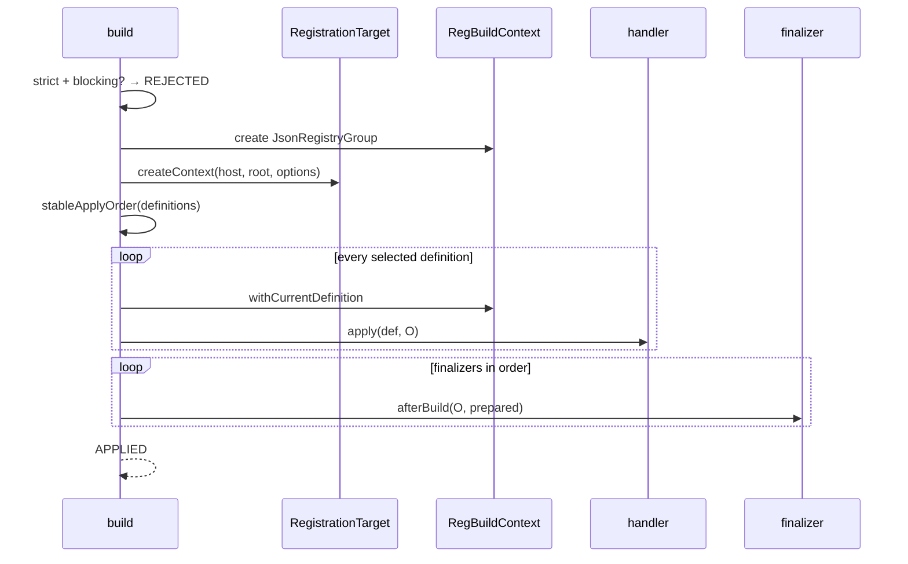

# Multi-Source Build Pipeline

`DataDrivenBuildPipeline` organizes discovery, parsing, policy selection, preflight validation, and `apply` across multiple `ContentSource` instances into an immutable two-phase `prepare`/`build` workflow. Each `ContentSource` should come from an already-frozen `ResourceSnapshot`, ensuring `prepare`, initial MC discovery, and subsequent consumers never read different snapshots of an install directory.

```java
PreparedContent prepared =
        pipeline.prepare(sources, BuildOptions.STRICT, dependencies);

BuildResult result = pipeline.build(prepared);
```

Source: [DataDrivenBuildPipeline.java](../../../modules/data-driven/src/main/java/lib/kasuga/registration/data_driven/pipeline/DataDrivenBuildPipeline.java).

## Construction

Core constructor:

```java
new DataDrivenBuildPipeline(
        String hostModId,
        Collection<? extends TypeHandler<?>> handlers,
        Collection<? extends BuildFinalizer> finalizers
)
```

Extended constructors allow customizing `RegistrationTarget`, reserved symbols, and reserved registry keys (a 5-argument overload omitting `reservedRegistryClaims` is also available):

```java
new DataDrivenBuildPipeline(
        hostModId,
        handlers,
        finalizers,
        RegistrationTarget.standard(),
        reservedSymbols,
        reservedRegistryClaims
);
```

Constructor arguments are copied defensively. Handler list order participates in deterministic tie-breaking within each phase. Handler type names must be non-blank, and STRICT `prepare` rejects duplicate type names.

`RegistrationTarget.standard()` constructs:

```java
new RegBuildContext(hostModId, rootGroup, options.isStrict())
```

A custom target lets the host supply its own `RegBuildContext` subclass. The contract expects the returned context to bind the supplied host and root group; `build` does not inspect internal context fields via reflection to enforce this.

## `prepare` Inputs

`prepare(sources, options, dependencies)` (and the four-argument overload `prepare(sources, options, dependencies, sharedAssetOwners)`) takes:

```java
Collection<? extends ContentSource> sources
BuildOptions options
Map<String, ? extends Collection<String>> dependencies
```

Source priority comes from the source descriptor:

- Sources backed by `ResourceSourceDescriptor` use their explicit, non-negative `rank`; the pipeline sorts by `rank` first, breaking ties by input position while reporting duplicate ranks as errors;
- Only legacy four-argument `SourceDescriptor`s with `resource() == null` receive a zero-based `sourceOrder` from their iteration position in the input collection;
- `(sourceId, rootId)` is the unique key for a platform source root. A single `sourceId` may contain `main`, `parcel`, and `shared` roots.

`ValidationContext.sourceOrder()` and `LocatedDefinition.sourceOrder()` store the effective order used during the session. Explicit platform `rank` is the source of truth for that order, not the caller's list ordering.

`dependencies` maps each `ownerId` to the other owners it is allowed to reference directly:

```java
Map.of(
        "example_addon", Set.of("example_core"),
        "example_theme", Set.of("example_core", "example_addon")
)
```

Every owner present in `sources` is automatically assigned an empty dependency set if omitted. Declaring a dependency on an owner absent from `sources` logs `UNKNOWN_DEPENDENCY` as an error in STRICT and a warning in LEGACY.

## Deterministic Ordering in `prepare`

```text
Sort sources by explicit rank
  → Aggregate manifests per source
  → Deduplicate register / reload paths
  → Sort register paths by logicalPath
  → Process top-level content keys in pipeline handler list order
  → Preserve file order within each handler array
```

Pass sequence:

1. Check `(sourceId, rootId)` uniqueness and global `rank` uniqueness;
2. Normalize and validate owner dependencies;
3. Read manifests per source, locate register/reload paths, and parse registration content;
4. Read reload files and run `ReloadHandler.decode` for preflight checks;
5. Check STRICT handler capabilities and `strictValidationImplemented()`;
6. Select effective definitions by identity and priority;
7. Run `validate` (STRICT only);
8. Check `parentDefinition` references for cycles;
9. Collect `claims` and check registry conflicts;
10. Produce an immutable `PreparedContent`.

Source processing is isolated per source. If enumerating or reading a source throws a `RuntimeException`, the pipeline records `SOURCE_READ_FAILED` and continues with the next source, without rolling back paths or definitions already collected from the failing source. STRICT then rejects the build due to the blocking diagnostic, while LEGACY may apply partial results.

Each source's effective manifest set comes from `ContentSource.indexes()`. Standard `ContentSource` implementations discover direct children under `data/<ns>/kasuga_lib/data_driven/`; `SnapshotContentSource` with `declaredIndexes` exposes only the paths named by the host. This entry selection is what these pages call scene indexing. It does not strip content files from the snapshot, so manifests can still open content from the same fixed root.

`PreparedContent` holds:

| Field | Meaning |
| --- | --- |
| `hostModId` | Host mod id for this session |
| `options` | `LEGACY` or `STRICT` policy used by `prepare` |
| `sources` | Ordered source descriptors |
| `definitions` | Selected definitions |
| `allDefinitions` | All parsed definitions, including lower-priority candidates |
| `registerFiles` | Located registration content paths |
| `reloadFiles` | Located and preflighted reload paths |
| `indexFiles` | Located index manifest paths |
| `claims` | Deduplicated claims declared by selected definitions |
| `diagnostics` | Immutable diagnostic snapshot from `prepare` |
| `dependencies` | Normalized owner dependency map |
| `reservedSymbols` | Host-reserved configuration symbols |

Each definition is wrapped in a `LocatedDefinition<T>`:

| Field | Meaning |
| --- | --- |
| `key` | Handler type domain and identity; required non-null in STRICT |
| `handler` | Handler that parsed and applies this value |
| `definition` | Typed result from `parse` |
| `source` | `SourceDescriptor` carrying `sourceId`, `rootId`, `rank`, and `namespaces` |
| `sourceOrder` | Effective priority order for this session (from `rank` for platform sources) |
| `logicalPath` | Content file path |
| `jsonPointer` | Location inside the content file |
| `declarationOrder` | Session-wide discovery sequence number |

`registerFiles`, `reloadFiles`, and `indexFiles` are public read-only lists that hosts can inspect or persist to record the exact files consumed.

## Identity Selection

Definitions are grouped by `(typeName, identity)`. Anonymous definitions have `key == null`.

### `NON_REGISTRATION` or LEGACY

Unless the handler declares `HandlerCapability.OVERLAY`, only the candidate with the highest priority is selected per key:

```text
sourceOrder
  → declarationOrder
```

Higher `sourceOrder` wins; within the same source, later parsed definitions win. Because `logicalPath` sorting governs parse order, definitions in lexicographically later paths within the same source receive higher `declarationOrder` values. Handlers declaring `HandlerCapability.OVERLAY` retain all candidates sharing an identity so they can merge or overlay them.

### STRICT `REGISTRY_CLAIMS`

In STRICT mode, definitions whose handler declares `REGISTRY_CLAIMS` (and not `NON_REGISTRATION`) retain all candidates sharing a `DefinitionKey`. Claim validation must then prove they do not collide on a final registry key:

- Same `(registry, id)` key -> `CLAIM_CONFLICT`, entire batch rejected;
- Same `DefinitionKey` with distinct final registry keys -> allowed by the current implementation;
- Any selected claim matching a host-reserved key -> `CLAIM_CONFLICT`.

This catches cases where two distinct JSON IDs resolve to the same block or item key. A source cannot bypass conflict checks merely by using distinct definition identities that claim the same block id.

Note that STRICT runs `validate` on all retained candidates sharing a registration identity. Even a lower-priority candidate whose final claim differs from a higher-priority one will block the build if it fails validation; registration types do not follow the "pick winner first, validate winner only" rule used by configuration types.

### Anonymous Definitions

- LEGACY: all selected without deduplication;
- STRICT: emits `MISSING_IDENTITY` and rejects the build (`REJECTED`).

## LEGACY vs. STRICT

| Behavior | LEGACY | STRICT |
| --- | --- | --- |
| JSON decoding | Gson lenient mode | Strict UTF-8 + `StrictResourceJson`; duplicate keys, comments, trailing commas, etc. block apply |
| Parse failure | Records error; continues applying other definitions | Blocks the entire batch before apply |
| Unknown top-level field | Warning | Error |
| Missing identity | Allowed | Error |
| Handler capabilities | Not checked | Requires `STRICT_PREFLIGHT`, `strictValidationImplemented()`, and exactly one identity role |
| `validate` | Not invoked | Invoked on all selected definitions |
| Parent cycles | Warning | Error |
| Claim collection | Invoked | Invoked |
| Claim conflict | Intra-data conflict is warning; reserved-host conflict is error, yet build continues | Rejects entire batch before apply |
| Unknown owner dependency | Warning | Error |
| Duplicate source root / rank | Error, yet build continues | Error, rejects entire batch |

"Duplicate source root" refers to duplicate `(sourceId, rootId)`; distinct `rootId`s under the same `sourceId` are valid. Duplicate `rank` values likewise record `INVALID_SOURCE`: STRICT rejects before apply, while LEGACY may continue.

Built-in registration handlers follow these identity paths:

```text
Legacy JsonTreeBuilder:               minecraft:foo -> <hostModId>:foo
Pipeline LEGACY DefinitionKey/apply:  minecraft:foo -> <hostModId>:foo
Pipeline STRICT DefinitionKey/apply:  minecraft:foo -> minecraft:foo
```

Thus `BuildOptions.LEGACY` uses lenient JSON, skips STRICT `validate`, and preserves the historical identity rewrite; built-in handlers also catch single-entry `apply` exceptions in non-strict contexts and continue, though custom `apply` throws still yield `FAILED`. A bare `foo` maps to the host namespace in LEGACY; in STRICT, `resolveIdentity` yields `<hostModId>:foo`, and `validate` then rejects it with `INVALID_IDENTITY`.

Built-in block and item `claims` read the final ID from `DefinitionKey`, so `minecraft:foo` stays aligned across `DefinitionKey`, `claims`, and `apply` in STRICT, while LEGACY consistently applies the historical rewrite across all three.

In LEGACY mode, `BuildResult` can still return `APPLIED` while carrying `ERROR` diagnostics. `APPLIED` indicates that `apply` ran to completion, not that inputs were clean. Strict verification must check both `!prepared.hasBlockingDiagnostics()` and `result.successful()`.

Owners present in the `dependencies` map that have no corresponding source descriptor do not raise an error on their own, although any dependencies they declare are still checked against known source owners. Hosts should ensure the `dependencies` map contains only expected owners so typos do not silently go unnoticed.

## Boundary Between `prepare` and `build`

`prepare` can be called repeatedly, producing fresh declaration orders, selected definitions, and diagnostics. `build` can also be called multiple times on the same `PreparedContent`, though each invocation constructs a fresh root and re-runs `apply` and finalizers; hosts should normally build once per prepared session.

`PreparedContent` checks only that `hostModId` matches the pipeline; do not pass an older `PreparedContent` to a new pipeline whose handler list, finalizers, target, or reserved keys have changed, because definitions retain handler references from the pipeline that prepared them.

`PreparedContent` holds no open `ContentSource` streams. Standard handlers finish parsing JSON during `prepare`, so providers can close `SnapshotContentSource` immediately afterward to release the underlying snapshot. Custom definitions that defer source reads must document and manage that lifecycle explicitly.

Building with zero definitions is valid. A source with no indexes, an explicit empty `on_register` array, or an assets/data-only pack yields zero selected definitions; provided no blocking diagnostics exist, `build` creates an empty `JsonRegistryGroup`, runs finalizers, and returns `APPLIED`. Hosts can handle "assets-only pack + zero Java registry entries" uniformly without synthesizing placeholder definitions.

## `build` Execution



Blocking diagnostics in STRICT mode are checked by:

```java
prepared.hasBlockingDiagnostics()
```

Only `Severity.ERROR` is blocking; warnings never prevent `build`.

Apply ordering:

1. `TypeHandler.getPhase()`;
2. Pipeline handler registration order;
3. `sourceOrder`;
4. `logicalPath`;
5. `jsonPointer`;
6. `declarationOrder`;
7. Topological order from `parentDefinition`.

If context creation throws, sorting throws, any `apply` throws, or any finalizer throws, `build` halts further steps and returns `FAILED`.

Commit semantics for `BuildResult`:

| Status | `rootGroup()` | Caller Action |
| --- | --- | --- |
| `REJECTED` | `null` | Do not apply or mount onto the registration tree |
| `APPLIED` | Newly built root group | Mount after confirming no host-level failures |
| `FAILED` | Newly created, possibly incomplete root group | Do not mount by default unless partial side effects are proven safe |

Both `successful()` and `applied()` return `status == Status.APPLIED`. Neither returns `true` on `FAILED`.

## Failures and Rollback

`build` does not attempt to undo already-executed `Reg.setParent`, `withProperty`, factory side effects, or finalizer writes.

Therefore:

- `REJECTED` occurs before `apply`, leaving no pipeline apply side effects;
- `FAILED` may have built a partial registration tree;
- When a finalizer fails, all selected definitions have already applied and earlier finalizers may have run side effects;
- Because a newly created `JsonRegistryGroup` has usually not yet entered Minecraft's registry events, a host can discard an incomplete `rootGroup`, though it cannot automatically erase process-wide cache writes made by custom handlers.

Handler `apply` implementations should keep visible mutations scoped to the active context and root group so the host can safely discard the root on `FAILED`.

## Diagnostics

`BuildDiagnostic`:

```java
record BuildDiagnostic(
        Severity severity,
        Stage stage,
        Code code,
        String sourceId,
        String ownerId,
        String logicalPath,
        String jsonPointer,
        String handler,
        String message,
        String suggestion
)
```

Stages (`Stage`):

```text
SOURCE
MANIFEST
PARSE
SELECTION
VALIDATION
CLAIMS
APPLY
FINALIZE
```

`SELECTION` is reserved in `Stage`; current selection failures typically emit under `PARSE` (identity errors) or `VALIDATION` (capability errors).

Primary diagnostic codes (`Code`):

| Stage | Codes |
| --- | --- |
| `SOURCE` | `INVALID_SOURCE`, `UNKNOWN_DEPENDENCY`, `SOURCE_FILE_MISSING`, `SOURCE_READ_FAILED` |
| `MANIFEST` | `MANIFEST_INVALID`, `MANIFEST_EMPTY`, `INVALID_PATH` |
| `PARSE` | `CONTENT_INVALID`, `UNKNOWN_TYPE`, `PARSE_FAILED`, `IDENTITY_FAILED`, `MISSING_IDENTITY` |
| `VALIDATION` | `HANDLER_NOT_STRICT_READY`, `INVALID_IDENTITY`, `UNKNOWN_FACTORY`, `UNKNOWN_REGISTRY_GROUP`, `MISSING_REFERENCE`, `REFERENCE_NOT_DECLARED`, `REFERENCE_AMBIGUOUS`, `GROUP_CYCLE`, `VALIDATION_FAILED` |
| `CLAIMS` | `CLAIM_FAILED`, `CLAIM_CONFLICT` |
| `APPLY` | `APPLY_FAILED` |
| `FINALIZE` | `FINALIZER_FAILED` |

Logical paths and JSON Pointers are constructed by appending the handler's relative pointer onto the definition pointer. Custom handlers should pass relative pointers such as `"/field"`.

`severity` has only `WARNING` and `ERROR`. `LEGACY` does not automatically downgrade every error diagnostic to `WARNING`; several structural errors remain `ERROR` in both modes, though LEGACY builds do not check diagnostics to block `apply`. In `STRICT`, the pipeline's `addIssue` helper promotes issues to `ERROR`.

`BuildDiagnostic` entries are not automatically forwarded into `Diagnostics`, and `/kasuga_data` does not display new-pipeline results on its own. Providers must emit them via logs, commands, `SavedData`, or a host-specific report.

In a `BuildDiagnostic`, `sourceId` identifies the concrete platform source, `ownerId` identifies the dependency/authorization unit, and `logicalPath` is the path inside the root. Raw `parcelId` is not a standard field on `BuildDiagnostic`; train-pack hosts should recover parcel identity from their frozen `(sourceId, rootId)` mapping when building user reports rather than assuming `ownerId` equals a parcel or pack ID.

## Reserved Registry Claims

Existing deferred registry entries in a host's `Reg` tree can be snapshot into reserved keys:

```java
Set<RegistryClaim.RegistryKey> reserved =
        RegistryClaimSnapshot.collect(hostRegistryRoot);
```

Pass `reserved` into the pipeline constructor so STRICT mode rejects any data definition whose claim collides with it.

`RegistryClaimSnapshot.collect`:

- Performs a BFS over `getChildren()` starting from `root`, skipping any `RegistryGroup` whose `dispatchWhen` predicate returns `false` along with its subtree;
- Collects `MinecraftDeferRegistryReg` nodes;
- Extracts keys via `getRegistryKey()` and `resolveId()`;
- Does not check whether the deferred value has already entered Minecraft's registry.

The snapshot therefore reflects registration intentions under the current dispatch predicates. Callers should ensure host code registrations are already attached to `root` and all ID mappings are configured before collecting.

## Finalizers

```java
BuildFinalizer finalizer = (context, content) -> {
    // all selected definitions have been applied
    return Map.copyOf(crossDefinitionResult);
};
```

Finalizers are suited for:

- Creating derived registrations once all groups, styles, and primary entries exist;
- Running one-shot cross-type summary validation;
- Producing a session-scoped management object.

Finalizers are **not** suited for:

- Mutating `PreparedContent`;
- Re-applying overridden definitions;
- Assuming automatic rollback on failure;
- Running non-idempotently across repeated `build` invocations.

`BuildResult.finalizerResults` holds return values from finalizers that succeeded; when a finalizer throws, its result is not added and subsequent finalizers do not run.

Finalizers sit at the session boundary after all selected `apply` calls finish and before the root group attaches to the host tree. Use them for one-off derived registrations or whole-session summaries, not per-definition member registration that can happen inside each definition's `apply`. Businesses with zero definitions (e.g., zero bogeys) should allow finalizers to produce an empty/no-op derived result cleanly.

## Process-Wide Finalizer Hooks

`DataDrivenBuildHooks` allows extensions to register finalizers outside the host provider:

```java
DataDrivenBuildHooks.registerFinalizer(
        "example",
        (context, content) -> content.claims().size()
);

List<BuildFinalizer> finalizers =
        DataDrivenBuildHooks.finalizersFor("example");
```

Hooks are bucketed by `hostModId` in thread-safe lists and have no unregister API. Initialization code must guard against registering the same finalizer repeatedly on reloads or repeated calls.

The pipeline itself does not automatically query `DataDrivenBuildHooks`; the provider or host must fetch `finalizersFor(hostModId)` and pass them to the pipeline constructor.

## `RegistrationTarget`

Default target:

```java
RegistrationTarget.standard()
```

Custom target example:

```java
RegistrationTarget target = (host, root, options) ->
        new MyRegBuildContext(host, root, options.isStrict(), hostServices);
```

The target must return a `RegBuildContext`. If `createContext` throws due to unavailable services or resources, `build` wraps the exception as `APPLY_FAILED` and returns `FAILED` with no definitions applied.

This wraps context creation only; adhering to the host/root contract inside the custom context remains the target implementation's responsibility.

## Host Provider

`DataDrivenRegistrationProvider` is the per-mod takeover point:

```java
@FunctionalInterface
public interface DataDrivenRegistrationProvider {
    JsonRegistryGroup build(String hostModId);
}
```

Installation:

```java
public final class ExamplePacks {
    private static DataDrivenRegistrationProviders.Attachment attachment;

    public static void install(PipelineServices services) {
        attachment = DataDrivenRegistrationProviders.install(
                ExampleMod.MOD_ID,
                hostModId -> buildRoot(hostModId, services)
        );
    }

    private static JsonRegistryGroup buildRoot(
            String hostModId,
            PipelineServices services
    ) {
        List<ContentSource> sources = services.openFixedSources();
        PreparedContent prepared;
        try {
            prepared = services.pipeline().prepare(
                    sources,
                    BuildOptions.STRICT,
                    services.dependencies()
            );
        } finally {
            services.closeSources(sources);
        }

        BuildResult result = services.pipeline().build(prepared);
        services.report(result.diagnostics());
        if (!result.successful()) {
            return null;
        }
        services.commitRegisteredRoots(result, prepared);
        return result.rootGroup();
    }
}
```

This example assumes `openFixedSources()` opens independent `SnapshotContentSource` instances via `FixedResourceSource.capture()`. Real hosts should retain and close the `Attachment` for test isolation or explicit teardown. Calling `install` a second time for the same host without closing the prior attachment throws `IllegalStateException`; `Attachment.close()` removes only its own registration instance.

Providers must be installed before `JsonTreeIntegration`'s registration callback executes. Returning `null` mounts no JSON root; exceptions thrown by a provider propagate directly out of the registration callback.

## `JsonTreeIntegration` Dispatch Compatibility

On each mod registration dispatch:

```java
DataDrivenRegistrationProvider provider =
        DataDrivenRegistrationProviders.find(modId).orElse(null);

if (provider != null) {
    JsonRegistryGroup root = provider.build(modId);
    if (root != null) modRegistry.addChild(root);
    return;
}

try {
    JsonRegistryGroup root = JsonTreeBuilder.buildForMod(modId);
    if (root != null) modRegistry.addChild(root);
} catch (Exception failure) {
    LOGGER.error("Failed to load JSON registrations for mod '{}'", modId, failure);
}
```

The `try/catch` in `JsonTreeIntegration` wraps only the `buildForMod` fallback. The provider branch must handle its own exceptions and diagnostics.

Because the standard pipeline copies parsed definitions into `PreparedContent`, a provider may close its sources immediately after `prepare`. If custom definitions defer reading from sources, the provider and handler must coordinate closure timing; `build` is unaware of source lifetimes. Resource pack publication should likewise wait until `successful()`, pack rejection closure, and dependency checks complete so rejected roots never leak into the Approved resource stack.

## Legacy `JsonTreeBuilder`

When no provider is installed:

- `JsonTreeBuilder` locates the mod file via `ModList`;
- Scans `data/<mod>/kasuga_lib/data_driven/` inside the mod JAR;
- Parses in index filename, manifest array, and content array order;
- Deduplicates with `DuplicateIdResolver` (last-wins) before `apply`;
- Uses global handlers from `TypeHandlerRegistry`;
- Uses two-argument `resolveIdentity(modId, definition)` legacy identity rules, including the `minecraft:` to host namespace compatibility rewrite;
- Uses Gson tolerant parsing without the new pipeline's strict JSON, claims, or finalizer support;
- Records exceptions during `apply` into the mod's loading-error bucket;
- Returns a single-source `JsonRegistryGroup`.

The legacy entry point suits single-mod JARs that need no cross-source claim preflight. It does **not** provide:

- Multi-owner dependency declarations;
- Strict source priority;
- Enforcement of `validate` and `claims`;
- Full preflight against reserved registry claims;
- Custom provider sources or finalizers.

Even after migrating to the new pipeline, `JsonTreeBuilder.parseIndexManifest`, `resolveIndexManifests`, and `parseContentBody` remain useful as pure-JVM schema test helpers.

## Recommended Host Flow

1. Install the provider early during mod construction;
2. Collect existing code registrations to build reserved claims;
3. Capture `ResourceSnapshot`s from the host's frozen roots and wrap `main`/`parcel`/`shared` views with `ContentSourceFactory.snapshot(...)`;
4. Assign globally unique ranks to every `(sourceId, rootId)` and order sources by rank;
5. Declare direct owner dependencies;
6. Run STRICT `prepare`;
7. Write diagnostics to the host report;
8. Do not call `build` or mount a root when blocking errors exist;
9. Commit only `APPLIED` roots after `build`;
10. Publish the corresponding `ApprovedResourcePacks` / MC pack layers only after the final approved root set is settled;
11. Persist `BuildResult`, source/root ordering, manifest paths, and claims for startup consistency checks across restarts.
