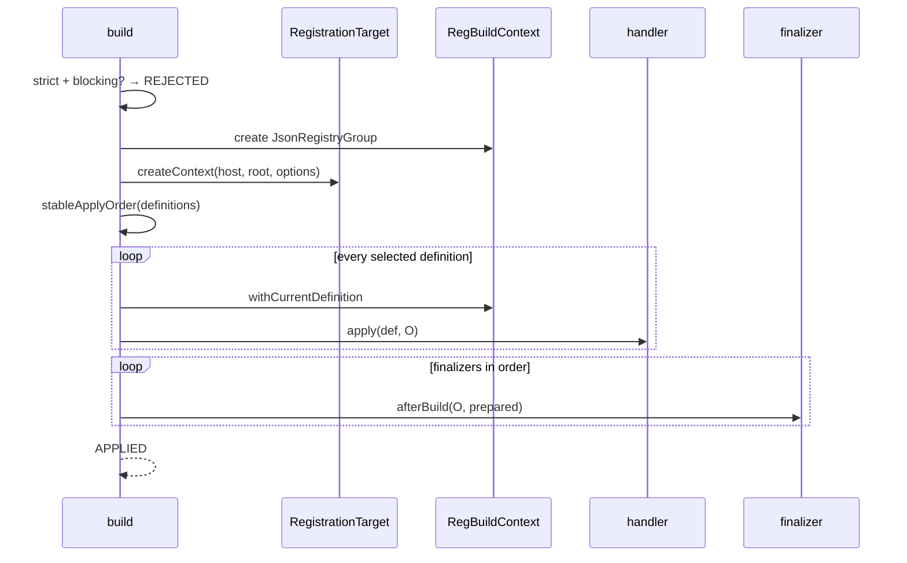

# 多来源构建管线

`DataDrivenBuildPipeline` 把多个 `ContentSource` 的发现、解析、策略选择、预检和 apply 组织成一个不可变的 prepare/build 两阶段流程。每个 `ContentSource` 应来自一份已经冻结的 `ResourceSnapshot`，使 prepare、首次 MC discovery 和后续消费不会读取不同时刻的安装内容。

```java
PreparedContent prepared =
        pipeline.prepare(sources, BuildOptions.STRICT, dependencies);

BuildResult result = pipeline.build(prepared);
```

源码：[DataDrivenBuildPipeline.java](../../../modules/data-driven/src/main/java/lib/kasuga/registration/data_driven/pipeline/DataDrivenBuildPipeline.java)。

## 构造

核心构造器：

```java
new DataDrivenBuildPipeline(
        String hostModId,
        Collection<? extends TypeHandler<?>> handlers,
        Collection<? extends BuildFinalizer> finalizers
)
```

扩展构造器可以替换 `RegistrationTarget`、声明 reserved symbols 和 reserved registry keys：

```java
new DataDrivenBuildPipeline(
        hostModId,
        handlers,
        finalizers,
        RegistrationTarget.standard(),
        reservedSymbols,
        reservedRegistryClaims
);
```

参数会在构造时复制。handler 列表顺序参与同一 phase 内的稳定排序。handler type name 必须非空；STRICT prepare 会拒绝重复的 type name。

`RegistrationTarget.standard()` 创建：

```java
new RegBuildContext(hostModId, rootGroup, options.isStrict())
```

自定义 target 可以让宿主注入自己的 `RegBuildContext` 子类。接口约定返回的 context 绑定同一个 host 和 root；当前 build 不会反射读取 context 内部字段来验证这一点。

## Prepare 输入

`prepare(sources, options, dependencies)` 的输入：

```java
Collection<? extends ContentSource> sources
BuildOptions options
Map<String, ? extends Collection<String>> dependencies
```

优先级按 source descriptor 决定：

- 由 `ResourceSourceDescriptor` 创建的来源使用显式、非负的 `rank`；pipeline 先按 rank 排序，rank 相同时才按调用输入位置排序，并报告重复 rank；
- 仅旧四字段 `SourceDescriptor` 的 `resource()==null` 时，才按调用集合的遍历位置分配从 0 开始的顺序；
- `(sourceId, rootId)` 才是平台来源根唯一键。同一个 sourceId 可以拥有 main、parcel 和 shared roots。

`ValidationContext.sourceOrder()` 和 `LocatedDefinition.sourceOrder()` 最终保存本次 session 使用的 order。平台 rank 是这份 order 的事实来源，调用列表顺序不是。

`dependencies` 的 key 是 owner，value 是 owner 可直接引用的其他 owner：

```java
Map.of(
        "example_addon", Set.of("example_core"),
        "example_theme", Set.of("example_core", "example_addon")
)
```

每个来源的 owner 会自动得到空依赖集合。声明了不存在 owner 的依赖时，STRICT 记 `UNKNOWN_DEPENDENCY` 错误，LEGACY 记 warning。

## Prepare 的确定性顺序

```text
sources 按显式 rank 排序
  → source 内 manifest 聚合
  → register / reload 路径去重
  → register 路径按 logicalPath 排序
  → content 文件顶层类型按 handlers 列表顺序
  → 每个数组保持书写顺序
```

pass 顺序：

1. `(sourceId, rootId)` 唯一性与全局 rank 唯一性检查；
2. owner 依赖归一化与存在性检查；
3. 逐 source 读取 manifest，定位 register/reload 路径，解析 register 内容；
4. 读取 reload 文件并调用 `ReloadHandler.decode` 做可选预检；
5. STRICT handler capability 检查；
6. 按 identity 与 priority 选择 effective definitions；
7. `validate`；
8. `parentDefinition` 环检查；
9. `claims` 与 registry 冲突检查；
10. 生成不可变 `PreparedContent`。

source 处理被逐来源隔离。某个 source 的 manifest、文件枚举或读取抛出 `RuntimeException` 时，pipeline 记录 `SOURCE_READ_FAILED` 并继续下一个 source，但不会撤销该 source 已经追加的 paths 或 definitions。STRICT 随后会因 blocking diagnostic 拒绝 build；LEGACY 可能应用这部分结果。

每个 source 的实际索引集合来自 `ContentSource.indexes()`。普通 `ContentSource` 发现标准 `data/<ns>/kasuga_lib/data_driven/` 直接子文件；`SnapshotContentSource` 若带 `declaredIndexes`，只暴露宿主点名的 index 路径。这个入口选择就是本目录所说的 Scene indexing。它不裁剪内容文件，所以 manifest 仍可读取同一个固定 root 中的内容。

`PreparedContent` 保存：

| 字段 | 含义 |
| --- | --- |
| `options` | 本次 prepare 使用的 LEGACY/STRICT 策略 |
| `sources` | 来源 descriptor |
| `definitions` | 最终选择的定义 |
| `allDefinitions` | 包括优先级落败者的全部解析结果 |
| `registerFiles` | 已定位的注册内容路径 |
| `reloadFiles` | 已定位、已预检的 reload 路径 |
| `claims` | selected definitions 声明的去重 claim |
| `diagnostics` | prepare 阶段不可变诊断快照 |
| `dependencies` | 归一化 owner 依赖 |
| `reservedSymbols` | 宿主保留符号 |

每个 definition 是 `LocatedDefinition<T>`：

| 字段 | 含义 |
| --- | --- |
| `key` | handler type 与 identity；STRICT build 要求非 null |
| `handler` | 解析并应用该值的 handler |
| `definition` | handler 的 typed parse 结果 |
| `source` | `SourceDescriptor`，包含具体 `sourceId`、`rootId`、rank 和 namespace 集合 |
| `sourceOrder` | 本次 session 使用的有效优先级 order；平台来源来自 rank |
| `logicalPath` | 内容文件 |
| `jsonPointer` | 文件内位置 |
| `declarationOrder` | 全 session 发现序号 |

`registerFiles` 和 `reloadFiles` 是公开只读列表。宿主可据此记录本次实际消费的文件集合。

## Identity 选择

定义按 `(typeName, identity)` 分组。匿名 definition 的 key 为 null。

### NON_REGISTRATION 或 LEGACY

每个 key 只选 priority 最大的一个：

```text
sourceOrder
  → declarationOrder
```

`sourceOrder` 大的胜出；同来源内部后解析的定义胜出。`logicalPath` 排序参与解析顺序，所以同一 source 中路径靠后的文件通常先进入更高 `declarationOrder`。

### STRICT REGISTRY_CLAIMS

STRICT 中带 `REGISTRY_CLAIMS` 的定义保留同一 key 的全部候选。随后 claims 必须证明它们不会占同一个最终 registry key：

- registry key 相同 → `CLAIM_CONFLICT`，整批拒绝；
- definition key 相同但最终 registry key 不同 → 当前实现可继续；
- selected 定义 claim 与宿主 reserved key 相同 → `CLAIM_CONFLICT`。

这解决“两个不同 JSON id 最终映射到同一个 block/item key”的问题。若这些候选没有 registry conflict，严格管线不会仅因 definition key 相同而删除候选。

这也意味着 STRICT 会对同 identity 的全部注册候选执行 `validate`。低优先级候选即使最终 claim 与高优先级候选不同，也可能因自身无效而阻止整批构建；注册类型不使用配置类型的“先选 winner、只校验 winner”语义。

### 匿名定义

- LEGACY：全部选中，identity 不参与去重；
- STRICT：记录 `MISSING_IDENTITY`，build 结果 `REJECTED`。

## LEGACY 与 STRICT

| 行为 | LEGACY | STRICT |
| --- | --- | --- |
| JSON 解码 | Gson 宽容模式 | 严格 UTF-8 + `StrictResourceJson`；重复键、注释、尾逗号等阻止 apply |
| parse 失败 | 记录错误，继续应用其他定义 | 阻止整批 apply |
| 未知顶层字段 | warning | error |
| missing identity | 允许 | error |
| handler capability | 不检查 | 要求预检与唯一 identity role |
| validate | 不调用 | 调用所有 selected |
| parent 环 | warning | error |
| claim 收集 | 调用 | 调用 |
| claim 冲突 | 普通冲突为 warning；reserved host 冲突为 error，但 build 仍继续 | 整批拒绝 |
| 未知 owner 依赖 | warning | error |
| 重复 source id | error，但 build 仍继续 | error，整批拒绝 |

上表的“重复 source id”应理解为重复 `(sourceId, rootId)`；相同 sourceId 下的不同 root 是合法结构。重复 rank 同样记录 error：STRICT 在 apply 前拒绝，LEGACY 仍可能继续。

内建注册 handler 的 identity 存在三条当前路径：

```text
JsonTreeBuilder 旧入口: minecraft:foo -> <hostModId>:foo
Pipeline LEGACY DefinitionKey/apply: minecraft:foo -> <hostModId>:foo
Pipeline strict apply: minecraft:foo -> minecraft:foo
Pipeline STRICT DefinitionKey/apply: minecraft:foo -> minecraft:foo
```

因此 `BuildOptions.LEGACY` 使用宽松 JSON、跳过 STRICT validate，并采用历史身份规则；内建注册 handler 在非 strict context 中捕获单条 apply 异常并继续，但自定义 `apply` 抛异常仍会让 build 返回 `FAILED`。裸 `foo` 在 LEGACY 中映射到 host namespace；STRICT 的 `resolveIdentity` 得到 `<hostModId>:foo`，随后 `validate` 以 `INVALID_IDENTITY` 拒绝。

内建 block/item claim 从定义目录的最终 DefinitionKey 取 ID，因此 `minecraft:foo` 在 STRICT 的 definition key、claim 和 apply 目标一致；LEGACY 则三者共同使用历史映射。

LEGACY 中 `BuildResult` 仍可能带 `ERROR` diagnostics 并返回 `APPLIED`。状态表示 apply 执行成功，不表示所有输入都无错误。严格验收应以 `prepared.hasBlockingDiagnostics()` 和 `result.successful()` 共同判断。

`dependencies` map 中未出现在任何 source descriptor 的 owner 当前不会单独报错；其声明的 dependency 仍会与已知 owner 集合比较。宿主应自行确认 map 只包含预期的 owner，避免拼写错误造成“配置存在但没有定义使用”的静默偏差。

## prepare 与 build 的边界

`prepare` 可以重复调用，产生新的声明序号、selected 列表和诊断。`build` 可以接受同一个 `PreparedContent` 多次调用，但每次都会创建新 root、重复 apply 和重复 finalizer。宿主通常只应 build 一次。

`PreparedContent` 只检查 host id 是否与 pipeline 一致；pipeline handler 列表改变后不应拿旧 prepared 去新 pipeline build。definition 的 handler 引用来自 prepare 时的 pipeline。

`PreparedContent` 不保存打开中的 `ContentSource` stream。标准 handler 在 prepare 时已经解析完 JSON；provider 可以关闭 `SnapshotContentSource`，由它关闭对应 snapshot。自定义 definition 若延迟读取来源，必须把这条生命周期责任写进自己的契约。

没有 definition 的 build 是合法的。没有 index 的来源、显式空 `on_register` 数组或纯资源包都会产生零 selected definitions；没有 blocking diagnostic 时，build 创建空 `JsonRegistryGroup`、执行 finalizer 并返回 `APPLIED`。宿主可据此统一处理“纯资源包 + 零 Java registry”的包，而不必伪造占位定义。

同一 `PreparedContent` 不应跨 pipeline 实例复用。build 只用 pipeline 的 host id 检查归属，definition 仍引用 prepare 时的 handler；若新 pipeline 改了 handler 顺序、finalizer、target 或 reserved keys，旧快照不再表达同一构建策略。

## Build 执行



严格模式 blocking diagnostics 的判定是：

```java
prepared.hasBlockingDiagnostics()
```

它只把 `Severity.ERROR` 视为 blocking。warning 不阻止 build。

apply 排序：

1. `TypeHandler.getPhase()`；
2. pipeline handler 顺序；
3. `sourceOrder`；
4. `logicalPath`；
5. `jsonPointer`；
6. `declarationOrder`；
7. `parentDefinition` 的拓扑约束。

context 创建失败、排序函数抛出、任一 apply 抛出或任一 finalizer 抛出，都会返回 `FAILED` 并停止后续步骤。

`BuildResult` 的提交语义：

| 状态 | `rootGroup()` | 调用方动作 |
| --- | --- | --- |
| `REJECTED` | `null` | 不 apply，不挂注册树 |
| `APPLIED` | 本次构建的 root | 可在确认无宿主级失败后挂载 |
| `FAILED` | 通常是已构建但可能不完整的 root | 默认不挂载，除非能证明部分副作用安全 |

`successful()` 等价于 `status == APPLIED`；`applied()` 表示 `status != REJECTED`，不能单独证明 finalizer 成功。

## 失败与回滚

`build` 不尝试撤销已执行的 `Reg.setParent`、`withProperty`、factory side effect 或 finalizer 写入。

因此：

- `REJECTED` 发生在 apply 前，可认为没有本管线 apply 副作用；
- `FAILED` 可能已经构建半棵注册树；
- finalizer 失败时，所有 definitions 已 apply，之前成功的 finalizer 结果也可能已产生副作用；
- 注册树创建本身通常尚未进入 Minecraft registry event，宿主可在拿到不完整 root 时选择不挂载，但不能自动清除 handler 写入进程级缓存的部分。

handler 的 `apply` 应尽量把可见副作用留在当前 context/root 中，便于宿主在 `FAILED` 时丢弃整个 root。

## Diagnostics

`BuildDiagnostic`：

```java
record BuildDiagnostic(
        Severity severity,
        Stage stage,
        Code code,
        String sourceId,
        String ownerId,
        String logicalPath,
        String jsonPointer,
        String handler,
        String message,
        String suggestion
)
```

阶段：

```text
SOURCE
MANIFEST
PARSE
SELECTION
VALIDATION
CLAIMS
APPLY
FINALIZE
```

`SELECTION` 已预留为诊断阶段，当前 selection 失败通常表现为 `PARSE` 的 identity 错误，或 `VALIDATION` 的 capability 错误。

主要 code：

| 阶段 | Code |
| --- | --- |
| source | `INVALID_SOURCE`、`UNKNOWN_DEPENDENCY`、`SOURCE_FILE_MISSING`、`SOURCE_READ_FAILED` |
| manifest | `MANIFEST_INVALID`、`MANIFEST_EMPTY`、`INVALID_PATH` |
| parse | `CONTENT_INVALID`、`UNKNOWN_TYPE`、`PARSE_FAILED`、`IDENTITY_FAILED`、`MISSING_IDENTITY` |
| validation | `HANDLER_NOT_STRICT_READY`、`INVALID_IDENTITY`、`UNKNOWN_FACTORY`、`UNKNOWN_REGISTRY_GROUP`、`MISSING_REFERENCE`、`REFERENCE_NOT_DECLARED`、`GROUP_CYCLE`、`VALIDATION_FAILED` |
| claims | `CLAIM_FAILED`、`CLAIM_CONFLICT` |
| apply | `APPLY_FAILED` |
| finalize | `FINALIZER_FAILED` |

逻辑路径和 JSON Pointer 通常由 handler 提供的相对 pointer 拼到 definition pointer 上。自定义 handler 应传 `/field` 这样的相对 pointer。

`severity` 只有 `WARNING` 和 `ERROR`。`LEGACY` 不会自动把 error diagnostic 降为 warning；相反，一些结构错误在这两种模式下都始终是 error，只是 LEGACY build 不读取 diagnostic 来停止 apply。`STRICT` 的 `addIssue` 路径会把常规 issue 统一提升为 error。

`BuildDiagnostic` 不会自动进入 `Diagnostics`，`/kasuga_data` 也不会自动显示新管线结果。provider 必须选择日志、命令、SavedData 或宿主自己的报告格式。

诊断中的 `sourceId` 是具体平台 source，`ownerId` 是依赖/授权单位，逻辑路径是 root 内路径。raw `parcelId` 不在 `BuildDiagnostic` 的标准字段中；车包宿主需要从 `(sourceId, rootId)` 的冻结映射恢复 parcel 身份后写入自己的报告。不要把 `ownerId` 猜成 parcel 或 pack ID。

## Reserved registry claims

宿主已有 `Reg` 树中的 deferred registry entry 可以转成 reserved keys：

```java
Set<RegistryClaim.RegistryKey> reserved =
        RegistryClaimSnapshot.collect(hostRegistryRoot);
```

然后把 `reserved` 传给 pipeline 构造器。数据定义 claim 与它冲突时，STRICT 会拒绝整批。

`RegistryClaimSnapshot.collect`：

- 从 root 开始 BFS 遍历 `getChildren()`，跳过 `dispatchWhen` 为 false 的组及其子树；
- 收集 `MinecraftDeferRegistryReg`；
- key 来自 `getRegistryKey()` 和 `resolveId()`；
- 不检查 deferred value 是否已经真正进入 Minecraft registry。

因此 snapshot 是“当前 dispatch 条件下”的注册树意图快照。调用方应确保宿主代码注册已经挂到传入 root，且在构建前已完成所有 ID 映射配置。

## Finalizer

```java
BuildFinalizer finalizer = (context, content) -> {
    // all selected definitions have been applied
    return Map.copyOf(crossDefinitionResult);
};
```

finalizer 适合：

- 在所有属性组、样式和主对象存在后建立派生注册；
- 一次性校验跨类型汇总；
- 生成一个只属于本 session 的管理对象。

finalizer 不适合：

- 修改 `PreparedContent`；
- 重新应用已落败 definition；
- 假定失败时可以自动回滚；
- 在没有幂等保护时被多次 build 调用。

`BuildResult.finalizerResults` 保存成功返回值；某个 finalizer 失败后，该异常值不会加入结果，后续 finalizer 不再执行。

finalizer 是在所有 selected definitions 的 `apply` 完成后、注册根挂入宿主树之前执行的会话边界。适合在此时创建一次性的派生注册或汇总全部有效定义；不适合做每个 definition 都可重复完成的成员注册。零注册定义或零 bogey 等业务场景应允许 finalizer 安全地产生“无派生对象”的结果。

## Process-wide finalizer hooks

`DataDrivenBuildHooks` 可以让扩展在宿主 provider 之外登记 finalizer：

```java
DataDrivenBuildHooks.registerFinalizer(
        "example",
        (context, content) -> content.claims().size()
);

List<BuildFinalizer> finalizers =
        DataDrivenBuildHooks.finalizersFor("example");
```

它按 host id 分桶，使用线程安全列表，没有注销 API。初始化逻辑必须避免每次重载或重复调用时反复登记同一个 finalizer。

pipeline 本身不会自动读取 hooks；provider 或宿主必须把 `finalizersFor(hostModId)` 传给构造器。

## RegistrationTarget

默认目标：

```java
RegistrationTarget.standard()
```

自定义目标示例：

```java
RegistrationTarget target = (host, root, options) ->
        new MyRegBuildContext(host, root, options.isStrict(), hostServices);
```

target 的返回值类型必须是 `RegBuildContext`。如果 target 内部需要抛出资源加载或服务不可用错误，build 会把异常包装成 `APPLY_FAILED`，并返回一个尚未应用 definition 的 `FAILED` 结果。

这个检查只覆盖 context 创建；target 自己是否遵守 host/root 约定由实现负责。

## 宿主 Provider

`DataDrivenRegistrationProvider` 是单个 mod 的接管点：

```java
@FunctionalInterface
public interface DataDrivenRegistrationProvider {
    JsonRegistryGroup build(String hostModId);
}
```

安装：

```java
public final class ExamplePacks {
    private static DataDrivenRegistrationProviders.Attachment attachment;

    public static void install(PipelineServices services) {
        attachment = DataDrivenRegistrationProviders.install(
                ExampleMod.MOD_ID,
                hostModId -> buildRoot(hostModId, services)
        );
    }

    private static JsonRegistryGroup buildRoot(
            String hostModId,
            PipelineServices services
    ) {
        List<ContentSource> sources = services.openFixedSources();
        PreparedContent prepared;
        try {
            prepared = services.pipeline().prepare(
                    sources,
                    BuildOptions.STRICT,
                    services.dependencies()
            );
        } finally {
            services.closeSources(sources);
        }

        BuildResult result = services.pipeline().build(prepared);
        services.report(result.diagnostics());
        if (!result.successful()) {
            return null;
        }
        services.commitRegisteredRoots(result, prepared);
        return result.rootGroup();
    }
}
```

示例假定 `openFixedSources()` 每次都从 `FixedResourceSource.capture()` 创建独立 `SnapshotContentSource`。实际宿主应保存并提供 `close()` attachment，以支持测试隔离或明确卸载。同一 host 的第二次 `install` 会抛 `IllegalStateException`；`Attachment.close()` 只删除与自身实例相同的 provider。

provider 必须在 `JsonTreeIntegration` 的注册 callback 运行前安装。provider 返回 null 时不挂 JSON 根；provider 抛出异常会直接沿注册 callback 传播。

## `JsonTreeIntegration` 兼容分派

每次 mod 注册分派时执行：

```java
DataDrivenRegistrationProvider provider =
        DataDrivenRegistrationProviders.find(modId).orElse(null);

if (provider != null) {
    JsonRegistryGroup root = provider.build(modId);
    if (root != null) modRegistry.addChild(root);
    return;
}

try {
    JsonRegistryGroup root = JsonTreeBuilder.buildForMod(modId);
    if (root != null) modRegistry.addChild(root);
} catch (Exception failure) {
    LOGGER.error("Failed to load JSON registrations for mod '{}'", modId, failure);
}
```

旧入口的 catch 只覆盖 `buildForMod` fallback。provider 分支必须自行处理异常与诊断。

provider 的实现可以在 prepare 后关闭 source，因为标准 pipeline 已经把解析结果保存在 `PreparedContent`。如果自定义 definition 延迟读取 source，则关闭时机必须由 provider 与 handler 协商；build 不感知 source 生命周期。资源发布也要延后到 `successful()`、拒包结果和依赖闭包全部确定之后，避免已拒绝 root 提前进入 Approved 资源栈。

## Legacy `JsonTreeBuilder`

没有 provider 时：

- `JsonTreeBuilder` 从 `ModList` 找 mod file；
- 读取 mod JAR 的 `data/<mod>/kasuga_lib/data_driven/`；
- 按索引文件路径、manifest 数组、content 数组顺序解析；
- 使用 `DuplicateIdResolver` 在 apply 前做 last-wins；
- 使用 `TypeHandlerRegistry` 的全局 handler；
- 使用 `resolveIdentity(modId, definition)` 的旧身份规则，包括 `minecraft:` 到 host namespace 的兼容映射；
- 使用 Gson 兼容解析，不提供新管线的严格 JSON/claims/finalizer 能力；
- apply 过程中把每个异常写入 mod loading-error bucket；
- 返回单来源 `JsonRegistryGroup`。

旧入口适合单 mod JAR、没有跨来源 claim 预检的兼容场景。它不提供：

- 多 owner 依赖声明；
- strict source priority；
- `validate` / `claims` 强制执行；
- reserved registry claim 全量预检；
- provider 自定义来源和 finalizer。

迁移到新管线后仍可保留 `JsonTreeBuilder.parseIndexManifest`、`resolveIndexManifests` 和 `parseContentBody` 作为纯 JVM schema 测试工具。

## 推荐宿主流程

1. 在构造早期安装 provider；
2. 先收集已有 code registrations，生成 reserved claims；
3. 从宿主冻结根捕获 `ResourceSnapshot`，再用 `ContentSourceFactory.snapshot(...)` 建立 main/parcel/shared 视图；
4. 为每个 `(sourceId, rootId)` 分配全局唯一 rank，并按 rank 排列 sources；
5. 声明 owner 的直接依赖；
6. STRICT prepare；
7. 将 diagnostics 写入宿主报告；
8. 有 blocking error 时不 build，也不挂 root；
9. build 成功后只提交 `APPLIED` 的 root；
10. 在最终 approved root 集合确定后，才发布对应 `ApprovedResourcePacks`/MC pack 层；
11. 保存 `BuildResult`、source/root 顺序、manifest 路径和 claims 供重启一致性检查。
