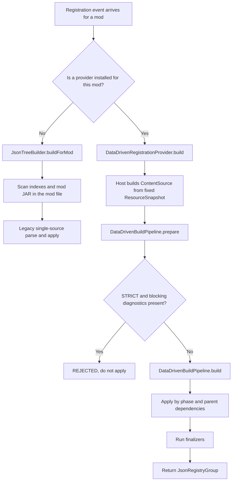

# KasugaLib Data-Driven System

This directory documents the data-driven implementation in the current working tree. Its contents are organized from `modules/data-driven`, the registration framework in `modules/core`, and the FSM reload integration in `modules/modelling` (verified 2026-11-13, and cross-checked against current sources), without relying on reserved capabilities from older design drafts.

The data-driven system solves three problems:

1. Converting blocks, items, block entities, and property groups declared in JSON into the existing `Reg` registration tree;
2. Writing state machine definitions and animation clips that can change during resource reload into separate reload buckets;
3. Allowing a host to organize multiple fixed resource roots into a single startup build with priority ordering, validation, and declared registry claims.

Production wiring in v2 has three layers: `core`'s `ResourceSource`/`ResourceSnapshot` first fixes the actual bytes and source identity; `data-driven`'s `ContentSourceFactory.snapshot(...)` projects the specified root into a registration view; and `DataDrivenBuildPipeline` then performs index discovery, strict JSON decoding, definition selection, claim preflight, and apply. The registration phase and reload phase share the `data/<namespace>/kasuga_lib/data_driven/` syntax, but the registration phase reads host-approved fixed roots whereas the reload phase reads the active Minecraft pack stack. Adding or removing Minecraft registry entries at runtime is outside the scope of this framework.

## Reading Map

| Page | Content |
| --- | --- |
| [Concepts and Lifecycle](01-concepts-lifecycle.md) | Fixed sources, registration domain, reload domain, `prepare`/`build`, and startup ordering |
| [Index and JSON Format](02-index-and-content-format.md) | Standard layout, scene indexing, main/parcel roots, manifests, strict JSON, and full examples |
| [TypeHandler and Preflight](03-handlers-and-preflight.md) | Handler lifecycle, identity, dependency visibility, validation, and registry claims |
| [ReloadHandler and Resource Reload](04-reload-pipeline.md) | Reload orchestrator, pack-stack discovery, FSM handlers, deduplication, and diagnostics |
| [Content Sources and Security](05-content-sources.md) | `ResourceSource`, `ResourceSnapshot`, `FixedResourceSource`, `snapshot(...)`, limits, and close semantics |
| [Multi-Source Build Pipeline](06-build-pipeline.md) | Global rank, `prepare`/`build`, LEGACY/STRICT, diagnostics, finalizers, and providers |
| [Factories, Registry Groups, and Host Integration](07-factories-groups-integration.md) | `FactoryRegistry`, derived claims, `dispatchWhen`, fixed roots, and MC resource projection |
| [Troubleshooting and Migration](08-troubleshooting-migration.md) | Common symptoms, error diagnosis, legacy entry compatibility, and migration checklist |

## Two Registration Entry Points

During registration dispatch, `JsonTreeIntegration` checks `DataDrivenRegistrationProviders` first. When a provider is found, the legacy JAR scan does not run, and the root group returned by the provider is attached directly to that mod's registration tree. When no provider is installed, `JsonTreeBuilder.buildForMod(modId)` is called, preserving the compatibility entry point for existing mods. If the provider returns `null`, it signals that the host has taken over and attaches no root group in this cycle, without falling back to the legacy scan.

New hosts typically use `DataDrivenBuildPipeline`, because it handles multiple sources simultaneously, declares source ownership, preflights cross-source references, checks final registry claims, and rejects an entire unsafe batch before apply. Small compatibility scenarios can still use the legacy entry point directly.

## Four Data Domains

| Domain | Source | Effective Timing | Current Use |
| --- | --- | --- | --- |
| Registration (`REGISTRATION`) | Host-approved fixed `ResourceSnapshot` exposed via `ContentSource` | Mod construction, before registration dispatch | `registry_groups`, `blocks`, `items`, embedded block entities |
| Reload data (`RELOAD_DATA`) | Active resource pack stack | Initial Manager attach and every `/reload` | `state_machines`, `animation_clips` |
| Reload assets (`RELOAD_ASSETS`) | Active resource pack stack | Resource reload | Models, textures, language files, and other ordinary assets |
| Config (`CONFIG`) | Game directory or host config | Decided by host | Startup switches, pack ordering, and other host configuration |

`Diagnostics.Domain` reserves address space for these four source categories. Today the reload orchestrator actively writes to `RELOAD_DATA`, while the legacy registration entry point writes to a separate per-mod compatibility error bucket keyed by mod id. The `REGISTRATION` enum value does not replace that legacy bucket, and ordinary assets and config are handled by their respective hosts. The structured `BuildDiagnostic` results from the new `DataDrivenBuildPipeline` form a separate reporting model and are not automatically written into `Diagnostics`.

## Key Invariants

- A `ContentSource`'s logical file list is fixed when opened and sorted by slash-separated logical path. In v2, `SnapshotContentSource` reads bytes already captured in a `ResourceSnapshot` and does not track subsequent changes in the original directory or archive.
- `ResourceSourceDescriptor`'s `rank` is non-negative; each source/root in a `prepare` call must have a unique rank. Explicit platform ranks determine `sourceOrder` instead of ad-hoc reordering by caller list position.
- Across multiple sources, larger `sourceOrder` values take higher priority; non-registration definitions pick a winner by priority (unless a handler declares `OVERLAY`). In STRICT mode, registration definitions retain all candidates and verify final `(registry, id)` claims.
- Strict registration definitions declare every final Minecraft registry key before apply. Multiple claims targeting the same `(registry, id)` reject the entire batch.
- `parse`, `resolveIdentity`, `validate`, `claims`, and `parentDefinition` must have no registration side effects; only `apply` on selected definitions may mutate the registration context.
- STRICT mode uses strict UTF-8 decoding and `StrictResourceJson` for manifests, registration content, and reload preflight; duplicate keys, comments, trailing commas, non-object roots, and overly deep or large JSON documents block the build. LEGACY continues to use Gson's tolerant parsing.
- The legacy `JsonTreeBuilder` and pipeline LEGACY mode map an explicit `minecraft:foo` to `<hostModId>:foo`, whereas v2 STRICT preserves `minecraft:foo`. The pipeline selects the identity rule via `BuildOptions`, and `DefinitionKey`, claims, and `apply` all use that same mode.
- `TypeHandler` phase takes precedence over handler registration order. Built-in content runs in the order: registry groups, blocks/items, embedded block entities.
- Both `TypeHandlerRegistry` and `ReloadHandlerRegistry` are meant to be populated during startup only; reload handler insertion order determines type traversal and registration order, while deduplication within a single handler still depends on file/entry candidate order.
- Reload buckets clear only resource-sourced entries on initial Manager attach and at the start of each reload cycle. Script- or code-registered entries of the same name take precedence over resource entries.
- Once registration completes, Minecraft registry entries cannot be added or removed via `/reload`. Changing such entries requires restarting and rebuilding both client and server registries.
- `RegistryGroup.dispatchWhen` evaluates its predicate on each dispatch; when the predicate returns `false`, that group and its entire subtree are skipped.
- `BuildResult.Status` is `APPLIED`, `REJECTED`, or `FAILED`; `FAILED` may have already executed partial `apply` calls or finalizers, and there is no automatic rollback.

## Source Map

| Concern | Primary Types |
| --- | --- |
| Compatibility entry point | [`JsonTreeIntegration`](../../../modules/data-driven/src/main/java/lib/kasuga/registration/data_driven/JsonTreeIntegration.java), [`JsonTreeBuilder`](../../../modules/data-driven/src/main/java/lib/kasuga/registration/data_driven/builder/JsonTreeBuilder.java) |
| Host takeover | [`DataDrivenRegistrationProvider`](../../../modules/data-driven/src/main/java/lib/kasuga/registration/data_driven/DataDrivenRegistrationProvider.java), [`DataDrivenRegistrationProviders`](../../../modules/data-driven/src/main/java/lib/kasuga/registration/data_driven/DataDrivenRegistrationProviders.java) |
| Platform fixed sources | [`ResourceSource`](../../../modules/core/src/main/java/lib/kasuga/core/resource/source/ResourceSource.java), [`ResourceSnapshot`](../../../modules/core/src/main/java/lib/kasuga/core/resource/source/ResourceSnapshot.java), [`FixedResourceSource`](../../../modules/core/src/main/java/lib/kasuga/core/resource/source/FixedResourceSource.java), [`ResourceSources`](../../../modules/core/src/main/java/lib/kasuga/core/resource/source/ResourceSources.java) |
| Registration source views | [`ContentSource`](../../../modules/data-driven/src/main/java/lib/kasuga/registration/data_driven/source/ContentSource.java), [`ContentSourceFactory`](../../../modules/data-driven/src/main/java/lib/kasuga/registration/data_driven/source/ContentSourceFactory.java), [`SnapshotContentSource`](../../../modules/data-driven/src/main/java/lib/kasuga/registration/data_driven/source/SnapshotContentSource.java), [`SourceDescriptor`](../../../modules/data-driven/src/main/java/lib/kasuga/registration/data_driven/source/SourceDescriptor.java) |
| Strict input | [`StrictResourceJson`](../../../modules/core/src/main/java/lib/kasuga/core/resource/routing/StrictResourceJson.java), [`InputPolicy`](../../../modules/core/src/main/java/lib/kasuga/core/resource/source/InputPolicy.java) |
| Multi-source build | [`DataDrivenBuildPipeline`](../../../modules/data-driven/src/main/java/lib/kasuga/registration/data_driven/pipeline/DataDrivenBuildPipeline.java), [`PreparedContent`](../../../modules/data-driven/src/main/java/lib/kasuga/registration/data_driven/pipeline/PreparedContent.java), [`BuildResult`](../../../modules/data-driven/src/main/java/lib/kasuga/registration/data_driven/pipeline/BuildResult.java) |
| Extension contracts | [`TypeHandler`](../../../modules/data-driven/src/main/java/lib/kasuga/registration/data_driven/TypeHandler.java), [`ValidationContext`](../../../modules/data-driven/src/main/java/lib/kasuga/registration/data_driven/validation/ValidationContext.java), [`ReloadHandler`](../../../modules/data-driven/src/main/java/lib/kasuga/registration/data_driven/reload/ReloadHandler.java) |
| Conflict preflight | [`DefinitionKey`](../../../modules/data-driven/src/main/java/lib/kasuga/registration/data_driven/pipeline/DefinitionKey.java), [`RegistryClaim`](../../../modules/data-driven/src/main/java/lib/kasuga/registration/data_driven/pipeline/RegistryClaim.java), [`RegistryClaimSnapshot`](../../../modules/data-driven/src/main/java/lib/kasuga/registration/data_driven/pipeline/RegistryClaimSnapshot.java) |
| Built-in content | [`RegistryGroupHandler`](../../../modules/data-driven/src/main/java/lib/kasuga/registration/data_driven/handler/RegistryGroupHandler.java), [`BlockTypeHandler`](../../../modules/data-driven/src/main/java/lib/kasuga/registration/data_driven/handler/BlockTypeHandler.java), [`ItemTypeHandler`](../../../modules/data-driven/src/main/java/lib/kasuga/registration/data_driven/handler/ItemTypeHandler.java), [`BlockEntityTypeHandler`](../../../modules/data-driven/src/main/java/lib/kasuga/registration/data_driven/handler/BlockEntityTypeHandler.java) |
| Reload orchestration | [`ReloadOrchestrator`](../../../modules/data-driven/src/main/java/lib/kasuga/registration/data_driven/reload/ReloadOrchestrator.java), [`ReloadHandlerRegistry`](../../../modules/data-driven/src/main/java/lib/kasuga/registration/data_driven/reload/ReloadHandlerRegistry.java), [`FsmReloadHandler`](../../../modules/modelling/src/main/java/lib/kasuga/rendering/models/mc/dynamic/fsm/FsmReloadHandler.java), [`FsmClipsReloadHandler`](../../../modules/modelling/src/main/java/lib/kasuga/rendering/models/mc/dynamic/fsm/FsmClipsReloadHandler.java) |
| Reload registration | [`FsmReloadHandlerRegistrar`](../../../modules/modelling/src/main/java/lib/kasuga/rendering/models/mc/dynamic/fsm/FsmReloadHandlerRegistrar.java) |
| Registration reuse | [`RegistryGroup`](../../../modules/core/src/main/java/lib/kasuga/registration/RegistryGroup.java), [`FactoryRegistry`](../../../modules/core/src/main/java/lib/kasuga/registration/factory/FactoryRegistry.java), [`Reg`](../../../modules/core/src/main/java/lib/kasuga/registration/Reg.java) |
| Diagnostics | [`BuildDiagnostic`](../../../modules/data-driven/src/main/java/lib/kasuga/registration/data_driven/pipeline/BuildDiagnostic.java), [`Diagnostics`](../../../modules/data-driven/src/main/java/lib/kasuga/registration/data_driven/diagnostics/Diagnostics.java), `/kasuga_data errors` |

## Current Boundaries

The framework turns registration-phase JSON into `Reg` nodes and lets those `Reg` nodes enter Minecraft registries during the final registry events. It does not generate models, language files, textures, or loot tables; those assets still need to be supplied using standard mod, resource pack, or data pack layouts. A platform can project both the registration layer and the MC resource layer from the same `ResourceSnapshot`, while the host remains responsible for creating roots, assigning unique ranks, configuring consumer routing, and controlling publication timing.

`StateProperty`, FSM state machine semantics, animation clip codecs, and concrete factory parameters are defined by each extension type. This directory covers wiring and lifecycle; for field-level details, see [Block-State Properties](../../reference/data-driven/block-state-properties.md), [FSM Reference](../../reference/fsm.md), and the concrete factory sources.

Strict mode proves only what it can inspect. Extension authors and hosts must actively verify whether a custom factory also creates a block item, whether a custom handler omits any claims, and whether all existing host registrations have been included in the reserved snapshot. Built-in block and item `DefinitionKey`s and claims share a single mode-aware final-ID rule, preserving explicit `minecraft:` in STRICT mode; see [Troubleshooting and Migration](08-troubleshooting-migration.md). The framework does not implement concrete pack discovery, world save compatibility, or cross-startup pack history; those policies belong to the host. `ApprovedResourcePacks` and `MappedPackResources` already provide the infrastructure to project MC pack layers from fixed sources/roots, and registration providers must not publish those layers before strict preflight and dependency closure succeed.
