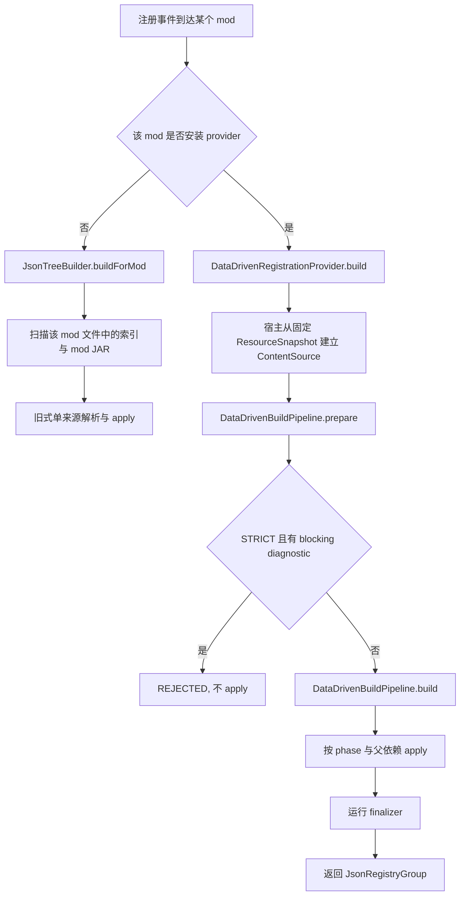

# KasugaLib 数据驱动系统

本目录记录当前工作树中的数据驱动实现。内容依据 `modules/data-driven`、`modules/core` 的注册框架和 `modules/modelling` 的 FSM reload 集成整理，核验日期为 2026-11-13，不依赖旧版设计稿中的预留能力。

数据驱动系统解决三个问题：

1. 把 JSON 中的方块、物品、方块实体和属性组转换成现有 `Reg` 注册树；
2. 把资源重载时可变化的状态机定义与动画片段写入独立的 reload 桶；
3. 允许宿主把多个固定资源根组织成一次有优先级、可校验、可声明 registry claim 的启动构建。

v2 的生产接线分三层：core 的 `ResourceSource`/`ResourceSnapshot` 先固定实际字节与来源身份；data-driven 的 `ContentSourceFactory.snapshot(...)` 把指定根投影成注册视图；`DataDrivenBuildPipeline` 再完成索引发现、strict JSON 解码、定义选择、claims 预检和 apply。注册期和 reload 期共用 `data/<namespace>/kasuga_lib/data_driven/` 语法，但注册期读取宿主批准的固定根，reload 期读取当前 Minecraft 包栈。运行时增删 Minecraft registry entry 不属于本框架能力。

## 阅读入口

| 页面 | 内容 |
| --- | --- |
| [概念与生命周期](01-concepts-lifecycle.md) | 固定来源、注册域、reload 域、`prepare`/`build` 与启动时序 |
| [索引与 JSON 格式](02-index-and-content-format.md) | 标准布局、Scene indexing、main/parcel roots、manifest、严格 JSON 和完整示例 |
| [TypeHandler 与预检](03-handlers-and-preflight.md) | handler 生命周期、identity、依赖可见性、校验与 registry claims |
| [ReloadHandler 与资源重载](04-reload-pipeline.md) | reload 编排器、包栈发现、FSM handler、去重与诊断 |
| [内容来源与安全](05-content-sources.md) | `ResourceSource`、`ResourceSnapshot`、`FixedResourceSource`、`snapshot(...)`、限额与关闭语义 |
| [多来源构建管线](06-build-pipeline.md) | 全局 rank、`prepare`/`build`、LEGACY/STRICT、诊断、finalizer 与 provider |
| [工厂、注册组与宿主接线](07-factories-groups-integration.md) | `FactoryRegistry`、派生 claim、`dispatchWhen`、固定根与 MC 资源投影 |
| [排查与迁移](08-troubleshooting-migration.md) | 常见症状、错误定位、旧入口兼容和迁移检查表 |

## 两条注册入口

`JsonTreeIntegration` 在注册分派时先查 `DataDrivenRegistrationProviders`。查到 provider 后，旧 JAR 扫描不会执行；provider 返回的根组直接挂到该 mod 的注册树。没有 provider 时，调用 `JsonTreeBuilder.buildForMod(modId)`，保留既有 mod 的兼容入口。provider 返回 `null` 表示该 host 已接管但本轮不挂根组，此时不会回退到旧扫描。

新宿主通常使用 `DataDrivenBuildPipeline`，因为它能同时处理多个来源、声明来源所有权、预检跨来源引用、检查最终 registry claim，并在 apply 前拒绝整批不安全内容。小型兼容场景仍可直接使用旧入口。

## 四个数据域

| 域 | 来源 | 生效时机 | 当前用途 |
| --- | --- | --- | --- |
| 注册 | 宿主批准的固定 `ResourceSnapshot`，经 `ContentSource` 暴露 | mod 构造、注册分派前 | `registry_groups`、`blocks`、`items`、内嵌方块实体 |
| reload data | 当前资源包栈 | Manager 首次挂接及每次 `/reload` | `state_machines`、`animation_clips` |
| reload assets | 当前资源包栈 | 资源重载 | 模型、纹理、语言等普通资源 |
| config | 游戏目录或宿主配置 | 宿主决定 | 启动开关、包顺序等宿主配置 |

`Diagnostics.Domain` 为这四类来源预留了地址空间。当前 reload 编排器主动写入 `RELOAD_DATA`；旧注册入口按 mod id 写入独立的兼容错误桶。`REGISTRATION` 枚举值没有替代该旧桶，普通 assets 和 config 也由各自宿主处理。新 `DataDrivenBuildPipeline` 的 `BuildDiagnostic` 是另一套结构化结果，不会自动写入 `Diagnostics`。

## 关键不变量

- 一个 `ContentSource` 的逻辑文件列表在打开时固定，并按 slash 分隔的逻辑路径排序。v2 的 `SnapshotContentSource` 进一步读取 `ResourceSnapshot` 中已经捕获的字节，不随原目录或归档变化。
- `ResourceSourceDescriptor` 的 `rank` 非负；一次 prepare 中每个 source/root 必须有唯一 rank。显式平台 rank 决定 `sourceOrder`，不再按调用列表临时重排。
- 多来源的 `sourceOrder` 数值越大优先级越高；非注册定义按 priority 选 winner。注册定义在 STRICT 中保留全部候选并检查最终 `(registry, id)` claim。
- 严格注册定义会在 apply 前声明每个最终 Minecraft registry key。同一 `(registry, id)` 出现多个 claim 时整批拒绝。
- `parse`、`resolveIdentity`、`validate`、`claims` 和 `parentDefinition` 必须无注册副作用；只有 selected definition 的 `apply` 可以修改注册上下文。
- STRICT 对 manifest、注册内容、reload 预检均使用严格 UTF-8 与 `StrictResourceJson`；重复键、注释、尾逗号、非 object 根和超深 JSON 会阻止构建。LEGACY 继续使用 Gson 的宽容解码。
- 旧 `JsonTreeBuilder` 和 pipeline 的 LEGACY 模式会把显式 `minecraft:foo` 映射为 `<hostModId>:foo`；v2 STRICT 保持 `minecraft:foo`。pipeline 按 `BuildOptions` 选择身份规则，claim、DefinitionKey 和 apply 使用同一模式。
- `TypeHandler` 的阶段优先于 handler 注册顺序。内建内容的顺序为属性组、方块/物品、内嵌方块实体。
- `TypeHandlerRegistry` 与 `ReloadHandlerRegistry` 都只适合在启动期完成注册；reload handler 的插入顺序决定类型遍历和 register 顺序，同 handler 的去重仍取决于文件/条目候选顺序。
- reload 桶在 Manager 首次挂接和每轮重载开始时只清理资源来源。脚本或代码写入的同名条目优先于资源条目。
- 注册完成后不可通过 `/reload` 增删 Minecraft registry entry。改变这类内容需要重启并重建客户端和服务器注册表。
- `RegistryGroup.dispatchWhen` 在每次分派时读取谓词；谓词为 false 时，该组及其子树整体跳过。
- `BuildResult.Status` 为 `APPLIED`、`REJECTED` 或 `FAILED`；`FAILED` 可能已执行部分 apply 或 finalizer，没有自动回滚。

## 源码地图

| 关注点 | 主要类型 |
| --- | --- |
| 兼容入口 | [`JsonTreeIntegration`](../../../modules/data-driven/src/main/java/lib/kasuga/registration/data_driven/JsonTreeIntegration.java)、[`JsonTreeBuilder`](../../../modules/data-driven/src/main/java/lib/kasuga/registration/data_driven/builder/JsonTreeBuilder.java) |
| 宿主接管 | [`DataDrivenRegistrationProvider`](../../../modules/data-driven/src/main/java/lib/kasuga/registration/data_driven/DataDrivenRegistrationProvider.java)、[`DataDrivenRegistrationProviders`](../../../modules/data-driven/src/main/java/lib/kasuga/registration/data_driven/DataDrivenRegistrationProviders.java) |
| 平台固定来源 | [`ResourceSource`](../../../modules/core/src/main/java/lib/kasuga/core/resource/source/ResourceSource.java)、[`ResourceSnapshot`](../../../modules/core/src/main/java/lib/kasuga/core/resource/source/ResourceSnapshot.java)、[`FixedResourceSource`](../../../modules/core/src/main/java/lib/kasuga/core/resource/source/FixedResourceSource.java)、[`ResourceSources`](../../../modules/core/src/main/java/lib/kasuga/core/resource/source/ResourceSources.java) |
| 注册来源视图 | [`ContentSource`](../../../modules/data-driven/src/main/java/lib/kasuga/registration/data_driven/source/ContentSource.java)、[`ContentSourceFactory`](../../../modules/data-driven/src/main/java/lib/kasuga/registration/data_driven/source/ContentSourceFactory.java)、[`SnapshotContentSource`](../../../modules/data-driven/src/main/java/lib/kasuga/registration/data_driven/source/SnapshotContentSource.java)、[`SourceDescriptor`](../../../modules/data-driven/src/main/java/lib/kasuga/registration/data_driven/source/SourceDescriptor.java) |
| 严格输入 | [`StrictResourceJson`](../../../modules/core/src/main/java/lib/kasuga/core/resource/routing/StrictResourceJson.java)、[`InputPolicy`](../../../modules/core/src/main/java/lib/kasuga/core/resource/source/InputPolicy.java) |
| 多来源构建 | [`DataDrivenBuildPipeline`](../../../modules/data-driven/src/main/java/lib/kasuga/registration/data_driven/pipeline/DataDrivenBuildPipeline.java)、[`PreparedContent`](../../../modules/data-driven/src/main/java/lib/kasuga/registration/data_driven/pipeline/PreparedContent.java)、[`BuildResult`](../../../modules/data-driven/src/main/java/lib/kasuga/registration/data_driven/pipeline/BuildResult.java) |
| 扩展契约 | [`TypeHandler`](../../../modules/data-driven/src/main/java/lib/kasuga/registration/data_driven/TypeHandler.java)、[`ValidationContext`](../../../modules/data-driven/src/main/java/lib/kasuga/registration/data_driven/validation/ValidationContext.java)、[`ReloadHandler`](../../../modules/data-driven/src/main/java/lib/kasuga/registration/data_driven/reload/ReloadHandler.java) |
| 冲突预检 | [`DefinitionKey`](../../../modules/data-driven/src/main/java/lib/kasuga/registration/data_driven/pipeline/DefinitionKey.java)、[`RegistryClaim`](../../../modules/data-driven/src/main/java/lib/kasuga/registration/data_driven/pipeline/RegistryClaim.java)、[`RegistryClaimSnapshot`](../../../modules/data-driven/src/main/java/lib/kasuga/registration/data_driven/pipeline/RegistryClaimSnapshot.java) |
| 内建内容 | [`RegistryGroupHandler`](../../../modules/data-driven/src/main/java/lib/kasuga/registration/data_driven/handler/RegistryGroupHandler.java)、[`BlockTypeHandler`](../../../modules/data-driven/src/main/java/lib/kasuga/registration/data_driven/handler/BlockTypeHandler.java)、[`ItemTypeHandler`](../../../modules/data-driven/src/main/java/lib/kasuga/registration/data_driven/handler/ItemTypeHandler.java)、[`BlockEntityTypeHandler`](../../../modules/data-driven/src/main/java/lib/kasuga/registration/data_driven/handler/BlockEntityTypeHandler.java) |
| reload 编排 | [`ReloadOrchestrator`](../../../modules/data-driven/src/main/java/lib/kasuga/registration/data_driven/reload/ReloadOrchestrator.java)、[`ReloadHandlerRegistry`](../../../modules/data-driven/src/main/java/lib/kasuga/registration/data_driven/reload/ReloadHandlerRegistry.java)、[`FsmReloadHandler`](../../../modules/modelling/src/main/java/lib/kasuga/rendering/models/mc/dynamic/fsm/FsmReloadHandler.java)、[`FsmClipsReloadHandler`](../../../modules/modelling/src/main/java/lib/kasuga/rendering/models/mc/dynamic/fsm/FsmClipsReloadHandler.java) |
| reload 注册 | [`FsmReloadHandlerRegistrar`](../../../modules/modelling/src/main/java/lib/kasuga/rendering/models/mc/dynamic/fsm/FsmReloadHandlerRegistrar.java) |
| 注册复用 | [`RegistryGroup`](../../../modules/core/src/main/java/lib/kasuga/registration/RegistryGroup.java)、[`FactoryRegistry`](../../../modules/core/src/main/java/lib/kasuga/registration/factory/FactoryRegistry.java)、[`Reg`](../../../modules/core/src/main/java/lib/kasuga/registration/Reg.java) |
| 诊断 | [`BuildDiagnostic`](../../../modules/data-driven/src/main/java/lib/kasuga/registration/data_driven/pipeline/BuildDiagnostic.java)、[`Diagnostics`](../../../modules/data-driven/src/main/java/lib/kasuga/registration/data_driven/diagnostics/Diagnostics.java)、`/kasuga_data errors` |

## 当前边界

框架负责把注册期 JSON 变成 `Reg`，并在最终注册事件中让 `Reg` 进入 Minecraft 注册表。它不生成模型、语言文件、纹理或 loot table；这些资源仍需以常规 mod/resource/data pack 布局提供。平台可以用同一个 `ResourceSnapshot` 投影注册与 MC 资源层，但宿主负责建立根、分配唯一 rank、配置消费者路由和发布时序。

`StateProperty`、FSM 状态机语义、动画 clip codec 和具体工厂参数由各扩展类型定义。本目录说明接线与生命周期，字段级细节继续参考 [方块状态属性](../../reference/data-driven/block-state-properties.md)、[FSM 参考](../../reference/fsm.md) 和具体工厂源码。

严格模式只证明它能检查到的内容。自定义 factory 是否同时创建方块物品、自定义 handler 是否遗漏 claim、宿主已有注册是否完整加入 reserved snapshot，都需要扩展作者和宿主主动维护。内建 block/item 的 DefinitionKey 与 claims 使用同一条 mode-aware 最终 ID 规则，显式 `minecraft:` 在 STRICT 中保持原 namespace；详见[排查与迁移](08-troubleshooting-migration.md)。框架不负责具体 pack discovery、世界存档兼容和跨启动的 pack history；这些策略由宿主实现。`ApprovedResourcePacks`/`MappedPackResources` 已提供从固定 source/root 投影 MC pack 层的基础设施，但注册 provider 不得在 strict 预检和依赖闭包完成前发布这些层。
