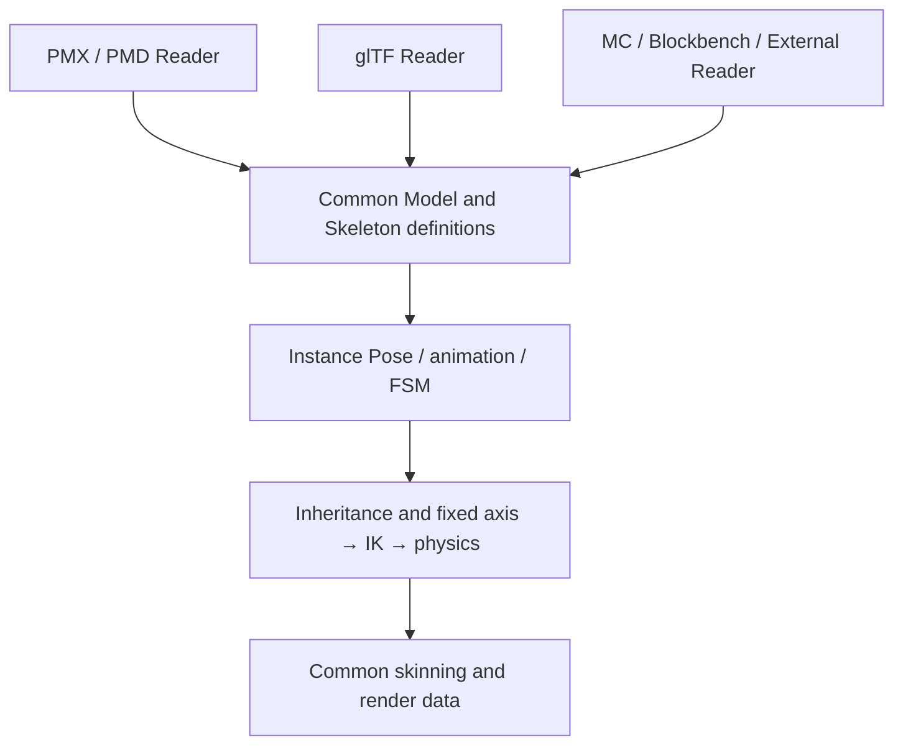

# How Model subsystem format boundaries work

For the interface reference see [Generic model posing and animation](../reference/model-posing.md) and
[Skeleton Dynamics](../reference/skeleton-dynamics.md).

A Model describes only the common geometry, materials, skeleton, morph, and named animation. The format of
a model file decides how that content is read; it does not decide which capabilities are available at runtime.
Original file records may be kept in metadata, and the runtime subsystem evaluates through the converted
common definitions instead of selecting model capabilities by the concrete class of the metadata.

Bone transform inheritance and fixed axes are generic skeleton capabilities. Indexes and flags in the file are
converted at read time into direct bone references and constraint data. Evaluation resolves the referenced local
pose first, so a value from the previous frame is not read just because another branch has not been traversed
yet. Inheritance loops have no well-defined order and are rejected at build time; the positional closure of a
diamond IK is a separate solve constraint. Cross-branch inheritance affects vertices outside the source bone's
subtree, and updates must cover those dependencies.

Animation keeps each source's sampling algorithm and only requires that the output be a common Pose. A named
clip library combines samplers and source data, the player handles time, and PoseSink writes into the model
instance. A static pose is a clip sampled at a constant value and uses the same channel ownership and reset
rules. VPD/VMD do not require the target skeleton to carry PMX metadata; matching bone names and channel
identities are enough for a write. Topological retargeting between different skeletons remains the
integrator's responsibility.

The IK switch is also a common channel in the Pose, so animation and state machines can both use the same write
path. A shared Model holds the capability definitions, while each instance holds playback position, bone
transforms, IK state, and physics simulation state. An ordinary MC model can reuse these capabilities directly
without faking MMD/glTF metadata.

A build check in the render core forbids the common structures, the dynamic runtime, math, and the framework
from depending on a concrete format package, limiting format access to the Reader/Converter/Sampler boundary.

## Outfit assembly and cache boundaries

The assembly capability of a common Model maps clothing bones onto the body skeleton and remaps vertex
bindings, morph, materials, animation, and dynamics, producing a reusable shared model definition. Named body
regions are supplied by the resource integrator; hiding one removes faces and vertices that are no longer used.
For the interface reference see the [Model assembly and outfit cache API](../reference/model-assembly.md).

The cache key covers the source objects and their revisions, part order, bone mapping, final hidden regions, and
integration settings. A rebuild happens only on a cache miss; multiple instances of the same outfit share the
assembly result and each holds its own pose state. Eviction follows most-recently-used order, and the entry count
and vertex count together bound how much is retained, so outfit combinations do not grow without limit.
Modifying a resource in place requires a revision bump or an explicit invalidate; hashing the content of a whole
model does not belong on every query path.

What is cached is bind pose geometry; animation is still evaluated on the instance skeleton. Merged geometry
cuts submissions and repeated skeleton processing, but different materials and alpha states still have to be
rendered separately. Only removing hidden body and inner clothing regions reduces the vertex and pixel cost of
those areas. Only parts that share motion semantics can share a skeleton directly; a garment's own bones, morph,
and secondary motion must be preserved at assembly time and their dependencies remapped. Shared bones must also
have compatible bind matrices, and a matching name is not a substitute for matching coordinates.

Assembly clones the mutable structures, material and frame definitions are isolated per part, and texture
resources continue to be held by the original resource system. The cache itself holds only CPU model
definitions; ownership of GPU buffers and per-instance state stays with the existing backend. Cache eviction
does not destroy a model that is still rendering, whereas a resource reload requires the host to end the old
instance before releasing its borrowed resources.

A resource-level definition holds only the host key, bone mapping, and visible regions, not the Model object of
any one load. The Minecraft adapter waits until all sources are published, then resolves the definition into a
complete assembly request. When a source is replaced or deleted, the publish notification first withdraws the
derived instances and their cache references, and keeps the definitions so that the next generation can resolve
them again. Several definitions may share one cached model, but instances are isolated by resource key, and
replacing one definition does not reclaim another definition's instances.

An outfit swap prepares first and switches after. While a source is missing the previous outfit stays in use; on
success the base pose and logical drivers are migrated before the old instance is reclaimed. A resource reload
has to withdraw the objects that borrowed the old textures first; the handle keeps the state to restore and
mounts again once the next generation is ready. Model geometry revision and the per-character logical clock are
independent, and refreshing the sampling sources of a named animation does not replace a timeline that other
targets follow.

## Anchors and deformable attachments

An Anchor describes a display coordinate frame on a bone and is evaluated after animation, IK, and physics. Its
bind-space transform works like a vertex: the inverse bind is applied first, then the current bone pose, so
rotation and non-uniform scaling stay consistent with skinning. A local attachment offset is converted to author
coordinates at bind time and only follows the bone at runtime; during rendering the camera origin is subtracted
in double precision, so large coordinates are not converted to float early and small offsets are not lost.

Equipment, tools, and weapons that move as a unit are placed through Anchors, and the host renderer decides how
they are displayed. Garment vertices may be controlled by several bones at once, and shared-skeleton assembly
preserves that deformation semantics. An outfit slot can organize both kinds of attachment at once, but a single
rigid-body attachment frame cannot provide per-vertex skinning for a garment and does not replace bind-space
adaptation. For the interfaces and the Minecraft item integration see the
[Anchor API](../reference/anchors.md).
