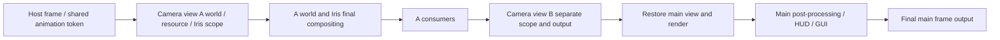

# How offscreen rendering, multi-camera, and shared output work

For examples of creating cameras, multiple windows, headless startup, FBO consumption, and recording see the
[API reference](../guides/offline-rendering.md).

## One client and several world views

Cameras come in three types: Player, Free, and Fixed. Player uses the player's native view and the final main
frame; Free has a world pose that can be controlled directly or driven by animation; Fixed binds a follow target,
samples its position/orientation during rendering, and combines an offset with an independent projection.
The type is independent of the resource lifecycle of pause, failure, and close. A follow target at the core layer
describes only world coordinates and angles, and the host supplies the entity adaptation.
The projection and follow binding of a Fixed camera are stored separately, so zooming does not replace the
target. When the entity is temporarily unavailable the camera is kept and output and chunk subscription for that
view stop; they resume once the host provider supplies the target again.

Target sampling happens before the camera view's private level is installed. A callback that reads the target
also uses the same native source level, so a native entity is not mistaken for one in the wrong dimension. Render
configuration changes are deferred until the current scope and callbacks end, and the camera view session is
replaced on the next frame so that resource ownership stays consistent.

Camera views render sequentially in the same client process and the main OpenGL context. Each camera view has its
own level caches, camera, terrain renderer, projection, and color/depth targets, while the main view keeps the
native path. An auxiliary window only presents the completed texture and does not create a new player connection
or game tick.
The full main frame also includes HUD and GUI, whereas an additional camera view produces only the world image.

A hidden desktop context and a Linux EGL pbuffer both run a full client and still need an OpenGL driver. Headless
is not fixed-timestep video export and does not automatically include an encoder. An auxiliary window has its own read
FBO and bidirectional fence; the main context waits for the read to finish before it overwrites the texture, but
it does not block the whole frame with a CPU glFinish.

## Same-process isolation and render ordering

| Configuration or resource | Isolation mechanism |
| --- | --- |
| Position, orientation, FOV, size | Per-camera-view Camera, projection, and color/depth FBO |
| Chunks and lighting | Per-camera-view ClientLevel, ClientChunkCache, light engine |
| Terrain and entity drawing | Per-camera-view LevelRenderer, RenderBuffers, mutable entity/block-entity dispatchers |
| Render distance | Per-camera-view 2..32 chunks, with independent server subscription and client render distance |
| Iris shader pack | Per-camera-view ShaderPack, PipelineManager, material settings, uniform time, capture, and shadow state |
| Materials and models | Per-pack-stack resource manager, TextureManager, ModelManager, atlas |
| Quality | Per-camera-view Fast/Fancy, leaf type, AO, mipmap |
| Fog and clouds | Per-camera-view fog history; Iris/Sodium cloud format flags are stored per CloudRenderer instance |

Camera views on the same pack stack and mipmap share loaded models and atlases, released by reference count,
while mutable renderers and dispatchers are held individually. Resource packs stack in list order, with later
packs taking precedence. The base resources keep vanilla and mod resources and do not inherit the user or server
packs selected by the main view; packs that are needed are written into `resourcePacks` explicitly. Both
directories and zips are supported. The player skin, cape, and elytra downloaded on connect, plus the shared
light texture, font glyphs, particle atlas, and mod-generated textures with no file resource, are borrowed
resources and are not deleted with the camera view. The camera view's own atlas takes precedence and is not
replaced by the main view's atlas.

The Iris entry points route to their own instances inside the scope, and some static state is isolated by
switching and restoring it. A chunk-build task captures the camera view's resources, materials, and quality when
it is created and restores that context when the worker runs it.
A vanilla rebuild task also holds a resource lease and returns it only after cancellation or after CPU building
ends, so closing a camera view does not release a model or material that an asynchronous task still reads. The
vanilla ViewArea is positioned from the actual camera view coordinates.
This requires sequential rendering in one context and does not support drawing camera views on several
threads at once.

The host tick and `RenderFrameEvent.Pre/Post` still run once per frame, model animation is deduplicated by a
shared frame token, and visibility marks are cleared before each camera view draws. Inside a scope the MC level,
renderer, buffers, targets, camera, and resource getters point at the current camera view, and the world stage
receives the camera view's frustum and matrices. Custom time history can be partitioned by
`WorldRenderPipelineContext.viewId()`.

Leaving the scope restores the main state as well as the GL read/draw FBO, viewport, projection, and draw/fog
state. A close inside a callback is deferred to the end of that delivery. A level switch destroys the old session
and rebuilds it for the current level next time; shutting down Minecraft releases everything. A vanilla builder
pack still in flight is released when it returns, and Sodium releases native buffers, sky VBOs, pipelines, and
FBOs after its terrain workers stop.

## Distant chunks and entities

The server also needs KasugaLib installed with this feature; an integrated server in single player uses the
same protocol.
A server that does not support the channel makes the camera view fail explicitly instead of pretending that a
distant world was loaded.

The server manages subscriptions by camera UUID, epoch, dimension, and center, requests FULL and non-ticking
chunk tickets in batches, and does not block the main thread waiting for generation. Per subscription and per
tick it requests at most 8 tickets and sends 4 snapshots that are already complete and light-ready; a block or
lighting change triggers a resend. The client feeds chunks, heightmaps, lighting, and block entities into their
own ClientLevel. Movement discards out-of-range caches and stale-epoch data and clears the light and Sodium
trackers. Pause, close, logout, a dimension change, and a heartbeat timeout all revoke the server-side tickets.

Entities sync spawn, position, head rotation, full metadata, equipment, attributes, passengers, and any existing
leash to the camera view's level every 5 ticks; the copy interpolates on its own, does not consume the vanilla
`packDirty`, and keeps the main player's entity tracking. This subscription is not a new player connection:
distant areas can be loaded and filmed, but non-ticking tickets do not extend the server-side simulation range
for AI or redstone.

## Output contract and boundaries

`OutputFrame<FrameTexture>` exposes the view ID, the frame number per view, the size, and the color texture.
The color is RGBA8 with opaque alpha, OpenGL bottom-left origin, and no depth attachment. The router owns a color
target per view; all subscriptions of one frame receive the same `OutputFrame` and resource objects, borrow them
for reading only, and may not write, resize, or delete them. The next frame overwrites them, and a resize or the
close of the last subscription deletes the old objects; an unsubscribe inside a callback defers the release to
the end of that delivery. Keeping the picture beyond the callback requires copying it into your own GPU/CPU
storage on the spot, and the DEBUG preview also copies before compositing.
Consumers run on the render thread and should not wait on encoding or network work; they may implement their own
PBO/fence readback and bounded worker queue, but a bare texture ID cannot be handed to an asynchronous thread
that has no current GL context.

The resources in the table above are isolated, but this is not a copy of the whole client:

- An additional camera view outputs world stages and the Iris final compositing, and does not include HUD/GUI,
  the hand, the glowing outline, or the main view's `GameRenderer.postEffect`. The full main frame goes through
  the final output entry.
- Quality supports Fast/Fancy, AO, and mipmap but not all options (Fabulous, particle presets,
  the separate cloud toggle, and so on). The main light texture, fonts, particle engine, and the vanilla core
  shader loader are shared; a pack that changes fonts, particles, or core shaders cannot be assumed to be fully
  isolated, and a distant camera view has no separate server-side particle event stream.
- It does not fully reproduce resource-pack overlays metadata, third-party reload listeners, mod
  entity pairing payload/attachment, or the effects and audio protocols.
- Third-party code that reads static state directly, caches the main level, or advances logic in a world stage
  still needs adaptation; an effect with time history should be managed by view ID.
- Multi-camera with a long render distance adds generation, network, CPU/GPU, and VRAM load. On a public server
  the permissions, subscription count, and resource budget are bounded by higher-level policy.

## Read-only consumers share the completed frame

The output router now captures and holds storage per view. All subscriptions of one frame receive the same
`OutputFrame<FrameTexture>`, and the shared target is released only after the last subscription closes; closing
or replacing a subscription inside a callback does not delete the borrowed texture early. The first registration
selects the target factory, and GPU storage is allocated only on the first valid output. Different views still
own their own output targets.

| N synchronous read-only subscriptions to one view | Before | After |
| --- | --- | --- |
| Output color texture / FBO | N copies | 1 copy |
| Final capture per frame | N times | 1 time |
| Alpha initialization operations per capture | 2N clears | 2 clears |
| Consumer calls | N calls | N calls |

The nominal size of RGBA8 color storage is `4 × width × height` bytes; about
7.91 MiB at 1080p and about 31.64 MiB at 4K. The table above does not count driver metadata, world render
targets, window presentation, or a consumer's own copy/encoding storage. A `MIRROR` main frame still needs the
normal screen blit, and every auxiliary window still needs to present; the shared capture does not remove that
work from those consumers.

This change does not add CPU zero-copy or asynchronous readback. A GPU texture ID is not a CPU address, and
`RgbaReadback.copy` still performs a synchronous GPU readback, a Java array copy, and a Y flip. A read-only GPU
consumer can just borrow the handle; cross-frame or asynchronous consumption needs its own storage and
synchronization mechanism.
