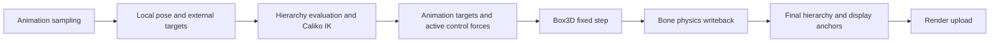

# How Native Physics and the Pose Pipeline Work

For generic rigid bodies, scenes, controllers, the tick loop, and the Minecraft integration see the [API reference](../reference/physics.md).

## Data Flow and Evaluation Ownership

Model animation writes the local pose first, procedural modules and IK produce the current animation targets, native physics advances the dynamic rigid bodies, and finally the physics results are written back to the bones
and the display anchors are computed. An anchor must follow the final pose, not an intermediate result from the animation stage.

When physics owns the pose, animation target evaluation takes on the IK work for this frame. After the physics writeback only the hierarchy is rebuilt; IK must not be solved again, and the original animation must not be
re-applied over the physics results. Targets can be reused by the epoch of bone input changes; while the input stays unchanged during one physics step there is no need to rebuild the whole animation hierarchy for every
fixed substep. The final pose revision is reused by the later upload.

## Fixed Step and Native Capabilities

Box3D handles integration, broad phase, narrow phase, contacts, joints, CCD, and sleeping; the Java layer only does object mapping,
fixed-timestep accumulation, lifecycle, and state synchronization. A single update caps the number of catch-up passes, and accumulated time beyond that is dropped, so a stutter does not trigger
unbounded catch-up. The physics pose used for drawing is interpolated between completed states.

The native library is an optional capability; a distribution that ships no platform library can still run models, animation, and IK, but cannot advance native physics.
This differs from a Java fallback solver: when the library is missing, the code does not quietly switch to a different set of physics behaviors.

## Rigid Bodies and Joints

A rigid body can be a compound collider made of several body-local child shapes. The world owns the native objects, and closing the world releases the whole object set;
modifying a dynamic object requires waking the corresponding native rigid body. Forces are integrated within a timestep, and an impulse changes momentum directly.
A kinematic body is driven by the animation, a dynamic body is written back to the bones in reverse; a rotation-only writeback keeps the animated translation.

The constraints of ball, weld, distance, revolute, and prismatic joints are all enforced by the native engine. An author's six-axis limits may be approximated as
cone/twist after adaptation; a fixed anchor does not mean the author's translation range is fully supported. The softness and limit error the native engine allows also differ from a mathematically rigid constraint.

## World Anchors and the Collision Environment

The double world anchor is kept apart from the local float physics coordinates; environment collision, rays, and drag convert into the same simulation coordinate frame first.
Moving the world or migrating a scene requires relocating the bone targets, the rigid bodies, and the environment together, otherwise it introduces wrong impulses or position jumps.

Minecraft block physics builds compounds from the real VoxelShape, and the environment mesh incrementally maintains the local collision region.
Block updates drive invalidation, with a periodic refresh as a fallback; the player takes part in local interaction through a kinematic proxy.
This client-side local simulation provides no server-authoritative entities, saving, or complete synchronization, and it does not extend the server's level simulation range.

## Active Ragdoll and Boundaries

The active controller turns the same-frame animation/IK targets into bounded PD spring forces and torques, and Box3D still handles contacts and joints.
The controller changes targets and applies forces; it cannot directly override the native integration. Physics must not freeze because of render frustum culling.
A world keeps only one drag constraint; fluid buoyancy and per-vertex PMX soft bodies are still not integrated.
