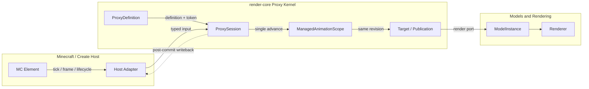
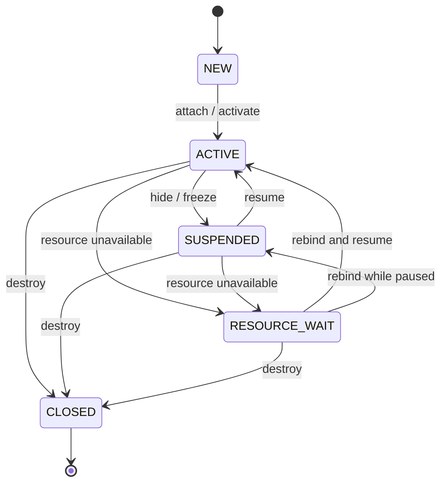

# Proxy: An Adapter Between Minecraft Elements and Animation

Proxy here is not a network proxy. It describes how one live Minecraft element, such as a block
entity or a Create bogey, acquires controllers, animation targets, visual resources, and a
lifecycle. The Proxy Kernel separates host events from animation state so block entities, Create
devices, and external hosts can share the same model and animation abstractions without each host
creating its own clock or scheduling path.



## The Problem It Solves

A Minecraft element usually owns three kinds of state:

1. Host state such as a block entity's selected gear, a Create bogey's wheel angle, or a train
   frame input;
2. Animation state such as an FSM, playback time, an input snapshot, and the current revision;
3. Visual state such as a model instance, bones, rigid parts, visibility, and resource rebuilds.

Advancing these states independently causes repeated ticks, logical writeback during rendering,
different parts observing different result generations, and animation state loss during resource
reload. The Proxy Kernel fixes the boundary:

- A host submits observations and lifecycle events;
- One element instance has one `ProxySession`;
- One session owns exactly one `ManagedAnimationScope`;
- A controller advances exactly once per logical step, and targets read committed output;
- A visual manages resources and render frames without advancing logical time;
- Writeback occurs only after the scope commits.

## System Layers and Data Flow

| Layer | Responsibility | Main types |
| --- | --- | --- |
| Minecraft/host adapter | Converts block, Create, or external-host events into typed calls | `ProxyTickers`, `ProxySessionHost`, host adapters |
| Registration and ownership | Stores shared definitions and permits at most one session per element and token | `ProxyDefinition`, `ProxyRuntime`, `ProxyAttachToken` |
| Instance coordination | Connects input, controller, scope, writeback, and visuals | `ProxyComposition`, `ProxySession` |
| Animation core | Fixed-step time, input snapshots, controllers, and target publications | `ManagedAnimationScope`, `TargetBinding`, `TargetPublication` |
| Visual | Writes published results to models, parts, and render-frame inputs | `ProxyVisualPort`, `AnimationRenderPort`, `ModelInstance` |

There is one normal logical path:

```text
host tick
  → observe and freeze input
  → prepare controller
  → scope.advance(...)
  → publish targets from the same generation
  → visual maintenance
  → read controller output
  → write back to the host
```

A render frame uses a separate path:

```text
host frame
  → session.publishFrame(frame)
  → visualPort.publishFrame(frame)
  → target/model sampling
  → renderer
```

`publishFrame()` does not increase the revision and does not advance the root timeline. It may
change an interpolation phase, root transform, or frame-domain motion, but it must not produce
events, consume triggers, or resample logical animation sources.

## Core Abstractions

### Element and Adapter

An element is the actual host represented by the proxy, such as `FanBlockEntity`, Create's
`ContraptionBogey`, or a ContentTesting block entity. The adapter converts the host API into
stable typed inputs, commands, and frame inputs. The kernel does not read Minecraft-specific
state and does not branch on concrete host classes at runtime.

### Definition, Template, and Runtime

`ProxyDefinition` is an immutable registration entry containing a stable `ProxyKey` and a
`ProxyTemplate` that creates a composition. Definitions are reused across instances and never
store a particular element's gear, session, or model instance.

`ProxyRuntime` is the explicit registry and attach authority. It ensures that an attach token is
consumed only once and that an element has at most one live session. `ProxyAttachToken`
identifies one attachment attempt, so a stale callback cannot mutate a newer session.

`BlockEntityProxyDefinitions` maps a `BlockEntityType` to a definition. This lets the generic
`ProxyTickers` find the right template when the host first ticks.

### Composition

`ProxyComposition<T, I, O, C, F>` declares the indivisible runtime parts of one device:

- `I`: input captured during one logical observation;
- `O`: host output produced after commit;
- `C`: host command;
- `F`: render-frame input;
- typed input, controller, writeback, command, and visual ports;
- the scope's `LogicalStepPolicy` and a set of `TargetBinding`s.

Keeping these parts in one value prevents a session from pairing a machine from device A with
visual resources from device B. A composition is still instance-scoped and must not store state
shared across elements.

### Session

`ProxySession` owns one element instance at runtime. It serializes tick, frame, and lifecycle
calls, creates the sole `ManagedAnimationScope`, registers targets, and gives the scope's
`AnimationRenderPort` to the visual.

A session reports whether a logical step committed. `ProxyTickOutcome.advanced` means at least
one logical substep committed. A later writeback or visual failure can also set `aborted = true`;
the already committed logical step must not be reported as if it never happened.

### Scope, Controller, and Target

`ManagedAnimationScope` owns logical time. A controller prepares input and is evaluated once by
the scope; it never advances a second clock. Targets consume the committed batch and do not read
state machines, playback, or animation sources directly.

All targets in one batch share a revision. Root transforms, poses, and rigid parts therefore
describe the same logical generation instead of sampling at different times.

## What a Port Is

A port is a role-specific interface. It is neither a network port nor necessarily a cross-thread
message queue. A port exposes one capability so a session can depend on a narrow contract rather
than a Minecraft block, FSM, or Flywheel implementation.

| Port | Input | Output or side effect | Invariant |
| --- | --- | --- | --- |
| `ProxyInputPort<T, I>` | Element | One immutable observation | Read once per step and keep frozen |
| `ProxyControllerPort<I, O>` | Frozen input | `RuntimeController` and post-commit output | Preparation does not advance time; evaluate once |
| `ProxyWritebackPort<T, O>` | Committed output | Host state | Runs only after commit and may expose rollback |
| `ProxyCommandPort<T, C>` | Queued command | Controller/machine state | Applied before the next logical step |
| `ProxyVisualPort<T, F>` | Scope render port and frame input | Models, resources, visibility | No logical clock and no second scope |

Ports exist to keep invalid dependencies out. A visual cannot obtain the full scope, and a target
cannot obtain a state machine. Tests can replace real Minecraft or graphics dependencies with
fake ports.

## Tick and Frame

| Path | Time semantics | Advances revision | Typical content |
| --- | --- | --- | --- |
| `tick(gameTime, deltaSeconds)` | Game tick commits one or more fixed logical steps | Yes, once per committed substep | Input, FSM, commands, logical root transforms |
| `publishFrame(frame)` | Presentation sampling for the current render frame | No | Interpolation alpha, frame root, visibility maintenance |

Game ticks and render frames are separate timelines. A Minecraft adapter maps `partialTick` into
`RenderSampleContext.interpolationAlpha`; it must not advance an animation source again.

## Session Lifecycle



The code exposes these resumable states:

- `SUSPENDED`: the element is hidden, frozen, or temporarily not consumed; resources remain and
  the same session resumes later;
- `RESOURCE_WAIT`: a model or visual is not ready; animation and controller state remain, and a
  successful `rebind()` reconstructs the visual;
- `CLOSED`: a terminal, idempotent release of the scope, targets, controller binding, and visual.
  A later element creates a new session.

A normal first host tick attaches and activates the session. `suspend()` is not `close()`; use it
for temporary hide or freeze behavior.

## Registration, Automatic Attachment, and Ownership

The standard block-entity flow has two distinct moments:

1. During content registration, `BlockEntityProxyDefinitions.register(type, id, template)`
   declares the definition;
2. On the first element tick, `ProxyTickers.forBlockEntity(type)` finds the definition by type
   and creates a session with the host's stable attach token.

Definitions are shared; sessions are private to elements. The token rejects consumed or stale
attachments, so an old visual callback cannot control a newer session after reload or rebuild.

External hosts do not always have a `BlockEntityType`. Create's train bogey path, for example,
uses `CreateBogeyProxyAdapter` to register a temporary definition directly with `ProxyRuntime`,
attach explicitly, and forward destroy/hide/show events to `close()`, `suspend()`, and `resume()`.

## Commit, Writeback, and Failure Recovery

A logical step follows a strict order:

```text
commands → input → controller preparation → scope advance
         → same-batch publications → controller output → writeback
```

Triggers are not consumed before the scope commits. A failed controller or command application
rolls back reversible state and leaves commands retryable. Writeback runs after commit. If
writeback or visual maintenance fails, `ProxyTickOutcome` records both the committed step and the
failure.

If visual replacement fails, the session enters `RESOURCE_WAIT`, preserving the old visual where
possible. A later successful `rebind()` reuses the original scope, so animation revision does not
restart merely because resources were rebuilt.

## Current Production Integrations

| Scenario | Integration | Location |
| --- | --- | --- |
| FSM block/fan | Register a type, then let `ProxyTickers` attach on the first tick | `FanProxyComposition`, `FanBlockEntity`, `FanBlock` |
| Placed Create bogey | Block entity implements `ProxySessionHost` and uses the type catalog | `ExampleBogeyProxyComposition` |
| Create train bogey | External-host adapter owns and attaches a session directly | `CreateBogeyProxyAdapter`, `ProxyBogeyVisual` |

These paths share the same invariants: one element, one session, one scope; one logical advance;
render frames change presentation only.

## Current Boundaries

- Multiplexer runtime variant selection remains owned by the external host;
- Some train-bogey machine synchronization still uses the legacy `ElementProxy.push` path;
- Real Flywheel, portal, Iris/Sodium, resource-reload, and dedicated-server acceptance remain;
- Normal block content should use `BlockEntityProxyDefinitions + ProxyTickers`; direct external
  attachment is for hosts without a Minecraft `BlockEntityType` lifecycle.

See the [Proxy integration guide](../../guides/proxy-integration.en.md) for concrete signatures,
host skeletons, and troubleshooting.
