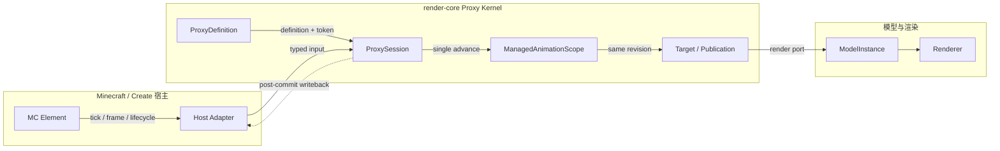
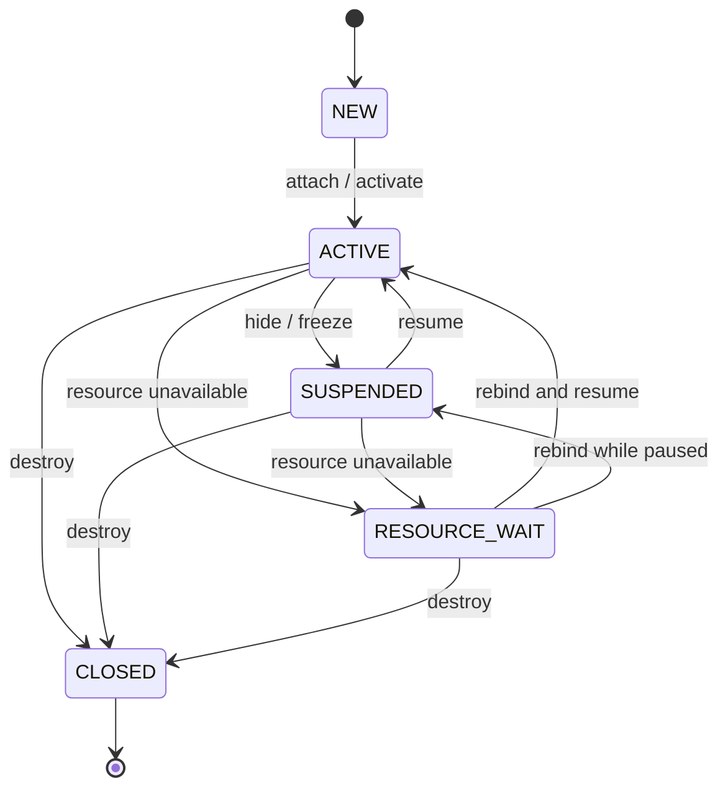

# Proxy：Minecraft 元素与动画系统之间的适配层

这里的 Proxy 不是网络代理。它表示一个 Minecraft 元素实例（例如方块实体或列车的转向架）
在运行时如何获得控制器、动画目标、模型资源和生命周期。Proxy Kernel 把“宿主事件”和
“动画系统内部状态”分开，使同一个模型/动画抽象可以接入方块、Create 设备和外部宿主，
同时避免每个宿主自行创建时钟、目标或调度路径。



## 它解决什么问题

一个 Minecraft 元素通常同时具有三类状态：

1. 宿主状态，例如方块实体保存的档位、Create 转向架的角度，或列车上的帧输入；
2. 动画状态，例如 FSM、播放时间、输入快照和当前 revision；
3. 视觉状态，例如模型实例、骨骼、刚体部件、可见性和资源重建。

如果这些状态由每个宿主分别推进，就会出现重复 tick、render 阶段回写逻辑、同一个模型组
读取到不同代次的结果，以及资源重载时丢失动画状态等问题。Proxy Kernel 将边界固定为：

- 宿主只提交观察值和生命周期事件；
- 一个元素实例只有一个 `ProxySession`；
- 一个 Session 只拥有一个 `ManagedAnimationScope`；
- Controller 在逻辑步中推进一次，Target 读取已经提交的结果；
- Visual 只管理资源和 render frame，不推进逻辑时间；
- writeback 只在 Scope 提交成功之后执行。

## 系统层级与数据流

| 层 | 职责 | 主要类型 |
| --- | --- | --- |
| Minecraft/宿主适配 | 把方块事件、Create 事件或外部生命周期转换成类型化调用 | `ProxyTickers`、`ProxySessionHost`、宿主 Adapter |
| 注册与产权 | 保存共享定义，限制同一实例和 token 最多一个 Session | `ProxyDefinition`、`ProxyRuntime`、`ProxyAttachToken` |
| 实例协调 | 串联输入、控制器、Scope、writeback 和视觉资源 | `ProxyComposition`、`ProxySession` |
| 动画内核 | 固定步时间、输入快照、Controller、Target publication | `ManagedAnimationScope`、`TargetBinding`、`TargetPublication` |
| 视觉 | 把已发布结果写入模型、维护部件和渲染帧输入 | `ProxyVisualPort`、`AnimationRenderPort`、`ModelInstance` |

正常逻辑路径只有一条：

```text
宿主 tick
  → observe 输入并冻结
  → prepare Controller
  → scope.advance(...)
  → 发布同代 Target
  → visual tick / maintenance
  → Controller 输出
  → 宿主 writeback
```

渲染帧走另一条路径：

```text
宿主 frame
  → session.publishFrame(frame)
  → visualPort.publishFrame(frame)
  → Target/ModelInstance 采样
  → renderer
```

`publishFrame()` 不增加 revision，也不推进 RootTimeline。它可以改变插值相位、根变换或
帧域运动，但不能产生事件、消费 trigger 或重采样逻辑动画源。

## 核心抽象

### Element 与 Adapter

Element 是 Proxy 所代表的实际宿主对象，例如 `FanBlockEntity`、Create
`ContraptionBogey` 或一个 ContentTesting 方块实体。Adapter 把宿主自己的 API 转成稳定、
类型化的输入、命令和帧输入。Kernel 不应读取 Minecraft 专有状态，也不应根据具体类名做
运行时分支。

### Definition、Template 与 Runtime

`ProxyDefinition` 是不可变的注册项，包含稳定的 `ProxyKey` 和创建 Composition 的
`ProxyTemplate`。Definition 可以跨实例复用，不保存某个元素的档位、Session 或模型实例。

`ProxyRuntime` 是显式的注册表和 attach 权威。它保证一个 attach token 只能消费一次，
一个 element 同时最多有一个 live Session。`ProxyAttachToken` 用于识别一次具体挂载；
旧回调携带过期 token 时不能操作新一代 Session。

`BlockEntityProxyDefinitions` 进一步把 `BlockEntityType` 映射到 Definition，让通用
`ProxyTickers` 在宿主第一次 tick 时找到正确模板。

### Composition

`ProxyComposition<T, I, O, C, F>` 描述一台设备不可拆分的运行时组成：

- `I`：一次逻辑观察的输入；
- `O`：提交后产生的宿主输出；
- `C`：宿主命令；
- `F`：render frame 输入；
- 对应输入、控制器、writeback、命令和视觉五个 Port；
- Scope 使用的 `LogicalStepPolicy` 和一组成员 `TargetBinding`。

把这些部分放在同一个值对象中，可以防止 Session 把 A 设备的机器和 B 设备的视觉资源错误
组合。Composition 仍然是实例级对象，不能承载跨元素共享状态。

### Session

`ProxySession` 是元素实例的运行时所有者。它串行化 tick、frame 和生命周期调用，创建唯一的
`ManagedAnimationScope`，把 Target 注册进 Scope，并把 Scope 的
`AnimationRenderPort` 交给 Visual。

Session 负责判断一个逻辑步是否成功提交。`ProxyTickOutcome.advanced` 表示至少有一个逻辑
子步提交；即使随后 writeback 或视觉维护失败，这个结果仍可能同时带有
`aborted = true`，因为已经提交的逻辑不能被伪装成从未发生。

### Scope、Controller 与 Target

`ManagedAnimationScope` 拥有逻辑时间。Controller 只能准备输入，并在 Scope 调用时计算一次
控制结果；它不能自己 tick 第二个计时器。Target 只消费同一批提交结果，不直接读取
StateMachine、Playback 或动画源。

同一批 Target 共享 revision。这保证骨骼姿态、刚体部件和根变换来自同一个逻辑代次，而不是
不同部件分别采样到不同时间。

## Port 是什么

Port 在这里是“职责接口”，不是网络端口，也不是必须跨线程发送的消息队列。一个 Port 只暴露
一类能力，让 Session 依赖窄接口，而不依赖 Minecraft 方块、FSM 或 Flywheel 的具体类型。

| Port | 输入 | 输出/副作用 | 约束 |
| --- | --- | --- | --- |
| `ProxyInputPort<T, I>` | 元素实例 | 一份不可变观察输入 | 每一步只观察一次，并在本步内冻结 |
| `ProxyControllerPort<I, O>` | 冻结输入 | `RuntimeController` 与提交后输出 | `prepare()` 不改逻辑时间；控制器每步只评估一次 |
| `ProxyWritebackPort<T, O>` | 提交后的输出 | 宿主状态 | 只在 Scope 成功后写入，可提供回滚 checkpoint |
| `ProxyCommandPort<T, C>` | 排队命令 | Controller/机器状态 | 在下一个逻辑步开始前应用 |
| `ProxyVisualPort<T, F>` | Scope render port 与帧输入 | 模型、资源、可见性 | 不推进逻辑时间，不创建第二个 Scope |

Port 的价值不是“类型更多”，而是把错误依赖挡在边界外。例如 Visual 不能拿到完整 Scope，
Target 不能拿到 StateMachine；这样测试可以用 fake Port 替换真实 Minecraft 或图形后端。

## Tick 与 Frame

| 路径 | 时间语义 | 是否推进 revision | 典型内容 |
| --- | --- | --- | --- |
| `tick(gameTime, deltaSeconds)` | 游戏 Tick 提交一次或多次固定逻辑步 | 是，每个成功逻辑子步一次 | 输入、FSM、命令、逻辑根变换 |
| `publishFrame(frame)` | 当前 render frame 的表现采样 | 否 | 插值 alpha、帧域根变换、可见性维护 |

游戏 Tick 与 render frame 不是同一条时间线。`partialTick` 只能在 Minecraft adapter 中映射
成 `RenderSampleContext.interpolationAlpha`，不能重新推进动画源。

## Session 生命周期



代码中的可恢复状态分为：

- `SUSPENDED`：元素隐藏、冻结或宿主暂时不消费视觉；资源保留，恢复后继续原 Session；
- `RESOURCE_WAIT`：模型或视觉资源尚不可用；Session 保留动画和 Controller 状态，资源就绪
  后通过 `rebind()` 重新建立视觉；
- `CLOSED`：终态。`close()` 幂等，释放 Scope、Target、Controller 绑定和视觉资源；实例再次
出现时创建新 Session。

宿主第一次 tick 通常会自动完成 attach 和 activate。显式 `activate()` 不是正常 tick 路径的
必需步骤。`suspend()` 不等于 `close()`；元素短暂隐藏时使用前者。

## 注册、自动挂载与产权

方块实体的标准流程分两个时机：

1. 内容注册时，用 `BlockEntityProxyDefinitions.register(type, id, template)` 声明 Definition；
2. 元素第一次 tick 时，`ProxyTickers.forBlockEntity(type)` 从类型目录取出 Definition，
   用宿主的稳定 attach token 建立 Session。

Definition 是共享的，Session 是实例私有的。旧宿主回调必须携带自己的 token，Kernel 通过
token 拒绝已消费或过期的 attach 请求。这样资源重载或元素重建不会让旧视觉回调控制新 Session。

外部宿主不一定有 `BlockEntityType`。例如 Create 列车转向架由
`CreateBogeyProxyAdapter` 直接向 `ProxyRuntime` 注册临时 Definition，再显式 attach，并由
宿主自己的 destroy/hide/show 事件转发 `close()`、`suspend()` 和 `resume()`。

## 提交、写回与失败恢复

逻辑步的顺序是严格的：

```text
命令 → 输入 → Controller prepare → Scope advance
     → 同批 publication → Controller output → writeback
```

输入在 Scope 提交完成前不会消费 trigger。Controller 或命令应用失败时，已经开始的逻辑步会
回滚可回滚状态，命令保留到下一次重试。writeback 位于提交之后；如果 writeback 或视觉维护
失败，返回的 `ProxyTickOutcome` 会明确标记已经提交和当前失败，而不是把已经发生的逻辑推进
吞掉。

视觉资源替换失败时，Session 进入 `RESOURCE_WAIT`，旧视觉尽力保留；后续 `rebind()` 成功
后沿用原来的 Scope，因此动画 revision 不会被重建清零。

## 当前生产接入

| 场景 | 接入方式 | 位置 |
| --- | --- | --- |
| FSM 方块/扇子 | 注册时绑定类型，`ProxyTickers` 首次 tick 自动 attach | `FanProxyComposition`、`FanBlockEntity`、`FanBlock` |
| Create 放置转向架 | 方块实体实现 `ProxySessionHost`，用类型目录挂载 | `ExampleBogeyProxyComposition` |
| Create 列车转向架 | 外部宿主 Adapter 直接管理外部 Session | `CreateBogeyProxyAdapter`、`ProxyBogeyVisual` |

这些路径共享同一个核心不变量：一个元素、一个 Session、一个 Scope；逻辑 tick 只推进一次；
render frame 只改变表现。

## 当前边界

- Multiplexer 的运行时变体选择仍由外部宿主完成，不属于当前 Session Kernel；
- Create 列车转向架的部分机器同步仍通过旧 `ElementProxy.push` 写回；
- 真实 Flywheel、portal、Iris/Sodium、资源重载和专用服务端仍需要运行时验收；
- 普通方块内容应优先使用 `BlockEntityProxyDefinitions + ProxyTickers`，只有宿主没有
  Minecraft `BlockEntityType` 生命周期时才使用外部 attach。

实际接入步骤、代码骨架和故障排查见
[Proxy 接入指南](../../guides/proxy-integration.md)。
