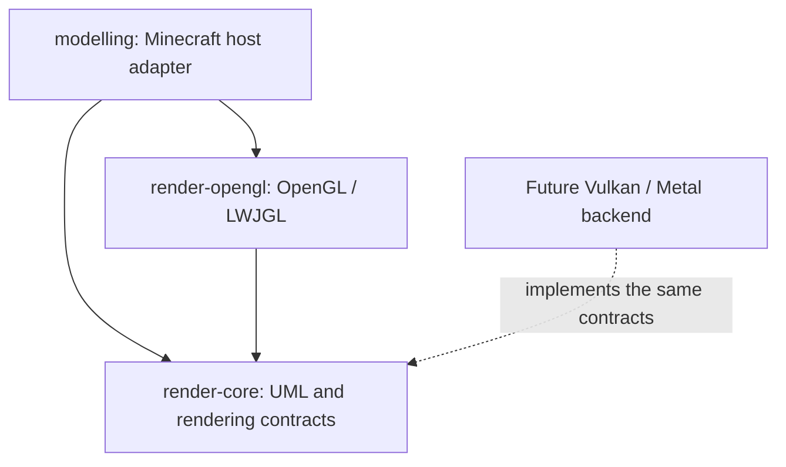
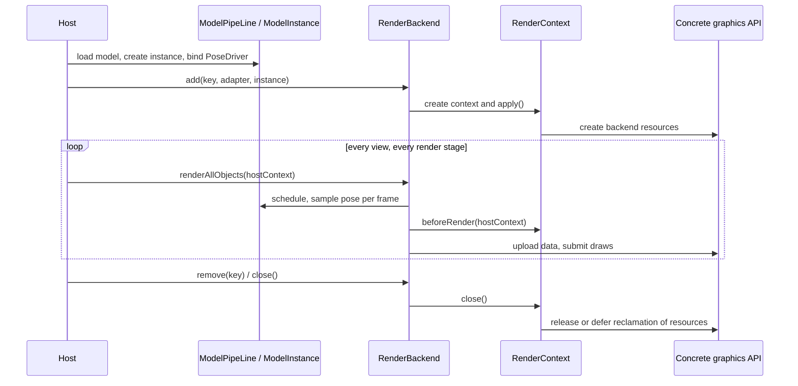

# How the boundary between rendering modules and the graphics API works

## Module dependencies

`render-core` is an ordinary Java library: it does not apply the ModDev plugin and does not depend on Minecraft,
NeoForge, LWJGL, or a concrete graphics API. `checkGraphicsApiIsolation` runs before
`compileJava` and inspects source imports plus compile and runtime dependencies, so those dependencies cannot
re-enter the core. DataFixerUpper is used for the existing data codecs; it is not Blaze3D or the Minecraft
renderer. Dependencies on formula and utils have transitive resolution disabled, so only the existing Java
expressions and data structures are reused.

`render-opengl` does not apply ModDev either. It depends on the core and on LWJGL, and manages GL buffers,
textures, shaders, VAO, fences, FBOs, readback, and the preview window. The host that runs it must supply the
current GL context, the correct thread, and the LWJGL natives for the platform.

`modelling` keeps the Minecraft world render events, RenderType, VertexFormat, texture atlas, lighting,
Iris/Sodium compatibility, and multi-camera world rendering. These classes are host adapters for the current
Minecraft + OpenGL combination and cannot serve as a generic interface for another graphics API.

## UML and resource lifecycle

The core contains model loading, model structure, skeleton, morph, animation, FSM, pose sampling, and scheduling,
plus the `RenderBackend`, `RenderContext`, `ModelGeometryAdapter`, `RenderableFactory`,
`RenderBuffer`, and `TypedBuffer` contracts and the output routing. Its resource type, host frame context, and
transform metadata are all generic and do not require GL objects or Minecraft classes.

`Backend` / `BackendContext` provide the default mount and release behavior, and a concrete backend implements
context creation, data packing, and drawing. A failed mount does not publish a half-finished context; removing an
instance releases only that mount's backend resources, while the model instance itself is managed by the model
pipeline.

The core still contains the existing Java/JNI physics adaptation for Box3D. Physics is not part of a graphics
API; when used standalone, a host that enables Box3D has to provide the native library for its platform as well.

## Upload and output

`UploadRing` handles only slot rotation, dirty-element merging, version tracking, and resource lifecycle, and
performs allocation, writes, and completion status queries through
`UploadDevice`. `GpuUploadRing` in the production path is now its OpenGL adapter and keeps
the original constructors, statistics types, and FloatBuffer entry points.
The macOS TBO orphan policy is still provided by `MacTboUploadDevice` in the OpenGL module.

The integer buffer token and long completion token of `UploadDevice` are opaque handles internal to a backend,
not native resource numbers shared across APIs. A new backend can map them onto its own resource table.
A device must guarantee that reads already submitted stay valid after the storage is replaced, and a completion
query must not block. A device that cannot meet this contract should use its own upload implementation and reuse
the higher-level `UploadBuffer` / `RenderBuffer`.

`FrameOutputRouter<T>`, `FrameOutputTarget<T>`, `OutputFrame<T>`, and camera state belong to the core.
`T` is defined by the backend. `FrameTexture` is the OpenGL framebuffer/texture carrier and belongs to the
OpenGL module; other APIs should provide their own output carrier and target.

## Adaptation boundary

A new backend implements its own resource representation, shaders, synchronization, and submission; windows,
host events, and interop stay in the host adaptation layer.
For the extension steps see the [API reference](../reference/rendering-backends.md).

The existing public class names are kept for call-site and serialized-name compatibility. Some GL classes
therefore still use the historical `uml.backend.gpu` package name, and the pure-math `Direction` keeps its
historical `models.mc.util` package name. Whether something belongs to the core follows the Gradle module
dependencies; the core cannot import the OpenGL module.

This split did not implement a Vulkan/Metal backend, and it does not let Minecraft's Blaze3D switch APIs at
runtime. The Minecraft effect pipeline descriptor still uses its own draw state for now; replacing the whole
renderer of that host would also require the corresponding host adaptation and shader generation path.
