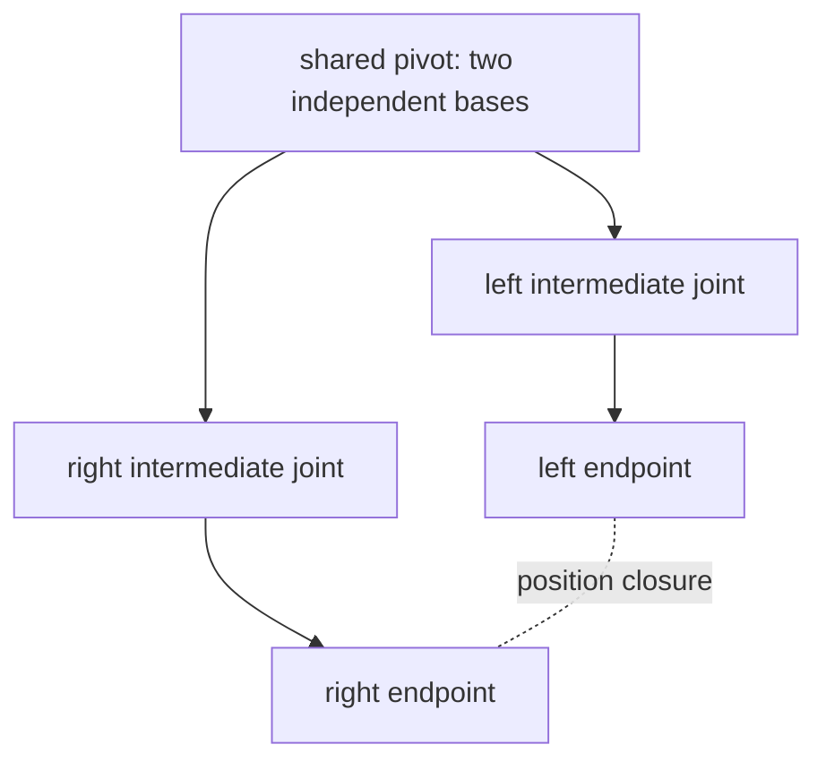

# How generic skeleton physics, IK, and closure constraints work

See [API reference](../reference/skeleton-dynamics.md) for constructors, fields, validation, the Reader/Builder, and runtime interfaces.

## Format reading and shared definitions

Physics rigid bodies, joints, bone inheritance, fixed axes, IK chains, and diamond closure definitions belong to the Skeleton's shared data. A format Reader converts authored data into generic bone
references and solver settings only at model construction time; at runtime there is no need to wrap glTF as PMX data.
Raw format metadata may still be retained for full format access, with ownership kept separate from the generic runtime definitions.

Shared definitions copy collections and vectors, but the bone objects themselves remain shared structural references. Targets, enable toggles, IK corrections, and physics state
belong to individual model instances, and multiple instances do not exchange solver state through shared definitions. The bone-to-chain reverse mapping is built ahead of time,
avoiding a scan of all chains on every bone evaluation. Definition extension should be completed before instance creation.

## Pose and position solving

The bone hierarchy first composites the bind pose, morph, and animation local transforms, then hands the driver bone and endpoint positions to Caliko's FABRIK.
Bone inheritance first resolves the source's current local pose, and the fixed axis then extracts the twist about that axis; these constraints apply to skeletons from any source.
The library handles position solving; the adaptation layer reverse-maps the solved bone-segment directions into local rotations, and re-evaluates the affected bone subtrees.

```text
current world direction → current bone inverse matrix → local direction
solved world direction → current bone inverse matrix → local target direction
minimal rotation between the two local directions → add IK correction → recompute hierarchy
```

The coordinate inverse transform avoids treating a world rotation directly as a bone local rotation. Cones and hinges are handled by Caliko; PMX multi-axis Euler
box limits are projected onto the local correction and re-solved, and complex box limits are not guaranteed to find all feasible solutions. Non-uniform scaling, shear, and
translation animation also change the effective segment lengths, so the result is judged by the endpoint residual after writeback to the real hierarchy.

Inputs are built from the current pose each time, preventing the library from reusing a stale animation solution based only on an unchanged target/base. Chains that already satisfy the target
keep their original pose and do not choose another bend solution. MMD chains may take over the authored local pose, avoiding double rotation from VMD directly driving the chain bones and IK;
single-bone toe direction targets instead ignore the controller's pure translation, preserving the toe orientation semantics.

## Representing the diamond closure

The Skeleton is still a single-parent tree. The closure is represented by two independent branches: the two bases share a pivot at the bind position,
and the two endpoints represent the same closure point. A typical quadrilateral has two segments per branch, with lengths determined by the bound bones;
the topological closure itself does not require four equal sides.



The midpoint of the controller targets is used as the shared target first, handing the two branches to Caliko separately. When limits or unreachability cause non-coincidence,
the midpoint of the two solutions is taken and projection continues for a limited number of iterations. Branches sharing driver bones or mutually nested hierarchies would let one writeback overwrite the other branch,
so these structures are rejected at construction.

The closure residual counts both the endpoint spacing and the base spacing. Stopping iteration does not mean convergence, so diagnostics need to retain residual and
satisfied. This closure only constrains positions; it does not lock endpoint poses and does not apply a mechanical feedback joint to the physics world.

## Physics writeback and stable initial conditions

Animation and IK first provide physics targets; after the dynamic rigid bodies finish integrating, they replace the corresponding local poses. After writeback only the final hierarchy is rebuilt;
IK is not solved again, avoiding correction of physics results. Equal-length child bones for the body capsule are chosen in stable bone order, preventing hash traversal
from changing the pelvis orientation and the landing initial conditions.

Six-axis author joints are still approximated to Box3D spherical cone/twist, and per-vertex soft bodies are still not simulated. For native integration, floating origin, and
affine hierarchy writeback, see [Physics principles](physics.md) and [format adaptation principles](mmd-ragdoll.md).
