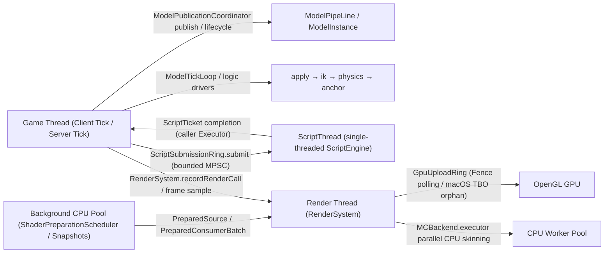

# Threading Model

KasugaLibNext spans Minecraft logical threads, the OpenGL render thread, background CPU preparation pools, native Box3D physics, and single-threaded script engines (such as V8/Javet). Rather than synchronizing across subsystems with coarse global locks, the architecture relies on **thread confinement**, **bounded/lock-free cross-thread handoffs**, and **generational atomic publication**.

---

## 1. Thread Ownership Overview

---

## 2. Game-Thread Confinement and Cross-Thread Handoffs

### 2.1 `ModelPublicationCoordinator` and `ModelPipeLine`

`ModelPublicationCoordinator` (`modules/render-core`) confines model publication and instance lifecycle operations to **the first thread that uses them**:

- `ModelPipeLine` calls `coordinator.checkThread()` on `createInstance`, `getInstance`, `removeInstance`, `addToRenderer`, `stopRendering`, `isRendering`, and `onModelChanged`. Calling from any other thread throws `IllegalStateException("Model publication and instance lifecycle must run on the game thread")`.
- Non-mutating cross-thread reads use `coordinator.pin()`, which returns an immutable `ModelPublicationCoordinator.Snapshot` that can be inspected and closed on any thread (note: pinning retains model references and revisions without freezing mutable `Model` internals).
- `releaseThread()` exists solely for quiescent lifecycle handoffs (`!publishing`) in tests or embedded hosts.

### 2.2 `DeferredGameThreadTask` and `ClientBlockUpdateHooks`

- **`DeferredGameThreadTask` (`modules/create`)**: Flywheel may delete visuals on worker threads, whereas model pipeline publication and teardown belong to the Minecraft game thread. `DeferredGameThreadTask` coalesces repeated cleanup requests under a `synchronized` `pending` flag so frame-rate callers neither enqueue duplicate cleanups nor attach replacement visuals before the previous session closes.
- **`ClientBlockUpdateHooks`**: Dispatched synchronously on the client main thread from `ClientLevel#sendBlockUpdated` over a `CopyOnWriteArrayList`; listeners must stay lightweight.
- **`StateProperty`**: `StateProperty.set(ServerLevel, ...)` asserts `level.getServer().isSameThread()`; `onChange` tracks a `ThreadLocal<Integer> CALLBACK_DEPTH` guard so synchronous listeners cannot re-entrantly mutate world state.

---

## 3. Render Thread, OpenGL Ownership, and Upload Rings

All OpenGL resource allocation/deletion, FBO transitions, `ShaderInstance` compilation/validation, and borrowed frame output routing must execute on Minecraft's render thread (`RenderSystem.assertOnRenderThread()`):

- **Render-thread-confined components**: `MinecraftWorldViews`, `MinecraftFrameOutputs`, `FrameOutputRouter`, `CameraIrisSession`, `ShaderParameterBlock.apply/validate`, and `RenderBackend` (see [UML rendering framework](../reference/uml-render-framework.md)).
- **Off-thread retirement forwarding**: When scopes or registrations close off the render thread (`RenderShaderRegistry.closeShader`, `PostProcessGraphRegistry.releaseWhenUnused`, `WaterEffects`, `WorldLights`, `WeatherFilters`, `SableWeatherBridge`), callers check `RenderSystem.isOnRenderThread()` and defer cleanup via `RenderSystem.recordRenderCall(...)`.
- **`ShaderPreloadScheduler` (frame-budgeted render-thread compilation)**: Pumps queued `DEFERRED` / late shaders during `RenderFrameEvent.Pre` under default limits of `2_000_000L` ns (`2 ms`) per frame, `4` jobs per frame, and `2` jobs per owner per frame (individual shader compilations are non-preemptible; the budget gates starting the next queued job).
- **`GpuUploadRing` / `UploadRing` / `TextureUploadRing` (non-blocking upload ring)**:
  - `UploadRing` (default `capacity = 3` slots) rotates streaming buffers so GPU storage under **in-flight reads** is never overwritten and the CPU never blocks waiting on the GPU.
  - Every draw consumer calls `markSubmitted()`; before replacing the current slot, `sealCurrent()` inserts a `GL32.glFenceSync`. Slot selection polls `glClientWaitSync(fence, 0, 0L)` with zero timeout; if all slots are still busy, the ring immediately **orphans** the buffer via `glBufferData` reallocation.
  - Range writes map `GL_COPY_WRITE_BUFFER` with `GL_MAP_WRITE_BIT | GL_MAP_UNSYNCHRONIZED_BIT`, leaving VAOs and Minecraft's cached `ARRAY_BUFFER` binding untouched.
  - **macOS TBO specialization (`MacTboUploadDevice`)**: `TextureUploadRing` selects `MacTboUploadDevice` (`orphanEveryUpload() == true`) when `os.name` indicates macOS/Darwin, avoiding costly Apple OpenGL texture-buffer re-validation after mapped/subdata updates; VBOs keep the fenced mapping path.
- **Parallel CPU vertex skinning (`MCBackend.executor` + `CpuVertexSkinning`)**: `MCBackend` creates `Executors.newFixedThreadPool(availableProcessors)` and supplies it to `MCBridge.createRenderable` / `KsgVertexBuffer`, allowing `CpuVertexSkinning.updateRange(...)` to transform disjoint vertex ranges in parallel with call-local scratch vectors.

---

## 4. `ModelTickLoop`, Frame Sample Deduplication, and Physics Barriers

`ModelInstance` and `ModelTickLoop` cleanly separate **logical advancement**, **render-frame interpolation sampling**, and **physics stepping** (see [How Native Physics and the Pose Pipeline Work](physics.md)):

1. **Drive vs. sample split**: `ModelInstance.animate(dt)` ticks `PoseDriver` on the logical tick; during rendering, `MCBackend` samples once per render frame via `FrameSampleCache` / `sample(partialTick, frameToken)` (`sample(RenderSampleContext)`).
2. **Canonical slot ordering and non-reentrancy**: `ModelTickLoop` guards against recursive evaluation (`evaluating` flag) and runs stages in fixed order:
   `[user pre-IK] -> kasuga:apply -> kasuga:ik -> [user post-IK] -> kasuga:physics -> [user post-physics] -> kasuga:anchor`.
3. **Shared multi-model physics barrier (`ModelTickLoop.tickSharedPhysics`)**: Models sharing a native Box3D `ModelPhysicsScene` never step the world individually. `tickSharedPhysics(participants, dt, solveWorld)` runs three synchronized stages:
   1. All participants execute through `SLOT_PHYSICS` to submit kinematic targets and active ragdoll controllers;
   2. `solveWorld.run()` steps the shared Box3D world once;
   3. `afterSharedPhysics` and `[post-physics] -> kasuga:anchor` commit poses and update downstream post-physics observers (`ModelParticleRuntime`, `ModelLightRuntime`).
4. **Cull-independent scheduling (`MinecraftModelRuntime`)**: Drives registered `ModelInstance`s and `ModelPhysicsScene`s on `RenderFrameEvent.Pre` (`DummyModelInstance` parent chains first, then shared `ModelPhysicsScene`s, then standalone instances), independent of frustum/distance culling so culled ragdolls do not freeze.

---

## 5. Background Preparation Pools and Generational Publication

| Component | Thread / Executor | Responsibility & Safety Invariant |
| --- | --- | --- |
| `ShaderPreparationScheduler` | `ThreadPoolExecutor` (auto workers `min(max(1, (cpus+1)/2), 4)`, queue capacity `128`, daemon `"Kasuga-Shader-Prepare-<n>"`, `AbortPolicy`) | Pure CPU Java Shader DSL → GLSL translation; **OpenGL calls never run on this pool** |
| `ShaderParameterPersistence` | Single daemon `ScheduledExecutorService` (`"Kasuga-Shader-Parameter-Writer"`) | Debounces writes by `200ms`, then writes atomically under `WRITE_LOCK` via temporary file replacement |
| `VfsWatchService` | Single daemon `ScheduledExecutorService` (`"KasugaLib-VfsWatcher"`, minimum interval `10ms`) | Polls `VirtualFileSystem.pollExternalChanges()` uniformly across Windows, macOS, and Linux |
| `ResourceCoordinator` | Caller-supplied `prepareExecutor` + `publishExecutor` | **Prepare-then-publish**: captures `ResourceSnapshot`s and runs `ResourceEntryPoint.prepare(...)` in dependency order on `prepareExecutor`, then atomically swaps `ResourceGeneration` under `publicationLock` on `publishExecutor` and retires the old generation. Monotonic `generation` (`ensureCurrent`) cancels superseded preparations |
| `KasugaModelManager` | `CompletableFuture.runAsync(..., backgroundExecutor)` + `thenRunAsync(..., gameExecutor)` | Performs `PbrUserConfig.reload`, model scanning, `prepareModel`, and texture/PBR atlas reload off-thread, then publishes atomically on `gameExecutor` |

---

## 6. Script Threads, `ScriptSubmissionRing`, and Non-Blocking Shutdown

Single-threaded script engines such as Javet (`V8Runtime`) are strictly confined to a dedicated `ScriptThread` (`modules/scripting`):

- **One engine per `ScriptThread`**: Each `ScriptPackage` spawns a child `ScriptThreadGroup` and a `ScriptThread` (`"Script-<package>-<entry>"`). `ScriptBlockRegistry.PackageSession` enforces `requireOwner()` (`Thread.currentThread() == thread`) for global API binding, block registration, invocation, and cleanup.
- **`ScriptThread` event loop and backpressure**:
  1. Polls `pendingTasks` (`recordCall`, bounded at `4096` tasks, throwing `RejectedExecutionException` when full);
  2. Drains attached `ScriptSubmissionRing`s (**bounded MPSC rings**, capacity `1024` per `PackageSession`, capped at `64` requests or `2_000_000` ns = 2 ms per iteration);
  3. Invokes `engine.tick()` whenever `ScriptRuntime.tick()` (`ServerTickEvent.Pre` / `ClientTickEvent.Pre`) raises `tickReady`;
  4. Parks on `this.wait()` when idle and wakes on task/ring submission or tick signals.
- **Asynchronous `ScriptTicket` isolation**: Host callers submit frozen arguments (`ScriptContract.freezeArguments`) via `ScriptSubmissionRing.submit` and receive a `ScriptTicket` without ever touching V8 objects or blocking game/render threads. Results are frozen before delivery to `ScriptTicket.onComplete(Executor, ...)`.
- **Non-blocking shutdown and reload**:
  - `ResourceSystem.close()` and `ResourceCoordinator` **never join script threads**;
  - `ScriptRuntime.onReloaded` serializes reloads through `reloadTail` (waiting for the previous `ScriptThreadGroup.shutdown()` before scanning replacement packages) while attaching only a `5s` logging timeout on the returned copy—keeping the real shutdown barrier intact so a hung script neither stalls the game thread nor overlaps with its replacement.

---

## 7. Network RPC Lock Boundaries

`lib.kasuga.core.networking.rpc.RpcSessionManager` guards its `PriorityQueue<Session<T>>` and `HashMap<Long, Session<T>>` under an internal `lock`, and always completes or times out `CompletableFuture`s **outside** the lock (`checkTimeout()`, `accept()`, and `reject()` detach sessions under lock first, then complete futures outside) so future callbacks cannot re-enter the manager and deadlock.

## Related Pages

- [Lifecycle and Initialization Order](../reference/lifecycle.md)
- [Sidedness Model](../reference/sidedness.md)
- [UML rendering framework and resource ownership](uml-render-framework.md)
- [How Native Physics and the Pose Pipeline Work](physics.md)
- [Unified Resource Platform and Script Tickets](../reference/resource-platform.md)
