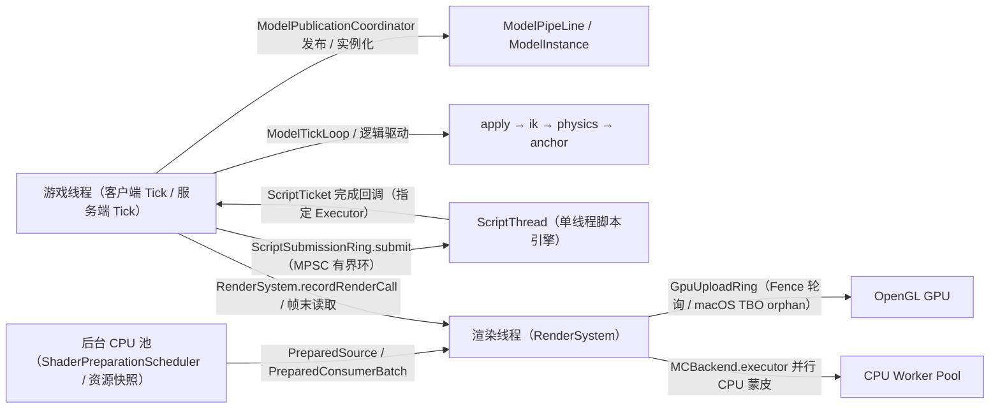

# 线程模型

KasugaLibNext 跨 Minecraft 逻辑线程、渲染线程（OpenGL 上下文）、后台准备线程池、原生 Box3D 物理以及单线程脚本引擎（如 V8/Javet）运行。为避免粗粒度全局锁导致卡顿、竞态或驱动隐式阻塞，整体设计遵循**线程封闭（thread confinement）+ 有界/无锁跨线程移交 + 分代原子发布**三条原则。

---

## 1. 线程域总览

---

## 2. 游戏线程封闭与跨线程移交

### 2.1 `ModelPublicationCoordinator` 与 `ModelPipeLine`

`ModelPublicationCoordinator`（`modules/render-core`）将模型发布事务与实例生命周期**严格封闭到首次访问它的游戏线程**：

- `ModelPipeLine` 的 `createInstance`、`getInstance`、`removeInstance`、`addToRenderer`、`stopRendering`、`isRendering`、`onModelChanged` 都会调用 `coordinator.checkThread()`。若在非拥有线程调用，直接抛出 `IllegalStateException("Model publication and instance lifecycle must run on the game thread")`。
- 非破坏性读隔离通过不可变分代快照 `coordinator.pin()`（返回 `ModelPublicationCoordinator.Snapshot`）实现：`Snapshot` 可以在任意线程读取模型引用与版本号并关闭，但调用方仍不能并发修改可读 `Model` 自身的内容。
- 仅在测试或嵌入式场景的静默边界（`!publishing`）才允许拥有线程调用 `releaseThread()` 移交所有权。

### 2.2 `DeferredGameThreadTask` 与 `ClientBlockUpdateHooks`

- **`modules/create` 的 `DeferredGameThreadTask`**：Flywheel 可能在工作线程销毁视觉实例，而模型管线挂载与关闭归游戏线程所有。`DeferredGameThreadTask` 使用 `synchronized` `pending` 标志将多次高频清理请求合并为一次游戏线程投递，防止帧率级反复调度或在旧会话未关闭前挂入新会话。
- **`ClientBlockUpdateHooks`**：由 `ClientLevel#sendBlockUpdated` 在客户端主线程同步分派，使用 `CopyOnWriteArrayList` 维护监听器，要求监听器逻辑尽量轻量。
- **`StateProperty`**：`StateProperty.set(ServerLevel, ...)` 校验 `level.getServer().isSameThread()`；其 `onChange` 回调通过 `ThreadLocal<Integer> CALLBACK_DEPTH` 禁止在同步状态回调中重入写世界。

---

## 3. 渲染线程、OpenGL 所有权与上传环

所有 OpenGL 对象创建/销毁、FBO 切换、`ShaderInstance` 编译与借用帧分发都必须在 Minecraft 渲染线程执行（`RenderSystem.assertOnRenderThread()`）：

- **渲染线程断言组件**：`MinecraftWorldViews`、`MinecraftFrameOutputs`、`FrameOutputRouter`、`CameraIrisSession`、`ShaderParameterBlock.apply/validate`、以及 `RenderBackend`（详见 [UML 渲染 framework 与后端接口](uml-render-framework.md)）。
- **跨线程释放防线**：当作用域或注册句柄在非渲染线程被关闭时（如 `RenderShaderRegistry.closeShader`、`PostProcessGraphRegistry.releaseWhenUnused`、`WaterEffects`、`WorldLights`、`WeatherFilters`、`SableWeatherBridge`），通过 `RenderSystem.isOnRenderThread()` 分支判断，若在非渲染线程则自动转交 `RenderSystem.recordRenderCall(...)` 延迟到渲染线程回收 GPU 资源。
- **`ShaderPreloadScheduler`（渲染线程帧预算编译）**：在 `RenderFrameEvent.Pre` 中运行，默认帧预算 `2_000_000L` ns（2 ms）、每帧最多 `4` 个任务、每个 `owner` 每帧最多 `2` 个任务（单个 GLSL 编译本身不可抢占，预算控制下一个排入任务的启动时机），避免大量 `DEFERRED` 着色器集中编译造成掉帧。
- **`GpuUploadRing` / `UploadRing` / `TextureUploadRing`（非阻塞上传环）**：
  - `UploadRing`（默认 `capacity = 3` 个槽位）为每帧动态缓冲（如骨骼矩阵、粒子实例、图集或蒙皮顶点）提供只写不锁的轮换池，严格避免**在途读取（in-flight read）**期间覆盖 GPU 仍在使用的显存或触发驱动隐式等待。
  - 每次消费缓冲绘制后必须调用 `markSubmitted()`；下次写入前 `sealCurrent()` 通过 `GL32.glFenceSync` 打上栅栏，选槽时用 `glClientWaitSync(fence, 0, 0L)` 做零超时轮询。若全部槽位均忙，上传环不阻塞等待，而是立即对当前槽位执行 **orphan**（`glBufferData` 重新分配存储）。
  - 写映射使用 `GL30.glMapBufferRange(..., GL_MAP_WRITE_BIT | GL_MAP_UNSYNCHRONIZED_BIT)` 且在 `GL_COPY_WRITE_BUFFER` 上完成，避免污染 VAO 与 Minecraft 缓存的 `ARRAY_BUFFER` 绑定。
  - **macOS TBO 特化（`MacTboUploadDevice`）**：`TextureUploadRing` 检测到 `os.name` 为 macOS / Darwin 时自动选用 `MacTboUploadDevice`（`orphanEveryUpload() == true`），每次 `RGBA32F` TBO 上传都走整块 orphan 路径，规避 Apple OpenGL 驱动在 `map/subdata` 更新 TBO 后的高昂校验开销；VBO 则保留常规栅栏映射路径。
- **CPU 并行顶点蒙皮（`MCBackend.executor` + `CpuVertexSkinning`）**：`MCBackend` 构造时创建固定线程池 `Executors.newFixedThreadPool(availableProcessors)` 并传给 `MCBridge.createRenderable` / `KsgVertexBuffer`，使 `CpuVertexSkinning.updateRange(...)` 可以使用线程局部暂存向量并行处理大网格顶点区间。

---

## 4. `ModelTickLoop`、帧采样去重与物理同步屏障

`ModelInstance` 与 `ModelTickLoop` 严格拆分**逻辑推进**、**渲染插值采样**与**物理求解**（参见 [原生物理与姿态管线原理](physics.md)）：

1. **驱动与采样分离**：`ModelInstance.animate(dt)` 在逻辑 tick 推进 `PoseDriver`；渲染时由 `MCBackend` 经 `FrameSampleCache`（或 `sample(partialTick, frameToken)`）保证同一帧内多 pass / 多机位仅采样一次（`sample(RenderSampleContext)`）。
2. **管线槽位顺序与防重入**：`ModelTickLoop` 维护 `evaluating` 标志禁止递归求值，并按固定槽位顺序执行：
   `[user pre-IK] -> kasuga:apply -> kasuga:ik -> [user post-IK] -> kasuga:physics -> [user post-physics] -> kasuga:anchor`。
3. **跨模型共享物理屏障（`ModelTickLoop.tickSharedPhysics`）**：当多个 `ModelInstance` 共享一个 Box3D `ModelPhysicsScene` 时，不能由各模型各自直接步进原生世界；`tickSharedPhysics(participants, dt, solveWorld)` 分三段同步推进：
   1. 所有参与者先执行到 `SLOT_PHYSICS` 结束，提交本步动力学/主动布娃娃目标；
   2. 调用一次 `solveWorld.run()` 步进原生 Box3D 世界（物理写回期间同步更新刚体）；
   3. 依次回调 `afterSharedPhysics` 与 `[post-physics] -> kasuga:anchor`（包括 `ModelParticleRuntime` 与 `ModelLightRuntime` 在此读取最终骨骼锚点）。
4. **独立于渲染剔除的调度（`MinecraftModelRuntime`）**：在 `RenderFrameEvent.Pre` 统一推进所有注册的 `ModelInstance` / `ModelPhysicsScene`（先求值 `DummyModelInstance` 父子链，再求值共享 `ModelPhysicsScene`，最后求值独立模型），确保被视锥或视距剔除的布娃娃不会停止物理模拟。

---

## 5. 后台准备池与资源代际发布

| 组件 | 线程 / 执行器 | 职责与线程安全不变量 |
| --- | --- | --- |
| `ShaderPreparationScheduler` | `ThreadPoolExecutor`（核心数自动为 `min(max(1, (cpus+1)/2), 4)`，有界队列 `128`，守护线程 `"Kasuga-Shader-Prepare-<n>"`，`AbortPolicy`） | 仅做纯 CPU 的 Java Shader DSL → GLSL 翻译；**绝不执行任何 OpenGL 调用** |
| `ShaderParameterPersistence` | 单线程守护 `ScheduledExecutorService`（`"Kasuga-Shader-Parameter-Writer"`） | 将参数修改防抖 `200ms` 后在 `WRITE_LOCK` 下原子写临时文件并替换 `shader-parameters.json`，避免阻塞渲染/UI 线程 |
| `VfsWatchService` | 单线程守护 `ScheduledExecutorService`（`"KasugaLib-VfsWatcher"`，最小轮询周期 `10ms`） | 跨平台（Windows/macOS/Linux）周期调用 `VirtualFileSystem.pollExternalChanges()` |
| `ResourceCoordinator` | 调用方传入的 `prepareExecutor` + `publishExecutor` | **先准备，再发布**：`prepareExecutor` 上捕捉 `ResourceSnapshot` 并按依赖拓扑异步准备各 `ResourceEntryPoint`；`publishExecutor` 上按 `publicationLock` 原子切换 `ResourceGeneration` 并退役旧代。每次请求分配单调递增 `generation` 序号，过时准备通过 `ensureCurrent(generation)` 自动取消释放 |
| `KasugaModelManager` | `CompletableFuture.runAsync(..., backgroundExecutor)` + `thenRunAsync(..., gameExecutor)` | 在后台执行 `PbrUserConfig.reload`、模型扫描、`prepareModel` 与纹理重载，最后回到游戏线程原子发布模型与组装定义 |

---

## 6. 脚本线程、`ScriptSubmissionRing` 与无阻塞停机

JavaScript（Javet `V8Runtime`）等 `ScriptEngine` 实例非线程安全，由 `ScriptThread`（`modules/scripting`）提供绝对线程封闭：

- **1 引擎 = 1 `ScriptThread`**：每个 `ScriptPackage` 在其父 `ScriptThreadGroup` 下创建子组与 `ScriptThread`（线程名 `"Script-<package>-<entry>"`）。`ScriptBlockRegistry.PackageSession` 在每次绑定全局 API、注册脚本块、执行函数与销毁清理时都会执行 `requireOwner()`（断言 `Thread.currentThread() == thread`）。
- **`ScriptThread` 事件循环与背压**：
  1. 消费 `pendingTasks`（由 `recordCall` 入队，上限 `4096`，满时抛出 `RejectedExecutionException`）；
  2. 排空绑定的每个 `ScriptSubmissionRing`（**多生产者单消费者 MPSC 有界环**，默认容量 `1024`，每次最多处理 `64` 个请求且单次时间预算 `2_000_000` ns = 2 ms）；
  3. 当收到 `ScriptRuntime.tick()`（来自 `ServerTickEvent.Pre` 或 `ClientTickEvent.Pre`）置位的 `tickReady` 信号时，执行一次 `engine.tick()`；
  4. 无工作时在 `synchronized (this)` 上 `wait()` 挂起，有新任务、Ring 提交或 tick 时唤醒。
- **异步 `ScriptTicket` 与跨线程隔离**：游戏或渲染侧通过 `ScriptSubmissionRing.submit` 提交不可变冻结参数（`ScriptContract.freezeArguments`）并立即取回 `ScriptTicket`，**永远不在主线程直接触碰 V8 对象或同步阻塞等待脚本**；返回结果亦经 `freezeResult` 剥离引擎对象后通过 `ScriptTicket.onComplete(Executor, ...)` 投递给消费者指定执行器。
- **不 join 脚本线程的停机/重载语义**：
  - `ResourceSystem.close()` 与 `ResourceCoordinator` **永远不 `join()` 脚本线程**；
  - `ScriptRuntime.onReloaded` 通过 `reloadTail` 串行化多次重载（先等待上一代 `ScriptThreadGroup.shutdown()` 完成再扫描新包），并对外仅挂一个 `5s` 的日志观察超时（不破坏真正的关闭屏障），确保即使某个脚本陷入死循环也不会阻塞游戏线程或让新旧脚本引擎并发重叠。

---

## 7. 网络 RPC 锁边界

`lib.kasuga.core.networking.rpc.RpcSessionManager` 使用内部 `lock` 保护 `PriorityQueue<Session<T>>` 与 `HashMap<Long, Session<T>>`，并在**释放锁之后**才完成或超时拒绝 `CompletableFuture`（`checkTimeout()`、`accept()`、`reject()` 均通过锁内摘除 + 锁外完成实现），防止回调在 `future` 链上重入管理器引发死锁。

## 相关页面

- [生命周期与初始化顺序](../reference/lifecycle.md)
- [侧边模型](../reference/sidedness.md)
- [UML 渲染框架与资源所有权原理](uml-render-framework.md)
- [原生物理与姿态管线原理](physics.md)
- [统一资源平台与 Script Ticket](../reference/resource-platform.md)
