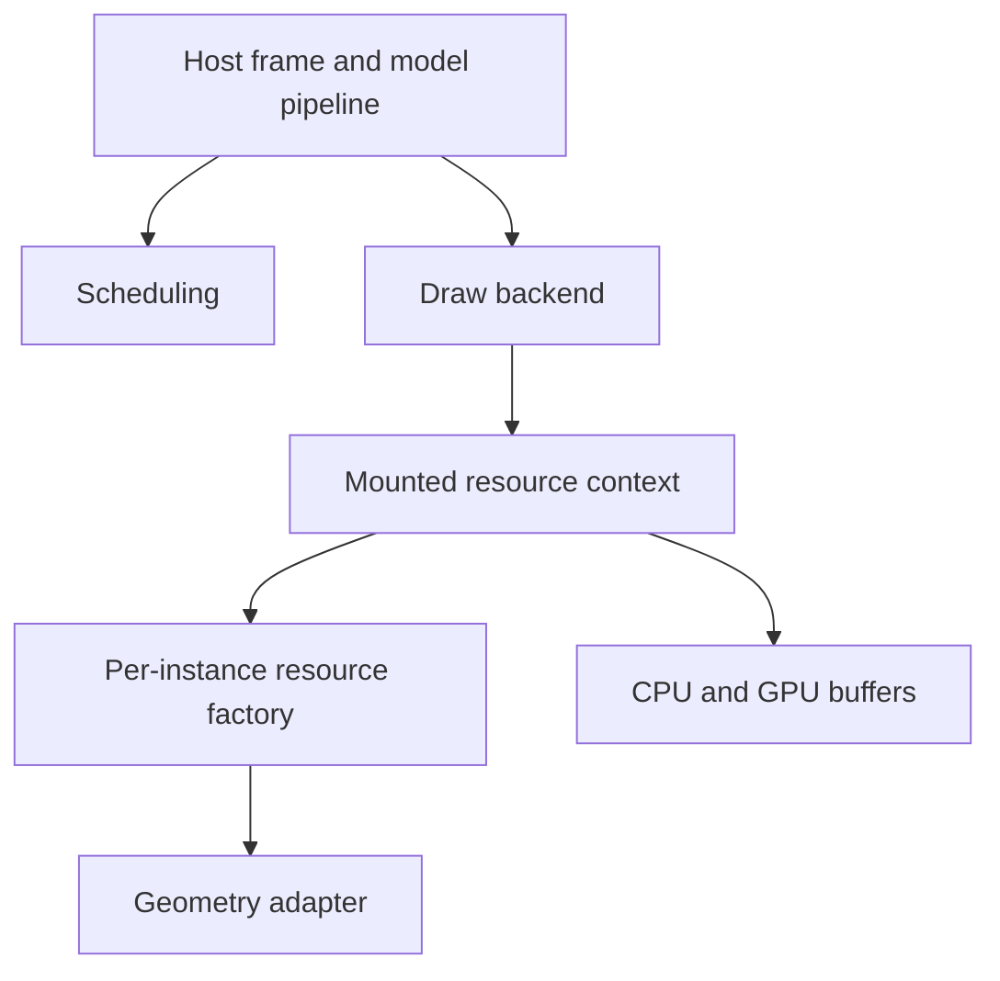

# How the UML render framework and resource ownership work

For the public interfaces, generics, lifecycle contracts, and buffer integration see the
[API reference](../reference/uml-render-framework.md).

## Layer responsibilities

The core defines the model, skeleton, pose, scheduling, resource context, buffer, and output contracts and does
not depend on Minecraft or a concrete graphics API.
The host owns the frame and view entry points, the backend owns resources and drawing, the geometry adapter
converts model representations, and the resource factory creates the resources of one instance.
These responsibilities compose, but geometry conversion must not also manage the shared executor, frame marks,
and the draw pipeline.

Mounted resources, the host frame context, and pre-render metadata are different objects. The backend offers its
services to the factory explicitly, so an adapter does not have to look the backend up by string. The context
caches the resources the factory creates but does not own model instances, shared adapters, or executors.

## Prepare-then-publish

A new mount must be prepared successfully before it is published. If a replacement fails, the unpublished new
context is closed and the old mount is kept; on success the new mount is published before the old resources are
released. Removal first unregisters from the registry and then closes the context; closing the whole backend
tries to release every mount and aggregates the exceptions.
Closing is idempotent, and a closed context cannot allocate resources again. A shared view is read-only, and
changes have to go through the lifecycle entry points.

## Scheduling and sampling are separate

Scheduling decides only strategy visibility, and the backend applies the distance and frustum gates in order.
Different views have their own visibility marks and share the pose sampling cache within a frame. Physics
advancement is independent of draw visibility. For the concrete frame ordering see
[Render Scheduling](render-scheduling.md).

## Buffers and in-flight reads

CPU buffer indices count elements, while capacity and stride are in bytes, and the two must not be mixed up. A
short update covers only the prefix and keeps the tail and the capacity;
a slice borrows the original memory and must not outlive the close.

A GPU upload receives a complete snapshot, and the dirty ranges describe the changed elements. Ring slots track
version and historical modifications separately and fill in the accumulated differences when the slot is used
again. Storage must not be overwritten while a GPU read is in flight; a device may replace the storage and decide
reclamation with a non-blocking completion query.
Every draw and translucent replay records consumption, and a completion mark must not be missed even when the
frame's data did not change.

The device layer owns graphics API operations and state restoration, and the ring owns the buffer/fence
lifecycle. The macOS TBO orphan policy belongs to the OpenGL device implementation and has no place in the
platform-independent model and scheduling layers. For the module boundaries see
[Rendering Backends](rendering-backends.md).
