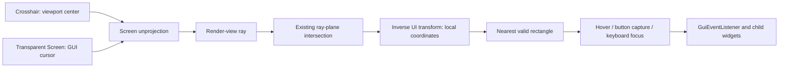

# World UI Input Design

A transparent input Screen lets players move the system cursor freely in front of world-space UI.
Crosshair and free-cursor modes share the same plane-intersection and event-routing stages.
For API contracts, units, integration, and acceptance commands, see the [reference](../reference/world-ui-input.en.md).
[中文](world-ui-input.md).

## Coordinate Spaces and Render Timing

For cursor coordinates `(x,y)` and logical viewport `(W,H)`, normalized device coordinates are
`nx = 2x/W - 1` and `ny = 1 - 2y/H`. Apply the inverse of the actual rendered projection `P` to
`(nx,ny,-1)` and `(nx,ny,0)`, performing the perspective divide. The first point is the ray origin;
the normalized difference is its direction. An interior depth point supports infinite far planes,
and the same construction works for orthographic cameras.

The viewpoint, screen plane, and UI plane in the reference sketch lie along this ray.
The projection already contains FOV, aspect ratio, optical zoom, and render bobbing, so no estimated
eye-to-screen distance or fixed cursor-offset multiplier is needed. A screen point determines a ray;
a target plane or another hit constraint is required to select a unique world point.

Let `M` be the complete local-to-view matrix used to draw a UI. Intersect the ray and plane in view space,
then apply `M^-1` to obtain UI-local pixel coordinates. `M` includes the host model-view, camera translation,
panel placement/rotation/scale. This avoids mixing a world-space ray with a plane
that has already had the camera position subtracted, or subtracting half the panel size twice.

Each frame, the backend copies the projection and each interactive panel's final transform, then finishes
input updates. Between frames, events use the most recently presented geometry. Clicks recompute the
pointer hit before dispatch rather than relying on an earlier hover. Frame completion also updates hover
and capture coordinates when the cursor is stationary but the view or panel has moved.
Offscreen cameras cannot replace the main player's input snapshot.

## Canvas and Depth

The world plane composites one texture. Widgets, glyphs, and shadows first render into an independent
RGBA+depth canvas using the ordinary orthographic GUI projection. This preserves fine separations such
as 0.03 GUI-Z. Compressing the full GUI depth range into 0.1 world blocks can quantize text and shadow
to the same perspective depth, producing stripes, missing fragments, and unstable borders.
One unit of padding beyond the GUI depth endpoints includes the `MAX_GUI_Z + 0.03` shadow layer.
Every composite vertex stays at local Z=0, keeping the panel position and picking plane identical
regardless of internal GUI depth.

The canvas clears to transparent black, so normal GUI blending stores premultiplied RGB. World
composition uses `ONE / ONE_MINUS_SRC_ALPHA` to avoid multiplying alpha twice and darkening edges.
The plane tests scene depth but does not write it. Draw scopes restore framebuffer bindings, viewport,
projection, blending, depth, clipping, and texture state. Removal, world changes, and shutdown release
canvases; resizing replaces attachments. Panel clipping uses canvas height rather than window height.

## Input Ownership

Hover tracks the nearest currently hit panel. Keyboard focus tracks the last clicked panel.
Each mouse button separately captures the panel that accepted its press. These can differ:
when dragging from A over B, B can be hovered while A continues to receive drag and release events.
Drag deltas are differences between successive projected local coordinates, not screen-pixel deltas.

Capture continues outside the rectangle by intersecting the extended panel plane. If intersection is
temporarily unavailable, the last valid local coordinates are retained. Closing, removal, or focus loss
still sends release to the original target. Keyboard presses also retain their target, and a focus change
balances held keys with releases. Duplicate move notifications do not dispatch zero-distance drags.

The input layer does not copy or redraw the panel as a second two-dimensional Screen.
Minecraft's Screen lifecycle releases/regrabs the cursor and clears gameplay keys. The transparent
Screen consumes input and forwards it to the router while world simulation continues.
World rendering, plane intersection, and input capture remain separate, allowing an existing occlusion
or alternative hit solver to consume the same ray source later.

Normal crosshair mode has temporary keyboard ownership when the last clicked panel's nested focus
chain leads to an editable text widget. A client-only `KeyboardHandler` HEAD hook consumes events
before vanilla updates `KeyMapping` or handles chat/debug shortcuts; a later key notification cannot
prevent those effects. Entering/leaving clears gameplay keys without changing mouse ownership or
the current Screen. Escape recursively clears child focus and balances held keys. Physical keys
still held at exit retain suppressed repeat/release events so they cannot become movement. Since
window focus loss may skip native releases, a fresh press clears its old record and resumes gameplay.

## Scope

The current implementation accepts Screens and other GuiEventListeners with explicit rectangular bounds.
It uses geometric plane picking and does not synchronize server state. Callbacks for server-controlled
business behavior should send packets; the server must validate permissions, distance, and business state.
Panel registration belongs to the caller. Closing the input layer only clears input state.
