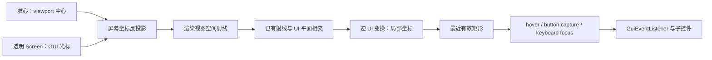

# 世界空间 UI 输入设计

[English](world-ui-input.en.md)。

目标是在世界 UI 前打开透明输入 Screen，使玩家可以自由移动系统光标。
默认准心模式与自由光标模式共用后续平面命中和事件路由。
接口、单位、接入示例与验收命令见 [API](../reference/world-ui-input.md)。

## 坐标空间与渲染时序

设输入层光标为 `(x,y)`，逻辑 viewport 为 `(W,H)`，归一化设备坐标为
`nx = 2x/W - 1`、`ny = 1 - 2y/H`。用本帧实际投影矩阵 `P` 的逆矩阵反投影
`(nx,ny,-1)` 和 `(nx,ny,0)`，透视除法后得到射线起点与第二点，两点之差归一化得到方向。
选择内部深度点可以兼容无限远投影；正交相机也能使用同一流程。

手绘图中的视点、屏幕平面和 UI 平面由这条射线联系起来。投影矩阵包含 FOV、宽高比、
光学缩放及渲染时的 bobbing；不需要另估屏幕到眼睛的距离，也不需要给鼠标偏移套一个固定系数。
没有目标平面或其他命中约束时，屏幕上的一点只确定一条射线，无法唯一确定一个世界点。

世界平面的完整局部到视图矩阵记为 `M`。相交时射线和平面都在视图空间，命中点再经 `M^-1`
还原成 UI 像素坐标。`M` 包含 host model-view、相机平移、UI 的旋转/缩放/位置；
这样避免将世界射线与已减相机位置的平面混用。也避免在命中后重复减去 UI 半宽高。

内置 backend 每帧先复制投影和各个可交互面板的最终变换，再结束这一帧的输入更新。
输入事件在两帧之间使用最近一次呈现的快照，点击前重新计算当前位置，避免只能点击上一帧的 hover。
自由光标不动但视角/面板变化时，帧结束仍重算 hover 和捕获中的局部位置。
离屏相机不覆盖玩家主画面的输入快照。

## 画布与深度

世界平面只负责一次纹理合成。面板内部的控件、字形和阴影先在独立 RGBA+depth 画布中使用
原版 GUI 正交投影组合，保留 0.03 GUI-Z 等细小层级差。直接把整个 GUI 深度范围压缩为
0.1 世界格，会使文字和阴影在透视深度缓冲中量化为相同值，出现条纹、缺块和边框闪烁。
GUI 深度端点外预留 1 单位，包含 `MAX_GUI_Z + 0.03` 的阴影层；所有合成顶点固定为局部 Z=0。
因此极端 GUI Z 不进入世界变换，面板位置及命中平面保持一致。

画布清为透明黑，原版 GUI 混合后 RGB 已预乘 alpha；世界合成使用
`ONE / ONE_MINUS_SRC_ALPHA`，避免重复乘 alpha 形成黑边。平面保留场景深度测试但不写深度。
绘制作用域恢复 FBO、viewport、投影、混合/深度/裁剪与纹理状态。面板删除、跨世界和客户端
关闭时释放画布，尺寸改变时替换附件。面板内的裁剪使用画布高度，而非主窗口高度。

## 输入所有权

hover 是射线当前命中的最近面板；键盘焦点是最后点击的面板；button capture 则按鼠标按钮分别记录
接受按下事件的面板。三者可以不同。例如按下面板 A 后拖到 B，B 可以成为 hover，A 仍接收拖拽和松键。
拖拽增量由连续两次投影后的 UI 局部坐标相减得到，不使用屏幕像素增量。

鼠标离开矩形后仍可与其无限延伸的平面相交，捕获因此不会因越界丢失。射线暂时无法与平面相交时，
保留最后有效坐标；关闭、移除或失焦时也将 release 发给最初的目标。键盘同样记录接收 key-down 的目标，
切换焦点时补发 release，防止 key-up 落到其他面板。重复移动通知不重复发送零增量拖拽。

输入层不复制世界 UI，也不把面板作为二维 Screen 再绘制一遍。Minecraft 的 Screen 生命周期负责
释放/重新捕获鼠标与清空游戏按键；透明 Screen 负责吞掉输入并转给路由器。世界模拟继续运行。
世界显示、平面求交和输入截获分别维护，后续可以把已有方块遮挡或其他求交器接入同样的射线来源。

正常准心模式另有临时键盘所有权：沿最后点击面板的嵌套焦点链找到可编辑文本控件才接管。
`KeyboardHandler` 的客户端 HEAD 注入在原版更新 `KeyMapping`、处理聊天和调试快捷键之前消费事件；
后置按键通知不足以阻止这些副作用。接管开始和结束都清空游戏按键，鼠标捕获与当前 Screen 不变。
Escape 递归清除子控件焦点，补发目标持有的松键，并记录仍按住的物理键，防止旧 repeat 在退出后
变成移动输入。失焦时可能缺少原生 release，故新的 press 会清除旧记录并正常进入游戏。

## 范围

当前接受 Screen 或有明确矩形尺寸的 GuiEventListener；默认沿用几何平面交互，不同步服务端状态。
点击服务器控制的业务应由面板回调发包，并由服务器验证权限、距离和业务状态。
世界面板的注册生命周期属于调用者；输入层的退出只清理输入状态。
