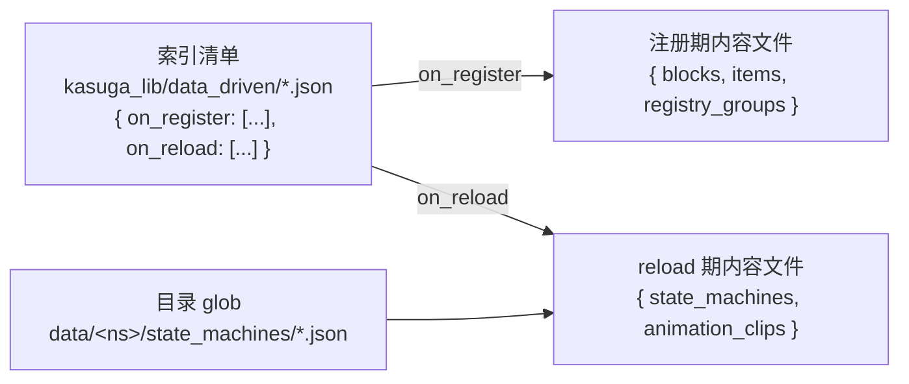

# Path 1: adding content with data-driven files (organization and best practices)

> For **content authors**: add blocks, items, groups, state machines, and animation clips with JSON alone, without writing Java.
> Applies to: Minecraft 1.21.1 · NeoForge 21.1.203 · Parchment 2024.11.17 · Java 21. Line numbers in this page refer to the current working tree (the uncommitted data-driven reimplementation), baseline commit `ec864a1`.
> This page answers "how to organize files" and "why organize them this way". The complete list of fields is not here — see [schema.md](../../reference/data-driven/schema.md).

This page is written for someone with a concrete goal in hand: adding the blocks of one carriage, wiring up a fan, setting up a creative tab.
Every step gives JSON fragments you can copy as-is and spells out the cost. Anything that takes Java to do (registering the factory behind a `type`, registering
a new top-level field) lives in [guide-extension.md](guide-extension.md) and is not repeated here.

---

## 0. Separate the three concepts first (about 30 seconds)

The three words each have a clear identity in this system:

- **index manifest**: a manifest file of "which files to parse". It lists paths only and contains no object definitions.
- **content file**: the **single source of truth** for definitions of blocks, items, and groups. The top-level field name (`blocks`, `items`, `registry_groups`) decides which handler this set of definitions is handed to.
- **domain**: content files are split into two domains by when they are read. **Registration phase (register)** content is read once during mod construction and written into Minecraft's registries; **reload phase (reload)** content is read on `/reload` and written into the reload bucket; state machines and animation clips belong here.

How the three relate:



This diagram holds one **asymmetry**, and it is the easiest pitfall in the whole page: `state_machines/` has an extra directory-glob entry point, while `animation_clips/` does not — the latter's files can **only** be listed by the index manifest (see section 6).

The authoritative table of field names, types, requiredness, defaults, and rule IDs D1–D6 is in [schema.md](../../reference/data-driven/schema.md). The examples in this page are copied from real fixtures and can be adapted directly.

---

## 1. Goal: get a batch of content loaded — how to organize the index manifest

### 1.1 The index directory is fixed and cannot be moved

Put the manifest into this four-segment path; the spelling must match exactly:

```
data/<你的 mod id>/kasuga_lib/data_driven/
```

The path is locked down by `JsonTreeBuilder.indexDirectorySegments(modId)` to `{"data", modId, "kasuga_lib", "data_driven"}` (`JsonTreeBuilder.java:745-747`).
`kasuga_lib` uses an underscore, and so does `data_driven`; write `kasuga-lib` instead, or drop the `kasuga_lib` level, and the
system concludes you have no index directory and then **does nothing at all** (leaving a single DEBUG line in the log). **Every** `.json` file
under the directory is treated as a manifest and read in ascending filename order; `index.json` is only a conventional name, not a requirement (`JsonTreeBuilder.listIndexFiles`, `:762-774`).

So **do not put content files in this directory** — a content file gets parsed as a manifest and reports "missing `on_register`/`on_reload`".

### 1.2 One manifest per mod, or several?

**Both work, and you can mix them.** All `.json` manifests under the index directory for the same mod are read in full first and then consumed together;
paths are joined in the order "ascending manifest filename → written order of the array inside the manifest" (`JsonTreeBuilder.java:92-96`, `:296-301`).

The trade-off:

- Splitting has the benefit that **each feature unit can carry its own manifest fragment**. KuaYue has one `data/kuayue/kasuga_lib/data_driven/cXX.json` per carriage; after compilation these fragments merge into the same jar directory, and the system aggregates them as several manifests of the same mod (see section 9).
- The cost of splitting is that **filenames must be unique**. Once several manifests are merged, files with the same name cannot overwrite each other (they are appended side by side, not overwritten), but you have to make sure each manifest lists only its own files, or content is parsed twice (the same path listed in more than one place within one mod is **silently deduplicated**, with no error, `parseSource`'s `parsedSources`, `:400-402`).

### 1.3 What goes in `on_register` and `on_reload`

A manifest has only two top-level fields, each a string array:

| Field | What it lists | When it is read |
|------|--------|----------|
| `on_register` | content files that go into Minecraft's registries, such as blocks, items, and groups | during mod construction, once |
| `on_reload` | reload-phase content files, such as state machines and animation clips | on every `/reload` |

**Both fields may be omitted, but at least one must be written**; a "pure reload mod" that writes only `on_reload` is legal (`JsonTreeBuilder.java:100-104`, `:323-326`).
An empty array `[]` also counts as "written" (rule D2). Omitting both records one error.

A minimal two-domain manifest:

```json
{
  "on_register": [
    "kasuga_lib_content/groups.json",
    "kasuga_lib_content/blocks.json"
  ],
  "on_reload": [
    "animation_clips/fan_fsm_data_driven.json"
  ]
}
```

Array elements are **paths relative to `data/<your mod id>/`**, must carry the `.json` suffix, must not start with `/`, and must not contain an empty segment or a `.`/`..` segment
(`JsonTreeBuilder.validateSourcePath`, `:383-392`). They are always joined under `data/<your mod id>/`, so **cross-namespace is structurally impossible**.

> **Best practice**: write the groups (`groups.json`) ahead of the block manifest so a human can see the dependency at a glance. But this has nothing to do with "order is semantic" — the group application phase comes before blocks anyway, see section 3.

### 1.4 Why leaving a file out means it never loads

The registration phase has **no directory scan**: `buildForMod` reads only the paths listed in `on_register` and does not walk your `data/` directory (`JsonTreeBuilder.java:105-110`).
A content file that really exists in the jar still **never gets read** as long as no manifest lists it, and nothing is reported either.

The reload side has different rules: `state_machines/` has a directory glob, `animation_clips/` does not. The difference is spelled out in section 6.

**The cost**: the index is a hand-maintained manifest, and "adding a file = editing the index" is what this design pays for "what gets loaded is fully controllable and auditable".
Change the directory structure and forget the index, and the symptom is **silently loading less**, not an error. That is why the first thing in the verification steps of section 8 is counting entries in the log.

---

## 2. How to split content files

Content files go anywhere under `data/<your mod id>/` (they do not have to be squeezed in next to the index directory), and one file may hold several top-level fields at once.
Files **do not reference one another**, so there is no recursion and no need for cycle detection (`JsonTreeBuilder.java:372-373`).

### 2.1 Split by type, or split by feature

Both hold up; the choice depends on whether the question you need to answer is "where is everything of this type" or "where is everything of this feature".

**Split by type** (one big file each for groups and blocks):

```text
data/mymod/kasuga_lib/data_driven/index.json
data/mymod/content/groups.json        # 所有 registry_groups
data/mymod/content/blocks.json        # 所有 blocks
data/mymod/content/items.json         # 所有独立 items
```

**Split by feature** (each feature directory carries its own type files):

```text
data/mymod/kasuga_lib/data_driven/panels.json     # on_register: content/panels/*
data/mymod/kasuga_lib/data_driven/lighting.json   # on_register: content/lighting/*
data/mymod/content/panels/groups.json
data/mymod/content/panels/blocks.json
data/mymod/content/lighting/groups.json
data/mymod/content/lighting/blocks.json
```

The trade-off:

- Splitting by type makes **reuse and cross-feature lookup convenient** (one file is the complete set for one type), but files keep growing, several people editing one file conflict easily, and nothing reminds you not to stuff unrelated things in.
- Splitting by feature keeps **one feature's changes in one place**, which suits units that can be delivered on their own, such as "one carriage = one feature"; the cost is that every feature has to list its own files in the index one by one.

> **Best practice**: take "the smallest unit that can be delivered and verified on its own" as the splitting unit. Inside a feature unit, split further by type (`groups.json` + `blocks.json`); that keeps reusability and keeps index entries readable. KuaYue's carriages are split that way (section 9).

### 2.2 More files means listing them one by one in the index

After splitting by feature, the manifest grows into one file per line — which is exactly what it is for: **the manifest is the explicit declaration of "which files this feature contains"**.
Do not stuff a whole block of content into one file just to keep the manifest short. A longer manifest is a readability cost, a stuffed file is a maintainability cost, and the former is easier to handle.

---

## 3. Goal: share properties across blocks — inheritance with `registry_groups`

A group is a container for shared properties: write `properties` on a group and the blocks in it inherit them automatically.

### 3.1 Create a group and attach blocks to it

```json
{
  "registry_groups": [
    {
      "id": "mymod:base_panels",
      "properties": {
        "no_occlusion": true,
        "strength": [1.5, 3.0]
      }
    },
    {
      "id": "mymod:detail_panels",
      "parent": "mymod:base_panels",
      "item_properties": {
        "tab": "mymod:main_tab"
      }
    }
  ]
}
```

A block names the group it attaches to with `registry_group`:

```json
{
  "blocks": [
    {
      "id": "mymod:simple_panel",
      "type": "simple_block",
      "registry_group": "mymod:detail_panels",
      "properties": {
        "destroy_time": 2.0
      }
    }
  ]
}
```

This passage is copied verbatim from the real fixtures `modules/data-driven/src/contentTesting/resources/data/kasuga_lib/kasuga_lib_content/groups.json` and `blocks.json`.

### 3.2 Inheritance chain: block level > child group > parent group > root

Properties are not "merged"; they are **applied in turn** along the parent chain. The parent group's properties are applied first, then the group's own, so definitions closer to the block take effect later and override what came before
(`Reg.applyProperties`, `Reg.java:103-114`). Priority in one sentence:

> **Block level > child group > parent group > root group.**

This order holds for both `properties` and `item_properties`. The real fixture `inheritance_blocks.json` shows three cases:

```json
{
  "blocks": [
    { "id": "mymod:inherited_block", "type": "simple_block", "registry_group": "mymod:inherit_group" },
    {
      "id": "mymod:overridden_block",
      "type": "simple_block",
      "registry_group": "mymod:inherit_group",
      "properties": { "strength": [5.0, 5.0] }
    },
    {
      "id": "mymod:item_inherit_override",
      "type": "simple_block",
      "registry_group": "mymod:inherit_group",
      "item_properties": { "stacks_to": 1, "durability": 100 }
    }
  ]
}
```

- `inherited_block` touches no property at all and inherits the group entirely.
- `overridden_block` overrides the group value with a block-level `properties.strength`.
- `item_inherit_override` overrides the group's `stacks_to` with a block-level `item_properties`, and adds a `durability` the group does not have.

One exception is worth noting on its own: **the creative tab (`tab`)**. The group's `item_properties.tab` is recorded separately and used only when the block has no `tab` of its own (`RegTypeHandler.java:89-97`). So "block-level `tab` wins" works like most fields here, but the implementation goes through a different channel, and that is worth remembering when troubleshooting tab problems.

### 3.3 What happens with a missing parent group or a cycle

Both anomalies are caught and neither crashes, but the result may differ from what you expect:

- **The parent group does not exist** → the group **silently attaches to the root group** (`RegistryGroupHandler.store`, `:58-63`). Blocks register as usual, they just inherit nothing. **With no log message.**
- **The ancestor chain contains a cycle** → the loader does a topological sort first, and on detecting a cycle emits a WARN: `Cycle detected among registry groups: [...]`; the groups in the cycle fall back to their original order and end up attached to the root (`JsonTreeBuilder.java:823-842`).

The real fixture `edge_cases_groups.json` contains a ready-made cycle:

```json
{
  "registry_groups": [
    { "id": "mymod:orphan_group" },
    { "id": "mymod:circular_a", "parent": "mymod:circular_b" },
    { "id": "mymod:circular_b", "parent": "mymod:circular_a" }
  ]
}
```

`orphan_group` explicitly has no `parent` and attaches to the root; `circular_a`/`circular_b` are each other's parent.

**The cost and the advice**: group inheritance saves a lot of repeated fields, but "silently attaches to the root" means **a mistyped group id is not reported**.
So give group ids a namespace prefix (starting with `mymod:`), and make "the group definition" and "the block that references the group" appear as a pair in the same manifest, so changing an id changes both together.

---

## 4. Goal: know who wins on a duplicate id — last-wins

### 4.1 What counts as "the same id"

A duplicate is decided only **within the same type field** (`blocks` against `blocks`, `items` against `items`, `registry_groups` against `registry_groups`, embedded block entities against embedded block entities).
The same name in different fields **is not a conflict** (`DuplicateIdResolver`'s collision key is `(typeName, identity)`, `:73-100`).

The three types compute identity differently:

| Type | What identity is | Normalization |
|------|-----------------|--------|
| `blocks` / `items` | the `ResourceLocation` at registration | no namespace or a `minecraft:` prefix → `<your mod id>:<path>`; any other namespace is kept as-is (`EffectiveId.of`, `:39-52`) |
| `registry_groups` | the entry's **literal** `id`, not normalized | groups are internal nodes and do not go into a registry, so `door` and `minecraft:door` count as two groups (`RegistryGroupHandler.resolveIdentity`, `:50-52`) |
| the embedded block entity | the identity of the **host block** | only two `block_entity` keys on the same block count as a duplicate (`BlockEntityTypeHandler.resolveIdentity`, `:66-68`) |

Normalization is the easiest one to trip over: as blocks, `foo` and `minecraft:foo` **are the same id** and conflict with each other (`EffectiveIdTest.explicitMinecraftNamespaceResolvesToTheOwningMod`).
But `foo` in `blocks` and `foo` in `items` do not conflict; they are two registration spaces.

### 4.2 "Later" means load order, not lexicographic order

The rule for duplicates is **last-wins** (the later definition wins). "Who is later" is decided entirely by load order:

1. Several manifests of the same mod, by **ascending filename**;
2. Inside one manifest's `on_register` array, by **written order**;
3. Inside one content file's type array, by **written order**.

`DuplicateIdResolverTest.lastMeansLastInSequenceNotLexicographicallyLastSource` locks this down specifically: even when the later candidate comes from a file whose path sorts earlier lexicographically, it is still the winner.
In other words, **order is a semantic switch, not a layout preference**.

### 4.3 Conflicting entries: isolated, no crash

When a duplicate is found (`DuplicateIdResolver.describe`, `:109-115`):

- **No crash**: loading finishes as usual and the game starts normally.
- **The loser does not take effect at all**: the earlier definition **never reaches registration**, so no ghost entry is left in Minecraft's registries.
- **No collateral damage**: only the conflicting entry is dropped; other entries in the file and other types proceed as usual.
- **Evidence is kept**: one WARN log line (giving the id, the type field, and the winner's and the loser's source files) plus one loading error recorded against that mod.

> **Best practice**: treat order as an "override switch", not as "layout". When you have no intent to override, make sure ids are unique within the type and keep the WARN away;
> when you do intend an override (a base file plus a variant file), point out which one is the patch file in the manifest with a comment or a name.
> The cost is that such an override **tells you nothing about "who got overridden" beyond that WARN**, so override files should be as small and focused as possible.

---

## 5. Goal: bind a block entity to a block — how to use an embedded type

### 5.1 The block entity is embedded, not a top-level field

A block entity (BE) does not get a top-level field of its own; it is written in the `block_entity` key of the block entry:

```json
{
  "blocks": [
    {
      "id": "mymod:be_test_block",
      "type": "be_block",
      "registry_group": "mymod:data_driven_group",
      "block_entity": {
        "type": "my_be",
        "params": {
          "tick_interval": 4
        }
      }
    }
  ]
}
```

(from `kasuga_lib_content/block_entities.json`.) `block_entity` accepts `type` (the BE factory) and `params`;
after the host block is registered, the system creates the BE automatically and attaches it as its child node, and the BE id is automatically `<block path>_be`.
So **a block can embed at most one BE** (`BlockEntityTypeHandler.apply`, `:88-95`).

Fsm blocks have a common pattern: `state_machine` is written at the **top level of the block entry**, and the system forwards it into the BE's `params`:

```json
{
  "blocks": [
    {
      "id": "mymod:my_fsm_block",
      "type": "fsm_block",
      "registry_group": "mymod:data_driven_group",
      "state_machine": "mymod:my_machine",
      "properties": { "destroy_time": 2.0 },
      "block_entity": {
        "type": "fsm_be",
        "params": { "model": "mymod:models/my_cube.obj" }
      }
    }
  ]
}
```

(from modelling contentTesting's `fsm_blocks.json`; the forwarding logic is in `BlockEntityTypeHandler.extractEmbedded`, `:33-44`, covered by `BlockEntityStateMachineExtractTest`.)

### 5.2 "In the same file" or "in its own file"

The filename `block_entities.json` is a convention, and **its top-level key is still `blocks` once you open it**. So the choice here is file organization, not syntax:

- Keeping blocks with BEs together with ordinary blocks puts the whole block picture in one place, which is convenient for comparison.
- Opening a separate file (such as `block_entities.json`) for blocks with BEs shows "which blocks have entities" at a glance, and lets this kind of block evolve on its own.

Either choice must list the file in the manifest. The trade-off is **review cost**: a separate file makes the BE set stand out, but seeing "a block's full definition" then takes two files.

### 5.3 Anti-pattern: writing an embedded type as a top-level field

The following form is **illegal**:

```json
{
  "block_entities": [ { "type": "my_be" } ],
  "blocks": [ { "id": "mymod:ok", "type": "simple_block" } ]
}
```

The result: the top-level `block_entities` is reported as an "unsupported top-level field", with the hint "it should be written in the `block_entity` key of a `blocks` entry";
the key point is that **`blocks` in the same file still dispatches as usual** (partial application), so this one mistake does not throw away the whole file (`JsonTreeBuilderEmbeddedTypeDispatchTest.topLevelEmbeddedTypeIsReportedAndTheRestOfTheFileStillDispatches`, `JsonTreeBuilder.java:475-490`).

Likewise, a single BE failing in the apply phase (a missing BE factory, for example) only emits a WARN and is skipped, leaving the other blocks in the same file alone (`BlockEntityTypeHandler.apply`, `:81-100`).

> **Best practice**: always write `block_entity` next to its host block. A BE has no id of its own, so an "orphan BE" does not exist syntactically.

---

## 6. Goal: add state machines and animation clips — reload-domain content

The reload domain has two kinds of content, and their top-level field names are each the only legal key.

### 6.1 State machines (`state_machines`): two entry points

A state machine file looks like this:

```json
{
  "state_machines": [
    {
      "id": "mymod:fan_machine",
      "state_vars": [
        { "name": "cycle", "type": "bool", "default": false, "ephemeral": true, "reference": "mymod:fan/cycle" }
      ],
      "layers": [
        {
          "id": "gear",
          "mode": "base",
          "initial_state": "off",
          "states": [
            { "id": "off", "clip": { "id": "mymod:fan_clip", "loop": true } },
            { "id": "g1", "clip": { "id": "mymod:fan_clip", "loop": true } }
          ],
          "transitions": [
            { "id": "off_to_g1", "from": "off", "to": "g1", "trigger_on": "cycle", "cross_fade_seconds": 0.25 }
          ]
        }
      ]
    }
  ]
}
```

(the full version of the real fixture `modules/modelling/src/contentTesting/resources/data/kasuga_lib/state_machines/fan_machine_data_driven.json` has 4 states and 4 transitions; a subset is taken here for space, with no field changed.)

A state machine has **two entry points**; use either one or both:

1. **Directory glob**: put the file at `data/<your namespace>/state_machines/*.json` and it is discovered automatically (`StateMachineDefinitionLoader.PATH = "state_machines"`, `:39`; the directory is declared by `FsmReloadHandler.globDirectories()`, `:69-71`). **No need to list it in the index.**
2. **The `on_reload` array**: list the path in the manifest and it is read as well.

When both entry points hit the same file, the glob skips the one the index already lists, so the file is read once (`ReloadOrchestrator.collectGlob`, `:348-367`).
The relative order of the two entry points is **glob first, index second**, and for the same id the later one still wins (`ReloadOrchestrator` class documentation, `:77-91`).

### 6.2 Animation clips (`animation_clips`): the index is the only entry point

```json
{
  "animation_clips": [
    {
      "id": "mymod:fan_clip",
      "duration_seconds": 12.0,
      "functions": [
        { "bone": "fan", "channel": "rotate", "y": "11 * query.angle" },
        { "bone": "cover", "channel": "rotate", "z": "sin(rad(2 * query.angle)) * 30" }
      ]
    }
  ]
}
```

(from `animation_clips/fan_fsm_data_driven.json`.)

`animation_clips/` has no directory glob, so clip files can only be read through the manifest's `on_reload` array
(`AnimationClipLoader` class documentation, `:28-29`). Put a clip file under `data/<ns>/animation_clips/` and forget to list it in the manifest, and
it **is never loaded, with no hint at all**.

Compare the real fixture `modelling.json`, which lists two entries under `on_register` and one under `on_reload`:

```json
{
  "on_register": [
    "kasuga_lib_content/fan_formula_data_driven.json",
    "kasuga_lib_content/fsm_blocks.json"
  ],
  "on_reload": [
    "animation_clips/fan_fsm_data_driven.json"
  ]
}
```

The state machine file `state_machines/fan_machine_data_driven.json` is **not in this manifest** — the glob picks it up. `fsm_blocks.json` originally belonged to data-driven's contentTesting, and moved to the modelling side because the `fsm_block` / `fsm_be` factories live in modelling only (the content is still written with `blocks` as its top-level key).

### 6.3 A few rules for reload content

- **One file can carry several top-level keys**: writing `state_machines` and `animation_clips` in the same file is legal, and the two handlers each read their own key and register their own entries (`ReloadOrchestrator.dispatch`, `:429-470`).
  A **genuinely unknown key** (claimed by no reload type, a mistyped `foo` for instance) is reported as an unsupported-top-level-field error, but known keys still contribute as usual and do not drag down the whole file.
- **Reload paths go through the pack stack**: paths in `on_reload` are resolved with `ResourceManager.getResource`, so **data packs can override** your reload content;
  `on_register` goes through the mod's jar (`IModFile.findResource`), which data packs cannot reach (`ReloadOrchestrator.collectIndex`, `:369`).
- **Dangling clip references are checked after the fact**: once a reload round finishes, the loader checks whether the id that `states[].clip` points at exists in every state machine definition just registered,
  and if it is missing it emits a WARN and records it in the error bucket, while that state degrades to a static pose (`FsmReloadHandler.afterReload`, `:95-116`). The check **does not block registration**.

> **Best practice**: keep state machines in `state_machines/` for the glob to discover, which cuts manifest maintenance; clips must be listed in `on_reload` one by one, so make clip files coarser rather than finer (one file per feature) instead of letting the manifest grow to dozens of lines.

---

## 7. Anti-patterns and boundary checklist

| What you write | Symptom | Cause / handling |
|--------|------|-------------|
| `"sources": [...]` in a manifest | two errors: `contains unsupported field 'sources'` + `declares neither 'on_register' nor 'on_reload'`, and that manifest contributes no path | `sources` is a **deprecated field**, not an alias (`JsonTreeBuilder.parseIndexManifest`, `:222-243`; `JsonTreeBuilderIndexSchemaTest.legacySourcesFieldIsReportedAsUnknown`). Change it to `on_register` |
| listing a `state_machines` file under `on_register` | error: `unsupported top-level field 'state_machines'`, with the hint "list this file under 'on_reload' instead" | the conditional D9 hint; the registration domain does not recognize a reload-domain shape, and the hint points you at the other array (`JsonTreeBuilder.java:474-491`; `JsonTreeBuilderReloadHintTest`) |
| listing registration content under `on_reload` | error: `unsupported top-level field 'blocks'`, with the hint to list it under `on_register` | the reverse D9 hint (`ReloadOrchestrator.dispatch`, `:441-446`) |
| the same path in both `on_register` and `on_reload` | error, and that path is **consumed by neither domain** | rule D6's fail-closed (`JsonTreeBuilder.resolveIndexManifests`, `:308-316`; `JsonTreeBuilderIndexSchemaTest.crossListedPathIsConsumedByNeitherDomain`) |
| a top-level `block_entities` | error + the hint to write it in the `block_entity` key of a `blocks` entry | embedded types do not take a top-level field (section 5.3) |
| a path written as `/blocks.json`, `blocks` (no suffix), `a/../b.json` | error: `path must be relative` / `path must include the '.json' suffix` / `path must not contain '.' or '..'` | `validateSourcePath` (`:383-392`; `JsonTreeBuilderSourcePathTest.rejectsMalformedSourcePaths`) |
| the manifest points at a file that does not exist | error: `Source file not found ...` | the path is relative to `data/<mod>/`; first confirm the file really made it into the jar |
| a content file placed in the index directory | error: the file is parsed as a manifest and reports the two domain fields as missing | the index directory holds manifests only |
| a block `type` with no corresponding factory | the block does not appear; log WARN `No factory for type '...'` | **log only, not into the error bucket** (`RegTypeHandler.apply`, `:70-74`). The factory must be registered first, see [guide-extension.md](guide-extension.md) |
| a block referencing a `registry_group` that does not exist | the block still appears, but its properties/tab do not match expectations | **silently attaches to the root group**, no log (section 3.3) |
| a misspelled property name (such as `sound_type`) | that property is ignored; log WARN `Unknown block property` / `Unknown sound type` | **log only, not into the error bucket** (`JsonPropertyParser`, `:50-57`, `:87-95`) |
| an element's `parse` throws during the registration phase (malformed fields in that element) | error: `Content file '<label>' for mod '<mod>': entry <i> in '<key>' failed to parse: <msg>; entry skipped` | **only that element is dropped**; sibling entries in the same file register as usual (`JsonTreeBuilder.java:530, 592`; isomorphic to the reload side's `…; element skipped`). |

> **Best practice**: distinguish "errors that go into the error bucket" from "errors that only emit a WARN". The former (index, path, field, duplicate id, apply failure) can be asserted red through `getLoadingErrors`;
> the latter (unknown factory, unknown property, missing group, group cycle) can only be found by **reading the log**. Lumping the two together will make you miss the second half of the problems.

### 7.1 Data-driven does not generate assets or localization

Data-driven registers the **block / item / block entity** itself only (`blocks` entries have no `model` / `textures` field, see [schema.md](../../reference/data-driven/schema.md) section 2.3). For a block to display properly, its model, texture, and language still have to be provided in the resource pack following vanilla conventions, and the system does not generate them for you:

- **Model / texture**: looked up following Minecraft conventions at `assets/<namespace>/blockstates/<path>.json` and `assets/<namespace>/models/block/<path>.json`, and you must supply them by hand; leave them out and you get a purple-and-black block.
- **Translation key**: derived by convention as `block.<namespace>.<path>` (`item.<namespace>.<path>` for items), and you must add it in `lang/*.json` by hand; leave it out and the raw key name is displayed.

---

## 8. Goal: confirm you got it right — verification and troubleshooting

### 8.1 Count the entries in the log first

After startup the log should contain this line (INFO):

```
Loaded N JSON entries across M types for mod '<你的 mod id>'
```

`JsonTreeBuilder.java:114`. `N` is the total number of entries parsed, and `M` is the number of distinct top-level types with content.
Turn DEBUG on and you also see the applied count per type (`Applying N entries for type '<type>'`, `:129`). **An N that is too small usually means a missed index entry or a wrong path**.
If the line is entirely absent, check the index directory path first (when the directory does not exist there is only one DEBUG line: `No data-driven index directory for mod '...'`, `:77`).

### 8.2 Inspect the error bucket with a command

In game (permission level 2 required):

```
/kasuga_data errors
/kasuga_data errors <你的 mod id>
```

With no argument it prints a one-line summary for every non-empty bucket (**both dimensions included**: the mod dimension and the reload `RELOAD_DATA[<namespace>]` source dimension); with a mod id it prints that mod's per-entry failures in both dimensions
(`DataDiagnosticsCommands`, `:45-92`). Registration-phase errors go into the mod dimension; reload-phase errors go into the `Domain.RELOAD_DATA` source dimension, keyed by namespace (`ReloadOrchestrator.reportError`, `:566-573`).

### 8.3 Assert in a test that the error bucket is empty

An integration test or a debugging tool can assert directly:

```java
JsonTreeBuilder.getLoadingErrors("mymod")   // 该 mod 的错误列表
JsonTreeBuilder.getLoadingErrorsByMod()     // 按 mod 分桶
```

Turning "silent errors" into a red light is the least-effort approach. Error buckets are isolated per mod, and one mod's `buildForMod` clears only its own bucket (`JsonTreeBuilderLoadingErrorTest.errorsAreIsolatedPerMod`).

### 8.4 A troubleshooting order table

| Symptom | Look first at |
|------|------|
| no `Loaded ... JSON entries` at all | is the index directory's four-segment path right? is there a `.json` in the directory? |
| N smaller than expected | is the manifest missing an entry? `Source file not found`? |
| the block does not appear | `No factory for type`? (WARN); are the block item, blockstate, and model assets all present? |
| properties are wrong | `Unknown block property` (WARN); is `registry_group` written correctly (silent attach to root)? |
| an id takes effect as something other than what you wrote | the duplicate-id WARN; look at the winner/loser source files (section 4) |
| the state machine does not take effect | is the file in `state_machines/`? or is it listed in `on_reload`? |
| the clip does not take effect | **almost always it is not listed in `on_reload`** — clips have no glob (section 6.2) |
| the state machine runs but the animation is frozen | look for the `unresolved clip references after reload` WARN (section 6.3) |

---

## 9. Production-scale reference: how KuaYue organizes carriages

> This section only observes the KuaYue repository's `modules/train-parts/resources/carriages/` read-only; nothing is modified.

KuaYue's 11 carriages (`22`/`25`/`25b`/`25g`/`25k`/`25t`/`25z`/`cr200j`/`freight`/`jy30`/`m1`) show what "split by feature, each feature carrying its own manifest fragment" looks like in a real project. Each carriage is an **independent resource-compilation module**, and its source directory top level holds `blockstates/`, `data/`, `lang/`, `loots/`, `models/`, `recipes/`, `tags/`, `textures/` and `module.toml` — **there is no `assets/`**; only after resource compilation does it merge into the `assets/`/`data/` layout in the output. Model assets, localization, loot tables, and data-driven content are delivered together inside the same carriage directory.

For the data-driven part there are three files per carriage (exception: `jy30` has `module.toml` but no data-driven content at all, so it does not take part in data-driven):

```text
carriages/22/
├── module.toml                                              # 模块根标记
└── data/kuayue/
    ├── kasuga_lib/data_driven/c22.json                      # 索引清单（每车厢一份）
    └── carriages/c22/
        ├── groups.json                                      # 该车厢的分组
        └── blocks.json                                      # 该车厢的方块
```

The manifest content is "groups first, blocks after":

```json
{
  "on_register": [
    "carriages/c22/groups.json",
    "carriages/c22/blocks.json"
  ]
}
```

The group (`c22`):

```json
{
  "registry_groups": [
    {
      "id": "kuayue:c22_panels",
      "properties": {
        "no_occlusion": true,
        "strength": [1.5, 3.0],
        "map_color": "blue"
      },
      "item_properties": { "tab": "kuayue:train_panel_tab" }
    }
  ]
}
```

The blocks (`c22`, excerpt):

```json
{
  "blocks": [
    { "id": "kuayue:22_floor", "type": "slab", "registry_group": "kuayue:c22_panels" },
    {
      "id": "kuayue:22_large_window",
      "type": "train_openable_window",
      "params": { "wide": 2 },
      "registry_group": "kuayue:c22_panels"
    }
  ]
}
```

**How it is split, and why**:

- **The splitting unit is one carriage**, because a carriage can be delivered and verified on its own, and the whole carriage's assets (models, language, block definitions) travel together anyway.
- **One manifest per carriage** (`c22.json`, `c25.json`, …; the filenames all differ). At compile time they merge into the same jar directory, and the framework aggregates them as several manifests of the same mod. This answers exactly the question in section 1.2: **"several manifests per mod" in production is split by delivery unit**.
- **Inside a carriage, split further into two files by type** (`groups.json` + `blocks.json`) rather than stuffing groups and blocks into one — that keeps the readability of "split by type" while **putting groups before blocks**, matching the framework's "groups are applied first" phase order.
- **A block's `type` is a factory KuaYue registers itself** (`slab`, `train_panel`, `train_openable_window`, and so on), not one of the library's built-in test factories — this is exactly the extension point described in [guide-extension.md](guide-extension.md) used in production.

**A lesson unrelated to data-driven content, but one that makes content "vanish into thin air"**: the two carriage directories `cr200j` and `freight` **have no `module.toml`**.
The resource compiler only walks directories that **contain `module.toml`** (`ResourceCompilerMain.java:24-39`; `ResourceScanner.scanModule`, `:43-58`),
so the content in these two directories (index and data-driven files included) **never makes it into the jar**, and the blocks in them are never registered.
Transferring this to your own project: even with the manifest written correctly, confirm that the directory carrying it is really picked up by your resource compilation/packaging pipeline.

---

## 10. Further reading

| What you want | Where to go |
|--------|------|
| the complete list of fields, types, requiredness, defaults, and D1–D6 rules | [schema.md](../../reference/data-driven/schema.md) |
| complete signatures of Java classes and methods, load timing, and the pure-function test surface | [the data-driven API reference](../../reference/data-driven/README.md) |
| getting the first path working from scratch | [intro.md](intro.md) |
| registering your own `type` factory, property compiler, and TypeHandler | [guide-extension.md](guide-extension.md) |
| a dedicated explanation of the Fsm state machine | [`../../reference/fsm.md`](../../reference/fsm.md) |
