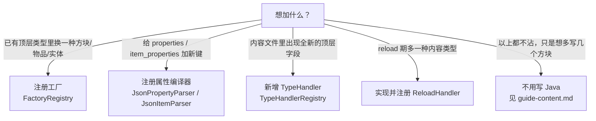

# Extension guide: what you have to write Java for (How-to)

> For mod developers who want to give data-driven new capabilities. Readers need a working path first (see `intro.md`) and a basic grasp of the JSON format (see `schema.md`).
> This page covers only the extension points that **have to land in Java**, and every section is organized as "goal → code → why": adding a top-level type, an embedded type, registering a factory, extending property parsing, wiring into diagnostics, adding a reload content type, and how to write tests.
> Boundaries: for per-class and per-method signatures see `api-registration.md` / `api-extension.md` / `api-diagnostics.md` / `api-reload.md`; for content organization expressible in pure JSON (groups, blocks, items, index writing, the property cheat sheet) see `guide-content.md`; for field-level JSON rules and D1–D6 see `schema.md`. This page repeats neither the signature tables nor the JSON field rules.
>
> Version baseline: Minecraft 1.21.1 / NeoForge 21.1.203 / mojmap + Parchment 2024.11.17 / Java 21. Line numbers in the text correspond to the file contents in the current working tree (the uncommitted data-driven reimplementation), baseline commit `ec864a1`; signatures follow `api-registration.md` / `api-extension.md` / `api-diagnostics.md` / `api-reload.md`.

## 0. Decide first: does this need Java?

Data-driven has two extension surfaces: JSON content, and capabilities JSON cannot recognize. Only the latter needs Java. Match your case in the table below:



| Your goal | Extension point | Does the result need to go into a Minecraft registry | Where in this page |
|---|---|---|---|
| `"type": "my_door"` produces a block | `FactoryRegistry.register` | Yes | §3 |
| `"type": "my_material"` produces an item | `FactoryRegistry.registerItem` | Yes | §3 |
| `"type": "my_be"` attaches a block entity | `FactoryRegistry.registerBlockEntity` | Yes | §3 |
| A custom non-MC-registry object (effect, definition, ...) | `FactoryRegistry.registerGeneric` + a custom `TypeHandler` | No | §1, §3 |
| `mymod:my_key` appears in `properties` | `JsonPropertyParser.registerCompiler` | — | §4 |
| `"my_things": [...]` appears at the top level of a content file | Implement and register a `TypeHandler` | Depends on the definition | §1 |
| A block embeds `"my_attach": {...}` | Embedded `TypeHandler` | — | §2 |
| One more `"xxx": [...]` file is read after reload | Implement and register a `ReloadHandler` | — | §6 |
| Expose an extension's failures to ops/tests | `Diagnostics` / `JsonTreeBuilder.addLoadingError` | — | §5 |

> The factory classes used as examples, `DataDrivenTestFactories` and `FanDataDrivenFactories`, both live in their modules' `contentTesting` source set. Such content **loads as a mod at test runtime but does not go into the published jar**; a real mod puts its factories in its own `src/main/java`. See §8.

## 1. Adding a top-level type (TypeHandler)

### 1.1 Goal

Let a new top-level field appear in a content file, for example `"my_definitions": [ {...}, {...} ]`, interpreted by your Java code. The system dispatches arrays to the matching `TypeHandler` by top-level field name: in the registration phase this happens in `JsonTreeBuilder.dispatchContent`, which walks `TypeHandlerRegistry.all()` (`JsonTreeBuilder.java:492-513`), and the field name is `getTypeName()`.

### 1.2 Pick a shape first

Two shapes; decide which one you are taking:

- **It produces a `Reg` (goes into an MC registry)**: extend `RegTypeHandler<T>` (`handler/RegTypeHandler.java:15`). It bakes in the template "split the id → look up the factory → attach namespace/group/creative tab → store into the context" (`RegTypeHandler.apply:63-112`), so you implement only two abstract methods. `blocks` / `items` are written this way.
- **It produces no `Reg` (a pure data definition, or an object obtained through `FactoryRegistry.registerGeneric`)**: implement `TypeHandler<T>` directly (`TypeHandler.java:8`) and handle things yourself in `apply`. `TestGenericFactory` in the tests takes this route (`TestGenericFactory.java:51-73`).

### 1.3 Skeleton (Reg-shaped, lifted from the `RegTypeHandler` template)

The class below compiles as-is (`EffectDef` is only a placeholder definition). It is shaped after `BlockTypeHandler` (`handler/BlockTypeHandler.java:16-64`), with just the factory lookup step swapped for a Generic factory. To save space, code blocks from here on omit imports, and every symbol involved is given a source:

```java
package com.example.mymod.data;

import com.google.gson.JsonObject;
import lib.kasuga.registration.Reg;
import lib.kasuga.registration.data_driven.handler.RegTypeHandler;
import lib.kasuga.registration.factory.FactoryRegistry;

public final class EffectTypeHandler extends RegTypeHandler<EffectTypeHandler.EffectDef> {

    /** parse 的产物：一个不可变的定义对象。字段来自 JSON，不含任何副作用。 */
    public record EffectDef(String id, String type, JsonObject params) {}

    @Override
    public String getTypeName() { return "effects"; }   // 认领的顶层字段名

    @Override
    public int getPhase() { return PHASE_CONTENT; }     // 见 1.5

    @Override
    public EffectDef parse(JsonObject json) {
        return new EffectDef(
                json.get("id").getAsString(),
                json.get("type").getAsString(),
                json.has("params") ? json.getAsJsonObject("params") : null);
    }

    @Override
    protected String resolveRawId(EffectDef definition) { return definition.id(); }

    /** 诊断里显示的是 JSON 的 type 值（如 my_effect），不是顶层字段名 effects。 */
    @Override
    protected String resolveType(EffectDef definition) { return definition.type(); }

    @Override
    protected Reg<?, ?> createRegistration(EffectDef definition, String path) {
        FactoryRegistry.GenericFactory factory = FactoryRegistry.getGeneric(definition.type());
        if (factory == null) return null;    // 返回 null 即「没有工厂」，框架会 warn 并跳过（见 §3.4）
        return factory.create(path, definition.params());
    }
}
```

`path` has already been stripped out of the id by the template and carries no namespace (`RegTypeHandler.resolvePath:43-46`); do not prepend a namespace again in the factory.

The pure-data shape can be shorter. It stores the definition in the `BuildContext` metadata slot for other handlers to look up (`BuildContext.putMeta:22`):

```java
public final class MyDefinitionHandler implements TypeHandler<MyDefinition> {

    @Override public String getTypeName() { return "my_definitions"; }
    @Override public int getPhase() { return PHASE_GROUPS; }   // 被别的内容引用，所以先应用

    @Override public MyDefinition parse(JsonObject json) {
        return new MyDefinition(json.get("id").getAsString());
    }

    @Override public void apply(MyDefinition definition, BuildContext context) {
        context.putMeta(getTypeName(), definition.id(), definition);
    }

    /** 非 null 才参与重复 id 去重；默认返回 null 表示退出去重。 */
    @Override public String resolveIdentity(String modId, MyDefinition definition) {
        return definition.id();
    }
}
```

### 1.4 How parse and apply divide the work

- `parse(JsonObject)` takes one JSON object from the array and returns your definition object. It should **be a pure function**: no registration, no mutation of global state, no dependence on call order.
- `apply(T, BuildContext)` is what performs registration. It is batched by `getPhase()` and called **after every file has been parsed** (`JsonTreeBuilder.buildForMod:61`).

Splitting it this way has two concrete reasons:

1. **Duplicate ids are decided before apply.** All entries are parsed first, `resolveDuplicates` uses `resolveIdentity` to find duplicates, and only the winner enters apply (`JsonTreeBuilder:119, 652`). The losing entries **have also been parsed**. So if parse has side effects, the losing entries take effect with their side effects.
2. **The same data may be referenced by several files/manifests**; parse is the collection stage, apply the execution stage. Separating them lets deduplication and diagnostics happen inside one "side-effect-free window".

### 1.5 Choosing a phase

`apply` does not follow file order; it is batched in ascending `getPhase()` order (`JsonTreeBuilder:119-121`). The three constants are defined in `TypeHandler.java:11-17`:

| Constant | Value | Use | Reference implementation |
|---|---|---|---|
| `PHASE_GROUPS` | 0 | Objects created first and referenced later | `RegistryGroupHandler` (`getPhase:23`) |
| `PHASE_CONTENT` | 1 | Regular content (blocks, items) | `BlockTypeHandler` (`:22`) / `ItemTypeHandler` (`:19`) |
| `PHASE_EMBEDDED` | 2 | Embedded types attached to a parent object | `BlockEntityTypeHandler` (`:24`) |

Almost every new type uses `PHASE_CONTENT`. If it gets looked up by id from later content, the way a group does, use `PHASE_GROUPS`; if it has to land after a parent object, the way a block entity does, use `PHASE_EMBEDDED`, together with §2.

Within the same phase the order is registration order (a stable `Comparator` sort); across phases the value order always holds. So do not guess "who comes first" from file order — guarantee it through `getPhase` or through lookups in `BuildContext`.

### 1.6 Registering the handler

`TypeHandlerRegistry` is a global static table, written with `register` and indexed by `getTypeName()` (`TypeHandlerRegistry.java:11-17`). The four built-in handlers are lazily registered once by `JsonTreeBuilder.ensureHandlersRegistered()` (`JsonTreeBuilder:49-56`); your handler must register itself, and it has to do so **before** the index is read:

```java
@Context                                        // Micronaut 即刻初始化
public class MyModDataDriven {

    @PostConstruct
    public void init() {
        TypeHandlerRegistry.register(new EffectTypeHandler());
    }
}
```

The `@Context` + `@PostConstruct` timing is safe: the `JsonTreeIntegration` that reads the index calls `buildForMod` only during startup dispatch, through a lazy `RegisterContextRegistry` callback, which is later than the construction of every `@Context` bean (see `FanDataDrivenFactories.java:39-43` for a note on the same timing). If you register too late, the framework finds no handler for the field and reports that field as an "unknown top-level field" (`JsonTreeBuilder:475-490`).

### 1.7 The matching JSON and index

The field name is `getTypeName()`, the value must be an **array**, and each element must be an object (`JsonTreeBuilder:500-506` enforces both):

```json
{
  "effects": [
    { "id": "mymod:burn", "type": "my_effect", "params": { "duration": 600 } }
  ]
}
```

For this content file to be read, an index manifest has to list it. The manifest has only two array fields, `on_register` and `on_reload`; the old `sources` field is retired, and writing it is recorded as a loading error since it counts as an unknown field (`schema.md` §1.3). Registration-phase content goes under `on_register`:

```json
{ "on_register": [ "mymod_content/effects.json" ] }
```

For manifest and content-file paths, syntax, and the D1–D6 rules see `schema.md` §1 and §2; for how to organize several content files see `guide-content.md`. The manifest location is fixed at `data/<mod_id>/kasuga_lib/data_driven/` (`JsonTreeBuilder.indexDirectorySegments:745-747`).

### 1.8 Deduplication identity (optional)

`resolveIdentity(modId, definition)` (`TypeHandler.java:64`) returns a string meaning "the identity of this definition within the same type field". Two definitions with equal identities count as duplicates, and **the later write wins** (last-wins). The default returns `null`, meaning this type never takes part in deduplication.

- When you extend `RegTypeHandler` this is already implemented: `EffectiveId` normalizes the id into its actual namespace so that `"foo"` and `"minecraft:foo"` correctly collide (`RegTypeHandler:58-60`).
- When you implement `TypeHandler` directly, override it yourself. If your definition has no registration id (a pure effect list, say), just keep the default `null`; do not invent a fake id.
- An exception thrown while resolving the identity degrades to "no identity": the entry is not deduplicated, and loading does not crash (`JsonTreeBuilder.identityOf:691`).

### 1.9 Why it is designed this way

The reason for the three phases is plain: one content file can declare both groups and blocks, and a block has to attach to a group that already exists; applying in file order would fail when the block is written first. The phase encodes "who must precede whom" as a declaration instead of leaving it to the author's file ordering. Splitting parse and apply lets deduplication and diagnostics finish before registration, so a duplicate id never actually reaches the registry (the `DuplicateIdResolver` class comment explains why the registrar layer cannot be the backstop).

## 2. Embedded types: types that hang off a parent entry

### 2.1 Goal

Some content hangs off a parent object instead of standing as its own entry, for example `block_entity` written inside a block (the `block_entity.type` in modelling contentTesting's `fsm_blocks.json`). Such a type takes no top-level field and can only be pulled out of the parent object.

### 2.2 How the three methods work together

Override `getParentTypeName`, `getEmbeddedKeyName`, and `extractEmbedded` (`TypeHandler.java:38-50`). The implementation below is taken from `BlockEntityTypeHandler` (`handler/BlockEntityTypeHandler.java:27-53`), with `block_entity` swapped for the key you want to use:

```java
public final class AttachmentTypeHandler implements TypeHandler<AttachmentTypeHandler.AttachmentDef> {

    public record AttachmentDef(String type, String parentBlockId) {}

    @Override public String getTypeName() { return "attachments"; }  // 仅用于注册表索引
    @Override public int getPhase() { return PHASE_EMBEDDED; }       // 父对象之后应用
    @Override public String getParentTypeName() { return "blocks"; } // 寄居在 blocks 条目里
    @Override public String getEmbeddedKeyName() { return "attachment"; } // 父条目里的键名

    @Override
    public List<JsonObject> extractEmbedded(JsonObject blockJson) {
        if (!blockJson.has("attachment")) return null;      // 没有内嵌数据
        JsonObject attachment = blockJson.getAsJsonObject("attachment").deepCopy();
        attachment.addProperty("_parent_block", blockJson.get("id").getAsString());
        return List.of(attachment);
    }

    @Override
    public AttachmentDef parse(JsonObject json) {
        return new AttachmentDef(
                json.get("type").getAsString(),
                json.get("_parent_block").getAsString());
    }

    @Override
    public void apply(AttachmentDef definition, BuildContext baseContext) {
        RegBuildContext context = (RegBuildContext) baseContext;
        Reg<?, Block> blockReg = context.getBlockReg(definition.parentBlockId());
        if (blockReg == null) return;                        // 父方块不存在，跳过（可加 warn）
        // ... 用 blockReg 构造并挂上你的内嵌对象
    }
}
```

The contracts of the three methods:

- A non-null `getParentTypeName()` declares "I am an embedded type", and its value is the parent type's `getTypeName()`.
- `getEmbeddedKeyName()` is used for diagnostics only. When an author writes an embedded type as a top-level field by mistake, the error message names "should be written in the `<this key>` of a `<parent type>` entry" (`JsonTreeBuilder.dispatchContent:475-490`). Without the override you lose that hint (it returns `null`).
- `extractEmbedded(JsonObject parentJson)` receives one parent entry and returns a list of embedded objects (`null` for zero). `_parent_block` is not a field name the framework enforces; it is the convention this repository's `BlockEntityTypeHandler` uses. You can define your own, as long as your `parse` recognizes the key.

### 2.3 Differences from top-level types

- An embedded type **takes no part in top-level field dispatch**. `dispatchContent` filters the embedded handlers out first (`JsonTreeBuilder:461-467`) and checks `root.has(getTypeName())` only for top-level handlers (`:500-506`); embedded data is extracted separately inside the parent loop (`:528-535`).
- Consequently an embedded type's `getTypeName()` is **not a legal top-level field**. Writing `"block_entities": [...]` at the top level goes down the unknown-field path, reports an error, and hints at the correct key name.

### 2.4 Why a stray top-level write does not abort the whole file

An unknown top-level field records one diagnostic and processing continues with the other fields (the loop in `JsonTreeBuilder:475-490` does not `throw`), and the file's legal fields parse as usual. This is deliberate "partial apply" semantics: one misplaced embedded type should not take the same file's healthy blocks/items down with it. The test `JsonTreeBuilderEmbeddedTypeDispatchTest.topLevelEmbeddedTypeIsReportedAndTheRestOfTheFileStillDispatches` (`:46-67`) pins down both "one error is reported" and "the sibling fields still dispatch".

A parent type can currently carry only one embedded child type: `TypeHandlerRegistry.findByParent` scans linearly and returns the first match (`TypeHandlerRegistry.java:23-30`).

## 3. Registering factories (FactoryRegistry)

### 3.1 Goal and choosing a table

`type` is the seam between JSON and Java. One factory builds one kind of object. `FactoryRegistry` provides four independent tables, each with its own `register*`/`get*`/`contains*` (`modules/core/.../factory/FactoryRegistry.java`):

| Your JSON | Registration method | Factory signature | Consumer |
|---|---|---|---|
| `type` in `blocks` | `register(type, BlockFactory)` (`:44`) | `create(String id, @Nullable JsonObject params)` (`:18-20`) | `BlockTypeHandler.createRegistration:60-64` |
| `type` in `items` | `registerItem(type, ItemFactory)` (`:58`) | `create(String id, @Nullable JsonObject params)` (`:23-25`) | `ItemTypeHandler.createRegistration:56-60` |
| `block_entity.type` | `registerBlockEntity(type, BlockEntityFactory)` (`:74`) | `create(String id, Supplier<Block[]> validBlocks, @Nullable JsonObject params)` (`:28-30`) | `BlockEntityTypeHandler.apply:92` |
| A custom top-level type | `registerGeneric(type, GenericFactory)` (`:93`) | `create(String id, JsonObject params)` (`:33-35`) | your custom handler |

A Generic factory's `params` carries no `@Nullable` annotation, so the implementation either accepts null or does its own null check.

### 3.2 Bean wiring: `@Context` + `@PostConstruct`

Factories have to be registered before the index is read, so they go in a `@Context` bean's `@PostConstruct`. The code below is taken from `FanDataDrivenFactories` (`modules/modelling/src/contentTesting/java/test/kasuga/modelling/FanDataDrivenFactories.java:45-115`) and `DataDrivenTestFactories` (`modules/data-driven/src/contentTesting/java/test/kasuga/data_driven/DataDrivenTestFactories.java:21-55`):

```java
@Context
public class MyModFactories {

    @PostConstruct
    public void init() {
        // 方块工厂：id 只含 path，namespace 已被 handler 剥掉
        FactoryRegistry.register("my_door", (id, params) -> blockWithItem(id, MyDoorBlock::new));

        // 同一工厂读 params 做变体
        FactoryRegistry.register("my_window", (id, params) -> {
            int height = params != null && params.has("height")
                    ? params.get("height").getAsInt() : 1;
            return blockWithItem(id, () -> new MyWindowBlock(height));
        });

        // 物品工厂
        FactoryRegistry.registerItem("my_material", (id, params) -> ItemReg.of(id, Item::new));

        // 方块实体工厂：validBlocks 是惰性 Supplier，存起来别当场 get()
        FactoryRegistry.registerBlockEntity("my_be", MyModFactories::createBeReg);
    }

    @SuppressWarnings("unchecked")
    private static <T extends Block> Reg<?, Block> blockWithItem(
            String id, Function<BlockBehaviour.Properties, T> blockSupplier) {
        return (Reg<?, Block>) (Reg<?, ?>) BlockReg.of(id, blockSupplier).withDefaultBlockItem(id);
    }

    private static Reg<?, ?> createBeReg(String id, Supplier<Block[]> validBlocks, JsonObject params) {
        BlockEntityReg<MyBlockEntity> reg = new BlockEntityReg<>(id,
                r -> (pos, state) -> new MyBlockEntity(r.getEntry(), pos, state));
        reg.withProperty(Collection.class,
                col -> { col.addAll(Arrays.asList(validBlocks.get())); return col; });
        return reg;
    }
}
```

Symbol sources: for the use of `BlockReg.of(...).withDefaultBlockItem(id)` see `DataDrivenTestFactories.java:27` and `FanDataDrivenFactories.java:92` (`withDefaultBlockItem` is defined in `BlockReg.java:108`); `ItemReg.of` is in `ItemReg.java:79`; `new BlockEntityReg<>(id, supplier)` in `BlockEntityReg.java:59`; `Reg.withProperty(Class, Function)` in `Reg.java:97`.

### 3.3 The params contract

`params` is the raw JSON object of the definition's `params` field, it may be `null`, and its meaning is **defined entirely by the factory**. The built-in `fsm_be` reads `state_machine` / `model` / `model_name` from params and degrades an absent value to a warn rather than an exception (`FsmBlockEntityFactories.java:63-76`). A custom factory should do the same: warn on a missing parameter and let the object exist in a degraded shape instead of failing the whole entry.

`BlockEntityFactory.validBlocks` is a `Supplier<Block[]>` evaluated lazily; the factory should store it in a supplier rather than calling `get()` at `create` time (`api-extension.md` §10).

### 3.4 When a factory is missing: warn and skip, not an error

If JSON's `type` has no matching factory, `RegTypeHandler.createRegistration` returns `null` by convention and the template immediately logs a WARN and returns (`RegTypeHandler.apply:70-74`):

```java
Reg<?, ?> reg = createRegistration(definition, path);
if (reg == null) {
    LOGGER.warn("No factory for type '{}' (id '{}')", resolveType(definition), rawId);
    return;
}
```

This WARN **goes into the log only, not into the diagnostics bucket** (`api-diagnostics.md` §12 lists it in the "log only" column). The reason is that "the factory may not be registered yet" is a common state during development, and treating it as a loading error would make the bucket too noisy. The cost is that **a missing factory means the block/item is silently skipped, and at runtime you see only one WARN**. When you are chasing "my block does not show up", look at this log line first.

An embedded block entity has a further precondition: when the parent block is missing or the BE type is unknown, `BlockEntityTypeHandler.apply:75-86` also warns and skips.

### 3.5 Why it is designed this way

Factories are separate from handlers because the same `type` (say `my_door`) is decided jointly by "who creates it" and "which registry it goes into", while different mods may reuse the same set of handlers. Factories register into a global static table backed by a `ConcurrentHashMap` (`FactoryRegistry.java:37-40`), and registering the same `type` twice overwrites silently (`FactoryRegistryTest.registerDuplicateOverwrites`). That also means `type` names are globally shared; a mod prefix is worth adding to lower the odds of a collision.

## 4. Extending property parsing

### 4.1 Goal

Let custom keys appear in `properties` (blocks/groups) or `item_properties` (items/blocks/groups). This layer only changes "how a key is compiled into a mutation function for `Properties`"; it touches no other field of the content file.

### 4.2 Block properties: `JsonPropertyParser.registerCompiler`

`JsonPropertyParser` is a singleton (`INSTANCE:23` or `getInstance():217`). Two ways to register:

```java
// 方式一：按 key 精确匹配（推荐）
JsonPropertyParser.getInstance().registerCompiler("mymod:hardness_per_axis", (key, value) -> {
    float hardness = value.getAsFloat();
    return props -> { props.strength(hardness); return props; };
});

// 方式二：自定义匹配逻辑
JsonPropertyParser.getInstance().registerCompiler(new PropertyCompiler(
        (key, value) -> key.startsWith("mymod:"),          // BiPredicate：这个键归我管吗？
        (key, value) -> props -> { props.strength(1.0F); return props; } // 编译为修改函数
));
```

For signatures see `JsonPropertyParser.registerCompiler:197/201`; for the `PropertyCompiler` constructor see `compiler/PropertyCompiler.java:16`. Both **append to the end** of the compiler list (`addCompiler:187-190`).

Matching rule: `valid(key, value)` is tried one by one in list order, and **the first hit wins** (`parseBlockProperty:44-49`). Built-in keys come first (`buildCompilers:148-174`), so a custom compiler **cannot override a built-in key** — registering `"strength"` has no effect, for instance, because the built-in `strength` is hit first. Use a prefixed key name instead; built-in entries cannot be pulled out, because `removeCompiler` needs a `PropertyCompiler` instance and the built-in instances are not exposed (see §10).

When no compiler matches, `Unknown block property: <key>` is logged as a WARN and the key is ignored (`:50-52`); a value that fails to parse logs a WARN and returns null (`:54-57`). Neither goes into the diagnostics bucket.

### 4.3 Item properties: `JsonItemParser.registerParser`

`JsonItemParser` is likewise a singleton (`INSTANCE:15`), and keys are matched **verbatim** (`Map<String, ItemPropertyParser>`, `registerParser:67`):

```java
JsonItemParser.INSTANCE.registerParser("mymod:durability_bonus", (key, value) -> {
    int bonus = value.getAsInt();
    return props -> { props.durability(bonus); return props; };
});
```

`ItemPropertyParser` is the functional interface `parse(String, JsonElement) → Function<Item.Properties, Item.Properties>` (`JsonItemParser.java:71-74`). Two things to note: keys are **case-sensitive** (unlike block properties, whose keys pass through `RLCompiler` and get lowercased, `RLCompiler.java:17-23`); `tab` is a reserved key that the parser stage skips outright (`JsonItemParser.parseItemProperty:52`), since the handler layer translates it into a creative tab binding — your parser never sees it.

### 4.4 Lifecycle

Both parsers are process-level singletons, and a custom compiler **persists** once registered: it is not cleared across mods or across `/reload` (`clearCompilers` is `protected`, `JsonPropertyParser.java:205`). So:

- Use keys that carry your mod namespace (`mymod:xxx`) to lower the chance of colliding with other mods. When you use `registerCompiler(String, ...)` for a block property, the key is parsed as a ResourceLocation, and a bare key lands under the `minecraft:` namespace.
- Register at the same time as factories: `@Context` + `@PostConstruct`, earlier than content parsing.

### 4.5 Why it is designed this way

Once a property is compiled into a `Function<Properties, Properties>`, the `Reg` property chain stacks them parents-first and children-last (`Reg.applyProperties`, `Reg.java:103-110`), so the block level applies last and therefore wins. This "chain of overrides, whole-key replacement" lets a group supply a default and a block level override it without any field-merging logic (detail in `api-extension.md` §11.3).

## 5. Wiring into diagnostics

### 5.1 Two dimensions, and what each one covers

`Diagnostics` (`diagnostics/Diagnostics.java`) is the single outlet, and error addresses come in two dimensions that never mix:

| Dimension | Write | Read | Who uses it |
|---|---|---|---|
| By mod id | `report(String modId, Throwable)` (`:64`) | `errors(modId)` (`:73`) | the whole registration domain |
| By domain + source key | `report(Domain, String key, Throwable)` (`:96`) | `errors(Domain, key)` (`:107`) | the reload domain uses `Domain.RELOAD_DATA` (key = namespace); the assets / config domains are still reserved |

`report(modId, ...)` delegates verbatim to `JsonTreeBuilder.addLoadingError(modId, error)` (`JsonTreeBuilder:844`), and `errors(modId)` on the read side delegates to `getLoadingErrors(modId)` (`:806`). So the existing contract "assert `getLoadingErrors(modId)` is empty" is unaffected by the facade (`DiagnosticsTest.modDimensionIsTheExistingBucket`).

### 5.2 Which channel a handler error should take

When you extend a handler, the three failure channels have different consequences:

| Where you throw | Handler | Consequence |
|---|---|---|
| Throw inside `apply` (and you do not catch it yourself) | `JsonTreeBuilder.applyUnchecked:712` | ERROR log + recorded into that mod's bucket; **the remaining entries proceed** |
| Throw inside `parse` | `JsonTreeBuilder` element-level tolerance in the registration phase | one bucket entry `entry <i> in '<key>' failed to parse: <msg>; entry skipped`; **only that element is lost**, sibling entries in the same file proceed as usual |
| Do not throw, just `LOGGER.warn` | you | log only, no trace in the bucket |

The convention that follows: **be tolerant in parse** (supply defaults for missing fields, do not throw), because the parse stage has no context and its diagnostics come out less complete than apply's. When you really do want to drop an entry, throwing from `parse` and throwing from `apply` now both affect only that entry, with the framework keeping accounts and continuing with the entries after it; a throw from `apply` carries the type name, mod id, and original cause in its diagnostic, which is more informative and generally the better choice. The test `JsonTreeBuilderLoadingErrorTest.failingHandlerApplyIsRecordedInTheBucket` (`:168-181`) pins down that a throw from apply records the type name, mod id, and original cause into the bucket.

When you need a soft hint that **does not go into the bucket** (a missing factory, a missing optional parameter, ...), just log a WARN as in `RegTypeHandler.apply:70-74`; §3.4 has explained that this is a deliberate degradation.

If you really want a non-fatal record in the bucket, call `Diagnostics.report(context.getModId(), new IllegalStateException("..."))` directly: `apply` receives the `BuildContext`, whose `getModId()` is available (`BuildContext.java:17`). Note that `parse` **cannot** get the modId or the context, so a soft diagnostic from the parse stage can only be added during apply. §10 lists this as a design shortcoming.

### 5.3 An easy trap: `RegTypeHandler` swallows exceptions internally

If a custom handler extends `RegTypeHandler`, the template method `apply` comes with its own try/catch that logs a WARN and returns after catching (`RegTypeHandler.apply:107-111`). This means **an exception you throw in `createRegistration` or `configureTypeSpecific` never reaches `applyUnchecked`, and therefore never reaches the bucket**. If you want the failure recorded in the diagnostics bucket, either implement `TypeHandler` directly (letting the exception escape `apply`), or call `Diagnostics.report` explicitly at a layer that catch does not cover.

### 5.4 The reload domain uses the domain dimension (`Domain.RELOAD_DATA`)

Errors on the reload side are reported through `ReloadOrchestrator.reportError` (`:566-573`) and each handler's `reportError` / `reportWarning` (for example `FsmReloadHandler.java:118-130`); both call `Diagnostics.report(Domain.RELOAD_DATA, namespace, ...)`, where `namespace` is the **namespace** the failing file sits in. In other words reload errors land in the **domain / source-key dimension** (`Domain.RELOAD_DATA`, key = namespace), separate from the registration phase's mod dimension. The two dimensions are told apart by different labels in `/kasuga_data errors` output (mod dimension `[<mod>] <error>`, reload dimension `[RELOAD_DATA[<namespace>]] <error>`); the reload dimension is cleared at the start of every cycle (`Diagnostics.clear(Domain.RELOAD_DATA)` in `runCycle`, `:208`), so consecutive `/reload`s do not accumulate.

All four constants of `Diagnostics.Domain` and the `errorsBySource` table are in place, and the reload domain already writes `RELOAD_DATA` (`Diagnostics.java:40-49, 55`). A new extension picks its dimension by attribution: attribute to a mod with `report(modId, ...)`; a failure that "belongs to a source rather than a mod" uses `report(Domain, key, ...)`. The assets / config domains are still reserved.

### 5.5 The read side

- In game: `/kasuga_data errors [mod]`. With no argument it prints one summary line per non-empty bucket (`Diagnostics.summarize():143`); with a mod id it lists that mod's failures entry by entry across both dimensions (the mod dimension and the `RELOAD_DATA[<namespace>]` source dimension). The command tree is defined in `DataDiagnosticsCommands.kasugaDataCommand:45` and registered in `onRegisterCommands:57`; permission level 2 is required.
- In tests: assert `JsonTreeBuilder.getLoadingErrors(modId)` is empty, or use `Diagnostics.errors(modId)` (equivalent).
- Summary line format (`summarize`): mod buckets print `<mod>: N error(s)`, source buckets print `<DOMAIN>[<key>]: N error(s)`, in a deterministic order that makes assertions easy (`DiagnosticsTest.summarizePrintsOneLinePerNonEmptyBucketDeterministically`).

## 6. Adding a reload-phase content type

### 6.1 Goal and prerequisites

Reload-phase content (read from the pack stack on `/reload`, overridable by data packs) is orchestrated by `ReloadOrchestrator` (`ReloadOrchestrator.java:121`). The orchestrator itself **knows no type name**: it walks `ReloadHandlerRegistry` and treats every registered `ReloadHandler`'s `typeName()` as a legal top-level key, routing, deduplicating, and registering file by file. So to add a reload content type you **implement and register one `ReloadHandler` and change no framework class**.

The interface mirrors the registration phase's `TypeHandler`: one `TypeHandler` handles the parse/apply of one registration type, one `ReloadHandler` handles the decode/register of one reload type. Their separate registries (`TypeHandlerRegistry` / `ReloadHandlerRegistry`) are both owned by data-driven, so data-driven **still does not depend on modelling** (see §8 item 1).

Prerequisite: **the handler implementation has to live in a module that can import data-driven**. `ReloadHandler` / `ReloadHandlerRegistry` / `Decoded` / `Reloaded` all sit in data-driven's `lib.kasuga.registration.data_driven.reload` package; this repository's two FSM handlers live in modelling (the consuming module), and the dependency direction is still modelling → data-driven. The data-driven side offers only reusable pure functions (`JsonTreeBuilder.parseIndexManifest` / `resolveIndexManifests` / `validateSourcePath`, `DuplicateIdResolver`).

### 6.2 Implementing and registering a `ReloadHandler`

The shortest example is `FsmClipsReloadHandler` (index-only, no cross-type validation). Write yours to its shape: `typeName()` claims the top-level key, `decode` decodes purely, `register` writes into its own bucket. The class below demonstrates every callback of the interface (`MyThing` / `MyThingCodec` / `MyBucket` are the author's own placeholder types, not framework API; `bucket.clearResource()` / `registerResource(...)` is the bucket this handler owns, modeled on `FsmAnimationClips`' `clearResource` / `registerResource`):

```java
package com.example.mymod.reload;

import com.google.gson.JsonObject;
import lib.kasuga.registration.data_driven.reload.Decoded;
import lib.kasuga.registration.data_driven.reload.ReloadHandler;

public final class MyThingsReloadHandler implements ReloadHandler<MyThing> {

    private final MyBucket bucket;

    public MyThingsReloadHandler(MyBucket bucket) { this.bucket = bucket; }

    @Override
    public String typeName() { return "my_things"; }        // 认领的顶层键，兼作去重碰撞空间

    @Override
    public String describeFile() { return "my thing file"; } // decode 诊断里的名词（默认 "reload-domain file"）

    @Override
    public void clearBucket() {
        bucket.clearResource();   // 只丢 reload 来源；脚本/代码注册的条目跨 reload 存活
    }

    @Override
    public Decoded<MyThing> decode(JsonObject root) {
        // 纯解码：不读文件（编排器负责 I/O），畸形内容作为 errors 返回而非抛异常。
        // 转调你自己的纯解码器，把条目包成 Decoded.Entry(id, payload)。
        return MyThingCodec.decode(root);
    }

    @Override
    public void register(MyThing payload) {
        bucket.registerResource(payload.id(), payload);  // last-wins 胜者在此落地
    }
}
```

A `@Context` bean registers it in `@PostConstruct`, at the same time as factories/handlers (before any reload):

```java
@Context
public class MyModReloadHandlers {

    @PostConstruct
    public void init() {
        ReloadHandlerRegistry.register(new MyThingsReloadHandler(MyBucket.GLOBAL));
    }
}
```

`ReloadHandlerRegistry.register` indexes by `typeName()` and keeps order with a `LinkedHashMap`: registering the same name twice **replaces in place and keeps the position**, so re-running the bean in tests is idempotent. **Registration order matters** — the orchestrator decides dispatch/register order by registration order, which also decides cross-type last-wins and which handler's `afterReload` can see entries another handler has already landed. For this reason the FSM side uses a separate bean `FsmReloadHandlerRegistrar` (`:22-31`) to register `FsmReloadHandler` → `FsmClipsReloadHandler` in that order.

### 6.3 Lifecycle: when the four callbacks run

Within one reload cycle the orchestrator calls, for **every** handler in turn:

1. `clearBucket()` — once per cycle, before discovery. The implementation must drop only the reload source ("script wins"), so it delegates to the bucket's `clearResource()` rather than clearing everything. A thrown exception is isolated in place by the orchestrator (`runClear`, `:250-261`) and recorded under `Domain.RELOAD_DATA`, while the other handlers proceed as usual.
2. `decode(JsonObject)` — called for every file whose top-level key hits `typeName()`. **It does not read files** (the orchestrator does the I/O) and **does not throw on malformed content** (shape violations come back as `Decoded.errors()`, and the orchestrator pairs them with a log line + a diagnostics bucket entry). A `Decoded.Entry(id, payload)` binds the payload to its identity for deduplication — the handler picks the identity (both existing types use their own `id`).
3. `register(payload)` — called only for the **last-wins winner**, and only after the whole discovery round has finished. A registration failure should throw; the orchestrator isolates it and attributes it to the namespace the entry sits in.
4. `afterReload(List<Reloaded<T>>)` — after **every** handler's register stage has run, called only for the entries actually registered this round. Cross-type validation belongs here: `FsmReloadHandler`'s dangling clip check has to wait until the clip handler's bucket has landed. `Reloaded` carries a `modId`, letting the handler attribute a diagnostic to the namespace that produced the entry.

### 6.4 Directory glob (optional)

The directories returned by `globDirectories()` have their `*.json` pulled into discovery by the orchestrator (the default is the empty set = **index only**: a file no manifest lists is never read). `FsmReloadHandler` returns `Set.of("state_machines")`, so `state_machines/` has a glob; `FsmClipsReloadHandler` keeps the default, so `animation_clips/` has no glob. When you declare several directories, use an ordered set to preserve discovery order. If a file is hit by both a glob and an index, the orchestrator skips the glob copy and reads it once through the index — the handler does not have to deduplicate the two entry points itself.

### 6.5 Hard rules on file shape

The two existing decoders **no longer require a file to have exactly one top-level key**: an extra key does not reject the whole file. A decoder validates only the shape of its own key (the body is an object, the key exists, the value is an array, the elements are objects), and the remaining top-level keys go to the orchestrator for judgment and routing (shape rules are centralized in the shared `ContentStructure`). So a file can declare `state_machines` alone, or declare `state_machines` and `animation_clips` together, with each handler contributing its own entries. `ReloadOrchestrator.dispatch` records an ERROR for a **genuinely unknown top-level key** (one no handler claims) and gives the reverse D9 hint pointing out "if this is registration content, list it under `on_register` instead" (`:439-446`); that error does not block the contributions of the known keys.

### 6.6 Differences from extending a registration-phase type

| Dimension | Registration phase (§1) | Reload phase (this section) |
|---|---|---|
| Extension mechanism | register with `TypeHandlerRegistry.register`, no framework class changes | register with `ReloadHandlerRegistry.register`, no framework class changes |
| Read source | the mod jar (`IModFile.findResource`) | the pack stack (`ResourceManager`) |
| When it takes effect | once, during mod construction | on every `/reload` |
| Data pack override | No | Yes |
| Discovery | all through `on_register` | the `on_reload` index, or a directory glob declared by the handler through `globDirectories()` |
| Where entries live | `BuildContext` (one `buildForMod`) | the bucket (process-level, survives reloads, split into RESOURCE/SCRIPT halves) |

### 6.7 Why it is designed this way

The reload and registration domains share a **contract** (manifest syntax, identity and conflict semantics, error outlets, failure isolation) but **not an implementation** (SDD §3.2–3.3): the registration domain reads the jar, once during mod construction; the reload domain reads the pack stack, at `/reload` time, which is why data packs can override it and hot reload works. Both domains now follow the same "registry + handler" shape, with the registry provided by data-driven and the handler registered by the consumer, which makes them symmetric without creating a cycle.

## 7. Testing your extension

### 7.1 Pure JVM: use `parseContentBody`

`JsonTreeBuilder.parseContentBody(modId, contentLabel, JsonObject)` (`:557-571`) is the in-memory half of the content pipeline: it runs the full dispatch, extraction, and parse, returns the results grouped by type name, and records diagnostics into that mod's bucket — **with no mod jar and no NeoForge runtime needed**. Use it to test top-level field dispatch, unknown-field diagnostics, and embedded extraction. Examples: `JsonTreeBuilderEmbeddedTypeDispatchTest` (`:46`) and `JsonTreeBuilderReloadHintTest` (`:40`):

```java
JsonTreeBuilder.clearLoadingErrors(MOD);
Map<String, List<Object>> collected = JsonTreeBuilder.parseContentBody(
        MOD, "test:my.json", JsonParser.parseString(CONTENT).getAsJsonObject());

assertEquals(1, collected.getOrDefault("effects", List.of()).size());
assertEquals(List.of(), JsonTreeBuilder.getLoadingErrors(MOD));   // 干净加载
```

Note: `parseContentBody` only parses, it does not apply. So it verifies "claiming the field, parsing, diagnostics" and not the registration side effects.

### 7.2 Recording fake factories: test the whole parse → apply chain

To verify that your handler passes factory parameters through verbatim from extraction, use a "recording fake factory": register a factory that captures its parameters and returns a minimal `Reg`, then build a `RegBuildContext` by hand to drive `extractEmbedded → parse → apply`. The example is `FactoryParamsForwardingTest` (now in modelling's `test` source set: `modules/modelling/src/test/java/lib/kasuga/test/registration/data_driven/FactoryParamsForwardingTest.java`; `registerRecordingFactory:47-56`, `shippedBlockForwardsStateMachineAndModelIntoFactoryParams:66-103`, `buildContext:124-129`):

```java
private static JsonObject capturedParams;

@BeforeAll
static void registerRecordingFactory() {
    FactoryRegistry.registerBlockEntity("my_be", (id, validBlocks, params) -> {
        capturedParams = params;
        return new FakeBlockEntityReg();     // 最小 Reg，getEntry 返回自身
    });
}

RegBuildContext context = new RegBuildContext("mymod", new JsonRegistryGroup("mymod:json_root"));
context.putReg("blocks", parentBlockId, new FakeBlockReg());
handler.apply(def, context);
assertSame(expectedParams, capturedParams);   // apply 传给工厂的对象不被重建
```

This makes the "factory parameter contract" assertable in a pure JVM, with no real modelling factory on the classpath.

### 7.3 Registration assertions under the FML gate

Real registration (into `BuiltInRegistries`) can only be verified in a runtime that has a mod list. Guard it with `Assumptions.assumeTrue`: a pure JVM skips it, and the FML test runtime really runs it. Example `FanDataDrivenRegistrationTest` (`:45-73`):

```java
@Test
void dataDrivenIndexLoadsWithoutErrors() {
    Assumptions.assumeTrue(neoForgeRuntimeLoaded(), "NeoForge runtime / mod list not available");

    JsonTreeBuilder.clearLoadingErrors(MOD_ID);
    JsonRegistryGroup root = JsonTreeBuilder.buildForMod(MOD_ID);

    assertNotNull(root);
    assertEquals(List.of(), JsonTreeBuilder.getLoadingErrors(MOD_ID));
}

private static boolean neoForgeRuntimeLoaded() {
    try {
        ModList modList = ModList.get();
        return modList != null && !modList.getModFiles().isEmpty();
    } catch (Throwable t) {
        return false;
    }
}
```

The division of labor between the two gates: modelling's `modelUnitTest` task filters `junit-fml-*` off the classpath (`modules/modelling/build.gradle:49-56`), runs in a pure JVM with no `ModList`, and skips via `assumeTrue`; data-driven's `test` task, through `neoForge.unitTest.enable()` (`modules/data-driven/build.gradle:99-102`), runs under the FML wrapper (`build.gradle:21-29` notes that this is not a separate `unitTest` Gradle task), where the assertions really take effect.

### 7.4 Unit-testing the factory itself

`FactoryRegistryTest` demonstrates three kinds of assertion: `contains`/`get` agree after registration (`registerAndGet:12-18`), an unregistered type returns null (`unknownTypeReturnsNull:26-28`), and a duplicate registration overwrites (`registerDuplicateOverwrites:31-37`). `factoryCreatesRegInstance:39-46` and `factoryWithParams:48-67` assert that a real factory can be fetched and reads params — the latter depends on `simple_block` / `params_block` registered in contentTesting.

## 8. Pitfall checklist

1. **data-driven must not depend on modelling.** The dependency direction is modelling → data-driven (`modules/modelling/build.gradle:330` comments "one-way edge and creates no cycle"). So both registries belong to data-driven (`TypeHandlerRegistry` and `ReloadHandlerRegistry`), and handlers are registered from the modelling side. The registration-phase D9 hint's mention of reload key names is also **no longer a literal hard-coded string** — it enumerates from `ReloadHandlerRegistry` at runtime (`JsonTreeBuilder.java:559-570`), so data-driven avoids importing modelling while the hint still updates automatically as reload types are added. If your new type's definition class belongs to modelling, then it can only live in modelling; putting it in data-driven would create a cycle.
2. **contentTesting is "a mod but not published".** `DataDrivenTestFactories` / `FanDataDrivenFactories` load as a mod at test runtime through `@Context`, but `jar`/`shadowJar` take only `sourceSets.main.output`, so they never enter the published jar. A real mod has to put its factories and handlers in `src/main/java`, or downstream gets "missing factory, silently skipped".
3. **Registration must happen before the index is read.** Both factories and handlers register early through a `@Context` bean's `@PostConstruct`. Late registration shows up as a missing-factory WARN, or a top-level field judged an "unknown field".
4. **parse has no side effects, and losing entries call it too.** Duplicate ids are decided before apply, and the losing entries were parsed as well (`JsonTreeBuilder:119`). Registering an object inside parse makes an eliminated duplicate id really take effect.
5. **`TypeHandlerRegistry` is a global static table with no namespace isolation and silent overwrite on a name clash** (`TypeHandlerRegistry.register:11-13`); `FactoryRegistry` is the same (a duplicate `type` overwrites). A mod prefix on `type` names and top-level field names is worth adding.
6. **A parent type can currently have only one embedded child type** (`findByParent` returns the first match, `TypeHandlerRegistry.java:23-30`).
7. **`getRegistryGroup` / `getBlockReg` sit on `RegBuildContext`, not on `BuildContext`.** The `apply` parameter type is `BuildContext`, while the registration path actually passes a `RegBuildContext` (`JsonTreeBuilder:82`), so a cast is needed; if a test passes a bare `BuildContext`, the cast fails.
8. **`RegTypeHandler` swallows exceptions internally** (§5.3), so failures do not reach the bucket. For bucket visibility, implement `TypeHandler` directly or call `Diagnostics.report` explicitly.
9. **The domain dimension of `Diagnostics` is already written by the reload domain** (`Domain.RELOAD_DATA`, §5.4). An extension's failures pick their dimension by attribution: the mod dimension for the registration phase, the domain dimension for failures that "belong to a source rather than a mod".
10. **A property compiler cannot override a built-in key** (§4.2); use a new key name.
11. **The handler implementation for a reload type has to live in modelling or further downstream** (a module that can import data-driven). data-driven itself cannot depend on modelling in reverse, while `ReloadHandlerRegistry` is a registration point usable from either side (§6.1, §10).

## 9. Wrap-up checklist

Check these off one by one once the extension is done:

- [ ] The handler's `getTypeName()` matches the top-level field in the content file, and the value is an array.
- [ ] `parse` has no side effects; registration happens in `apply`.
- [ ] The `getPhase()` choice matches the dependency relations (referenced → smaller phase).
- [ ] Both handler and factory are registered in a `@Context` bean's `@PostConstruct`.
- [ ] The content file is listed by the index manifest under `on_register` (registration phase) or `on_reload` (reload phase).
- [ ] A pure-JVM test runs `parseContentBody`; registration side effects have an assertion under the FML gate.
- [ ] `getLoadingErrors(modId)` is empty (a clean load).
- [ ] If downstream is to use it, the factory/handler is in `src/main/java` rather than `contentTesting`.

## 10. Known shortcomings of the current extension points (observations)

The gaps below were found while reading the code. They are recorded only; this page offers no fixes:

1. ~~**There is no extension registry on the reload side.**~~ **Resolved.** The reload side is now symmetric with the registration phase: there is a `ReloadHandlerRegistry` to hook into, and extending means implementing a `ReloadHandler` + calling `register` in a `@Context` bean's `@PostConstruct`, with **no framework class changed** (see §6). The two FSM types are the two handlers of this registry (`FsmReloadHandler` / `FsmClipsReloadHandler`, registered by `FsmReloadHandlerRegistrar`).
   - **The cost remains**: wiring it up means writing a `@Context` bean that calls `register` (there is no SPI auto-scan), and the handler implementation has to live in a module that can import data-driven. So it is "no framework class changed", not "zero code for a third-party mod".
2. **`TypeHandlerRegistry` is a global static table** with no namespace isolation, silent overwrite on a same-name `put` (`TypeHandlerRegistry.register:11-13`), and no unregister entry point. A custom handler registered in a test stays alive in the same JVM until the process ends (the `TestEffect` registered by `TestGenericFactory`, for example).
3. **`parse` cannot get the `BuildContext` or the modId**, so it cannot record a non-fatal diagnostic during parsing; a soft error from the parse stage can only be added during apply (§5.2).
4. **`RegTypeHandler` swallows exceptions internally** (`apply:107-111`), so a handler extending it does not get its failures into the diagnostics bucket (§5.3).
5. **`RegTypeHandler.resolveItemProperties` is declared but has no call site** (`RegTypeHandler.java:34`; `api-extension.md` §8.4 mentions it too). An implementation resolves properties in its own `configureTypeSpecific` instead.
6. **A parent type can carry at most one embedded child type**: `TypeHandlerRegistry.findByParent` returns the first match (`TypeHandlerRegistry.java:23-30`).
7. **A property compiler can only be appended, never override a built-in key**: matching is "first hit wins" with the built-ins first (§4.2); `removeCompiler` needs the exact instance, and the built-in instances are not exposed.
8. **The two kinds of property parser disagree on key semantics**: `JsonPropertyParser` normalizes keys into a `ResourceLocation` (lowercase, namespace optional), while `JsonItemParser` matches verbatim and case-sensitively (§4.2, §4.3).
9. **The domain dimension of `Diagnostics` already has a writer**: reload errors land under `Domain.RELOAD_DATA` with key = namespace (§5.4). An extension's failures pick their dimension by attribution.
10. **The built-in item property parsers cover only a few keys**: `JsonItemParser` builds in `stacks_to` / `rarity` / `fire_resistant` / `durability` / `no_repair` (`tab` is consumed separately by the loader); food properties, item components, and the like are not built in, and an unknown key is only warned about and ignored (`JsonItemParser:63`). Extend with `registerParser` when needed (§4.3).
11. **An embedded BE's `data_type` (the DataFixer type) cannot be configured from JSON**: `BlockEntityReg` has a `DataType` modifier (`RegFacade.transformObject("DataType", …)`, passed to `BlockEntityType.Builder.build(dataType)`), but `block_entity` on the JSON side has only `type` / `params` ([schema.md](../../reference/data-driven/schema.md) §2.5), with no channel for it.

---

## Related documents

- `api-extension.md` §8 (the TypeHandler system), §9 (BuildContext / RegBuildContext), §10 (FactoryRegistry), §11 (property parsers); `api-diagnostics.md` §12 (error classification), §6 (Diagnostics), §7 (the /kasuga_data command); `api-reload.md` §13 (the reload API) — every signature this page cites is looked up there.
- `schema.md` §1 (the index manifest and D1–D6), §2 (registration-phase content files), §2.5 (embedded `block_entities`), §4 (reload content), §5 (error classification and outlets) — field-level rules.
- `guide-content.md` — content organization in pure JSON: creating directories, writing the index, writing blocks/items/block_entity, the property cheat sheet.
- `intro.md` — the first path that works, from scratch.

## Appendix: what this page leaves to the data-driven API reference

- The complete signatures and parameter tables of every method.
- The algorithmic details of `DuplicateIdResolver` / `EffectiveId`.
- The complete signatures of `ReloadHandler` / `ReloadHandlerRegistry` / `Decoded` / `Reloaded`, plus `ReloadOrchestrator`'s stages in a full cycle and its four layers of participant-level guards with one fallback layer.
- The script-wins bucketing semantics of `FsmDefinitions` / `FsmAnimationClips`.
