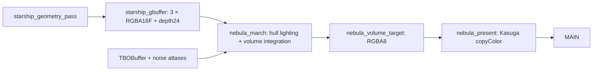

# Nebula Warp Flight Demo

Nebula is a full rendering demo in `contentTesting`: an OBJ starship flies through a volumetric nebula, passing through charging, jump, warp, and exit stages while the camera gradually pulls back from a close-up to a wide shot. It demonstrates how Kasuga's post-processing graph, managed MRT, OBJ/MTL loading, GPU resources, shader parameters, and a shared animation clock work together. It is not shipped in the release library JAR.

## Running and Recording

Requires JDK 21; recording additionally requires Python, `nbtlib==2.0.4`, and `ffmpeg` / `ffprobe` on `PATH`.

```sh
python3 -m venv build/nebula-venv
build/nebula-venv/bin/pip install nbtlib==2.0.4
build/nebula-venv/bin/python scripts/nebula-sim.py --world /absolute/path/to/test-world
```

The script copies the source save into an isolated client directory, defaulting to `build/nebula-sim/client/saves/nebula-sim`. When `--world` is omitted, it uses `modules/modelling/run/client/saves/New World`, so you must prepare a test save before the first run. The demo only starts in a private singleplayer integrated server (not opened to LAN). The player is temporarily moved high above The End and restored to their original position, dimension, view orientation, game mode, flight state, and HUD state when stopping normally or exiting the world.

| Input / Command | Behavior |
| --- | --- |
| `/kasuga_nebula` | Start or restart the showcase |
| `/kasuga_nebula warp` / `Space` | Enter warp charging during cruise phases that allow manual trigger |
| Hold right mouse button + drag | Adjust the follow camera's orbit orientation |
| `/kasuga_nebula stop` / `Esc` | Stop and restore player state |
| `F3+T` | Rebuild shaders, models, and textures through the resource reload chain |

The demo draws no top-left control panel and keeps the lightning discharge frequency at `0.25 Hz` by default. The camera pulls back between 10.5 and 15 seconds; the wide shot uses scene time and does not wrap with the 15-second warp cycle.

Full client verification and 15-second offline 4K60 export:

```sh
build/nebula-venv/bin/python scripts/nebula-sim.py --test --record-seconds 15 \
  --width 3840 --height 2160 --fps 60 --allow-slow-render \
  --timeout-seconds 1800 --output build/nebula-kasuga-migration-4k60
```

The CLI prints `NEBULA_RENDER_PROGRESS 0%..100%` and outputs `nebula-sim.mp4`, PNG frames, and `report.json`. All 900 frames use the same simulation clock, advancing `1/60` second per frame; 60 FPS is the video timebase. `--allow-slow-render` only disables the dev-machine GPU duration gate; frame, timing, and lifecycle checks still run.

## Code and Resource Entry Points

The Java demo lives in `modules/modelling/src/contentTesting/java/test/kasuga/modelling/demo/nebula/`, and its unit tests live in `modules/modelling/src/test/java/test/kasuga/modelling/demo/nebula/`.

| Class | Responsibility |
| --- | --- |
| `NebulaDemo` | Registers the shader/graph and manages the player session, per-frame input, and resource generation |
| `NebulaPipeline` | Declares the targets, passes, and read/write dependencies used at runtime; topology tests call the same factory method |
| `NebulaStarshipRenderer` | Uses the library's OBJ loader and GPU objects to submit geometry to the passed-in graph target |
| `NebulaTextures` | Generates noise atlases and uploads dynamic scene data to `TBOBuffer` |
| `NebulaSimulation` / `NebulaWarpSequence` | Unified timeline, lightning simulation, manual trigger, and warp FSM |
| `NebulaFlight` | Starship trajectory, wake, local coordinates, and camera curves |
| `NebulaClientSmokeTest` | Real-GPU pixel checks, reload, cleanup, and fixed-step capture acceptance |

Resources are under `modules/modelling/src/contentTesting/resources/assets/kasuga_demo/`: `models/constitution_starship.obj` with matching MTL/PNGs, `shaders/core/nebula_starship.{vert,frag}`, `nebula_volume.{json,vsh,fsh}`, and `shaders/include/`. The OBJ, MTL, textures, and geometry shaders are all loaded via Minecraft's `ResourceManager`, supporting resource pack overrides.

## Render Pipeline



`PostProcessTargetDescriptor.colorAttachments(...)` declares three half-float attachments; `useDepth(true)` provides sampleable depth. The target pool adapts the library's `FrameBuffer` through `MultiAttachmentRenderTarget`, allocating at the actual output dimensions. The geometry renderer owns neither its own FBO nor a second target pool.

| G-buffer Slot | Contents |
| --- | --- |
| color 0 | Linear base color RGB and surface mask |
| color 1 | World normal XYZ and validity flag |
| color 2 | metallic / roughness / AO / emission |
| depth | 24-bit depth; the volume pass reconstructs the hull hit distance and truncates foreground integration |

The geometry pass declares `writes(GBUFFER)`; the volume pass declares `reads(GBUFFER).writes(VOLUME)` and samples via `colorSampler(name, context.read(GBUFFER), index)` and `depthSampler`. Finally, `context.copyColor(VOLUME, MAIN, false)` presents to the main target, reusing the library copy instead of creating another present shader.

Low-level resources are managed by `GlslProgram`, `VertexArrayObject`, `VBOBuffer`, `TBOBuffer`, `GpuTexture2D`, and the target pool. The demo layer retains only the GL calls needed for draw state, timing, and diagnostics; generic allocation, binding restoration, and release are handled in the library. After a resource reload, the shader handle's `generation` triggers OBJ/PBR/noise reconstruction; on stop, the current targets are released via the graph's physical target IDs and reallocated on demand on restart. Deletion checks run immediately after release to avoid false positives from GL name reuse.

## Model and Materials

`KsgObjLoader.loadFlatMesh` reuses the existing OBJ/MTL processors and outputs a triangulated vertex stream for custom geometry shaders. Negative indices, groups/objects, and `usemtl` follow the shared parsing chain; missing normals fall back to generated face normals, and missing UVs default to zero. The current asset has 6,564 triangles with a 16-float vertex layout: `position` (3), `normal` (3), `UV` (2), `baseColor/opacity` (4), and `emissionStrength/roughness/materialKind/padding` (4). Metallic values are supplied by a data texture.

| MTL Directive | Nebula Usage |
| --- | --- |
| `map_Kd` | Imagegen base color, decoded as sRGB |
| `map_Bump` | Tangent-space normal data map |
| `map_Pr` | Demo-specific packed metallic / roughness / AO data map |
| `map_Ke` | Emissive data map |
| `Ke` / `Pr` | Material emissive color / scalar roughness |

In this demo, `map_Pr` carries a packed data texture; that channel layout is a Nebula shader convention and does not imply that other OBJ renderers interpret it the same way. Texture names come from the MTL. The base color generation prompt is in [imagegen-material-prompt.txt](../../examples/nebula-sim/imagegen-material-prompt.txt), and the remaining data textures are generated by the [asset script](../../scripts/generate-nebula-starship-obj.py).

`nebula_starship.frag` only outputs surface data; `nebula_hull_lighting.glsl` evaluates GGX/Schlick direct lighting and indirect light from the cloud field; `nebula_warp_medium.glsl` supplies non-emissive dust/smoke density. Indirect light samples cloud density and the lit field across a hemisphere while accounting for AO as a bounded-probe GI approximation. The wake alters the medium through evacuation, compression, and twin-vortex domain distortion, which is then extinguished, scattered, and composited together with the nebula.

## Dynamic Data and Parameters

Dynamic data uses `samplerBuffer DataSampler`, bound after shader apply via `FullscreenPassBuilder.bufferSampler`. The TBO is pinned to texture unit 7, leaving other 2D sampler units free; shared sampler JSON entries must not be treated as ordinary `getUniform()` uniforms.

The layout spans 384 `vec4` entries (`64 × 6 × 16 = 6144` bytes), uploaded in full every frame. The logical row layout is only for packing clarity; the shader reads entries with `texelFetch(DataSampler, y * 64 + x)` (`y` as row, `x` as column).

| Range (`vec4` index) | Contents |
| --- | --- |
| 0–23 / 24–25 | Stern wake history positions / lightning point lights; 26–63 zero-padded |
| 64–127 / 128–191 | Lightning segment start + energy / end + width |
| 192–223 / 224–255 | Culled stars / near-camera dust motes, zero-padded |
| 256–319 / 320–383 | Twin-engine particle heads + brightness / tails + radius |

`RenderShaderDescriptor`'s `ShaderParameterSchema` / `ShaderParameterBlock` manages seven scalar parameters: `InteractionStrength`, `IndirectStrength`, `SmokeStrength`, `CoreStrength`, `DetailStrength`, `GlobalFlash`, and `ShipScale`. Time, matrices, and per-frame counts are still set via uniforms; they are scene inputs rather than persisted user parameters.

## Camera, FSM, and Clock

Only `AnimationTimeline` advances scene time: interactive mode is driven by 20 Hz ticks, while recording mode disables tick advance and drives it per frame via `captureFrame(fps)`. Cloud motion, starship trajectory, wake, lightning, and camera all read the same clock.

`StateMachine<DoubleSupplier>` guards read the warp cycle time directly to handle `CRUISE`, `CHARGING`, `JUMP`, `WARP`, `EXIT`, `READY`, and cross-phase seeks; the FSM does not own a second playback clock. Manual triggering only adjusts the warp offset without resetting the flight trajectory or the ending camera pull-back.

Phase-driven camera motion uses `CameraAnimationClip.Track`, `Keyframe`, and the shared `Easing.quinticHermite`, sharing knot velocities and accelerations. The ending lens reveal uses a `CameraAnimationPlayer` following the scene timeline to widen the baseline 66° FOV to 74°; sampling never advances the clock. This custom Hermite easing is constructed in Java and currently has no matching custom-parameter JSON codec.

The camera retains procedural tracking and warp-specific offsets, producing a `WorldCameraView`. Both the geometry and volume passes share its `forward`, `inverseView`, and `projection` matrices so yaw/pitch/roll, FOV, and local coordinates match without rendering a second copy of the Minecraft world.

## Verification and Boundaries

```sh
./gradlew :modules:modelling:compileContentTestingJava \
  :modules:modelling:modelUnitTest \
  --tests 'test.kasuga.modelling.demo.nebula.*' \
  --tests 'lib.kasuga.rendering.effect.post.*' \
  --tests 'lib.kasuga.rendering.models.uml.dynamic.math.EasingTest' \
  --tests 'lib.kasuga.rendering.output.camera.*'
./gradlew :modules:modelling:renderGlTest
```

JVM tests cover the real graph declaration, MRT formats, OBJ/MTL loading, envelope bounds, timing, FSM transitions, and camera curves. The client smoke test verifies sampler bindings, pixel luminance, hull mask coverage, core/GI/texture/smoke A/B checks, near-to-wide camera motion, resize, reload `generation`, repeated start/stop, disconnect, and player state restoration.

Migration acceptance records are in the [example README](../../examples/nebula-sim/README.md). Current GPU evidence comes from Apple M3 Max, Java 21, Minecraft 1.21.1, and NeoForge 21.1.203 with Iris/Sodium installed and no external shader pack enabled; other GPUs and enabled external shader packs require separate verification.
