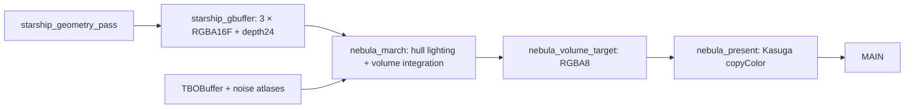

# Nebula 曲速飞行 demo

Nebula 是 `contentTesting` 中的完整渲染示例：OBJ 星舰穿过体积星云，经过蓄能、跃迁、曲速和脱出，镜头从近景逐渐拉到远景。它演示 Kasuga 后处理图、受管 MRT、OBJ/MTL 加载、GPU 资源、shader 参数和共享动画时钟的组合方式，不随正式库 jar 发布。

## 运行与录制

需要 JDK 21；录制另外需要 Python、`nbtlib==2.0.4` 和 PATH 中的 `ffmpeg` / `ffprobe`。

```sh
python3 -m venv build/nebula-venv
build/nebula-venv/bin/pip install nbtlib==2.0.4
build/nebula-venv/bin/python scripts/nebula-sim.py --world /absolute/path/to/test-world
```

脚本将源存档复制到隔离客户端目录，默认是 `build/nebula-sim/client/saves/nebula-sim`。未传 `--world` 时使用 `modules/modelling/run/client/saves/New World`，因此首次运行须准备一个测试存档。演示仅在未开放 LAN 的单人集成服务器启动；玩家临时进入末地高空，正常停止或退出世界时恢复原位置、维度、视角、游戏模式、飞行和 HUD 状态。

| 操作 | 行为 |
| --- | --- |
| `/kasuga_nebula` | 启动或重启展示 |
| `/kasuga_nebula warp` / 空格 | 允许手动触发的巡航阶段进入曲速蓄能 |
| 鼠标右键拖动 | 调整跟随镜头方位 |
| `/kasuga_nebula stop` / Esc | 停止并恢复玩家状态 |
| F3+T | 通过资源重载链重建 shader、模型和纹理 |

画面不绘制左上角面板，放电频率默认保持 `0.25 Hz`。镜头在 10.5–15 秒间拉远；远景使用场景时间，不随 15 秒曲速周期回绕。

完整客户端验证与 15 秒离线 4K60 导出：

```sh
build/nebula-venv/bin/python scripts/nebula-sim.py --test --record-seconds 15 \
  --width 3840 --height 2160 --fps 60 --allow-slow-render \
  --timeout-seconds 1800 --output build/nebula-kasuga-migration-4k60
```

命令行显示 `NEBULA_RENDER_PROGRESS 0%..100%`，输出 `nebula-sim.mp4`、PNG 和 `report.json`。900 帧使用同一个仿真时钟，每帧推进 `1/60` 秒；60 FPS 是视频时间基准。`--allow-slow-render` 只解除开发机 GPU 耗时门禁，仍执行画面、时序和生命周期检查。

## 代码与资源入口

Java 示例位于 `modules/modelling/src/contentTesting/java/test/kasuga/modelling/demo/nebula/`，对应测试位于 `modules/modelling/src/test/java/test/kasuga/modelling/demo/nebula/`。

| 类 | 职责 |
| --- | --- |
| `NebulaDemo` | 注册 shader/graph，管理玩家会话、逐帧输入和资源 generation |
| `NebulaPipeline` | 声明实际使用的目标、pass 和读写依赖；拓扑测试直接调用同一构造方法 |
| `NebulaStarshipRenderer` | 使用库内 OBJ loader 与 GPU 对象，向传入的 graph target 提交几何 |
| `NebulaTextures` | 生成噪声图集，将动态场景数据上传到 `TBOBuffer` |
| `NebulaSimulation` / `NebulaWarpSequence` | 统一时间轴、闪电、手动触发和曲速 FSM |
| `NebulaFlight` | 星舰轨迹、尾流、局部坐标和镜头业务曲线 |
| `NebulaClientSmokeTest` | 真实 GPU 像素、重载、清理与固定帧录制验收 |

资源在 `modules/modelling/src/contentTesting/resources/assets/kasuga_demo/`：`models/constitution_starship.obj`、配套 MTL/PNG，`shaders/core/nebula_starship.{vert,frag}`、`nebula_volume.{json,vsh,fsh}` 和 `shaders/include/`。OBJ、MTL、贴图和几何 shader 均从 Minecraft `ResourceManager` 读取，支持资源包覆盖。

## 渲染管线



`PostProcessTargetDescriptor.colorAttachments(...)` 声明三张半浮点附件；`useDepth(true)` 提供可采样深度。目标池通过 `MultiAttachmentRenderTarget` 适配库内 `FrameBuffer`，按实际输出尺寸分配。几何 renderer 不持有自己的 FBO，也不分配第二套目标池。

| G-buffer 槽 | 内容 |
| --- | --- |
| color 0 | 线性底色 RGB 与表面遮罩 |
| color 1 | 世界法线 XYZ 与有效标记 |
| color 2 | metallic / roughness / AO / emission |
| depth | 24 位深度；体积 pass 重建船体命中距离并截断前景积分 |

几何 pass 声明 `writes(GBUFFER)`；体积 pass 声明 `reads(GBUFFER).writes(VOLUME)`，通过 `colorSampler(name, context.read(GBUFFER), index)` 和 `depthSampler` 采样。最后用 `context.copyColor(VOLUME, MAIN, false)` 呈现，复用库内拷贝，不另建 present shader。

底层资源由 `GlslProgram`、`VertexArrayObject`、`VBOBuffer`、`TBOBuffer`、`GpuTexture2D` 和目标池分工管理。业务层保留绘制状态、计时和诊断所需 GL 调用；通用分配、绑定恢复及释放在库内实现。资源重载后，shader handle 的 generation 触发 OBJ/PBR/噪声重建；停止时通过 graph 的物理 target ID 释放本次目标，重新启动按需分配。删除校验在释放后立即执行，避免 GL 名字复用造成误判。

## 模型与材质

`KsgObjLoader.loadFlatMesh` 复用已有 OBJ/MTL processor，输出供自定义几何 shader 使用的三角化顶点流。负索引、group/object 和 `usemtl` 沿用公共解析链；缺法线时生成面法线，缺 UV 时补零。当前资产为 6,564 个三角面，顶点布局为 16 个 float：position3、normal3、UV2、baseColor/opacity4、emissionStrength/roughness/materialKind/padding4。金属度由数据贴图提供。

| MTL 指令 | Nebula 用途 |
| --- | --- |
| `map_Kd` | imagegen 底色，以 sRGB 解码 |
| `map_Bump` | 切线空间法线数据图 |
| `map_Pr` | 示例约定的 metallic / roughness / AO 数据图 |
| `map_Ke` | 自发光数据图 |
| `Ke` / `Pr` | 材质自发光颜色 / 标量粗糙度 |

`map_Pr` 在本 demo 中承载打包数据图；通道解释属于 Nebula shader 约定，不能推断其他 OBJ renderer 自动采用同样语义。贴图名称由 MTL 提供。底色生成提示词见 [imagegen-material-prompt.txt](../../examples/nebula-sim/imagegen-material-prompt.txt)，其余数据图由 [资产脚本](../../scripts/generate-nebula-starship-obj.py) 生成。

`nebula_starship.frag` 只输出表面数据；`nebula_hull_lighting.glsl` 计算 GGX/Schlick 受光与云场间接光；`nebula_warp_medium.glsl` 提供非自发光烟尘密度。间接光采样半球内云密度和受光场，并考虑 AO，是有限探针的 GI 近似。尾流通过排空、压缩和双涡域扭曲改变介质，随后与星云共同消光、散射和合成。

## 动态数据与参数

动态数据使用 `samplerBuffer DataSampler`，经 `FullscreenPassBuilder.bufferSampler` 在 shader apply 后绑定。TBO 固定使用纹理单元 7，保留其他 2D sampler 单元；公共 sampler JSON 条目不能当成普通 `getUniform()` 处理。

布局共 384 个 `vec4`，即 `64 × 6 × 16 = 6144` 字节，每帧完整上传。旧行号仅用于理解打包，实际 shader 以 `texelFetch(buffer, row * 64 + column)` 读取。

| 区间（vec4 索引） | 内容 |
| --- | --- |
| 0–23 / 24–25 | 船尾历史位置 / 闪电点光；26–63 补零 |
| 64–127 / 128–191 | 闪电线段起点与能量 / 终点与宽度 |
| 192–223 / 224–255 | 剔除后的星点 / 近景尘埃，不足补零 |
| 256–319 / 320–383 | 双引擎粒子头部与亮度 / 尾部与半径 |

`RenderShaderDescriptor` 的 `ShaderParameterSchema` / `ShaderParameterBlock` 管理七项标量参数：`InteractionStrength`、`IndirectStrength`、`SmokeStrength`、`CoreStrength`、`DetailStrength`、`GlobalFlash`、`ShipScale`。时间、矩阵和逐帧计数仍通过 uniform 设置；它们是场景输入，不另建参数存储系统。

## 镜头、FSM 与时钟

只有 `AnimationTimeline` 推进场景时间：交互模式由 20 Hz tick 驱动，录制模式关闭 tick 推进，改由逐帧 `captureFrame(fps)` 驱动。云、船体、航迹、闪电、镜头都读取同一时钟。

`StateMachine<DoubleSupplier>` 的守卫直接读取曲速周期时间，处理 CRUISE、CHARGING、JUMP、WARP、EXIT、READY，以及跨阶段 seek；FSM 不拥有第二套播放时钟。手动触发只改变曲速偏移，不重置飞行和收尾镜头。

阶段镜头使用 `CameraAnimationClip.Track`、`Keyframe` 与公共 `Easing.quinticHermite`，共享节点速度和加速度。收尾光学变化使用跟随场景 timeline 的 `CameraAnimationPlayer`，将基准 66° 镜头展开到 74°；采样不会推进时钟。该自定义 Hermite easing 供 Java 构造，当前没有对应的自定义参数 JSON codec。

镜头保留程序化跟随与曲速业务位移，最终产出 `WorldCameraView`。几何和体积共同使用其 `forward`、`inverseView`、`projection`，保持 yaw/pitch/roll、FOV 与局部坐标一致，不需要额外渲染一份 Minecraft 世界。

## 验证与边界

```sh
./gradlew :modules:modelling:compileContentTestingJava \
  :modules:modelling:modelUnitTest \
  --tests 'test.kasuga.modelling.demo.nebula.*' \
  --tests 'lib.kasuga.rendering.effect.post.*' \
  --tests 'lib.kasuga.rendering.models.uml.dynamic.math.EasingTest' \
  --tests 'lib.kasuga.rendering.output.camera.*'
./gradlew :modules:modelling:renderGlTest
```

JVM 检查真实 graph 声明、MRT 格式、OBJ/MTL、包络、时序、FSM 与镜头曲线。客户端 smoke 检查实际采样器绑定、像素亮度、船体遮罩、核心/GI/贴图/烟尘 A/B、近远运镜、resize、重载 generation、重复启停、断线和玩家恢复。

迁移验收记录见 [示例 README](../../examples/nebula-sim/README.md)。当前 GPU 证据来自 Apple M3 Max、Java 21、Minecraft 1.21.1、NeoForge 21.1.203，安装 Iris/Sodium 且未开启外部光影包；其他 GPU 和外部光影包组合需另验。
