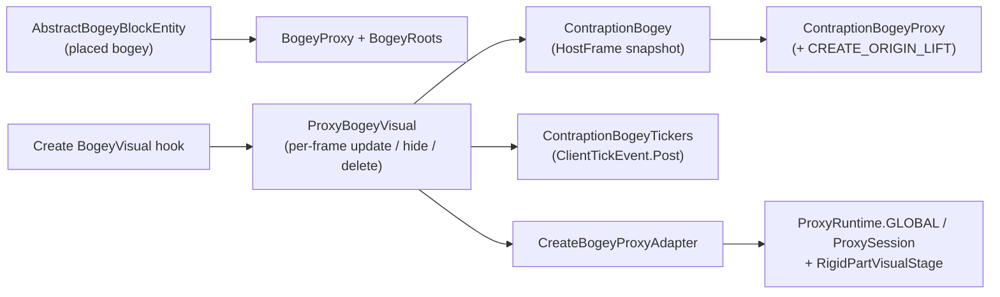

# Create Module Integration Reference

`modules/create` provides KasugaLibNext's optional Create 6 integration, covering the track and
bogey registration DSL, train device and custom signal segment extensions, bogey and contraption
Proxy adapters, extended contraption interaction shapes, and moving-structure scene hosts. All
Micronaut beans are gated on `@CreateModBeans` (`IfCreateModLoaded`) so they activate only when
the `create` mod is loaded.

Package root: `lib.kasuga.create`  
Source tree: `modules/create/src/main/java/lib/kasuga/create/`

Related guides and scene-host references:

- [Multi-Bogey Train Carriages](../guides/create/multi-bogey-carriage.md) / [Carriage Vertical Posture](../guides/create/carriage-posture.md)
- [Model Collision, Chunk Lifecycle, and Distant Rendering](../guides/world-model-collision-and-lod.md) (Create contraption LOD)
- [Scenes and UI on moving structures](moving-scene-hosts.md) / [Aeronautics / Sable scene hosts](sable-scene-hosts.md)
- [Integrating Content With the Proxy Kernel](../guides/proxy-integration.md) / [Proxy: An Adapter Between Minecraft Elements and Animation](../explanation/proxy/README.md)

## 1. Create Registration DSL and Lifecycle

Packages: `lib.kasuga.create.registration`, `lib.kasuga.create.registration.{bogey,track,edge_data,edge_point}`, `lib.kasuga.create.client.registration`

### 1.1 Dispatching and Two-Phase Commit

`CreateRegistrationDispatcher` (`@Context @CreateModBeans`) hooks
`RegisterContextRegistry.registerBefore(Side.COMMON, RegistrationStage.REGISTER_EVENT, ...)` so
`CreateRegistrationState.prepare(registry, clientBridge)` runs once before the vanilla registration
event:

| Type | Responsibility | Key members |
| --- | --- | --- |
| `CreateRegistrationDispatcher` | Wires `CreateRegistrationStages.PREPARE` into the common registration lifecycle | `@PostConstruct init()` |
| `CreateRegistrationStages` | Defines the Create preparation stage | `PREPARE` (`RegistrationStage<CreateRegistrationEvent>`) |
| `CreateRegistrationState` | Tracks per-`Registry` preparation state so commit runs at most once | `Status` (`NEW` / `PREPARING` / `COMMITTED` / `FAILED`), `prepare(...)`, `status()`, `preparationCount()` |
| `CreateRegistrationEvent` | Collects, validates, and commits Create entries in phase order | `Phase` (`TRACK_MATERIAL`, `BOGEY_SIZE`, `BOGEY_BLOCK`, `BOGEY_STYLE`), `submit(...)`, `contains(...)` |
| `CreateClientBridge` | Isolates client visual wiring; dedicated servers fall back to `CreateClientBridge.noop()` | Implemented on client by `ClientCreateRegistrationBridge` (`@BeanOnlyIn.Client`) |

`CreateRegistrationEvent` guarantees:

- All submissions are sorted by `(Phase, ResourceLocation.toString())`; duplicate `(Phase, id)` keys throw `IllegalStateException`;
- Every `validator` runs before any `committer` executes;
- Any validation or commit exception transitions `CreateRegistrationState` to `FAILED` and caches the failure so subsequent calls rethrow the same exception.

### 1.2 Bogey Registration: `BogeySizeReg`, `BogeyBlockReg`, `BogeyGroupReg`

| Registration / Index | Package | Signatures & Behavior |
| --- | --- | --- |
| `BogeySizeReg` | `registration.bogey` | `BogeySizeReg(String name)` (default radius `1.0f`), `BogeySizeReg(String name, float wheelRadius)`, `size(float wheelRadius)`. Radius must be finite and positive. Commits via `BogeySizes.register(...)` and populates `BogeyMetadataIndex`. |
| `BogeyBlockReg<T extends AbstractBogeyBlock<?>>` | `registration.bogey` | `BogeyBlockReg(String name, BogeySizeReg size, BogeyBlockFactory<T> factory)`. Owns a child `BlockReg<T>` (`getBlockReg()`) and exposes `withBlockProperties(UnaryOperator<BlockBehaviour.Properties>)` and `getSizeReg()`. Validates during `PREPARE` that `size` is committed or pending in the same event. |
| `BogeyGroupReg` | `registration.bogey` | `BogeyGroupReg(String name, String cycleGroup)`, producing a Create `BogeyStyle`. Requires at least one size, rejects duplicate style IDs already in `AllBogeyStyles.BOGEY_STYLES`, checks size/block consistency, and calls `clientBridge.validateBogeyRenderer(...)`. |
| `BogeyRendererHandle` | `registration.bogey` | `record BogeyRendererHandle(ResourceLocation id)`, `BogeyRendererHandle.of(ResourceLocation)`. Keeps common code decoupled from client renderer types. |
| `ClientBogeyRendererRegistry` | `client.registration` | `@Context @CreateModBeans @BeanOnlyIn.Client`. `register(BogeyRendererHandle, Supplier<? extends BogeyRenderer>, BogeyVisualizer)`, `get(...)`, `remove(...)`, `clear()` backed by `WeakHashMap`. |
| `BogeyMetadataIndex` | `registration.bogey` | `SizeMetadata(ResourceLocation id, float wheelRadius)`, `StyleMetadata(ResourceLocation id, ResourceLocation cycleGroup)`, `get(BogeySizes.BogeySize)` / `get(BogeyStyle)` / `clear()` (`WeakHashMap`). |

Fluent methods on `BogeyGroupReg`:

- `displayName(Component)` / `translationKey(String)`
- `sound(Supplier<SoundEvent>)`, `contactParticle(ParticleOptions)`, `smokeParticle(ParticleOptions)`, `defaultData(CompoundTag)`
- `bogey(BogeySizeReg size, BogeyBlockReg<?> block, BogeyRendererHandle rendererHandle)`
- `onCommitted(Consumer<BogeyStyle> callback)`: runs once after the style is committed into `AllBogeyStyles`. Style IDs and sizes only exist at this point, so external render-pipeline mappings such as `BogeyModels.register(...)` must be called inside `onCommitted`.

### 1.3 Track Registration: `TrackMaterialReg` and `TrackReg`

| Registration / Index | Package | Signatures & Behavior |
| --- | --- | --- |
| `TrackMaterialReg` | `registration.track` | `TrackMaterialReg(String name)` builds Create's `TrackMaterial` and records `TrackMaterialMetadata` in `TrackMaterialMetadataIndex`. |
| `TrackReg<T extends TrackBlock>` | `registration.track` | `TrackReg(String name, TrackMaterialReg material, TrackBlockFactory<T> factory)`. Composes child `BlockReg<T>` (`getBlockReg()`) and `ItemReg<TrackBlockItem>` (`getItemReg()` / `getItem()`) without inheriting `BlockReg`. Hooks `CreateClientBridge.trackBlockCreated` to wrap baked block models in Create's `TrackModel`. Exposes `withBlockProperties(...)`, `withItemProperties(...)`, and `getMaterialReg()`. |
| `TrackModelDescriptor` | `registration.track` | `Mode` (`DEFAULT` / `STANDARD` / `CUSTOM`), `defaultModels()`, `standardModels()`, `custom(tie, leftSegment, rightSegment)`. |
| `TrackMaterialMetadata` / `TrackMaterialMetadataIndex` | `registration.track` | `TrackMaterialMetadata(ResourceLocation id, boolean replaceable, UnaryOperator<Vec3> railOffset)`; `put` / `get` / `remove` / `clear` (`WeakHashMap`). |
| `ClientTrackMetadataIndex` | `client.registration` | `@Context @CreateModBeans @BeanOnlyIn.Client`, caches `TrackModelDescriptor` per `TrackMaterial`. |

Fluent methods on `TrackMaterialReg`:

- Required: `block(Supplier<? extends TrackBlock>)` / `block(TrackReg<?>)` and `particle(ResourceLocation)`;
- Optional: `lang(String)`, `trackType(TrackMaterial.TrackType)` / `trackType(ResourceLocation, TrackMaterial.TrackType.TrackBlockFactory)`, `sleeper(ItemLike...)`, `rails(ItemLike...)`, `replaceable(boolean)`;
- Models: `defaultModels()`, `standardModels()`, `customModels(ResourceLocation tie, ResourceLocation leftSegment, ResourceLocation rightSegment)`;
- Curve rail gauge offset: `simpleTrackModelOffset(float halfDistance)` (`vector -> vector.scale(halfDistance)`) or `trackModelOffset(UnaryOperator<Vec3>)`, defaulting to `vector -> vector.scale(.965f)`. On the client, `CreateMixinPlugin` selects `BezierConnectionMixin` or `ModernBezierSegmentsMixin` / `ModernBezierGirdersMixin` according to Create's curve API.

### 1.4 Edge Data & Edge Point Registrations: `EdgeDataReg` and `TrackEdgePointReg`

- `EdgeDataReg<T extends EdgeExtraPayload>` (`lib.kasuga.create.registration.edge_data`):
  `new EdgeDataReg<>(registrationKey, supplier, reader)` builds an `EdgeExtraPayloadType<T>` and registers it into `EdgeExtraPayloadRegistry` during `RegistrationStage.REGISTER_EVENT`.
- `TrackEdgePointReg<T extends TrackEdgePoint>` (`lib.kasuga.create.registration.edge_point`):
  `new TrackEdgePointReg<>(id, supplier)` calls `EdgePointType.register(...)` during `RegistrationStage.REGISTER_EVENT`; `getBlockItemFactory()` provides a `BiFunction<Block, Item.Properties, BlockItem>` via `TrackTargetingBlockItem.ofType`.
- Edge-point helpers (`content.train.edge_point` and `client.rendering.edge_point`):
  - `BogeyObserverEdgePoint`: defines `void notifyBogey(Train train)`. Note that automatic dispatch of `BogeyObserverEdgePoint` inside `TrainMixin`'s `frontSignalListener` and `backSignalListener` is currently commented out in source.
  - `EdgePointBlockEntity<T extends TrackEdgePoint>`: extends Create's `SmartBlockEntity`, attaches `TrackTargetingBehaviour<T>`, and delegates `getEdgePointType()` to subclasses.
  - `EdgePointRenderer`, `EdgePointBlockEntityRenderer<T>`, `EdgePointOverlayRenderer`, and `EdgePointOverlayRendererRegistry` (weak-key registry mapping `EdgePointType<?> -> EdgePointOverlayRenderer`).

### 1.5 Minimal Registration Example

```java
// Common definitions (adapted from contentTesting)
public static final BogeySizeReg PK209P = new BogeySizeReg("pk209p", 0.915f / 2f);
public static final BogeyRendererHandle PK209P_RENDERER =
        BogeyRendererHandle.of(ResourceLocation.fromNamespaceAndPath("examplemod", "pk209p_renderer"));

public static final BogeyBlockReg<ExampleBogeyBlock> STANDARD_BOGEY = new BogeyBlockReg<>(
        "pk209p_bogey",
        PK209P,
        (properties, size) -> new ExampleBogeyBlock(properties, size, /* ... */)
).withBlockProperties(properties -> properties.strength(2.0f).noOcclusion());

public static final BogeyGroupReg STANDARD_GROUP = new BogeyGroupReg("standard", "example_bogey")
        .displayName(Component.literal("Standard Bogey"))
        .bogey(PK209P, STANDARD_BOGEY, PK209P_RENDERER)
        .onCommitted(style -> BogeyModels.register(
                style.id, PK209P.getEntry(), pk209pParts, 0.91f + BogeyRoots.CREATE_Y_OFFSET
        ));

public static final TrackMaterialReg STANDARD_MATERIAL = new TrackMaterialReg("standard")
        .lang("Standard")
        .particle(ResourceLocation.fromNamespaceAndPath("examplemod", "block/track_particle"))
        .customModels(tieModel, leftSegModel, rightSegModel)
        .simpleTrackModelOffset(0.755f);

public static final TrackReg<ExampleTrackBlock> STANDARD_TRACK = new TrackReg<>(
        "standard_track",
        STANDARD_MATERIAL,
        (properties, material) -> new ExampleTrackBlock(properties, material, STANDARD_BOGEY::getEntry)
);

public static void register(Registry registry) {
    PK209P.setParent(registry);
    STANDARD_BOGEY.setParent(registry);
    STANDARD_GROUP.setParent(registry);
    STANDARD_MATERIAL.block(STANDARD_TRACK).setParent(registry);
    STANDARD_TRACK.setParent(registry);
}
```

```java
// Client renderer binding (@BeanOnlyIn.Client)
renderers.register(
        PK209P_RENDERER,
        ProxyBogeyVisual.NoopRenderer::new,
        (context, partialTick, inContraption) -> new ProxyBogeyVisual(
                context, PK209P.getEntry(), myContraptionBogeyProxy)
);
```

## 2. Train Devices, Custom Track Segments, and Graph Extra Data

### 2.1 `TrainDeviceRegistry` and `TrainDeviceSystem`

Package: `lib.kasuga.create.content.train.device`

`TrainMixin` implements `TrainDeviceProvider`, attaching one `TrainDeviceManager` to each Create
`Train` and forwarding NBT serialization, ticks, speed/distance hooks, and signal callbacks:

| Type | Key Methods | Notes |
| --- | --- | --- |
| `TrainDeviceRegistry` | `register(ResourceLocation, TrainDeviceSystemType<?>)`, `register(ResourceLocation, TrainDeviceSystemType<?>, boolean contextDevice)`, `get(ResourceLocation)`, `getKey(TrainDeviceSystemType<?>)`, `createInitialContextDevices(TrainDeviceManager)` | Registers train device system types. Setting `contextDevice = true` instantiates the system on every newly constructed `Train`. Duplicate IDs or types throw `IllegalArgumentException`. |
| `TrainDeviceSystemType<T>` | `TrainDeviceSystemType.of(Function<TrainDeviceManager, T>)`, `create(TrainDeviceManager)` | Factory descriptor for a `TrainDeviceSystem`. |
| `TrainDeviceSystem` | `write(CompoundTag)`, `read(CompoundTag)`, `earlyTick(Level)`, `tick(Level)`, `initializeServer(Level)`, `beforeSpeed()`, `cancelSlowdown()`, `notifySpeed(double)`, `notifyDistance(double)`, `notifySignalFront(...)`, `notifySignalBack(...)`, `notifySignalCollection()`, `notifyDisassemble(Direction, BlockPos)`, `onSegmentUpdated(ResourceLocation)` | Base class for per-train systems. On the first non-client `tick`, invokes `initializeServer(Level)` once. |
| `TrainDeviceManager` | `getManager(Train)`, `getManager(MovementContext)`, `getManager(AbstractContraptionEntity, BlockPos)`, `getSystem(TrainDeviceSystemType<T>)`, `getOrCreateSystem(TrainDeviceSystemType<T>)`, `updateCache()` | Manages per-train system instances. `cancelSlowdown()` uses a cached flag updated via `updateCache()`. Persists under `"TrainDeviceSystems"`. |
| `TrainDeviceLocation` | `record TrainDeviceLocation(UUID trainId, int carriageIndex, BlockPos position)`, `read(CompoundTag)`, `write(CompoundTag)` | Identifies a device block position inside a train carriage. |

### 2.2 `BoundarySegmentRegistry` and `CustomTrackSegment`

Package: `lib.kasuga.create.content.train.signal`

Provides custom track-graph signal/circuit segments independent of Create's built-in block signals:

| Type | Responsibility & Key Methods |
| --- | --- |
| `BoundarySegmentRegistry` | `register(ResourceLocation featureLocation, EdgePointType<? extends CustomBoundary> boundary, Function<UUID, CustomTrackSegment> constructor)`, `registerUpdateListener(ResourceLocation, EdgePointType<? extends SegmentUpdateListener>)`, `createSegment(CustomBoundary, UUID)`, `createSegmentByFeatureName(ResourceLocation, UUID)`, `getFeatureName(...)`, `getBoundaries()`. |
| `CustomTrackSegment` | Per-segment state object constructed with `UUID segmentId`; overridable `write()`, `read(CompoundTag)`, and `onEarlyGlobalTick()` (invoked from `GlobalRailwayManagerMixin.onTick` on Overworld ticks via `RailwayData.onEarlyGlobalTick(Level)`). |
| `CustomBoundary` | Abstract `SingleBlockEntityEdgePoint` subclass maintaining directional `sidedSegments` and `dirty` flags; triggers `CustomTrackSegmentPropagator.propagate(graph, this, dir)` in `tick` and `onRemoved`. |
| `CustomTrackSegmentPropagator` | `@Singleton` bean propagating segment IDs across the `TrackGraph` (`propagate`, `notifyNewNode`, `onRemoved`, `walk`) and notifying trains on affected edges via `TrainDeviceManager.onSegmentUpdated(segmentType)`. |
| `CustomSegmentUtil` | `@Singleton` bean providing `getSegment(TrackGraph, TrackEdge, EdgePointType<? extends CustomBoundary>, double position)` and `getSegmentIdAt(...)`. |
| `SegmentPropagator`, `EdgePointFilter`, `ResourcePalette`, `SegmentUpdateListener` | Generic BFS graph traversal helper, filtered edge-point scanner, NBT `ResourceLocation` palette, and update listener marker interface. |

### 2.3 `EdgeExtraPayloadRegistry`, `RailwayData`, and `RailwayDataSyncManager`

Packages: `lib.kasuga.create.content.train.graph`, `lib.kasuga.create.content.train.graph.sync`

| Type | Core API | Notes |
| --- | --- | --- |
| `EdgeExtraPayloadRegistry` | `register(ResourceLocation id, EdgeExtraPayloadType<T> type)`, `get(ResourceLocation id)`, `getId(EdgeExtraPayloadType<?> type)` | Registry for custom per-edge payloads (normally registered via `EdgeDataReg` during `REGISTER_EVENT`). |
| `EdgeExtraPayloadType<T>`, `EdgeExtraPayload` | `EdgeExtraPayloadType.Builder<>(supplier, reader).build()`, `write()`, `getType()` | Serialization contract for edge payloads. |
| `EdgeExtraData` | `setBoundaryFeature`, `getBoundaryFeature`, `getEffectiveBoundaryFeature`, `setBoundaryFeaturePassive`, `setPayload`, `getPayload`, `getPayloadOptional` | Per-`TrackEdge` boundary group IDs (defaulting to `passiveBoundaryGroup`, the zero UUID) and lazily instantiated payload map. |
| `GraphExtraData` | `withGraph`, `getEdgeData`, `getOrComputeEdgeData`, `createEdge`, `removeEdge`, `transfer`, `transferAll`, `syncWithExternal` | Kept synchronized across graph creation, removal, merging, transfers, and node edits by `TrackGraphMixin` and `GlobalRailwayManagerMixin`. |
| `RailwayManager` / `RailwayData` | `RailwayManager.getData()`, `RailwayData.withGraph(TrackGraph)`, `addSegment` / `removeSegment` / `getSegment` / `hasSegment` | Persists all graph extra data and custom segment instances via `Saved<RailwayData>` (`Saved.Impl`) under `"kasuga_railway_data"`. |
| `RailwayDataSyncManager` | `edgeExtraDataChanged(TrackGraph, TrackNode, TrackNode, TrackEdge, TrackEdge)`, `nodeExtraDataChanged(TrackGraph, TrackNode)` | **Currently a no-op stub**: callers in `CustomTrackSegmentPropagator` are commented out and no network sync packets are implemented yet. |

Additional graph utilities in `content.train.graph`: `TrackEdgeLocation`, `GraphWalker`, `GraphSimplifier` (collapsed topology & JSON export), and `TrainDistanceIntegrator`.

## 3. Bogey Proxy and Train Visual Integration

Packages: `lib.kasuga.create.proxy`, `lib.kasuga.create.client.rendering`

KasugaLibNext shares one `BogeyModels` registry across placed bogey block entities and
contraption-mounted train bogeys, driving both through the `ProxySession` kernel.



### 3.1 `BogeyModels`, `BogeyRoots`, and `ContraptionBogeyProxy`

- `BogeyModels`: thread-safe static registry (`ConcurrentHashMap`) mapping `(styleId, sizeId)` or style-wide `styleId` to `Placement(List<ModelPart> parts, float yOffset)`. Resolution order: exact `(style, size)` → style-wide → `null`. Also provides `styleIdOf(CompoundTag bogeyData)` reading Create's `"BogeyStyle"` NBT tag.
- `BogeyRoots`: `CREATE_Y_OFFSET = -1.5f - 1f / 128f` (Create's bogey models place their origin at the rail plane rather than the block center). `BogeyRoots.of(element, yOffset)` builds the block-centered transform including `AbstractBogeyBlock.AXIS` rotation.
- `BogeyProxy<T extends AbstractBogeyBlockEntity>`: implements `ElementProxy<T>` for placed bogeys; override `partsFor(T, BogeyModels.Placement)` to attach `ModelPart.Spin.tick(...)` or `pull` / `push` for an FSM.
- `ContraptionBogey`: train-side host carrier storing an atomic immutable `record HostFrame(float wheelAngle, Transform root)` snapshot; `normalizedRoot()` applies `placementYOffset` exactly once.
- `ContraptionBogeyProxy`: implements `ElementProxy<ContraptionBogey>` for train bogeys.
  - `CREATE_ORIGIN_LIFT = -BogeyRoots.CREATE_Y_OFFSET` (`1.5f + 1f / 128f`);
  - `rootOf(org.joml.Matrix4f pose, org.joml.Vector3i renderOrigin)` converts Flywheel's render-origin-relative `PoseStack` matrix into world-space placement coordinates by adding `renderOrigin` and lifting by `CREATE_ORIGIN_LIFT`;
  - `configure(ContraptionBogey)` looks up `BogeyModels.resolve(element.styleId(), element.sizeId())` and stores `element.placementYOffset(...)`; subclasses override `partsFor(...)` to attach `ModelPart.Spin.frame(...)`.

### 3.2 `ProxyBogeyVisual`, `ContraptionBogeyTickers`, and `CreateBogeyProxyAdapter`

- `ProxyBogeyVisual implements BogeyVisual`:
  - Constructor: `new ProxyBogeyVisual(VisualizationContext context, BogeySizes.BogeySize size, ElementProxy<ContraptionBogey> template)` (registered in `ClientBogeyRendererRegistry`).
  - Lazy creation: the first `update(CompoundTag bogeyData, float wheelAngle, PoseStack poseStack)` resolves the style ID from `bogeyData`, constructs `ContraptionBogey`, attaches a session via `CreateBogeyProxyAdapter.attach(...)`, and registers with `ContraptionBogeyTickers`.
  - Strict tick/frame split: `update(...)` executes during Flywheel's `beginFrame` and only calls `session.publishFrame(...)` (calling `resume()` if `SUSPENDED`); logical stepping runs once per game tick in `ContraptionBogeyTickers` (`ClientTickEvent.Post` → `session.tick(gameTime, 1.0 / 20.0)`).
  - Lifecycle & threading: `hide()` calls `session.suspend()`; a style change or `delete()` (which Flywheel may invoke from a worker thread) schedules `session.close()` onto the client game thread via `DeferredGameThreadTask` and `ContraptionBogeyTickers`.
  - `ProxyBogeyVisual.NoopRenderer implements BogeyRenderer`: register alongside `ProxyBogeyVisual` in `ClientBogeyRendererRegistry` so Create's non-Flywheel fallback renderer does not draw a duplicate model.
- `CreateBogeyProxyAdapter`:
  - `attach(ContraptionBogey element, ElementProxy<ContraptionBogey> template, ProxyIdentity identity, ProxyAttachToken token, @Nullable Level level)`:
    - Registers a temporary `ProxyDefinition` under `ProxyKey.external("kasuga_lib", "contraption_bogey/" + identity.discriminator() + "/" + token)` in `ProxyRuntime.GLOBAL` and attaches `element`;
    - Builds a `RigidPartVisualStage` (plus an optional `FsmAnimatedModel` via `ProxyConfig.machine()` wrapped in `ProxyMachineController`) using `LogicalStepPolicy.fixed(1.0 / 20.0, 5)`;
    - Forwards `isReady` / `bind` / `tick` / `publishFrame` / `suspend` / `resume` / `rebind` / `close` to `RigidPartVisualStage`;
    - Guarantees single-shot `template.onDetach(element)` and definition unregistration on `close()` and on every attach/configure failure path.

## 4. Contraption-Captured Proxy Models and Interaction Shapes

Packages: `lib.kasuga.create.client.rendering`, `lib.kasuga.create.interaction`, `lib.kasuga.create.mixins.client`

### 4.1 `ContraptionProxyModels`

`@Context @CreateModBeans @BeanOnlyIn.Client`. Captured `ProxyModelBlockEntity` instances inside
`Contraption.presentBlockEntities` have no world `BlockEntityTicker` or vanilla block entity
renderer. `ContraptionProxyModels` drives their existing `ProxySession`s on the client:

- On `ClientTickEvent.Post`, scans `AbstractContraptionEntity` instances and creates an `Attachment` (backed by `CreateSceneHosts.contraption(entity)`) when `presentBlockEntities` contains any `ProxyModelBlockEntity`.
- Calls `refreshState(model, contraption.getBlocks().get(localPos))` each tick to apply Create packet `BlockState` updates without detaching the session or advancing the animation clock.
- Calls `model.bindVisualHost(instanceIdentity(entity.getUUID(), localPos), anchorTransform(pose, localPos))`, assigning stable identity `kasuga_lib:contraption_model/<entityUuid>/<x>/<y>/<z>` and host-local world anchor pose.
- Forwards `contraption.isHiddenInPortal(localPos)` to `session.suspend()` / `resume()`, and otherwise ticks the model via `ProxyTickers.tickClientBlockEntity(model)`.
- On `RenderFrameEvent.Pre` (`EventPriority.HIGHEST`, before shared model sampling), refreshes `anchorTransform` and calls `session.publishFrame(null)`.
- Calls `model.releaseVisualHost()` on `EntityLeaveLevelEvent`, contraption replacement, local block removal, or level change.

### 4.2 `ContraptionShapeProvider`, `ContraptionBlockView`, and `ContraptionInteractionShapes`

Provides opt-in contraption-local `BlockGetter` ownership context and extended raycast picking for
blocks whose selection shape extends outside their anchor cell:

| Type | Package | Notes |
| --- | --- | --- |
| `ContraptionShapeProvider` | `interaction` | Opt-in `Block` interface: `VoxelShape getContraptionShape(BlockState state, BlockGetter localBlocks, BlockPos localPos)`. |
| `ContraptionBlockView` | `interaction` | Read-only `BlockGetter` backed by `Contraption.getBlocks()` and `contraption.presentBlockEntities`: returns `Blocks.AIR.defaultBlockState()` for unoccupied coordinates and `null` from `getBlockEntity` when absent from `getBlocks()`; never falls through to the outer world; delegates height bounds to `dimensions`. |
| `ContraptionInteractionShapes` | `interaction` | `shape(...)` passes `ContraptionBlockView` to `ContraptionShapeProvider` blocks while leaving ordinary blocks on the original query; `pick(...)` scans non-portal-hidden `ContraptionShapeProvider` blocks across `contraption.getBlocks()` to pick extended shapes while preserving the closest ordinary native hit. |
| `ContraptionInteractionShapeMixin` | `mixins.client` | Mixin on `ContraptionHandlerClient#rayTraceContraption` wrapping `BlockState.getShape` and injecting at `RETURN` for extended selection picking. |

## 5. Common Configuration and Default Overrides

`CreateConfig` (`config/kasuga_lib-common.toml`) and `KasugaLibCreateApi` (call during mod
construction before configs load to override generated defaults):

| Config Key | Default | `KasugaLibCreateApi` Default Setter | Effect |
| --- | --- | --- | --- |
| `enable_multi_bogey_carriage` | `false` | `setMultiBogeyCarriageDefault(boolean)` | Enables multi-bogey carriage assembly, sync, and rendering |
| `max_bogey_offset` | `1.0` | — | Maximum lateral curve offset (in blocks) for interior bogeys |
| `derailed_on_bogey_offset_overflow` | `false` | `setDerailedOnBogeyOffsetDefault(boolean)` | Derails the train when required curve offset exceeds `max_bogey_offset` |
| `enable_carriage_y_offset` | `false` | `setCarriageYOffsetDefault(boolean)` | Enables [Carriage Vertical Posture](../guides/create/carriage-posture.md) (`ModifyCarriagePostureEvent`) |
| `max_carriage_y_offset` | `0.5` | — | Symmetric maximum carriage vertical offset (in blocks) |
| `enable_contraption_lod` | `true` | — | Syncs simplified distant meshes for active contraptions within 512 blocks |
| `enable_contraption_weather_filter` | `true` | `setContraptionWeatherFilterDefault(boolean)` | Automatically occludes rain and snow inside Create contraptions |
| `enable_sable_weather_filter` | `true` | — | Automatically occludes rain and snow inside Sable / Aeronautics sublevels |
