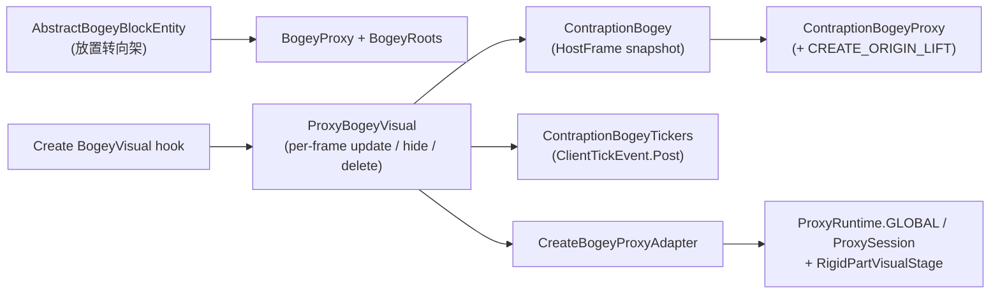

# Create 模块集成参考

`modules/create` 提供 KasugaLibNext 与 Create 6 的可选集成能力，涵盖轨道与转向架注册 DSL、列车设备与自定义信号区段扩展、转向架及装配结构中的 Proxy 模型适配、交互判定形状以及移动结构场景宿主。所有 Micronaut Bean 均通过 `@CreateModBeans`（条件类 `IfCreateModLoaded`）在检测到 `create` 模组已加载时启用。

包根路径：`lib.kasuga.create`  
源码目录：`modules/create/src/main/java/lib/kasuga/create/`

相关指南与宿主参考：

- [多转向架列车车厢](../guides/create/multi-bogey-carriage.md) / [车厢垂直姿态](../guides/create/carriage-posture.md)
- [模型碰撞、区块生命周期与远景](../guides/world-model-collision-and-lod.md)（包含 Create Contraption LOD）
- [移动结构上的场景与 UI](moving-scene-hosts.md) / [航空学 / Sable 的场景宿主](sable-scene-hosts.md)
- [把内容接入 Proxy Kernel](../guides/proxy-integration.md) / [Proxy 系统原理](../explanation/proxy/README.md)

## 1. Create 注册 DSL 与生命周期

包名：`lib.kasuga.create.registration`、`lib.kasuga.create.registration.{bogey,track,edge_data,edge_point}`、`lib.kasuga.create.client.registration`

### 1.1 分发与两阶段提交

`CreateRegistrationDispatcher`（`@Context @CreateModBeans`）在初始化时通过 `RegisterContextRegistry.registerBefore(Side.COMMON, RegistrationStage.REGISTER_EVENT, ...)` 挂载回调，在原版注册事件之前运行一次 `CreateRegistrationState.prepare(registry, clientBridge)`：

| 类型 | 职责 | 关键成员 |
| --- | --- | --- |
| `CreateRegistrationDispatcher` | 将 `CreateRegistrationStages.PREPARE` 接入公共注册生命周期 | `@PostConstruct init()` |
| `CreateRegistrationStages` | 声明 Create 准备阶段常量 | `PREPARE`（`RegistrationStage<CreateRegistrationEvent>`） |
| `CreateRegistrationState` | 维护每个 `Registry` 的准备状态，保证只成功提交一次 | `Status`（`NEW` / `PREPARING` / `COMMITTED` / `FAILED`）、`prepare(...)`、`status()`、`preparationCount()` |
| `CreateRegistrationEvent` | 按依赖阶段收集、校验并提交注册动作 | `Phase`（`TRACK_MATERIAL`、`BOGEY_SIZE`、`BOGEY_BLOCK`、`BOGEY_STYLE`）、`submit(...)`、`contains(...)` |
| `CreateClientBridge` | 隔离客户端图形依赖；专用服务端自动回退到 `CreateClientBridge.noop()` | `ClientCreateRegistrationBridge`（`@BeanOnlyIn.Client`）实现该接口 |

`CreateRegistrationEvent` 提交行为约束：

- 所有提交按 `(Phase, ResourceLocation.toString())` 排序；同一 `(Phase, id)` 重复提交抛出 `IllegalStateException`；
- 先执行全部条目的 `validator`，全部校验通过后才执行任何 `committer`；
- 校验或提交失败会把 `CreateRegistrationState` 标记为 `FAILED` 并缓存异常，后续重复调用直接重抛同一异常。

### 1.2 转向架注册：`BogeySizeReg` / `BogeyBlockReg` / `BogeyGroupReg`

| 注册器 / 索引 | 包 / 类型 | 核心签名与说明 |
| --- | --- | --- |
| `BogeySizeReg` | `registration.bogey` | `BogeySizeReg(String name)`（默认半径 `1.0f`）、`BogeySizeReg(String name, float wheelRadius)`、`size(float wheelRadius)`。半径必须为有限正数。提交阶段调用 `BogeySizes.register(...)` 并写入 `BogeyMetadataIndex`。 |
| `BogeyBlockReg<T extends AbstractBogeyBlock<?>>` | `registration.bogey` | `BogeyBlockReg(String name, BogeySizeReg size, BogeyBlockFactory<T> factory)`。通过组合持有 `BlockReg<T>`（`getBlockReg()`），提供 `withBlockProperties(UnaryOperator<BlockBehaviour.Properties>)` 和 `getSizeReg()`。在 `PREPARE` 校验引用尺寸已提交或同批待提交。 |
| `BogeyGroupReg` | `registration.bogey` | `BogeyGroupReg(String name, String cycleGroup)`，产生物品/转向架样式 `BogeyStyle`。至少需配置一个尺寸，不能与 `AllBogeyStyles.BOGEY_STYLES` 重名，且所引用的 `BogeySizeReg`、`BogeyBlockReg` 与客户端渲染句柄必须有效。 |
| `BogeyRendererHandle` | `registration.bogey` | `record BogeyRendererHandle(ResourceLocation id)`，`BogeyRendererHandle.of(ResourceLocation)`。公共侧仅持逻辑句柄，不链接客户端类。 |
| `ClientBogeyRendererRegistry` | `client.registration` | `@Context @CreateModBeans @BeanOnlyIn.Client`。`register(BogeyRendererHandle, Supplier<? extends BogeyRenderer>, BogeyVisualizer)`、`get(...)`、`remove(...)`、`clear()`。内部使用 `WeakHashMap`。 |
| `BogeyMetadataIndex` | `registration.bogey` | `SizeMetadata(ResourceLocation id, float wheelRadius)`、`StyleMetadata(ResourceLocation id, ResourceLocation cycleGroup)`，`get(BogeySizes.BogeySize)` / `get(BogeyStyle)` / `clear()`（使用 `WeakHashMap`）。 |

`BogeyGroupReg` 常用链式方法：

- `displayName(Component)` / `translationKey(String)`
- `sound(Supplier<SoundEvent>)`、`contactParticle(ParticleOptions)`、`smokeParticle(ParticleOptions)`、`defaultData(CompoundTag)`
- `bogey(BogeySizeReg size, BogeyBlockReg<?> block, BogeyRendererHandle rendererHandle)`
- `onCommitted(Consumer<BogeyStyle> callback)`：样式提交进 `AllBogeyStyles` 后执行一次。`BogeyStyle.id` 及各尺寸只在此时才最终就绪，因此向 `BogeyModels` 注册外置模型映射必须放在 `onCommitted` 中。

### 1.3 轨道注册：`TrackMaterialReg` / `TrackReg`

| 注册器 / 索引 | 包 / 类型 | 核心签名与说明 |
| --- | --- | --- |
| `TrackMaterialReg` | `registration.track` | `TrackMaterialReg(String name)`，构建 Create `TrackMaterial` 并写入 `TrackMaterialMetadataIndex`。 |
| `TrackReg<T extends TrackBlock>` | `registration.track` | `TrackReg(String name, TrackMaterialReg material, TrackBlockFactory<T> factory)`。组合持有 `BlockReg<T>`（`getBlockReg()`）和 `ItemReg<TrackBlockItem>`（`getItemReg()` / `getItem()`），不继承 `BlockReg`。提供 `withBlockProperties(...)`、`withItemProperties(...)`、`getMaterialReg()`。客户端通过 `CreateClientBridge.trackBlockCreated` 将方块模型包装为 Create 的 `TrackModel`。 |
| `TrackModelDescriptor` | `registration.track` | `Mode`（`DEFAULT` / `STANDARD` / `CUSTOM`）、`defaultModels()`、`standardModels()`、`custom(tie, leftSegment, rightSegment)`。 |
| `TrackMaterialMetadata` / `TrackMaterialMetadataIndex` | `registration.track` | `TrackMaterialMetadata(ResourceLocation id, boolean replaceable, UnaryOperator<Vec3> railOffset)`；`put` / `get` / `remove` / `clear`（`WeakHashMap`）。 |
| `ClientTrackMetadataIndex` | `client.registration` | `@Context @CreateModBeans @BeanOnlyIn.Client`，按 `TrackMaterial` 缓存客户端 `TrackModelDescriptor`。 |

`TrackMaterialReg` 常用链式方法：

- 必选：`block(Supplier<? extends TrackBlock>)` / `block(TrackReg<?>)` 与 `particle(ResourceLocation)`；
- 可选：`lang(String)`、`trackType(TrackMaterial.TrackType)` / `trackType(ResourceLocation, TrackMaterial.TrackType.TrackBlockFactory)`、`sleeper(ItemLike...)`、`rails(ItemLike...)`、`replaceable(boolean)`；
- 模型：`defaultModels()`、`standardModels()`、`customModels(ResourceLocation tie, ResourceLocation leftSegment, ResourceLocation rightSegment)`；
- 曲线轨距偏移：`simpleTrackModelOffset(float halfDistance)`（等价于 `vector -> vector.scale(halfDistance)`）或 `trackModelOffset(UnaryOperator<Vec3>)`，默认 `vector -> vector.scale(.965f)`。客户端由 `CreateMixinPlugin` 根据 Create 版本选择 `BezierConnectionMixin` 或 `ModernBezierSegmentsMixin` / `ModernBezierGirdersMixin` 应用该偏移。

### 1.4 轨道附加数据与路网点注册：`EdgeDataReg` / `TrackEdgePointReg`

- `EdgeDataReg<T extends EdgeExtraPayload>`（`lib.kasuga.create.registration.edge_data`）：
  `new EdgeDataReg<>(registrationKey, supplier, reader)` 在 `RegistrationStage.REGISTER_EVENT` 构造 `EdgeExtraPayloadType<T>` 并注册到 `EdgeExtraPayloadRegistry`。
- `TrackEdgePointReg<T extends TrackEdgePoint>`（`lib.kasuga.create.registration.edge_point`）：
  `new TrackEdgePointReg<>(id, supplier)` 在 `RegistrationStage.REGISTER_EVENT` 调用 `EdgePointType.register(...)` 注册路网点类型；`getBlockItemFactory()` 返回可用于方块物品的 `BiFunction<Block, Item.Properties, BlockItem>`（基于 `TrackTargetingBlockItem.ofType`）。
- 路网点辅助基类与渲染（`content.train.edge_point` 与 `client.rendering.edge_point`）：
  - `BogeyObserverEdgePoint`：定义 `void notifyBogey(Train train)` 接口；注意目前 `TrainMixin` 中 `frontSignalListener` / `backSignalListener` 里调用 `notifyBogey` 的分支处于注释停用状态，不会自动回调。
  - `EdgePointBlockEntity<T extends TrackEdgePoint>`：继承 Create `SmartBlockEntity`，自动挂载 `TrackTargetingBehaviour<T>`，子类实现 `getEdgePointType()`。
  - `EdgePointRenderer`、`EdgePointBlockEntityRenderer<T>`、`EdgePointOverlayRenderer`、`EdgePointOverlayRendererRegistry`（弱引用映射 `EdgePointType<?> -> EdgePointOverlayRenderer`）。

### 1.5 最小注册示例

```java
// 公共侧定义（源自 contentTesting 示例）
public static final BogeySizeReg PK209P = new BogeySizeReg("pk209p", 0.915f / 2f);
public static final BogeyRendererHandle PK209P_RENDERER =
        BogeyRendererHandle.of(ResourceLocation.fromNamespaceAndPath("examplemod", "pk209p_renderer"));

public static final BogeyBlockReg<ExampleBogeyBlock> STANDARD_BOGEY = new BogeyBlockReg<>(
        "pk209p_bogey",
        PK209P,
        (properties, size) -> new ExampleBogeyBlock(properties, size, /* ... */)
).withBlockProperties(properties -> properties.strength(2.0f).noOcclusion());

public static final BogeyGroupReg STANDARD_GROUP = new BogeyGroupReg("standard", "example_bogey")
        .displayName(Component.literal("Standard Bogey"))
        .bogey(PK209P, STANDARD_BOGEY, PK209P_RENDERER)
        .onCommitted(style -> BogeyModels.register(
                style.id, PK209P.getEntry(), pk209pParts, 0.91f + BogeyRoots.CREATE_Y_OFFSET
        ));

public static final TrackMaterialReg STANDARD_MATERIAL = new TrackMaterialReg("standard")
        .lang("Standard")
        .particle(ResourceLocation.fromNamespaceAndPath("examplemod", "block/track_particle"))
        .customModels(tieModel, leftSegModel, rightSegModel)
        .simpleTrackModelOffset(0.755f);

public static final TrackReg<ExampleTrackBlock> STANDARD_TRACK = new TrackReg<>(
        "standard_track",
        STANDARD_MATERIAL,
        (properties, material) -> new ExampleTrackBlock(properties, material, STANDARD_BOGEY::getEntry)
);

public static void register(Registry registry) {
    PK209P.setParent(registry);
    STANDARD_BOGEY.setParent(registry);
    STANDARD_GROUP.setParent(registry);
    STANDARD_MATERIAL.block(STANDARD_TRACK).setParent(registry);
    STANDARD_TRACK.setParent(registry);
}
```

```java
// 客户端渲染绑定（@BeanOnlyIn.Client）
renderers.register(
        PK209P_RENDERER,
        ProxyBogeyVisual.NoopRenderer::new,
        (context, partialTick, inContraption) -> new ProxyBogeyVisual(
                context, PK209P.getEntry(), myContraptionBogeyProxy)
);
```

## 2. 列车设备、自定义区段与路网附加数据

### 2.1 `TrainDeviceRegistry` 与 `TrainDeviceSystem`

包名：`lib.kasuga.create.content.train.device`

`TrainMixin` 实现 `TrainDeviceProvider`，在每列 Create `Train` 构造时创建一个 `TrainDeviceManager`，并在 `Train` 的 NBT 读写、tick 与信号事件中驱动已挂载的 `TrainDeviceSystem`：

| 类型 | 关键方法 | 说明 |
| --- | --- | --- |
| `TrainDeviceRegistry` | `register(ResourceLocation, TrainDeviceSystemType<?>)`、`register(ResourceLocation, TrainDeviceSystemType<?>, boolean contextDevice)`、`get(ResourceLocation)`、`getKey(TrainDeviceSystemType<?>)`、`createInitialContextDevices(TrainDeviceManager)` | 注册列车设备系统类型；`contextDevice = true` 时会在每列新建 `Train` 上自动实例化该系统。重复键或类型会抛出 `IllegalArgumentException`。 |
| `TrainDeviceSystemType<T>` | `TrainDeviceSystemType.of(Function<TrainDeviceManager, T>)`、`create(TrainDeviceManager)` | 设备系统类型工厂。 |
| `TrainDeviceSystem` | `write(CompoundTag)`、`read(CompoundTag)`、`earlyTick(Level)`、`tick(Level)`、`initializeServer(Level)`、`beforeSpeed()`、`cancelSlowdown()`、`notifySpeed(double)`、`notifyDistance(double)`、`notifySignalFront(...)`、`notifySignalBack(...)`、`notifySignalCollection()`、`notifyDisassemble(Direction, BlockPos)`、`onSegmentUpdated(ResourceLocation)` | 供子类覆写的列车系统基类。首次非客户端 `tick` 自动调用一次 `initializeServer(Level)`。 |
| `TrainDeviceManager` | `getManager(Train)`、`getManager(MovementContext)`、`getManager(AbstractContraptionEntity, BlockPos)`、`getSystem(TrainDeviceSystemType<T>)`、`getOrCreateSystem(TrainDeviceSystemType<T>)`、`updateCache()` | 管理单列列车上的系统映射。`cancelSlowdown()` 缓存结果，状态变化后需调用 `updateCache()`。`write`/`read` 以 `"TrainDeviceSystems"` 持久化。 |
| `TrainDeviceLocation` | `record TrainDeviceLocation(UUID trainId, int carriageIndex, BlockPos position)`、`read(CompoundTag)`、`write(CompoundTag)` | 定位列车车厢内的方块装置位置。 |

### 2.2 `BoundarySegmentRegistry` 与 `CustomTrackSegment`

包名：`lib.kasuga.create.content.train.signal`

用于基于自定义路网边界点（`CustomBoundary`）划分独立于 Create 原版信号的自定义轨道区段：

| 类型 | 职责与核心方法 |
| --- | --- |
| `BoundarySegmentRegistry` | `register(ResourceLocation featureLocation, EdgePointType<? extends CustomBoundary> boundary, Function<UUID, CustomTrackSegment> constructor)`、`registerUpdateListener(ResourceLocation, EdgePointType<? extends SegmentUpdateListener>)`、`createSegment(CustomBoundary, UUID)`、`createSegmentByFeatureName(ResourceLocation, UUID)`、`getFeatureName(...)`、`getBoundaries()`。 |
| `CustomTrackSegment` | 区段状态对象，构造接收 `UUID segmentId`；可覆写 `write()`、`read(CompoundTag)`、`onEarlyGlobalTick()`（由 `GlobalRailwayManagerMixin.onTick` 在主世界 tick 驱动 `RailwayData.onEarlyGlobalTick(Level)`）。 |
| `CustomBoundary` | 继承 `SingleBlockEntityEdgePoint` 的边界点基类，维护正反两向 `sidedSegments` 与 `dirty` 标记；在 `tick` 中调用 `CustomTrackSegmentPropagator.propagate(graph, this, dir)` 重算连通区段并在 `onRemoved` 时触发传播清理。 |
| `CustomTrackSegmentPropagator` | `@Singleton` Bean。执行图传播（`propagate`、`notifyNewNode`、`onRemoved`、`walk`），并通过 `TrainDeviceManager.onSegmentUpdated(segmentType)` 通知受影响边上的列车。 |
| `CustomSegmentUtil` | `@Singleton` Bean。`getSegment(TrackGraph, TrackEdge, EdgePointType<? extends CustomBoundary>, double position)` 与 `getSegmentIdAt(...)` 查询轨道边某位置的所属区段或有效组 ID。 |
| `SegmentPropagator` / `EdgePointFilter` / `ResourcePalette` / `SegmentUpdateListener` | 通用 BFS 图传播工具、按 `EdgePointType` 集合过滤的路网点查找器、NBT 资源路径调色板与监听标记接口。 |

### 2.3 `EdgeExtraPayloadRegistry`、`RailwayData` 与 `RailwayDataSyncManager`

包名：`lib.kasuga.create.content.train.graph`、`lib.kasuga.create.content.train.graph.sync`

| 类型 | 核心 API | 说明 |
| --- | --- | --- |
| `EdgeExtraPayloadRegistry` | `register(ResourceLocation id, EdgeExtraPayloadType<T> type)`、`get(ResourceLocation id)`、`getId(EdgeExtraPayloadType<?> type)` | 注册自定义轨道边附加负载类型（通常经由 `EdgeDataReg` 在 `REGISTER_EVENT` 注册）。 |
| `EdgeExtraPayloadType<T>` / `EdgeExtraPayload` | `EdgeExtraPayloadType.Builder<>(supplier, reader).build()`；接口 `write()`、`getType()` | 轨道边负载序列化契约。 |
| `EdgeExtraData` | `setBoundaryFeature`、`getBoundaryFeature`、`getEffectiveBoundaryFeature`、`setBoundaryFeaturePassive`、`setPayload`、`getPayload`、`getPayloadOptional` | 每条 `TrackEdge` 附带的边界组（默认回退到 `passiveBoundaryGroup`，全零 UUID）和延迟创建的负载映射。 |
| `GraphExtraData` | `withGraph`、`getEdgeData`、`getOrComputeEdgeData`、`createEdge`、`removeEdge`、`transfer`、`transferAll`、`syncWithExternal` | 由 `TrackGraphMixin` 和 `GlobalRailwayManagerMixin` 在图增删、合并、分裂及节点连断时自动同步。 |
| `RailwayManager` / `RailwayData` | `RailwayManager.getData()`、`RailwayData.withGraph(TrackGraph)`、`addSegment` / `removeSegment` / `getSegment` / `hasSegment` | 通过 `Saved<RailwayData>`（`Saved.Impl`）将所有图附加数据与区段实例持久化到 `kasuga_railway_data`。 |
| `RailwayDataSyncManager` | `edgeExtraDataChanged(TrackGraph, TrackNode, TrackNode, TrackEdge, TrackEdge)`、`nodeExtraDataChanged(TrackGraph, TrackNode)` | **当前为空实现占位类**，`CustomTrackSegmentPropagator` 中对应同步调用处于注释状态，尚未实现网络同步包。 |

同包内还包含路网辅助工具：`TrackEdgeLocation`（边的两端节点位置对及 NBT 读写）、`GraphWalker`（可排序 BFS 边遍历）、`GraphSimplifier`（剔除直连二度节点的简化拓扑及 JSON 导出）和 `TrainDistanceIntegrator`（按对象追踪累计距离差）。

## 3. 转向架 Proxy 与列车视觉集成

包名：`lib.kasuga.create.proxy`、`lib.kasuga.create.client.rendering`

KasugaLibNext 为「放置在世界中的转向架方块实体」与「编组在列车上的转向架」提供同一套模型组注册表（`BogeyModels`），并统一接入 `ProxySession` 内核。



### 3.1 `BogeyModels`、`BogeyRoots` 与 `ContraptionBogeyProxy`

- `BogeyModels`：静态线程安全映射（`ConcurrentHashMap`），按 `(BogeyStyle id, BogeySize id)` 或仅 `BogeyStyle id` 存储 `Placement(List<ModelPart> parts, float yOffset)`。查找顺序：精确 `(style, size)` → 样式通用项 → `null`。同时提供 `styleIdOf(CompoundTag bogeyData)` 从 Create 的 `"BogeyStyle"` NBT 读取样式 ID。
- `BogeyRoots`：`CREATE_Y_OFFSET = -1.5f - 1f / 128f`（Create 原生模型原点位于轨面而非方块中心）。`BogeyRoots.of(element, yOffset)` 构造包含方块中心平移和 `AbstractBogeyBlock.AXIS` 旋转的根变换。
- `BogeyProxy<T extends AbstractBogeyBlockEntity>`：实现 `ElementProxy<T>`，供方块实体路径使用；可覆写 `partsFor(T, BogeyModels.Placement)` 为轮对绑定 `ModelPart.Spin.tick(...)` 或驱动状态机 `pull` / `push`。
- `ContraptionBogey`：列车转向架宿主载体，使用不可变原子快照 `record HostFrame(float wheelAngle, Transform root)` 保存最新帧状态；`normalizedRoot()` 对该快照精确叠加一次 `placementYOffset`。
- `ContraptionBogeyProxy`：实现 `ElementProxy<ContraptionBogey>`，是列车侧的 `ElementProxy`。
  - `CREATE_ORIGIN_LIFT = -BogeyRoots.CREATE_Y_OFFSET`（`1.5f + 1f / 128f`）；
  - `rootOf(org.joml.Matrix4f pose, org.joml.Vector3i renderOrigin)` 把 Flywheel 相对渲染原点的 `PoseStack` 加上 `renderOrigin` 并抬升 `CREATE_ORIGIN_LIFT`，使列车与放置转向架对齐到同一放置坐标系；
  - `configure(ContraptionBogey)` 从 `BogeyModels.resolve(element.styleId(), element.sizeId())` 解析模型组并写入 `element.placementYOffset(...)`；子类可覆写 `partsFor(...)` 挂载 `ModelPart.Spin.frame(...)`。

### 3.2 `ProxyBogeyVisual`、`ContraptionBogeyTickers` 与 `CreateBogeyProxyAdapter`

- `ProxyBogeyVisual implements BogeyVisual`：
  - 构造：`new ProxyBogeyVisual(VisualizationContext context, BogeySizes.BogeySize size, ElementProxy<ContraptionBogey> template)`（客户端初始化在 `ClientBogeyRendererRegistry` 中创建）。
  - 惰性创建：首次 `update(CompoundTag bogeyData, float wheelAngle, PoseStack poseStack)` 从 `bogeyData` 解析样式 ID，构造 `ContraptionBogey` 并调用 `CreateBogeyProxyAdapter.attach(...)` 建立会话，随后注册进 `ContraptionBogeyTickers`。
  - Tick 与 Frame 严格分离：`update(...)` 运行在 Flywheel 的渲染 `beginFrame` 中，只做帧数据发布（`session.publishFrame(...)`），如果会话处于 `SUSPENDED` 则恢复（`resume()`）；逻辑步由 `ContraptionBogeyTickers` 在 `ClientTickEvent.Post` 上推进（`session.tick(gameTime, 1.0 / 20.0)`）。
  - 生命周期与线程边界：`hide()` 调用 `session.suspend()`；当 `bogeyData` 中的样式 ID 改变或 Flywheel 调用 `delete()`（可能在工作线程）时，通过 `DeferredGameThreadTask` 把 `session.close()` 合并投递回客户端游戏线程执行，避免在渲染线程或工作线程直接释放管线资源。
  - `ProxyBogeyVisual.NoopRenderer implements BogeyRenderer`：与 `ProxyBogeyVisual` 成对注册到 `ClientBogeyRendererRegistry`，防止在未启用 Flywheel 可视化时 Create 的回退实体渲染器重复绘制默认模型。
- `CreateBogeyProxyAdapter`：
  - `attach(ContraptionBogey element, ElementProxy<ContraptionBogey> template, ProxyIdentity identity, ProxyAttachToken token, @Nullable Level level)`：
    - 使用外部键 `ProxyKey.external("kasuga_lib", "contraption_bogey/" + identity.discriminator() + "/" + token)` 向 `ProxyRuntime.GLOBAL` 注册临时 `ProxyDefinition` 并 attach；
    - 构造 `RigidPartVisualStage`（并按 `ProxyConfig.machine()` 可选创建 `FsmAnimatedModel` 交给 `ProxyMachineController`），使用 `LogicalStepPolicy.fixed(1.0 / 20.0, 5)`；
    - 通过 `CreateVisualPort` 把 `isReady` / `bind` / `tick` / `publishFrame` / `suspend` / `resume` / `rebind` / `close` 转发给 `RigidPartVisualStage`；
    - `close()` 及任意初始化/配置失败路径都会保证最多调用一次 `template.onDetach(element)`，并从 `ProxyRuntime.GLOBAL` 注销该临时定义。

## 4. Contraption 捕获的 Proxy 模型与交互形状

包名：`lib.kasuga.create.client.rendering`、`lib.kasuga.create.interaction`、`lib.kasuga.create.mixins.client`

### 4.1 `ContraptionProxyModels`

`@Context @CreateModBeans @BeanOnlyIn.Client`。在普通世界外，Create 会将方块实体捕获进 `Contraption.presentBlockEntities`，这些方块实体既没有世界 `BlockEntityTicker`，也不走原版 BER。`ContraptionProxyModels` 负责在客户端复用其原有 `ProxySession`：

- 在 `ClientTickEvent.Post` 扫描客户端可渲染实体中的 `AbstractContraptionEntity`；仅当 `presentBlockEntities` 包含 `ProxyModelBlockEntity` 时创建 `Attachment`（内部借用 `CreateSceneHosts.contraption(entity)`）。
- 每次 tick 通过 `refreshState(model, contraption.getBlocks().get(localPos))` 同步 Create 同步包更新后的最新 `BlockState`（不销毁会话，也不额外推进时钟）。
- 通过 `model.bindVisualHost(instanceIdentity(entity.getUUID(), localPos), anchorTransform(pose, localPos))` 绑定稳定外部身份（`kasuga_lib:contraption_model/<entityUuid>/<x>/<y>/<z>`）与宿主的局部锚点变换。
- 若 `contraption.isHiddenInPortal(localPos)` 为真，则调用 `session.suspend()`；离开传送门后调用 `resume()`；其余情况调用 `ProxyTickers.tickClientBlockEntity(model)` 推进逻辑步。
- 在 `RenderFrameEvent.Pre`（优先级 `EventPriority.HIGHEST`，早于模型系统本帧采样）更新 `anchorTransform` 并调用 `session.publishFrame(null)`。
- 实体离开世界（`EntityLeaveLevelEvent`）、结构变更、方块从捕获表移除或切换世界时调用 `model.releaseVisualHost()` 清理挂载。

### 4.2 `ContraptionShapeProvider` / `ContraptionBlockView` / `ContraptionInteractionShapes`

用于让已装配进 Create Contraption 的自定义方块在射线交互（选取/点击）时读取真实捕获上下文，并支持超出锚点单格范围的扩展碰撞/选取形状：

| 类型 | 包 | 说明 |
| --- | --- | --- |
| `ContraptionShapeProvider` | `interaction` | 需由方块类显式实现的接口：`VoxelShape getContraptionShape(BlockState state, BlockGetter localBlocks, BlockPos localPos)`。 |
| `ContraptionBlockView` | `interaction` | 实现 `BlockGetter` 的只读本地视图，仅读取 `Contraption.getBlocks()` 与 `contraption.presentBlockEntities`：未占用坐标返回 `Blocks.AIR.defaultBlockState()`，不在 `getBlocks()` 中的坐标 `getBlockEntity` 返回 `null`，永不穿透查询外部世界；高度边界委托给传入的 `dimensions`。 |
| `ContraptionInteractionShapes` | `interaction` | 静态辅助：`shape(...)` 对实现 `ContraptionShapeProvider` 的方块传入 `ContraptionBlockView`，普通方块保留原调用；`pick(...)` 遍历结构内非传送门隐藏的 `ContraptionShapeProvider` 方块并对扩展 `VoxelShape` 执行局部射线裁剪，同时保留距离最近的原生命中结果。 |
| `ContraptionInteractionShapeMixin` | `mixins.client` | 混入 `ContraptionHandlerClient#rayTraceContraption`：包装选区形状查询并注入返回阶段，使锚点位于射线格之外的扩展形状也能被正确命中。 |

## 5. 通用配置与默认开关

`CreateConfig`（`config/kasuga_lib-common.toml`）与 `KasugaLibCreateApi`（在模组构造期、配置加载前覆写生成默认值）共同控制模块开关：

| 配置键 | 默认值 | `KasugaLibCreateApi` 默认值入口 | 说明 |
| --- | --- | --- | --- |
| `enable_multi_bogey_carriage` | `false` | `setMultiBogeyCarriageDefault(boolean)` | 多转向架车厢总开关 |
| `max_bogey_offset` | `1.0` | — | 内部转向架允许的最大弯道侧移（格，非负） |
| `derailed_on_bogey_offset_overflow` | `false` | `setDerailedOnBogeyOffsetDefault(boolean)` | 弯道所需侧移超限时是否触发列车脱轨 |
| `enable_carriage_y_offset` | `false` | `setCarriageYOffsetDefault(boolean)` | 车厢垂直姿态系统开关（`ModifyCarriagePostureEvent`） |
| `max_carriage_y_offset` | `0.5` | — | 车厢垂直偏移最大幅度（格，上下对称夹紧） |
| `enable_contraption_lod` | `true` | — | 服务端为 512 格内活动 Contraption 同步简化远景网格 |
| `enable_contraption_weather_filter` | `true` | `setContraptionWeatherFilterDefault(boolean)` | Create Contraption 室内挡雨 / 降雪遮挡开关 |
| `enable_sable_weather_filter` | `true` | — | Sable / Aeronautics 子世界室内挡雨 / 降雪遮挡开关 |
