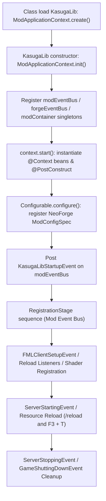

# Lifecycle and Initialization Order

This page documents the startup, Micronaut DI bootstrap, `RegistrationStage` dispatch order, client and shader initialization, capability boundary between the registration phase and the reload phase, and shutdown cleanup in KasugaLibNext.

---

## 1. Startup Overview

---

## 2. Micronaut DI Bootstrap and `@Context` Startup Order

### 2.1 `KasugaLib` and `ModApplicationContext`

In the mod entry class `lib.kasuga.KasugaLib` (`@Mod("kasuga_lib")`):

1. **Static initialization**: `ModApplicationContext.create(KasugaLib.class)` builds the Micronaut `ApplicationContext`. In development (`!FMLLoader.isProduction()`), it wraps classloaders with `CombinedClassLoader(modMainClass.getClassLoader(), ApplicationContext.class.getClassLoader())` so bean definitions across classpath entries are discoverable.
2. **`KasugaLib(IEventBus, ModContainer)` constructor**:
   - Calls `ModApplicationContext.init(context, modEventBus, modContainer)`:
     1. Registers named singletons: `IEventBus` (`"modEventBus"` and `"forgeEventBus"`) and `ModContainer` (`"modContainer"`).
     2. Calls `context.start()`, instantiating all active `@Context` beans that pass `@BeanOnlyIn`, `@CreateModBeans`, and related Micronaut conditions, and running their `@PostConstruct` hooks.
     3. Calls `Configurable.configure(context, modEventBus, modContainer)` to register every non-empty NeoForge `ModConfigSpec`.
   - Posts `new KasugaLibStartupEvent()` via `ModLoader.postEvent(...)`. Dependent mods can call `KasugaLib.afterRunning(modEventBus, hook)` to listen for `KasugaLibStartupEvent` (or run immediately if the context is already running). For example, `KasugaLibJavet` waits for both `KasugaLibStartupEvent` and native V8 library initialization before registering its `ScriptEngineType` and `BuiltinModuleRegistry` factories.

### 2.2 Core `@Context` Bean `@PostConstruct` Wiring

During `context.start()`, `@Context` beans wire the registration and reload subsystems:

- **Common and client registry activation**:
  - `KasugaLibApplication` (`lib.kasuga`): owns the root `REGISTRY = KasugaLibRegistry.getRegistryOf("kasuga_lib")` and calls `REGISTRY.register(modEventBus)` in `@PostConstruct`, registering `Side.COMMON` on `RegisterContextRegistry`.
  - `KasugaLibClientApplication` (`@BeanOnlyIn.Client`): calls `KasugaLibApplication.REGISTRY.registerClient(modEventBus)`, registering `Side.CLIENT`.
- **Stage dispatchers**:
  - `DefaultRegisterContextDispatchers`: hooks `NewRegistryEvent`, `RegisterEvent` (`EventPriority.HIGHEST`), `RegisterPayloadHandlersEvent`, `RegisterCapabilitiesEvent`, and `BuildCreativeModeTabContentsEvent` onto `Side.COMMON`.
  - `DefaultClientRegisterContextDispatchers` (`@BeanOnlyIn.Client`): hooks `RegisterMenuScreensEvent`, `RegisterClientExtensionsEvent`, and `ModelEvent.BakingCompleted` onto `Side.CLIENT`.
- **Data-driven and Create wiring**:
  - `JsonTreeIntegration`: subscribes to `RegisterContextRegistry.Side.COMMON` so every configured mod `Registry` queries `DataDrivenRegistrationProviders.find(modId)` first and falls back to `JsonTreeBuilder.buildForMod(modId)`, attaching the resulting `JsonRegistryGroup` as a child of `modRegistry`.
  - `CreateRegistrationDispatcher` (`@CreateModBeans`): calls `registerBefore(Side.COMMON, RegistrationStage.REGISTER_EVENT, ...)` so Create track and bogey entries are prepared and committed before any standard `Reg` handles `RegisterEvent`.
  - `ClientCreateRegistrationBridge` (`@CreateModBeans`, `@BeanOnlyIn.Client`): attaches itself to `Registry` under `CreateClientBridge.class` on `Side.CLIENT` (on dedicated servers, `CreateClientBridge.noop()` is used instead).
- **Reload and factory registration**:
  - `FsmReloadHandlerRegistrar` registers `FsmReloadHandler` before `FsmClipsReloadHandler` in `ReloadHandlerRegistry`.
  - `ProxyModelBlockFactories` registers built-in `proxy_model` and `proxy_model_be` factories in `FactoryRegistry`.
  - `ResourceSystem` attaches listeners on `modEventBus` and `forgeEventBus`; `ReloadOrchestrator` and `ScriptingApplication` (injecting `ScriptingSystem`) register themselves via `ResourceSystem.registerConsumer(...)`.

---

## 3. `RegistrationStage` Order and Event Mapping

`lib.kasuga.registration.stages.RegistrationStage<T>` defines reference-identity tokens for registration phases. Each root `Registry` (`Reg` tree) dispatches `RegisterContext<T>` recursively down its child tree:

| Order | Stage Token | Payload Type | Dispatcher Side | Underlying NeoForge Event / Trigger | Notes |
| --- | --- | --- | --- | --- | --- |
| 1 | `RegistrationStage.NEW_REGISTRY` | `NewRegistryEvent` | `COMMON` | `NewRegistryEvent` | Registers custom MC registries (`RegistryReg`, `DeviceRegistries`, `DocumentComponentRegistries`) |
| 2 | `CreateRegistrationStages.PREPARE` | `CreateRegistrationEvent` | `COMMON` | `registerBefore(COMMON, REGISTER_EVENT, ...)` | Guards once-only idempotent preparation via `CreateRegistrationState` (`NEW → PREPARING → COMMITTED / FAILED`); validates then commits actions in fixed `Phase` order: `TRACK_MATERIAL` → `BOGEY_SIZE` → `BOGEY_BLOCK` → `BOGEY_STYLE` |
| 3 | `RegistrationStage.REGISTER_EVENT` | `RegisterStageContext` | `COMMON` | `RegisterEvent` (`EventPriority.HIGHEST`) | Populates vanilla/custom registries (blocks, items, block entities, entities, fluids, menus, sounds, data components) |
| 4 | `RegistrationStage.REGISTER_CAPABILITIES` | `CapabilityRegistration` | `COMMON` | `RegisterCapabilitiesEvent` | Registers NeoForge capabilities for block entities or entities |
| 5 | `RegistrationStage.PAYLOAD_REGISTRATION` | `PayloadRegistrationStage` | `COMMON` | `RegisterPayloadHandlersEvent` | Registers network payloads via memoized `getRegistrar(version)` |
| 6 | `RegistrationStage.CREATIVE_TAB_CONTENT_REGISTRATION` | `CreativeTabContentRegistration` | `COMMON` | `BuildCreativeModeTabContentsEvent` | Populates creative tabs |
| 7 | `RegistrationStage.MENU_SCREEN_BINDING` | `MenuScreenBindingStage` | `CLIENT` | `RegisterMenuScreensEvent` | Binds `MenuType` to client `Screen` factories |
| 8 | `RegistrationStage.REGISTER_CLIENT_EXTENSIONS` | `FluidClientExtensionsStage` | `CLIENT` | `RegisterClientExtensionsEvent` | Dispatched via `registry.dispatchRegister(...)` (does not run `beforeDispatchFunctions`) |
| 9 | `RegistrationStage.BAKING_COMPLETE` | `BakingCompleteStage` | `CLIENT` | `ModelEvent.BakingCompleted` | Registers `BlockEntityRenderer`, `EntityRenderer`, and `DocumentComponentRenderer` |
| — | `RegistrationStage.COMMON_SETUP` | `RegisterStageContext` | — | Not dispatched | Declared on `RegistrationStage`, but `DefaultRegisterContextDispatchers` does not currently bind it to any NeoForge event (an unused `FMLCommonSetupStageContext` payload class also exists) |

---

## 4. Client Setup, Model, and Shader Initialization

Client mod-bus events in `lib.kasuga.rendering.models.mc.Constants` and `ResourceSystem` proceed as follows:

1. **`FMLClientSetupEvent`**:
   - `Constants.onClientSetup`: applies `-Dkasuga.shaderPreparationWorkers` and prestarts workers (`ShaderPreparationScheduler`), initializes `ShaderParameterPersistence` (`<configDir>/kasuga_lib/shader-parameters.json`), creates `UIBackend`, and posts `RegisterRenderPipelinesEvent(CLIENT_RENDER_PIPELINES)` once so integrations can register client-lifetime pipelines, effects, post-process graphs, and generated shaders via `event.registrar(owner)`.
   - `ResourceSystem.onClientSetup`: wraps `Minecraft.getInstance().getResourceManager()` in a client `ScopedResourceManager`, registers it with `ReloadableResourceManager`, and notifies `ScopedResourceManagerConsumer`s (`ReloadOrchestrator`, `ScriptingSystem`).
2. **`RegisterClientReloadListenersEvent`**:
   - Registers `ModelParticleRuntime.invalidateTextures()`, calls `IrisCompat.onStart()`, constructs `CombinedTextureManager`, calls `PipelineRegistry.registerBuiltins(basic)` and `PipelineRegistry.registerDefaultRoutes(router)`, and registers `KasugaModelManager`.
3. **`RegisterShadersEvent`**:
   - Registers core UML shaders (`ksglib_main`, `ksglib_global_batch`, and optional `ksglib_oit_composite`; failure on `ksglib_oit_composite` logs a `WARN` and falls back to sorted translucent rendering).
   - Calls `RenderShaderRegistry.registerShaders(event)`: `ShaderPreloadPolicy.EAGER` shaders await source preparation and compile synchronously; `ShaderPreloadPolicy.DEFERRED` shaders are rescheduled into `ShaderPreloadScheduler` for frame-budgeted compilation.
4. **`RegisterRenderBuffersEvent` and `RegisterNamedRenderTypesEvent`**:
   - Registers model `RenderType`s (`OPAQUE` / `CUTOUT` / `TRANSLUCENT`, global batching, Iris compat, and OIT passes) and `RenderTypeGroup`s.

---

## 5. Registration Phase vs. Reload Phase Capability Boundary

KasugaLibNext separates **the two phases** (see [How data-driven registration works](../explanation/data-driven-registration.md) and [Unified Resource Platform and Script Tickets](resource-platform.md)):

| Aspect | Registration Phase | Reload Phase |
| --- | --- | --- |
| Trigger | Mod startup through `RegisterEvent` (once per process) | `ServerStartingEvent`, `/reload`, client startup, and `F3 + T` |
| Source | Mod JAR (`JsonTreeBuilder`) or host-composed `ContentSource`s (`DataDrivenBuildPipeline`) | Resource/data pack stack (`ResourceManager`) or `ResourceSource` snapshots (pack-stack overrides apply) |
| Index Domain | `on_register` inside `data/<ns>/kasuga_lib/data_driven/*.json` | `on_reload` in the same manifests, plus `ReloadHandler.globDirectories()` (e.g., `state_machines/`) |
| Supported Objects | Registry-frozen objects (`Block`, `Item`, `BlockEntityType`, `RegistryGroup`, etc.) | FSM definitions, animation clips, models/textures, shader sources/parameters, script packages (`ScriptRuntime` / `ManagedScriptEntryPoint`) |
| Validation & Error Policy | `DataDrivenBuildPipeline` supports `BuildOptions.STRICT`: separates side-effect-free `prepare()` (parsing, validation, `RegistryClaim`) from `build()` (applies by `PHASE_GROUPS → PHASE_CONTENT → PHASE_EMBEDDED` and runs `BuildFinalizer`s) | `ReloadOrchestrator` isolates errors per participant: clears `Diagnostics.Domain.RELOAD_DATA`, then runs `clearBucket() → decode() → DuplicateIdResolver → register() → afterReload()` without aborting pack reload |
| Atomic Publication | Objects are committed to MC registries during `RegisterEvent` | `KasugaModelManager` prepares models and PBR bakes asynchronously, then swaps atomically on the game thread via `ModelPublicationCoordinator` / `McModelAssemblies.publishResourceGeneration`; `ResourceCoordinator` follows **prepare-then-publish** per monotonic `generation` and retires the previous `ResourceGeneration` |

---

## 6. World Runtime and Shutdown Sequence

- **Server world lifecycle**:
  - `ServerStartingEvent`: `ResourceSystem` creates and attaches a server-scoped `ScopedResourceManager`.
  - `ServerStartedEvent`: `Saved.Impl<T>` binds the active `MinecraftServer` (calling `Saved.get()` before this throws `IllegalStateException`).
  - `/reload` (`MinecraftServer.reloadResources`): `MinecraftServerMixin` invokes `ResourceSystem.onServerReloading(server)` and posts `ServerResourceReloadFinishEvent` (`ScriptingServerApplication` checks missing engines here).
  - `ServerStoppingEvent`: `Saved.Impl<T>` unloads its `MinecraftServer` and dimension cache; `ResourceSystem` notifies consumers (`onResourceManagerRemoved`, shutting down server `ScriptRuntime`) and closes server-managed closeables and `ResourceCoordinator` scopes.
- **Client world change and shutdown**:
  - Level switch / disconnect (`ClientTickEvent.Post` / `MinecraftWorldViews.worldChanged()`): `MinecraftModelRuntime` releases active drags and clears particle/light world state; `ClientEffectRuntime` clears live effects and `PostProcessTargetPool`; `MinecraftWorldViews` releases offscreen render targets and `CameraIrisSession`s while keeping subscriptions.
  - `GameShuttingDownEvent`: invokes `ResourceSystem.close()` while the client OpenGL context is still valid, closing client/server consumers, managed scopes, and `unifiedVfs` (**never joining script threads** so shutdown cannot stall on a hung engine).

## Related Pages

- [Configuration Options](configuration.md)
- [Extension Point Catalog](extensions.md)
- [Sidedness Model](sidedness.md)
- [Threading Model](../explanation/threads.md)
- [Unified Resource Platform and Script Tickets](resource-platform.md)
- [Data-Driven Registration](data-driven/README.md)
