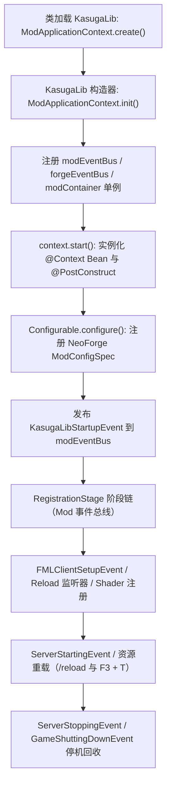

# 生命周期与初始化顺序

本文说明 KasugaLibNext 从模组加载、Micronaut DI 启动、`RegistrationStage` 派发、客户端与渲染系统初始化，到两个时机（注册期 vs. reload 期）与停机清理的完整顺序及能力边界。

---

## 1. 启动总览

---

## 2. Micronaut DI 引导与 `@Context` 启动顺序

### 2.1 `KasugaLib` 与 `ModApplicationContext`

入口类 `lib.kasuga.KasugaLib`（`@Mod("kasuga_lib")`）：

1. **静态初始化**：`ModApplicationContext.create(KasugaLib.class)` 构建 `ApplicationContext`。在开发环境（`!FMLLoader.isProduction()`）下，使用 `CombinedClassLoader(modMainClass.getClassLoader(), ApplicationContext.class.getClassLoader())` 合并类加载视图以保证 Bean 元数据可见。
2. **`KasugaLib(IEventBus, ModContainer)` 构造器**：
   - 调用 `ModApplicationContext.init(context, modEventBus, modContainer)`：
     1. 注入具名单例：`IEventBus`（`"modEventBus"`、`"forgeEventBus"`）与 `ModContainer`（`"modContainer"`）。
     2. 调用 `context.start()`，初始化所有通过条件校验（`@BeanOnlyIn`、`@CreateModBeans` 等）的 `@Context` Bean 并执行其 `@PostConstruct`。
     3. 调用 `Configurable.configure(context, modEventBus, modContainer)` 注册非空的 NeoForge 配置规格。
   - 调用 `ModLoader.postEvent(new KasugaLibStartupEvent())`。依赖模组可通过 `KasugaLib.afterRunning(modEventBus, hook)` 订阅 `KasugaLibStartupEvent`（若上下文已在运行则立即执行 `hook`）。例如 `KasugaLibJavet` 会在收到 `KasugaLibStartupEvent` 且原生 V8 库加载完成后，向 `ScriptEngineRegistry` 与 `BuiltinModuleRegistry` 注册 Javet 引擎与内置模块工厂。

### 2.2 核心 `@Context` Bean 的 `@PostConstruct` 接线

`context.start()` 期间，各模块 `@Context` Bean 按依赖关系完成自我挂接：

- **通用与客户端注册表激活**：
  - `KasugaLibApplication`（`lib.kasuga`）：持有静态根 `REGISTRY = KasugaLibRegistry.getRegistryOf("kasuga_lib")`，在 `@PostConstruct` 中调用 `REGISTRY.register(modEventBus)`，向 `RegisterContextRegistry` 注册 `Side.COMMON`。
  - `KasugaLibClientApplication`（`@BeanOnlyIn.Client`）：调用 `KasugaLibApplication.REGISTRY.registerClient(modEventBus)`，向 `RegisterContextRegistry` 注册 `Side.CLIENT`。
- **阶段派发器绑定**：
  - `DefaultRegisterContextDispatchers`：向 `RegisterContextRegistry`（`Side.COMMON`）挂接 `NewRegistryEvent`、`RegisterEvent`（`EventPriority.HIGHEST`）、`RegisterPayloadHandlersEvent`、`RegisterCapabilitiesEvent`、`BuildCreativeModeTabContentsEvent`。
  - `DefaultClientRegisterContextDispatchers`（`@BeanOnlyIn.Client`）：向 `Side.CLIENT` 挂接 `RegisterMenuScreensEvent`、`RegisterClientExtensionsEvent`、`ModelEvent.BakingCompleted`。
- **数据驱动与 Create 注册挂接**：
  - `JsonTreeIntegration`：通过 `register(Side.COMMON, ...)` 在任意接入模组的 `Registry` 配置时构建其数据驱动子树：优先查询 `DataDrivenRegistrationProviders.find(modId)`，未安装则回退至 `JsonTreeBuilder.buildForMod(modId)`，并将结果 `JsonRegistryGroup` 挂为 `modRegistry` 子节点。
  - `CreateRegistrationDispatcher`（`@CreateModBeans`）：通过 `registerBefore(Side.COMMON, RegistrationStage.REGISTER_EVENT, ...)` 挂接，保证 Create 轨道与转向架注册在首个 `RegisterEvent` 派发给普通 `Reg` 之前完成提交。
  - `ClientCreateRegistrationBridge`（`@CreateModBeans`、`@BeanOnlyIn.Client`）：在 `Side.CLIENT` 上把自身绑定到 `Registry` 附件 `CreateClientBridge.class`（专用服务端上无此附件，回退使用 `CreateClientBridge.noop()`）。
- **重载与工厂初始化**：
  - `FsmReloadHandlerRegistrar` 按固定顺序向 `ReloadHandlerRegistry` 注册 `FsmReloadHandler`（先）与 `FsmClipsReloadHandler`（后）。
  - `ProxyModelBlockFactories` 向 `FactoryRegistry` 注册内置 `proxy_model` 与 `proxy_model_be` 工厂。
  - `ResourceSystem` 在 `modEventBus` 与 `forgeEventBus` 上订阅服务端/客户端/停机事件；`ReloadOrchestrator` 与 `ScriptingApplication`（注入 `ScriptingSystem`）向 `ResourceSystem.registerConsumer(...)` 注册自身。

---

## 3. 注册阶段（`RegistrationStage`）顺序与映射

`lib.kasuga.registration.stages.RegistrationStage<T>` 使用基于对象身份（引用相等）的令牌区分注册阶段。每个模组根 `Registry`（`Reg` 树）在收到对应阶段的 `RegisterContext<T>` 时按树形结构递归派发：

| 顺序 | Stage 令牌 | Payload 类型 | 派发侧（`Side`） | 底层 NeoForge 事件 / 触发器 | 说明 |
| --- | --- | --- | --- | --- | --- |
| 1 | `RegistrationStage.NEW_REGISTRY` | `NewRegistryEvent` | `COMMON` | `NewRegistryEvent` | 创建自定义 MC 注册表（如 `RegistryReg`、`DeviceRegistries`、`DocumentComponentRegistries`） |
| 2 | `CreateRegistrationStages.PREPARE` | `CreateRegistrationEvent` | `COMMON` | `registerBefore(COMMON, REGISTER_EVENT, ...)` | 每次 `RegisterEvent` 前检查 `CreateRegistrationState`（状态机 `NEW → PREPARING → COMMITTED / FAILED`），仅首次幂等提交一次；内部按 `Phase` 严格排序：`TRACK_MATERIAL` → `BOGEY_SIZE` → `BOGEY_BLOCK` → `BOGEY_STYLE`（先全量校验再提交） |
| 3 | `RegistrationStage.REGISTER_EVENT` | `RegisterStageContext` | `COMMON` | `RegisterEvent`（`EventPriority.HIGHEST`） | 向 MC 原版 / 自定义注册表写入方块、物品、方块实体、实体、流体、菜单、音效、数据组件等 |
| 4 | `RegistrationStage.REGISTER_CAPABILITIES` | `CapabilityRegistration` | `COMMON` | `RegisterCapabilitiesEvent` | 注册方块实体或实体的能力（Capability） |
| 5 | `RegistrationStage.PAYLOAD_REGISTRATION` | `PayloadRegistrationStage` | `COMMON` | `RegisterPayloadHandlersEvent` | 通过 memoized `getRegistrar(version)` 注册网络 Payload |
| 6 | `RegistrationStage.CREATIVE_TAB_CONTENT_REGISTRATION` | `CreativeTabContentRegistration` | `COMMON` | `BuildCreativeModeTabContentsEvent` | 填充 creative tab 内容 |
| 7 | `RegistrationStage.MENU_SCREEN_BINDING` | `MenuScreenBindingStage` | `CLIENT` | `RegisterMenuScreensEvent` | 将 `MenuType` 绑定到客户端 `Screen` |
| 8 | `RegistrationStage.REGISTER_CLIENT_EXTENSIONS` | `FluidClientExtensionsStage` | `CLIENT` | `RegisterClientExtensionsEvent` | 通过 `registry.dispatchRegister(...)` 派发流体等客户端扩展（不经 `beforeDispatchFunctions`） |
| 9 | `RegistrationStage.BAKING_COMPLETE` | `BakingCompleteStage` | `CLIENT` | `ModelEvent.BakingCompleted` | 注册 `BlockEntityRenderer`、`EntityRenderer` 与 `DocumentComponentRenderer` |
| — | `RegistrationStage.COMMON_SETUP` | `RegisterStageContext` | — | 当前未接线 | `RegistrationStage` 中已声明该常量，但 `DefaultRegisterContextDispatchers` 目前未将其绑定到任何 NeoForge 事件（存在未派发载荷类 `FMLCommonSetupStageContext`） |

---

## 4. 客户端建立与模型 / 着色器初始化

客户端模组总线事件在 `lib.kasuga.rendering.models.mc.Constants` 与 `ResourceSystem` 中按以下职责推进（由 NeoForge 模组加载生命周期驱动）：

1. **`FMLClientSetupEvent`**：
   - `Constants.onClientSetup`：读取 `-Dkasuga.shaderPreparationWorkers` 并预启动工作线程（`ShaderPreparationScheduler`），调用 `ShaderParameterPersistence.initialize()` 加载 `<configDir>/kasuga_lib/shader-parameters.json`，初始化 `UIBackend`，并仅一次发布 `RegisterRenderPipelinesEvent(CLIENT_RENDER_PIPELINES)`（允许各集成通过 `event.registrar(owner)` 注册持久客户端渲染管线、特效、后处理图与生成着色器）。
   - `ResourceSystem.onClientSetup`：包装 `Minecraft.getInstance().getResourceManager()` 为客户端 `ScopedResourceManager`，将其作为 `ReloadableResourceManager` 的重载监听器注册，并通知已注册的 `ScopedResourceManagerConsumer`（`ReloadOrchestrator`、`ScriptingSystem`）。
2. **`RegisterClientReloadListenersEvent`**：
   - 注册 `ModelParticleRuntime.invalidateTextures()` 监听器、调用 `IrisCompat.onStart()`、初始化 `CombinedTextureManager` 与 `PipelineRegistry.registerBuiltins(basic)` / `registerDefaultRoutes(router)`，并注册 `KasugaModelManager`。
3. **`RegisterShadersEvent`**：
   - 编译核心 UML 着色器（`ksglib_main`、`ksglib_global_batch`，以及可选的 `ksglib_oit_composite`；后者若失败会记录 `WARN` 并保留排序半透明回退路径）。
   - 调用 `RenderShaderRegistry.registerShaders(event)`：所有 `ShaderPreloadPolicy.EAGER` 着色器等待 CPU 准备完成后在事件中同步编译，之后将 `ShaderPreloadPolicy.DEFERRED` 着色器重新排入 `ShaderPreloadScheduler` 逐帧预算编译。
4. **`RegisterRenderBuffersEvent` 与 `RegisterNamedRenderTypesEvent`**：
   - 注册模型 `RenderType`（`OPAQUE` / `CUTOUT` / `TRANSLUCENT`、全局合批、Iris 兼容及 OIT pass）及 `RenderTypeGroup`。

---

## 5. 注册期 vs. reload 期的能力边界

KasugaLibNext 严格区分数据驱动与资源系统的**两个时机**（详见 [数据驱动注册原理](../explanation/data-driven-registration.md) 与 [统一资源平台与 Script Ticket](resource-platform.md)）：

| 维度 | 注册期（Registration Phase） | reload 期（Reload Phase） |
| --- | --- | --- |
| 触发时机 | 模组初始化至 `RegisterEvent`（进程生命周期内一次） | 服务端启动 `ServerStartingEvent`、`/reload`、客户端启动及 `F3 + T` |
| 数据来源 | 模组 JAR（`JsonTreeBuilder`）或宿主组合的 `ContentSource`（`DataDrivenBuildPipeline`） | 数据包栈 / 资源包栈（`ResourceManager`）或 `ResourceSource` 快照，支持数据包后写覆盖 |
| 索引域 | `data/<ns>/kasuga_lib/data_driven/*.json` 中的 `on_register` | 同一索引清单中的 `on_reload`，外加 `ReloadHandler.globDirectories()`（如 `state_machines/`） |
| 可创建对象 | `Block`、`Item`、`BlockEntityType`、`RegistryGroup` 等受 MC 注册表冻结约束的对象 | FSM 定义、动画剪辑、模型与纹理、Shader 源码/参数、脚本包（`ScriptRuntime` / `ManagedScriptEntryPoint`） |
| 严格构建与校验 | `DataDrivenBuildPipeline` 支持 `BuildOptions.STRICT`：`prepare()`（解析/校验/`RegistryClaim`）与 `build()`（按 `PHASE_GROUPS → PHASE_CONTENT → PHASE_EMBEDDED` 顺序应用并运行 `BuildFinalizer`）分离 | `ReloadOrchestrator` 对单次周期采用异常隔离：每次先 `Diagnostics.clear(RELOAD_DATA)`，按 `clearBucket() → decode() → DuplicateIdResolver → register() → afterReload()` 执行，不中止包加载 |
| 原子发布语义 | 注册结果在 `RegisterEvent` 写入 MC 注册表后固定 | `KasugaModelManager` 先异步 `prepareModel` 与烘焙 PBR，再在游戏线程经 `ModelPublicationCoordinator` / `McModelAssemblies.publishResourceGeneration` 原子替换并淘汰旧代实例；`ResourceCoordinator` 按递增 `generation` **先准备，再发布**并回收旧 `ResourceGeneration` |

---

## 6. 世界运行与停机回收顺序

- **服务端世界生命周期**：
  - `ServerStartingEvent`：`ResourceSystem` 为该 `MinecraftServer` 创建并注册服务端 `ScopedResourceManager`。
  - `ServerStartedEvent`：`Saved.Impl<T>` 绑定当前 `MinecraftServer` 实例，之后方可调用 `Saved.get()` / `Saved.get(dim)`。
  - `/reload`（`MinecraftServer.reloadResources`）：`MinecraftServerMixin` 在资源重载完成回调后触发 `ResourceSystem.onServerReloading(server)` 并发布 `ServerResourceReloadFinishEvent`（`ScriptingServerApplication` 在此校验缺失引擎）。
  - `ServerStoppingEvent`：`Saved.Impl<T>` 解绑并清空维度缓存；`ResourceSystem` 通知 `onResourceManagerRemoved`（关闭对应 `ScriptRuntime`）并释放该服务端托管资源与 `ResourceCoordinator` 作用域。
- **客户端世界切换与停机**：
  - 客户端切换或退出世界（`ClientTickEvent.Post` / `MinecraftWorldViews.worldChanged()`）：`MinecraftModelRuntime` 释放活动拖拽并清理粒子/光源世界状态；`ClientEffectRuntime` 清空活动效果与 `PostProcessTargetPool`；`MinecraftWorldViews` 释放离屏相机目标与 `CameraIrisSession` 并保留订阅。
  - `GameShuttingDownEvent`：在客户端 OpenGL 上下文仍然有效时触发 `ResourceSystem.close()`，依次通知客户端/服务端消费者移除、关闭客户端与服务端托管作用域及 `unifiedVfs`（**不会 join 脚本线程**，避免卡住停机）。

## 相关页面

- [配置项](configuration.md)
- [扩展点目录](extensions.md)
- [侧边模型](sidedness.md)
- [线程模型](../explanation/threads.md)
- [统一资源平台与 Script Ticket](resource-platform.md)
- [数据驱动注册专题](data-driven/README.md)
