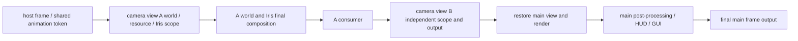

# Multi-camera output contract

## Final main frame WYSIWYG output

```java
import lib.kasuga.rendering.output.FrameOutputMode;
import lib.kasuga.rendering.output.mc.MinecraftFrameOutputs;

var output = MinecraftFrameOutputs.open(FrameOutputMode.MIRROR, frame -> {
    var texture = frame.resource();
    consumeTexture(texture); // implemented by the caller, consumed synchronously on the render thread.
});
output.close(); // released on the render thread.
```

`MIRROR` delivers to both the FBO and the display window; `OFFSCREEN_ONLY` skips the screen blit
for that frame after a successful delivery, while the game loop and window events keep running.
After all exclusive outputs are closed, normal display resumes; when no exclusive output succeeds,
it falls back to the native window output.

The default view `minecraft:main` is intercepted at the final
`RenderTarget.blitToScreen` in `Minecraft.runTick`, after the world, post-processing, HUD, GUI,
loading screen, and debug overlay have been drawn. It reuses the native final blit and provides the
final WYSIWYG frame, with no need to render the world again just to capture it. Additional camera
views deliver through their own world/Iris composition.

## Creating a camera and its lifecycle in one call

All create, update, pause, resume, and close operations happen on the render thread. Other threads
schedule work with
`Minecraft.getInstance().execute(...)`; the first creation requires a loaded level.

```java
import lib.kasuga.rendering.output.WorldCameraView;
import lib.kasuga.rendering.output.camera.CameraRenderSettings;
import lib.kasuga.rendering.output.mc.MinecraftCameras;
import java.nio.file.Path;
import java.util.List;
import java.util.Map;

var settings = new CameraRenderSettings(
        12,
        CameraRenderSettings.Quality.FANCY,
        new CameraRenderSettings.Shader(
                Path.of("/absolute/path/to/shader-pack.zip"),
                Map.of("SHADOW_QUALITY", "1")), // an option name defined by the selected shader pack.
        List.of(Path.of("/absolute/path/to/resource-pack.zip")),
        2,    // mipmap level 0..4
        true  // ambient occlusion
);
var camera = MinecraftCameras.create("capture:wide", () ->
        new WorldCameraView(100, 80, 100, 45, 15, 0, 70, 1280, 720),
        settings, frame -> consumeTexture(frame.resource()));

camera.pause();
camera.updatePose(new WorldCameraView(110, 82, 100, 90, 10, 0, 50, 1920, 1080));
camera.resume();
camera.close(); // closes both the producer and the outputs it owns.
```

The consumer is a placeholder example function. With no shader pack, use
`CameraRenderSettings.Shader.disabled()`.
The overload that omits settings uses render distance 8, Fancy, no shader pack, base vanilla/mod
materials, mipmap 0, and AO on. The pose can be a fixed record or a provider sampled once per frame.

`WorldCameraView` parameters are absolute world x/y/z coordinates, yaw/pitch/roll, vertical FOV, and
width/height. Angles are in degrees; yaw/pitch follow MC. Values must be finite, FOV must be in
`(0, 180)`, and dimensions must be positive and no larger than the GL maximum texture size. A new
size automatically replaces the render and output FBOs.
The view ID must be non-empty and unique and must not be `minecraft:main`.

`CameraHandle.state()` is one of READY, PAUSED, FAILED, CLOSED; `failure()` stores
the fault. READY means the registration is usable; when resources load asynchronously for the
first time, the first frame may not have been delivered yet.
A failure in the provider, resource loading, drawing, or the consumer removes that camera view and
releases its resources, keeping the exception.
`close()` is idempotent; pausing stops the output and withdraws the server subscription, and
resuming subscribes again.

Resource configuration is fixed at creation; to change packs, quality, or render distance, close
and recreate. Position, FOV, and
size are modified dynamically through `updatePose`. At the lower level you can also call
`MinecraftWorldViews.register`
and `MinecraftFrameOutputs.open(viewId, ...)` separately, or add multiple consumers to the same
view;
lower-level producers/consumers must be closed separately. A camera view with no consumer, or one
that is not enabled, is not re-rendered and not sampled.

## Same-process isolation and render timing



| Configuration or resource | Isolation |
| --- | --- |
| Position, orientation, FOV, size | Per-camera-view Camera, projection, and color/depth FBO |
| Chunks and lighting | Per-camera-view ClientLevel, ClientChunkCache, light engine |
| Terrain and entity drawing | Per-camera-view LevelRenderer, RenderBuffers, mutable entity/block entity dispatcher |
| Render distance | Per-camera-view 2..32 chunks, independent server subscription and client render distance |
| Iris shader pack | Per-camera-view ShaderPack, PipelineManager, material settings, uniform time, capture, and shadow state |
| Materials and models | Per pack stack independent resource manager, TextureManager, ModelManager, atlas |
| Quality | Per-camera-view Fast/Fancy, leaf type, AO, mipmap |
| Fog and clouds | Per-camera-view fog history; Iris/Sodium cloud format flags stored per CloudRenderer instance |

Camera views with the same pack stack/mipmap share loaded models/atlases and release them by
reference count; the mutable
renderer/dispatcher is held per camera view. Resource packs stack in list order, with later ones
taking priority. Base resources
keep vanilla/mod resources and do not inherit the user/server packs selected by the main view;
required packs must be written explicitly into `resourcePacks`. Both directories and zips are
supported. Player skins/capes/elytras downloaded on connect,
plus the shared light texture, font glyphs, particle atlas, and mod-generated textures with no file
resource, are borrowed resources and are not deleted with the camera view. A camera view's own atlas
takes priority and is not replaced by the main view's atlas.

Iris entry points route to their respective instances inside the scope, and some static state is
isolated through switching and restoration. Chunk build tasks capture the camera view's resources,
materials, and quality when created and restore the context when running on a worker. Vanilla
rebuild tasks also hold a resource lease, returned only after cancellation or the end of CPU
building, so closing a camera view does not release models/materials still being read by async
tasks. The vanilla ViewArea is positioned at the actual camera view coordinates.
This requires sequential rendering in the same context and does not support drawing camera views
concurrently on multiple threads.

The host tick and `RenderFrameEvent.Pre/Post` still run only once per frame, model animation is
deduplicated by the shared
frame token, and visibility marks are cleared before each camera view draws. Inside the scope the MC
world, renderer,
buffers, targets, camera, and resource getters point to the current camera view, and world stages
receive the camera view's frustum
and matrices. Custom time histories can be partitioned with `WorldRenderPipelineContext.viewId()`.

Leaving the scope restores the main state as well as GL read/draw FBO, viewport, projection, and
draw/fog state. Closing inside a callback defers release until the current delivery ends. Switching
worlds destroys the old session, which is rebuilt from the current
world next time; MC shutdown releases everything. Vanilla in-flight builder packs are released when
returned, and Sodium
releases its native buffers, sky VBO, pipeline, and FBO after stopping its terrain workers.

## Distant chunks and entities

The server must also have KasugaLib with this feature installed; the integrated server in single
player uses the protocol as well.
A server without the channel support makes the camera view fail explicitly rather than pretending
the distant world was loaded.

The server manages subscriptions by camera UUID, epoch, dimension, and center, requests
FULL/non-ticking chunk tickets in batches, and does not block the main thread waiting for
generation. Per subscription it requests at most 8 tickets and sends 4 completed, light-ready
snapshots per tick; block/lighting changes trigger resends. The client feeds chunks, heightmaps,
lighting, and block entities into its own ClientLevel. Movement discards caches outside the range
and data from stale epochs, and cleans up the light/Sodium tracker. Pausing, closing, logging out,
dimension changes, and heartbeat timeouts withdraw the server tickets.

Entities are synced to the camera-view world every 5 ticks — spawn, position, head rotation, full
metadata, equipment, attributes, passengers,
and existing leashes. The copy interpolates independently, does not consume the vanilla `packDirty`,
and keeps tracking the main player
entity. This subscription is not a new player connection: distant areas can be loaded/captured, but
non-ticking tickets
do not extend the server simulation range for AI/redstone.

## Output rules and boundaries

`OutputFrame<FrameTexture>` provides the view ID, the per-view frame number, the size, and the color
texture.
The color is RGBA8 with opaque alpha, OpenGL bottom-left origin, and no depth attachment. The router
owns the color target per
view; all subscriptions for the same frame receive the same `OutputFrame` and resource object,
borrowed for reading only and not writable, resizable, or deletable. The next frame overwrites it,
and a
resize or the closing of the last subscription deletes the old objects; when unsubscribing inside a
callback, release is deferred until the current delivery ends. Keeping the frame outside the
callback
requires copying it on the spot into your own GPU/CPU storage; the DEBUG preview also copies first
and composites afterwards.
Consumers run on the render thread and should not wait on encoding/network; you may implement your
own PBO/fence readback and a bounded
worker queue, and a bare texture ID must not be handed to an async thread without the current GL context.

The resources in the table above are isolated, but this is not a copy of the full client:

- An additional camera view outputs world stages and the Iris final composition, but not the HUD/GUI, the hand, glowing
  outlines, or the main view's `GameRenderer.postEffect`. The complete main frame goes through the final output entry point.
- Quality supports Fast/Fancy, AO, and mipmap, but not all options (Fabulous, particle presets,
  separate cloud toggles, etc.). The main light texture, fonts, particle engine, and the vanilla core shader
  loader are shared; a pack that modifies fonts, particles, or core shaders cannot be considered fully isolated, and a distant
  camera view also has no independent server particle event stream.
- Resource-pack overlays metadata, third-party reload listeners, mod entity pairing payload/attachment, effect, and audio
  protocols are not fully replicated.
- Third-party code that reads static state directly, caches the main world, or advances logic in a world stage still needs
  adaptation; effects with a time history should be managed by view ID.
- Multi-camera with a high render distance increases generation, network, CPU/GPU/VRAM load. Permissions,
  subscription counts, and resource budgets on public servers are constrained by higher-level policies.

## How to drive the FBO data flow without showing a window

After a headless launch, the same FBO API below is used. `MinecraftCameras.create` comes with an
offscreen
consumer; `MinecraftFrameOutputs.open` subscribes to the final main frame. The launcher keeps one
main-frame
`OFFSCREEN_ONLY` output, including the loading screen, so closing the caller's output does not show
the MC
window. The launcher's and the caller's main-frame subscriptions share one capture target and do not
copy an extra frame.
On a normal desktop launch the main-frame subscription may be `OFFSCREEN_ONLY`, and display resumes
after closing it.

### Direct transfer inside the GPU

```java
var camera = MinecraftCameras.create("export:camera", () ->
        new WorldCameraView(100, 80, 100, 0, 20, 0, 70, 1280, 720), frame -> {
    FrameTexture texture = frame.resource();
    // In this callback and the current GL context, sample/composite with texture.textureId(),
    // or blit from texture.framebufferId() to an FBO held by the caller.
});
```

Synchronous read-only consumers share the handle above directly without copying first. For example,
when one camera view subscribes to two preview windows and one GPU compositor at the same time, the
router creates only one output color texture and performs the final capture once per frame;
presenting to each screen still needs one blit per window. Closing one consumer does not release the
frame other consumers are using, and a consumer exception only cancels its subscription.
If the capture itself fails, all subscriptions of that view are cancelled while other camera views
keep working.

A texture ID is a GL object handle, not a pointer the CPU can dereference, and is meaningful only in
the corresponding GL context/share group of this process. Even for read-only use, a CPU encoder
still needs a readback. If a later frame or an async
consumer needs it, you must copy it into your own FBO inside the callback and manage the copy target
and fence on the GL/render thread; a borrowed ID must not be put directly into a background queue.
The DEBUG preview's `OutputFramebuffer.capture`
plus `glBlitFramebuffer` is a real GPU copy example, see `DualCameraDebug` in the `modelling` module.

### CPU byte stream: a minimal working recording example

`RgbaReadback.copy(FrameTexture)` is provided: inside a callback it returns a **caller-owned**,
tightly packed RGBA8 `byte[]`, already flipped to the top-left origin, with no stride padding. It
restores the read FBO,
read buffer, pixel-pack buffer, and pack parameters; after it returns, the byte[] can be handed to a
thread without a GL context. The implementation is a synchronous `glReadPixels` that waits on the
GPU, suitable for functional verification; high-throughput recording should switch to multi-slot
PBO/fence readback.

The snippet below fixes 1280×720 and writes one camera view to an encodable raw RGBA file;
creating/closing
the camera happens on the render thread and disk writes happen on a separate thread. The caller
should create the output directory first:

```java
import lib.kasuga.rendering.output.WorldCameraView;
import lib.kasuga.rendering.output.gl.RgbaReadback;
import lib.kasuga.rendering.output.mc.MinecraftCameras;
import java.nio.file.Files;
import java.nio.file.Path;
import java.util.concurrent.ArrayBlockingQueue;
import java.util.concurrent.Executors;
import java.util.concurrent.TimeUnit;
import java.util.concurrent.atomic.AtomicBoolean;

var queue = new ArrayBlockingQueue<byte[]>(2);
var running = new AtomicBoolean(true);
var writer = Executors.newSingleThreadExecutor();
// Keep the future; check get() afterwards so disk errors become visible.
var writeResult = writer.submit(() -> {
    try (var stream = Files.newOutputStream(Path.of("capture.rgba"))) {
        while (running.get() || !queue.isEmpty()) {
            byte[] rgba = queue.poll(100, TimeUnit.MILLISECONDS);
            if (rgba != null) stream.write(rgba);
        }
    }
    return null;
});
var camera = MinecraftCameras.create("export:camera", () ->
        new WorldCameraView(100, 80, 100, 0, 20, 0, 70, 1280, 720), frame -> {
    if (writeResult.isDone()) {
        try { writeResult.get(); }
        catch (Exception failure) { throw new IllegalStateException("Output writer failed", failure); }
        throw new IllegalStateException("Output writer stopped");
    }
    if (queue.remainingCapacity() == 0) return; // drop the frame when the bounded queue is full; do not block the host.
    queue.offer(RgbaReadback.copy(frame.resource()));
});

// End of recording: close the camera on the render thread, then tell the writer to drain the remaining data.
try { camera.close(); }
finally { running.set(false); writer.shutdown(); }
// Wait for writeResult.get() on a background control thread; do not wait on disk on the render thread.
```

The output file is ordered frame by frame and row by row as RGBA; one frame is `1280 * 720 * 4`
bytes. It can be converted to video with FFmpeg:

```sh
ffmpeg -f rawvideo -pixel_format rgba -video_size 1280x720 -framerate 60 \
  -i capture.rgba -c:v libx264 -pix_fmt yuv420p capture.mp4
```

The 60 here is the playback interpretation of the file's frame sequence and does not guarantee that
MC samples at 60 FPS; a full queue
drops frames, and the game also ticks in real time. Offline rendering that needs an exact
duration/fixed time step additionally
requires scheduling time, timestamp-based frame filling or offline stepping, and an encoder
backpressure policy. The resolution must stay fixed during a continuous stream; after a resize the
encoder must be reconfigured or a new segment started.

To export only the final main frame, replace the create above with:

```java
var output = MinecraftFrameOutputs.open(FrameOutputMode.OFFSCREEN_ONLY, frame -> {
    byte[] rgba = RgbaReadback.copy(frame.resource());
    // Deliver under the same bounded-queue rule; use frame.width()/frame.height() for the size.
});
// Call output.close() when done.
```

The flow is `world/Iris → one final blit per view → shared output FBO → synchronous read-only callback → own GPU copy or
RGBA bytes → bounded background queue → encoding/disk/network`. Additional camera views do not include the HUD; the main view includes
the complete final frame. The public API's texture output and readback are implemented; the example video encoding is the caller's job.

## Read-only consumers share the completed frame

The output router now captures and holds storage per view. All subscriptions for the same frame
receive the same
`OutputFrame<FrameTexture>`, and the shared target is released only after the last subscription
closes; closing
or replacing a subscription inside a callback does not delete the borrowed texture early. The first
registration chooses the target factory, and GPU storage is allocated only on the first valid
output. Different views still own their own output targets.

| N synchronous read-only subscriptions on the same view | Before | After |
| --- | --- | --- |
| Output color texture / FBO | N copies | 1 copy |
| Final capture per frame | N times | 1 time |
| Alpha initialization operations per frame capture | 2N clears | 2 clears |
| Consumer calls | N times | N times |

The nominal size of the RGBA8 color storage is `4 × width × height` bytes; about
7.91 MiB at 1080p and about 31.64 MiB at 4K. The table does not count driver metadata, world render
targets, window
presentation, or the consumer's own copy/encoding storage. The `MIRROR` main frame still needs the
normal screen blit, and
each auxiliary window still needs presenting; the shared capture does not save these consumers their work.

This change did not add CPU zero-copy or asynchronous readback. A GPU texture ID is not a CPU
address, and
`RgbaReadback.copy` still performs a synchronous GPU readback, a Java array copy, and a Y flip. A
read-only GPU
consumer can just borrow the handle; cross-frame, asynchronous consumption needs its own storage and
synchronization mechanism.

This round's JVM check ran **633 cases, 0 failures/errors, 1 skipped**, the standalone GL **10
suites** passed, and `renderingReleaseCheck` passed. The new GL assertions empirically show that
three subscriptions allocate only one
output target and capture once per frame, that correct RGB/alpha can still be read after a consumer
failure, and that resize
and closing the last subscription release the old GL objects. The real MC menu check passed for
shared frame identity, pixel-exact complete GUI
consistency, resize, replacing a subscription inside a callback, release on the last subscription,
and consumer-failure fallback.
These results verify capture counts and resource ownership; they do not measure standalone GPU time
in milliseconds. The earlier JFR
data is the whole-frame result from before the change and cannot be used to claim a specific FPS
gain from this shared capture.

The shared-capture version also re-passed the macOS MC + Iris/Sodium multi-camera window regression
(`FRAME_WINDOWS_SMOKE_PASS`, independent close and resize) and the hidden-window launch regression
(`HEADLESS_CLIENT_SMOKE_PASS`, main frame plus two camera view outputs). This round did not rerun the
Linux no-display-server test; the earlier Linux record belongs to a previous launcher verification.

> This document is the contract page of the offscreen and multi-camera topic. For startup, verification, and performance walkthroughs see [the offscreen rendering walkthrough](../guides/offline-rendering.md); for the principles see [offscreen output and multi-camera principles](../explanation/offline-rendering-and-multi-cam.md).
