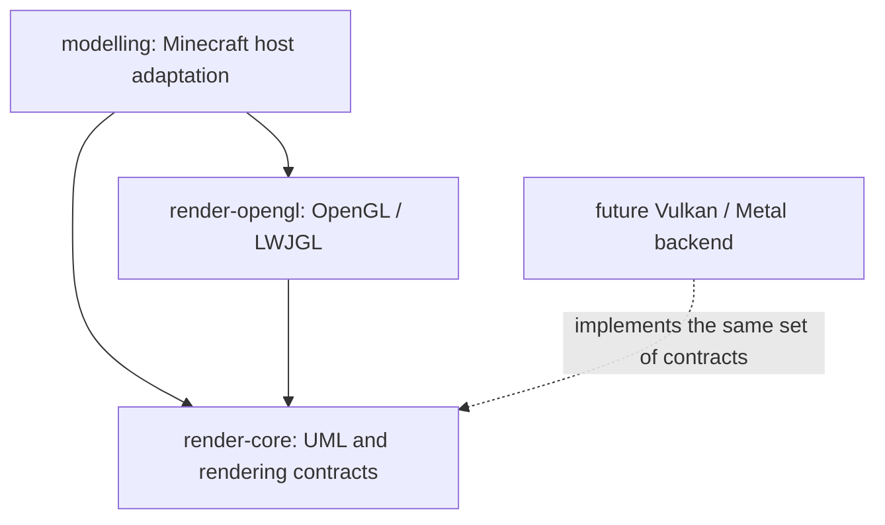
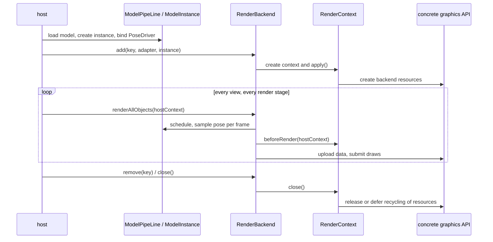

# Rendering backend integration reference

Backend integration and contract reference; for module layering, resource ownership, and
synchronization principles see [the explanation](../explanation/rendering-backends.md).

## Module dependencies

`render-core` is a plain Java library. It does not apply the ModDev plugin and does not depend on
Minecraft, NeoForge, LWJGL, or a specific graphics API. Before `compileJava`,
`checkGraphicsApiIsolation` runs and checks source imports as well as compile and runtime
dependencies, keeping these dependencies out of the core.
DataFixerUpper is used for the existing data codecs; it is not Blaze3D or the Minecraft renderer.
The dependencies of formula and utils disable transitive resolution and only reuse the existing
Java expressions and data structures.

`render-opengl` likewise does not apply ModDev. It depends on the core and on LWJGL and centrally
manages GL buffers, textures, shaders, VAOs, fences, FBOs, readback, and preview windows. The host
that runs it is responsible for providing the current GL context, the correct thread, and the
LWJGL natives for the platform.

`modelling` keeps Minecraft's world render events, RenderType, VertexFormat, texture atlases,
lighting, Iris/Sodium compatibility, and multi-camera world rendering. These classes are host
adapters for the current Minecraft + OpenGL combination and cannot serve as a general interface
for other graphics APIs.

## UML and resource lifecycle

The core covers model loading, model structures, skeletons, morph, animation, FSM, and pose
sampling and scheduling, plus the `RenderBackend`, `RenderContext`, `ModelGeometryAdapter`,
`RenderableFactory`, `RenderBuffer`, `TypedBuffer`, and output routing contracts. Its resource
type, host frame context, and transform metadata are all generic; it does not require GL objects
or Minecraft classes.

`Backend` / `BackendContext` provide the default mount and release behavior; a concrete backend
implements context creation, data packing, and drawing. A failed mount does not publish a
half-built context; removing an instance releases only that mount's backend resources, while the
model instance itself is managed by the model pipeline.

The core still contains the Java/JNI physics adaptation of the existing Box3D. Physics is not part
of a graphics API; when used standalone, a host that enables Box3D must additionally provide the
platform's native library.

## Upload and output

`UploadRing` is responsible only for slot rotation, dirty element merging, version tracking, and
the resource lifecycle, and performs allocation, writes, and completion-status queries through
`UploadDevice`. `GpuUploadRing` on the production path is now its OpenGL adapter, keeping the
original constructors, statistics types, and FloatBuffer entry points.
The macOS TBO orphan policy continues to be provided by `MacTboUploadDevice` in the OpenGL module.

The integer buffer token and the long completion token of `UploadDevice` are opaque handles
internal to the backend, not cross-API native resource IDs. A new backend can map them into its own
resource table.
A device must guarantee that reads already submitted remain valid after the storage is replaced;
completion queries must not block. A device that cannot meet this contract should use its own
upload implementation and reuse the higher-level `UploadBuffer` / `RenderBuffer`.

`FrameOutputRouter<T>`, `FrameOutputTarget<T>`, `OutputFrame<T>`, and the camera state belong to
the core.
`T` is defined by the backend. `FrameTexture` is the OpenGL framebuffer/texture carrier and belongs
to the OpenGL module; other APIs should provide their own output carrier and target.

## Integrating another API

1. Create a standalone Java backend module that depends only on `render-core` and the binding of the target API.
2. Implement `RenderBackend` / `RenderContext`, or extend the default `Backend` / `BackendContext`.
   Model, skeleton, and pose data are read directly from the existing `ModelInstance`; the adapter
   is responsible for the target API's vertex layout, skeleton data representation, shader,
   synchronization, and submission.
3. Have the host inject the corresponding backend and host frame context. `ModelPipeLine.Builder`
   already supports registering a backend; a default implementation can extend `Backend`, and a
   standalone `RenderBackend` implementation can also mount model instances directly.
4. Implement `FrameOutputTarget<YourFrame>` and reuse the core output routing and camera lifecycle.
5. Handle windows, resource reload, render stages, and other platform interop in the host adaptation layer.

Existing public class names are kept to preserve call and serialization name compatibility. Some GL
classes therefore still use the historical `uml.backend.gpu` package name, and the pure math
`Direction` also keeps the historical `models.mc.util` package name.
Whether something belongs to the core is determined by Gradle module dependencies; the core must
not import the OpenGL module.

This split did not implement a Vulkan/Metal backend, nor does it let Minecraft's Blaze3D switch APIs
at runtime. Minecraft's effect pipeline description still uses its own draw state for now; replacing
the whole renderer of that host would additionally require the corresponding host adaptation and
shader generation path.
