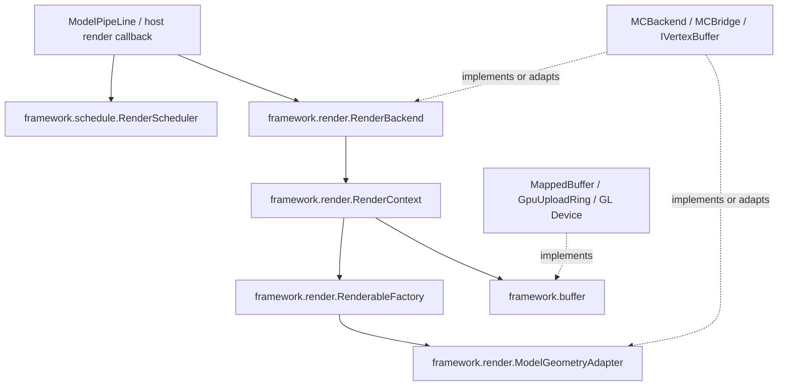

# UML rendering framework and backend interfaces

Interface, configuration, and call reference. For the principles see [uml-render-framework.md](../explanation/uml-render-framework.md).

`models.uml.framework` defines the public capabilities extracted from existing rendering
implementations. It does not depend on Minecraft, Iris, or LWJGL; model structures and JOML
math types remain public data types.
`uml.bridge` and `uml.backend` handle adaptation and default implementations and are no longer
the only entry point for all capabilities. MC, OpenGL, and platform upload strategies stay in
concrete implementations.

## Layers and responsibilities



| Layer | Interface/implementation | Responsibilities |
| --- | --- | --- |
| framework.schedule | `RenderScheduler<I>`, `DefaultRenderScheduler<I>` | Per-instance visibility policy, host frame marks, render distance limit, unmount cleanup |
| framework.schedule | `FrameSampleCache<I>` | Deduplicates identity sampling across camera views/material passes within a shared frame token |
| framework.render | `ModelGeometryAdapter` | Vertex/mesh conversion, skeleton binding selection; does not own scheduling or drawing |
| framework.render | `RenderableFactory<R>` | Creates render resources for one instance, receives explicitly provided backend services |
| framework.render | `RenderContext<R,Q,E>` | Resource cache for one mount, hard visibility switch, host transform/lighting metadata, release |
| framework.render | `RenderBackend<A,C,Q>` | Mount registry, context creation, draw submission, replacement and unmount, backend shutdown |
| framework.buffer | `TypedBuffer<T>` | Fixed-capacity CPU element read/write, partial/full updates, borrowed byte view |
| framework.buffer | `UploadBuffer`, `UploadDevice` | Full snapshot upload, dirty element ranges, in-flight read protection; device calls and state restoration |
| framework.buffer | `RenderBuffer<D,S>` | Geometry upload, update, draw, and `markSubmitted` after every consumption |
| uml.bridge | `Bridge<R>` | Combines geometry conversion with the legacy resource creation entry point, compatible with the old pipeline |
| uml.backend | `Backend`, `BackendContext` | Default lifecycle implementation of registry and context |
| mc / uml.backend.gpu | MC renderer, OpenGL buffer/device | Vanilla frustum/lighting, shader, VAO/VBO/TBO, Iris, and platform policies |

## The boundary between Bridge and Backend

Bridge provides the model conversion rules. The backend owns services such as the executor,
chooses the context type and passes those services explicitly to the resource factory. The
current MC main path is:

```text
MCBackend.add(key, bridge, instance)
  → MCBackend.createContext(bridge, instance)
  → MCRenderableContext(bridge, instance, factory)
  → factory: bridge.createRenderable(instance, backend.executor)
```

This path does not require Bridge to look up the executor from the string `mc_backend`.
`Bridge.getBackendContext`, `setBackends/getBackends`, and the single-argument
`createRenderable/apply` are kept as compatibility entry points for old calls; the default
`Backend.createContext` can still call the old factory. New backends should override
`createContext` and return a type-matching context directly.
Do not let the geometry adapter close the executor, manage frame marks, or handle the draw pipeline.

`Q` is the host frame context, `E` is pre-render metadata, `R` is the mount resource; none of
them substitutes for another.
`BackendContext` does not allocate `R` at construction; the first `apply` creates and caches it.
The default `Backend.add` calls `apply` up front, so the mount is published only after resources
are prepared successfully.
`beforeRender(Q)` reads metadata; it does not sample animation and does not create buffers.
Animation sampling, version updates, morph, and upload are done by the rendering implementation
and cannot be achieved by rebuilding the context over and over.

## Mount and release rules

- The registry matches mounts by the caller's key; key, adapter, instance, context, and resources must not be null.
- Replacing the same key prepares the new context first. If preparation fails, the unpublished
  context is closed and the old mount is kept; on success the new mount is published and the old
  context is closed. A failure to release the old resources reports an exception, and the new
  mount is already in effect at that point.
- `getRenderingObjects` is a read-only view; mount changes must go through `add/remove`.
- `remove` first removes from the registry, then releases resources; release exceptions are visible
  and are not silently ignored.
- A context owns only the render resources returned by the factory; it does not own the
  `ModelInstance`, the Bridge, or the shared executor.
  `close` is idempotent; after closing, `apply` throws, and resources of an unmounted instance
  cannot be reallocated.
- On shutdown the Backend tries to release all mounts and aggregates release exceptions; after
  shutdown it rejects new mounts and submissions.
  The MC Backend then releases batching/translucent resources and stops the executor.
- Mounts, buffer operations, and drawing are held by the render thread; the scheduler
  independently synchronizes tick/render access.

## Scheduling rules

The framework modes are `ALWAYS`, `MANUAL`, `HOST_RENDERER`. MC's
`VANILLA_RENDERER` maps to `HOST_RENDERER`; the old static `ModelRenderScheduler`
only forwards to `ModelRenderScheduling.scheduler()`. ModelPipeLine and MCBackend
use the same framework scheduling domain. Other backends may create an independent
`DefaultRenderScheduler`.

Instances are distinguished by object identity. Switching modes keeps the per-instance render
distance limit; `setVisible` selects MANUAL.
Render distance uses host world units; a non-positive value disables the distance gate, and
NaN/Infinity are rejected.
`shouldRender` answers the policy result only; the distance and frustum checks are performed by
the backend in order.
Culled instances are not sampled and not uploaded; physics stepping continues to be managed by
the independent runtime.

The host renderer calls `markRenderedThisFrame` within its own visible frame. The first model
pass calls `flipFrame` once, and later material/translucent passes share the mark; when the next
flip has no new mark, the old mark expires. Marks made after a flip are also immediately visible.
Removing the last mount cleans up the instance policy and both mark sets; unmounting the whole
render domain can call `resetAll`. For MC's concrete timing see
[render-scheduling.md](render-scheduling.md).

Multi-camera calls `clearFrameMarks()` before each host view pass; it clears only visibility
marks and keeps the instance policy and render distance. `FrameSampleCache.beginFrame(token)`
instead clears the sample set when the token changes; later camera views with the same token use
`firstSample(instance)` to avoid duplicate sampling, while still being able to sample instances
visible only in the new camera view. For the MC producer see [the multi-camera and offscreen output document](multi-camera-output.md).

## Buffer rules

`TypedBuffer` counts index/offset in elements and `sizeOfType/bufferCapacity` in bytes. For a
short array, `updateAll` updates only the prefix, keeping the capacity and the tail; `updateRange`
must not go out of bounds and may write zero elements at the end of the capacity. `slice` keeps
the packed byte order and borrows memory; it must not outlive the close point.
A direct `writeData` in an implementation must also check the closed state and the element range.
Closing is idempotent.

`GpuUploadRing` implements `UploadBuffer`, and the old `GpuUploadRing.Device` extends the
framework's `UploadDevice`. Upload requires a complete direct snapshot; dirty bits are element
indices, stride is in bytes, and mergeGap is in elements. An empty dirty set may reuse the current
storage; each slot independently fills in the changes since its last upload. The input
position/limit stay unchanged.

Every GPU consumption, including repeated draws of unchanged data and translucent replay, must
mark `markSubmitted`. A busy slot cannot be overwritten; the device may reallocate storage; fence
checks do not block.
The device is responsible for API calls and bind state restoration; the ring owns the release of
buffers/fences.
The concrete OpenGL and macOS TBO orphan policies continue to be provided by the existing device
implementations.

`IVertexBuffer` extends `RenderBuffer<FlatModelData, ShaderInstance>` and only adds access to the
Minecraft `VertexBuffer` and the GL id. A new host integrates with the framework contract through
its own data/shader types without referencing Minecraft interfaces.
